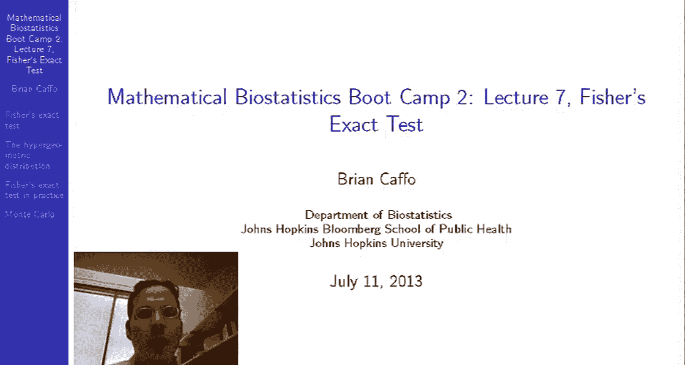
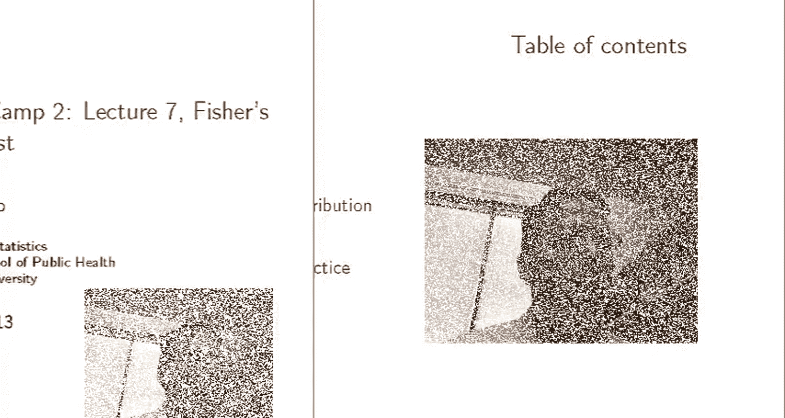
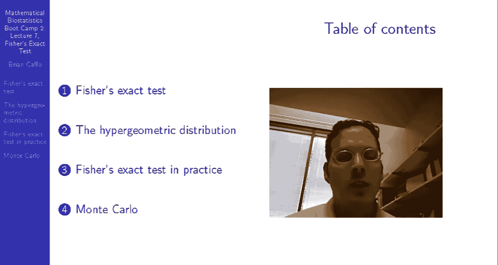
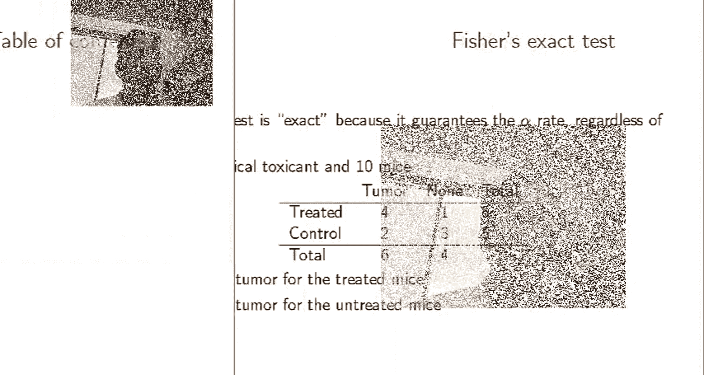
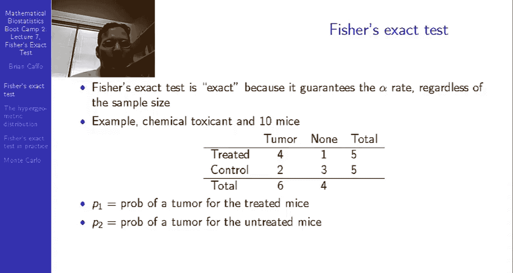
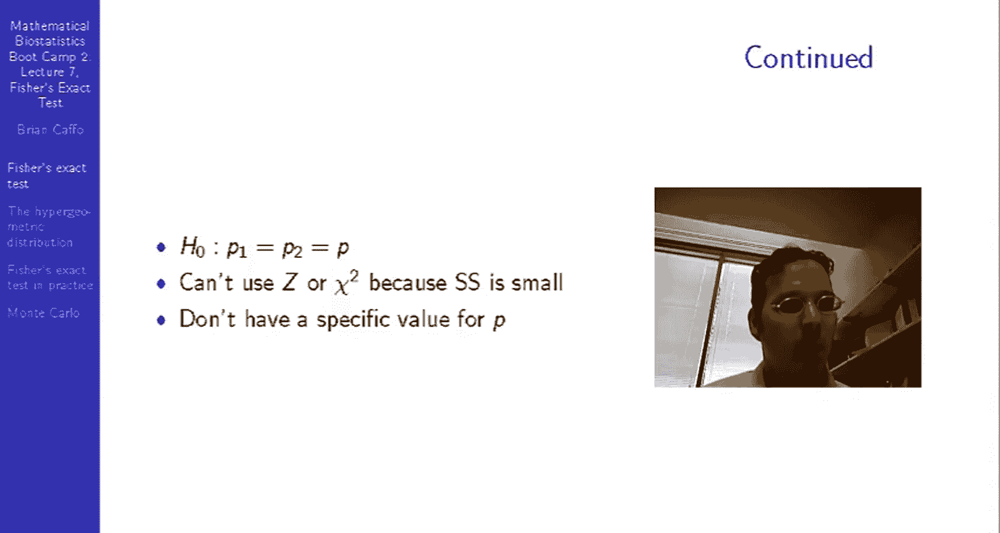
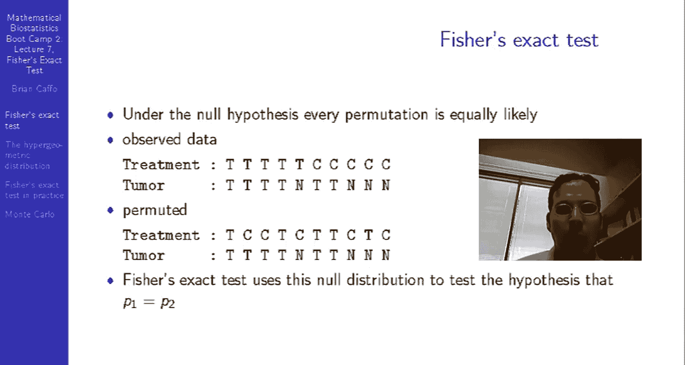

# 约翰霍普金斯大学《数据科学的高级统计｜Advanced Statistics for Data Science》中英字幕（deepseek p51 20_Fisher精确检验.zh_en -BV1htPjeYEFH_p51-

Hi， my name is Brian Caho and this is Mathematical Biosstatistics bootc。

 Leture7 on Fish's exact Test。

So in this lecture we're going to talk about Fisher's exact test。

 we're going to talk about the hypergemetric distribution which plays a central role in Fisher's exact test and we'll talk about some practical implementations。

And then we'll talk about how you can execute Fer's exact test using Monte Carlo Fisher's exact test is a historically very famous test and it's going to be one of the first instances where we're able to test equality of say binomial proportions using a formal exact test rather than relying on asymptotics。

So what does exact mean so fish's exact test is exact because it guarantees the alpha rate。

 so when you do a asymptotic test and you use the nominal type1 error rate， say a 5%。

 if you say for example， calculate a 95% confidence interval for the risk difference。

And declare the difference in the proportions as being significant if the confidence interval for the difference doesn't include zero。

 that's a nice valid testing procedure， however。That doesn't guarantee you a 5% error rate。

 only guarantees you a 5% error rate in the limit as the sample sizes go to infinity。

 Fish's exact test in contrast guarantees you the 5% limit provided the IID assumptions are met for each of the two groups。

And the background on Fisher's exact test is that the famous example is that of the so-called lady tasting tea and in this case Fisher was at a party and there was a wager about whether or not a lady at the party could determine whether the cream had been put in place first or the milk had been put in place first into her tea and Fisher devised a blinded experiment where he put tea in first for a couple of cups and put the milk in first for a couple of examples。

And then had her declare which she thought was the case so you know here's a kind of more medically oriented version of that so we here we had a chemical toxic with 10 mice and we treated 10 of them with this toxicant and1 I'm sorry we treated five of them with the toxicant five with the control and then here we have the counts of in each group of tumors versus in each group of treated versus control。

 what number had tumors so here just looking at this four exposed to the toxicant received tumors。

 two controls received tumors out of five in both cases。

 so there's maybe some amount of indication that there's a difference that the toxiccan may have some association with the tumors but we'd like to test that formally。

There's a lot of ways there's actually a surprising number of ways you can wind up at Fisher's exact test and so we're going to go through a particular development so the way we're going to develop Fser's exact test is we're going to assume that we have two binomials and we want to test the quality of the proportions when Fisher originally developed this test it was quite interesting he so in our case we're going to fix these margin。

 the five and the five so we have five treated in five control and we're going to model the probability that a random mouse from this population of the treated mice has a tumor as being having probability binommial probability P1 and similarly P2 for the controls。

Fisher thought about this problem differently， he said。I know that I random。

 let's just assume this was the tea tasting experiment and he had randomized five cups to have the tea put in first and five cups to have the milk put in first and he says。

 I know that these margins should be fixed then it would have made sense if given that the lady guessing would also know that this margin was fixed。

 she would it would have made sense for her to fix the second margin instead of six and4。

 she would force five and five so he wanted to create a procedure that would force both margins。

AndAnd it turns out the fish's exact test constrains the margins。

 right it looks at all tables matching the margins。嗯。

And that gave him the motivation for designing the test this way。

 so he looked at so-called hypergemetric distribution。

 which is a way in which we can characterize this table in terms of having fixed margins now when we actually implement the test now we don't have to have five and five on both margins the way Fisher was thinking about it。

 but he was analyzing a particular experiment with。in a particular way。

 but the result of Fisher's exact test is constraining both of these margins and then looking at what tables satisfy the margins and we'll go through the formal mathematical development of the way in which we're thinking about Fisher's exact test。

 there's other ways and maybe I'll allude to some more of them later on。Okay。

Okay， on this slide so imagine that we want to test that P1 equals P2 where P1 is the probability that a mouse。

 a treated mouse has a tumor， and then P2 is the probability the control mouse has a tumor and so were going the nu hypothesispo that these are equal。

 which let's just call the common proportion P。Um， and you know， just as a matter of practicality。

 we can't use a normal distribution or a chi score test because the sample size is small。But also。

 we don't have a specific value of P， which is taken care of in the chi squared in the。ZT。

 they figure out a way to do that using the asymptotics。

 but we want to use small sample distribution， but making the small sample distribution。

 using a small sample distribution is hard because we don't actually know this probability P。

Okay。So。One way one way to think about Fisher's exact test。

 what it's testing is imagine if we were to。Create the observed data or list out the observed data as the individual data points。

 so mouse one was treated and got a tumor， mouse2 was treated and got a tumor。

 Mo 3 was treated and got a tumor， Mo4 was treated and got a tumor。

 Mo 5 was treated and had no tumor， mouse6 was a control and got a tumor and so on okay。Um now。

One so what I'm going to do right now is go through another way to kind of develop Fisher's exact test and it winds up with the same test。

 all these different developments yield the exact same test。So in this case。

 imagine if the treatment and control were randomized。

And we wanted to explicitly use the randomization process。In analyzing the data。

 so treatment and control are were randomized， treatment and control status were randomized Well。

 then if the no hypothesis is true。Then it should be exchangeable for any mouse whether or not it got a tumor as to whether or not it was from the treated group or the control group。

There should be nothing outrageous about the particular collection of treated and control mice that we see how they line up with the tumor and nont statussis that we saw。

 so what we could do is take this top row and permute the treatment and control labels， right。

Permute the Ts in the seas。And we see the second row here as one example of a permutation。Okay。

 and the result of that。I is that the total number of treated and the total number of controls remain fixed and the total number of tumors and the total number of nontums also remain fixed and that's exactly maintaining the margins of the table。

 but this seems like kind of a reasonable null distribution to investigate right in other words。

 that treatment and control status is exchangeable relative to tumor status so we'll look at some test statistic relative to this distribution。

And the consequence of this is every time we permute treatment and control labels。

 if we were to reform the little two by two table we had， it would have the same margins。

 it would have five and five on the row margins and six and four on the column margins。

And this is exactly one way to develop the null distribution for Fer's exact test。

 and this is an interesting way to develop it because it explicitly uses the idea of randomization there's more than one way to think about it we can think about this rather than explicitly using the randomization。

We could say， well， maybe treatment and control status weren't randomized。

 maybe just the first five mouse mice got the treatment， the latter five mouse mice got the control。

And we believe that there's no ordering effect like there's no light in the lab that only turned on for the first five mice causing tumors and not for the controls。

So in that case， we might think of not the relabeling as a process of。

reimplementing the randomization scheme， but instead iss a process of well we think if the null hypothesis is true。

 relative to tumor status， treatment and control status there are a bunch of exchangeable permutable labels and that you could do the same procedure for coming up with a null distribution。

And that's another way to think of it。Yet another way to think of is the development that we're going to go through next was a mathematical treatment。

 but it is interesting that these very different methods of thinking about the problem result in the same test and you see this very often statistics where you wind up with procedurally the same approach but that the interpretation differs quite a bit。

 I would argue that explicitly using the randomization saying well this treatment and control was randomized and so we're going to explicitly work that into our analysis is a very fundamentally different process than what we're about to do which is to assume that the data are binomially distributed。

 I impose a model a superpopulation model for the mice and to work with that and wind up with the same procedure。

 but the interpretation I think is' vastly different and I hope you think so too after taking this class。

