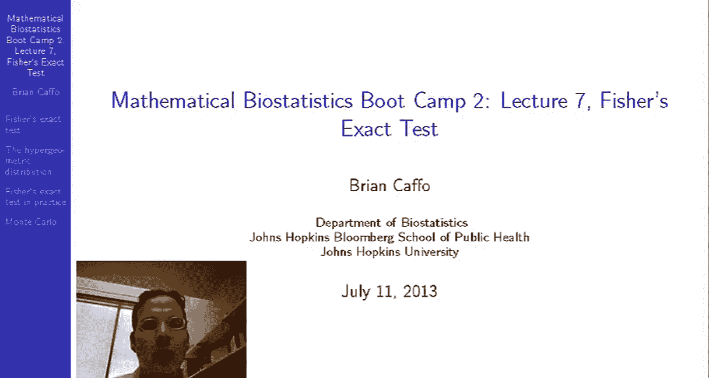
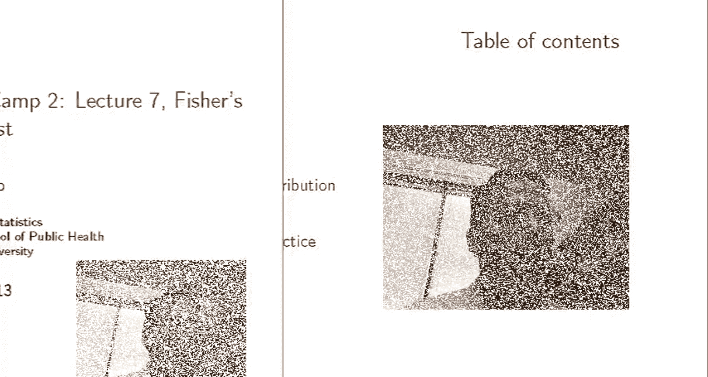
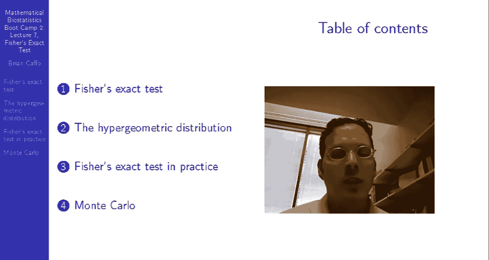
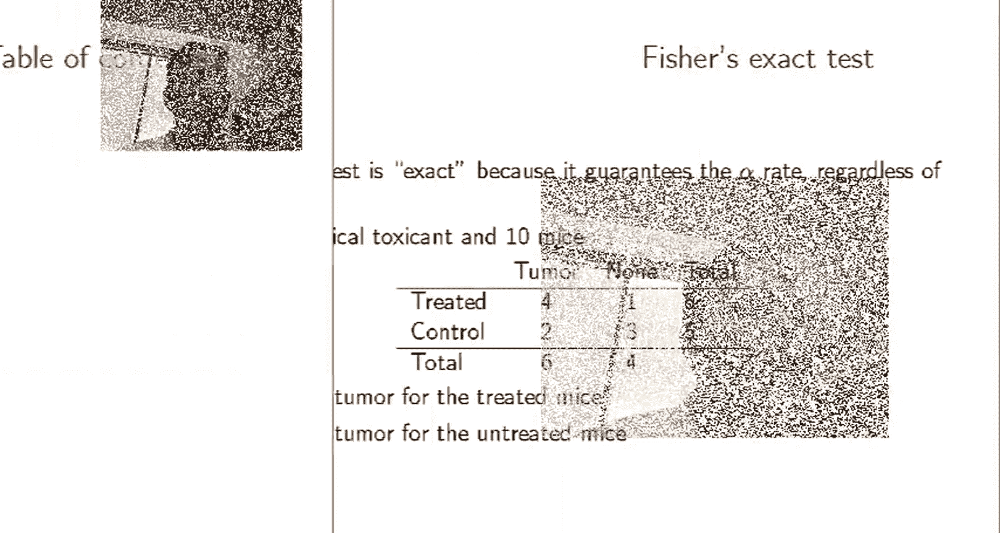
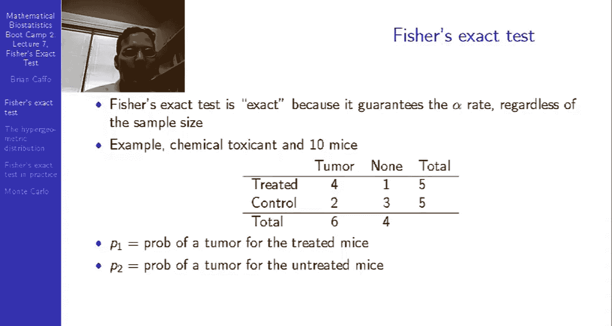
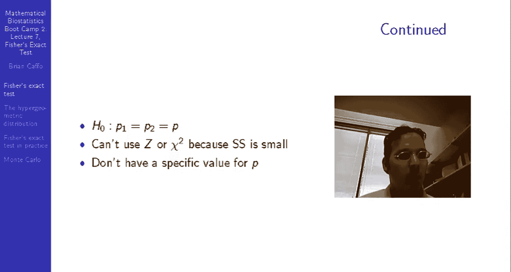
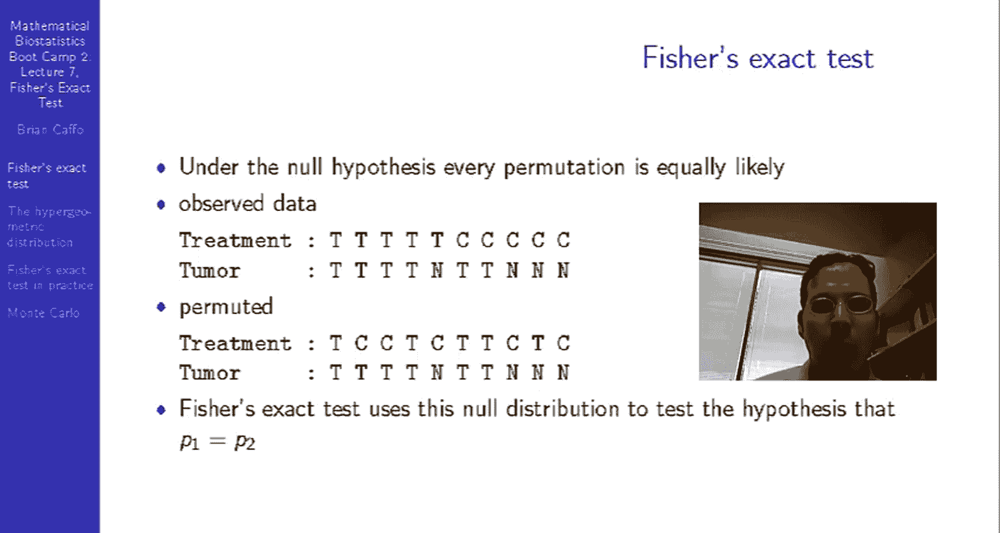

# 高级统计：7：Fisher精确检验 🧪





在本节课中，我们将学习Fisher精确检验。这是一种用于检验两个二项比例是否相等的精确检验方法，尤其适用于小样本情况。我们将探讨其核心的超几何分布，介绍实际应用，并学习如何使用蒙特卡洛方法执行该检验。

---





上一节我们介绍了Fisher精确检验的基本概念，本节中我们来看看其核心的数学基础——超几何分布。

## 超几何分布 📊

超几何分布描述了在固定总体的成功与失败数量下，不放回抽样中成功次数的概率分布。在Fisher精确检验的背景下，它用于计算在行合计与列合计固定的情况下，观察到特定2x2列联表的概率。

假设我们有一个2x2列联表：

|          | 成功 | 失败 | 合计 |
| :------- | :--- | :--- | :--- |
| 组1      | a    | b    | n1   |
| 组2      | c    | d    | n2   |
| **合计** | m1   | m2   | N    |

在零假设（两组成功概率相等）下，给定边缘合计（n1, n2, m1, m2），左上角单元格a服从超几何分布。其概率质量函数为：

**公式：**
`P(a = k) = [C(m1, k) * C(m2, n1 - k)] / C(N, n1)`

其中，`C(n, k)` 表示组合数，即从n个不同元素中选取k个的方式数。

---

上一节我们介绍了超几何分布，本节中我们来看看如何将其应用于Fisher精确检验。

## Fisher精确检验的原理 🔬

Fisher精确检验是一种精确检验，因为它能保证在零假设成立时，犯第一类错误的概率（α水平）严格等于预设值（如5%）。这与依赖于大样本近似的渐近检验（如卡方检验）不同，后者只能在样本量趋于无穷时保证α水平。

检验的基本思想是：在行合计与列合计固定的条件下，列举所有可能的2x2列联表。然后，计算在当前观察到的表格以及更极端（更偏离零假设）的表格下，出现当前或更极端结果的概率总和（即p值）。

以下是执行Fisher精确检验的步骤：

1.  **建立假设**：
    *   零假设 (H0)：两组的成功概率相等（P1 = P2）。
    *   备择假设 (H1)：两组的成功概率不相等（P1 ≠ P2，或单侧P1 > P2 / P1 < P2）。

2.  **计算观察表的概率**：使用超几何分布公式计算观察到的列联表（a, b, c, d）的概率。

3.  **列举更极端的表**：在保持边缘合计不变的前提下，系统地改变a的值，生成所有可能的列联表。对于双侧检验，“更极端”通常指概率小于或等于观察表概率的所有表。

4.  **计算p值**：将所有“更极端”表的概率相加，得到p值。
    **公式：** `p-value = Σ P(table_i)`，其中求和针对所有满足 `P(table_i) ≤ P(observed_table)` 的表 `i`。



5.  **做出决策**：如果p值小于显著性水平α（如0.05），则拒绝零假设。

---

上一节我们介绍了Fisher精确检验的原理，本节中我们来看看一个经典案例及其与随机化检验的联系。

## 案例：女士品茶与随机化视角 ☕️



Fisher精确检验源于著名的“女士品茶”实验。Fisher设计了一个实验，让一位女士判断多杯茶中是先加奶还是先加茶。在这个实验中，处理（先加茶/先加奶）是随机分配的。

从这个随机化实验的视角，可以推导出Fisher精确检验：如果零假设（女士没有辨别能力）成立，那么“处理标签”（先加茶或先加奶）与“结果标签”（女士的判断）之间应该是可交换的。我们可以通过**置换检验**来构建零分布：

*   保持“结果标签”（女士的判断）不变。
*   随机地重新分配“处理标签”给各个杯子。
*   每次置换后，重新计算一个检验统计量（如成功判断数）。
*   大量重复此过程，观察到的统计量在置换分布中的位置就给出了p值。

有趣的是，这种基于随机化（或可交换性）的置换检验，与基于超几何分布模型的Fisher精确检验，在数学上是等价的。它们都固定了列联表的边缘合计。这展示了统计学中不同思想（设计随机化 vs. 超总体模型）可能导向相同的检验程序，但解释却可能不同。

---

上一节我们探讨了检验的理论背景，本节中我们来看看在实际中如何执行Fisher精确检验。

## 实践：使用蒙特卡洛方法的Fisher精确检验 💻

当样本量较大时，精确计算所有可能列联表的概率会非常耗时。此时，可以使用**蒙特卡洛模拟**来近似p值。

蒙特卡洛Fisher精确检验的步骤如下：

1.  根据观察到的边缘合计，使用超几何分布随机生成大量（例如10,000次）模拟的2x2列联表。
2.  对于每次模拟，计算其概率（或一个相关的检验统计量，如优势比）。
3.  计算观察到的列联表的概率（或统计量）。
4.  近似p值等于模拟表中概率小于或等于观察表概率的比例。

以下是一个简化的R语言代码示例，演示如何使用 `fisher.test` 函数进行蒙特卡洛模拟：

```r
# 创建一个2x2列联表
# 例如：处理组4例成功/1例失败；对照组2例成功/3例失败
data <- matrix(c(4, 1, 2, 3), nrow = 2, byrow = TRUE,
               dimnames = list(Group = c("Treated", "Control"),
                               Outcome = c("Success", "Failure")))
print(data)

# 执行精确的Fisher检验
fisher_exact <- fisher.test(data)
print(fisher_exact)

# 执行蒙特卡洛近似的Fisher检验（当精确计算太慢时）
fisher_mc <- fisher.test(data, simulate.p.value = TRUE, B = 10000)
print(fisher_mc)
```

---

## 总结 📝

本节课中我们一起学习了Fisher精确检验。

*   **核心概念**：它是一种用于检验2x2列联表中两个比例是否相等的**精确检验**方法，通过**超几何分布**计算p值，能严格保证预设的α水平。
*   **关键思想**：在行合计与列合计固定的条件下，评估观察到的关联强度是否由偶然导致。
*   **应用场景**：特别适用于小样本数据，或当渐近检验（如卡方检验）条件不满足时。
*   **执行方式**：可以直接计算精确p值，也可以通过**蒙特卡洛模拟**进行高效近似。
*   **深层联系**：该检验可以从超几何模型推导，也可以从随机化实验的置换检验视角理解，两者殊途同归。



Fisher精确检验是统计学中一个强大而优雅的工具，它将概率论、组合数学与假设检验紧密结合，为解决小样本比较问题提供了坚实的基础。