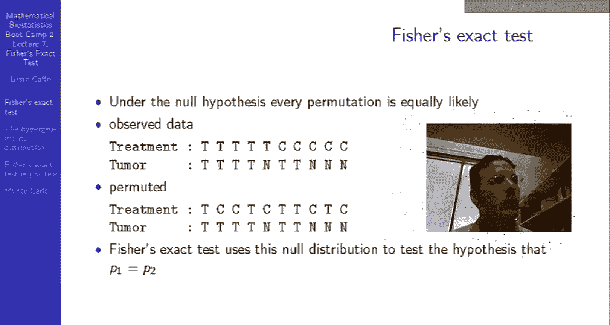
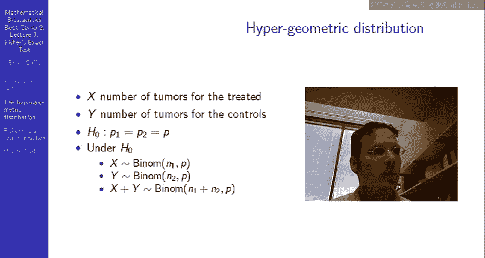
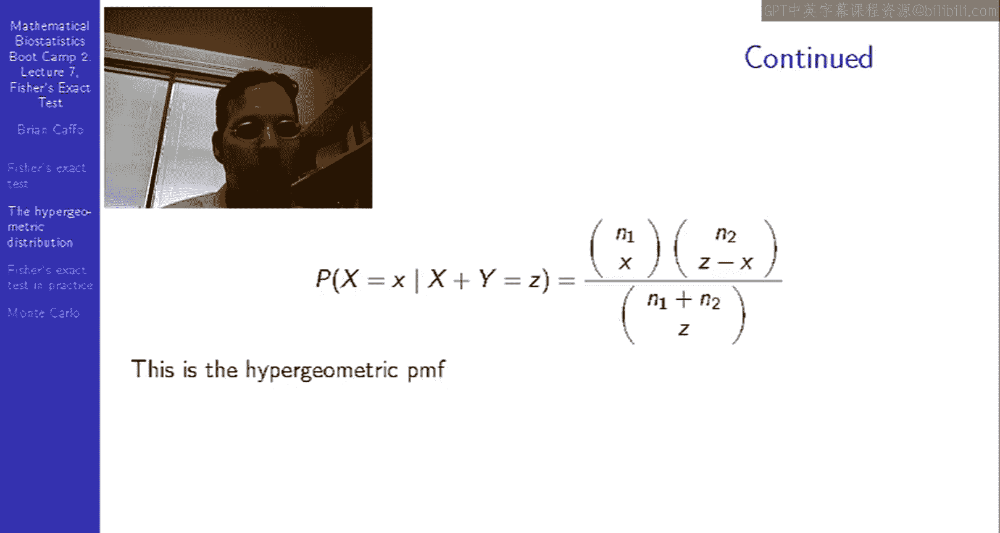
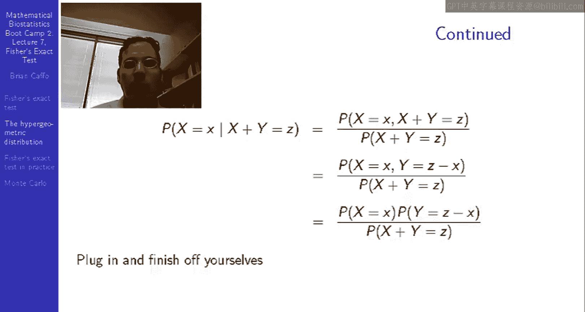

# 约翰霍普金斯大学《数据科学的高级统计｜Advanced Statistics for Data Science》中英字幕（deepseek p52 21_超几何分布.zh_en -BV1htPjeYEFH_p52-

Okay， so let's go through our more mathematical development where we're assuming a model right so now before when we were talking about it as a randomization process we' were kind of conditioning on the data。

 we said， oh you have so many treated， you have so many control。

 you have so many tumors and so many non-tumors and we're simply redoing the randomization process on the computer under the hypothesis that the randomization was irrelevant。

 right that whether you received the treatment or the control was irrelevant。

 that's one way to think about fish's exact test。Now we're going to talk about a different way。

 so let's let X be the number of tumors for the treated and Y be the number of tumors for the control。

And where our nu hypothesispo is going to be H not p1 equal to P2 equal to the common proportion。

 where we're going to assume that x is binomial with whatever its sample size was and success probability P and y is binomial with whatever its sample size was and binomial probability P under the no hypothesis under the alternative。

 they would have different probabilities。By the way， if this is true right， if this is true。

 if both x and Y are a bunch of IID Bernoulli sums。

Then x plus y is just the sum of more Brnouloleles。

 n1 plus N2 Brnooleles all with a common success probability P。

 and so it's an interesting and fairly obvious fact that if you add two binomials with a common probability that the sum of the two binomials is also binomial with a total number of trials equal to n1 plus n2 and the same probability。

 and this is clear because if x is comprised as a sum of N1 Brnouloleles with probability P and y is comprised as the sum of N2 Brnoulles with probability P。

 then x plus y is simply the sum of N1 plus n2 IID Brnouloleles with probability P。

 hence its binomial N1 plus N2 NP P。

So now the way we've characterized the problem now we have two numbers x and y that are random in our two by2 table there are no other free numbers right if we know x and we know n1 then we know the number of nontumors for the treatA group。

 if we know Y and we know N2 then we know the number of nontumors for the control group so in that two by2 table we know both we know the margin with that n1 and N2 and then if we know x and y then we know second which is the first column of numbers。

 then we know the second column of numbers。So we only have two free numbers in our four numbers in our two by two table there。

 so but we still have one parameter that we don't know even under the nu hypothesis。

 the nu hypothesispo says age not p when equal to p2 equal to P okay so what if we were to then try and figure out a strategy to get rid of that？

Prameter， find a distribution that doesn't depend on it。

And it turns out that the probability of one of the data points given the sum。

 and it doesn't matter we just picked the first data point。

 you get the same procedure if you pick the second one。Probability of x given x plus y equals z。

 it turns out that this follows the hypergemetric probability mass function。

 and I give the hypergemetric probability mass function right there。

Now what's interesting about this？Is this hypergemetric mass function is exactly the probability distribution from our couple slides earlier where we have so many bins of T's and ends。

And we have so many balls labeled T and C for treated in control and how if we randomly allocate treated in control balls to the bins that you know the first bin being able to hold six balls and the latter bin being the end bin being able to only hold four balls。

 and I need to allocate10 balls， five treated in five controls randomly to that process to those bins。

 that's the hypergemetric， the other way to think about it this idea that it is the distribution of the two by two table where you're permuting the T's in the Cs。

Leaving the T's in the ends fixed in the way that we described earlier。

 of course that's identical to permuting the T's in the ends， leaving the T's in the C's fixed。

So again， you wind up you wind up if you have the same data and you assume that the row margins are the margins where that include the randomized treatment or if you assume the column margins are the margin that。

Had the randomized treatment， you wind up with the same procedure provided you have the same data set。

 so that's interesting， perhaps comforting， perhaps discomforting。But either way。

 now before remember we only had two numbers， we had the two success probabilities。

 x and Y or in this case it's a tumor， so I'd hardly call that successful。

 but let's say two success probabilities using the convention of Colhen。A binomial event， a success。

 regardless of how successful it is。嗯。We have the two success probabilities at the onset when we know the value of the sum then we only have one left so in that whole margin when we when we assume we only had two free。

Two free cells， given that the row margins were fixed， now we only have one free cell。

 given that the row margins were fixed and now that the sum is fixed。

 and so this is exactly what fisers exact test really tells you is that as you vary that upper lefthand cell or any cell holding both margins fixed。

 you get the remaining three elements， you can obviously put in a value for the upper left hand cell and you can obviously go through the exercise of finding the other three cells very easily given the margins。

But more than that， we also have this distribution on that cell。

The hypergemetrictry distribution that arises if we take the distribution of the upper left hand cell and condition on the sum。

Note that this distribution does not contain P， it got rid of it。

And there's a mathematical reason for that it's a so calledled conditioning on a sufficient statistics。

 so when you condition on the sufficient statistics for P you get rid of it in this class we won't go over that we won't go over the mechanics of why。

We won't go over the mechanics of the logic of how Fssha came up to condition on x plus y or how mathematical development works。

Suffice it to say for the needs of this class。That when you condition on the sum。

 you do get rid of that probability and there is a very general mathematical principle that is relying on that relies on the fact that x plus y is sufficient for these statistics for the parameterpy。

Okay， so let's derive this conditional distribution， so we know the probability of x。

 it's just the binomial probability here， we know the probability y and let's say z minus x。

 this will make the derivation a little bit easier but we can plug in anything here provided z minus x is an integer between zero and n to then it's this binomial probability right here and then we said already that x plus y is binomial so the probability that x plus y equals z is this probability right here。

Okay， now putting everything together， the probability x equals x and x plus y equals z。

Over the probability x plus y equals Z， that's exactly this conditional probability just using our rules of conditional probil that we know quite well from mathematical biostatistics boot campamp1。

And then if x equals x and x plus y equals z， then that's the same thing as saying x equals x and y equals z minus x。

 of course。And then X and Y are independent so we can factor these two probabilities。

 and then on the previous slide we had all three of these expressions plug in and you'll find that you wind up with the hypergemetric distribution that we described before。

