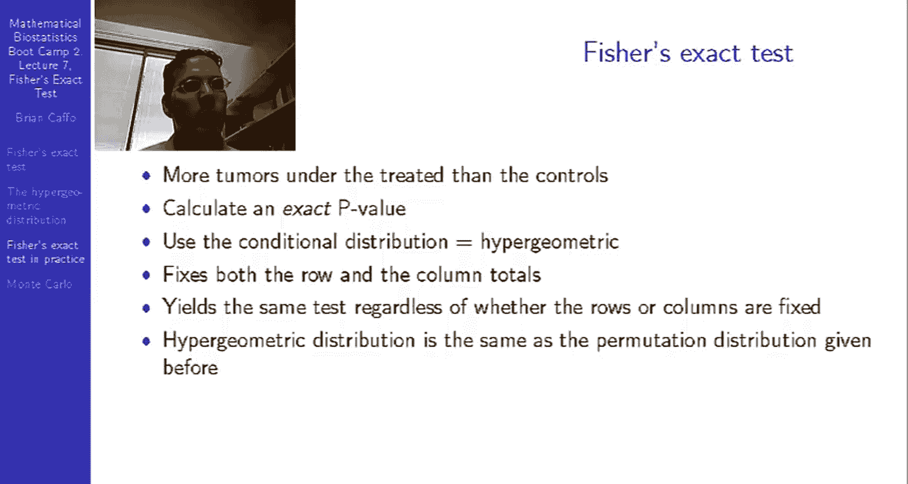
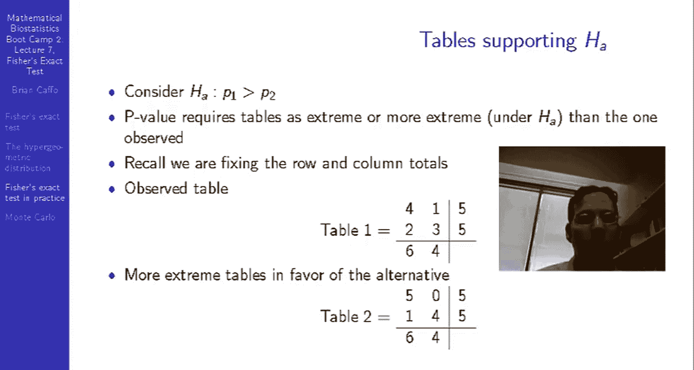
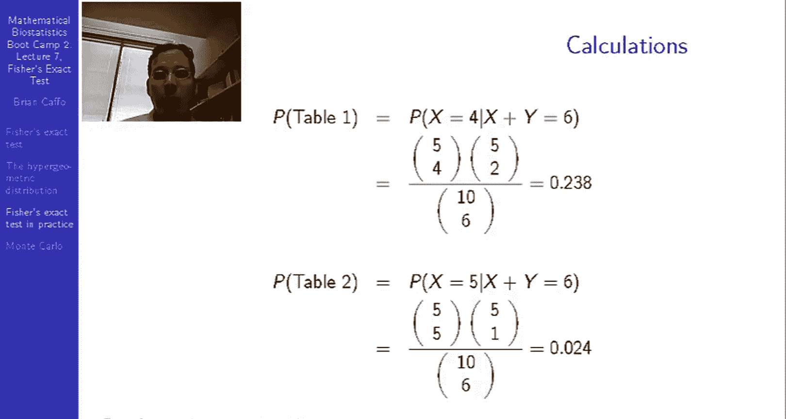
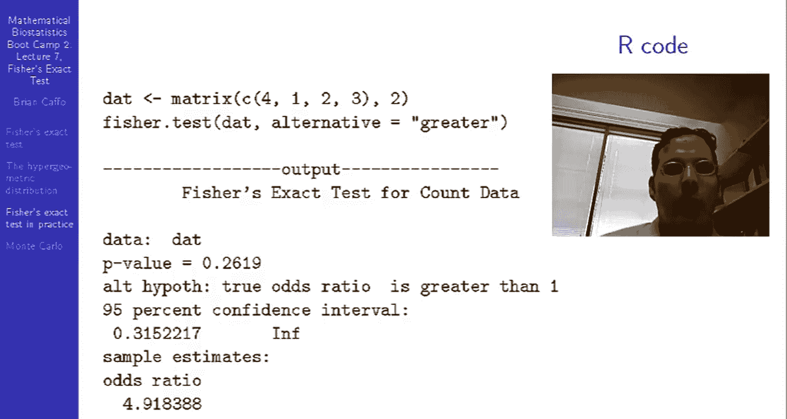
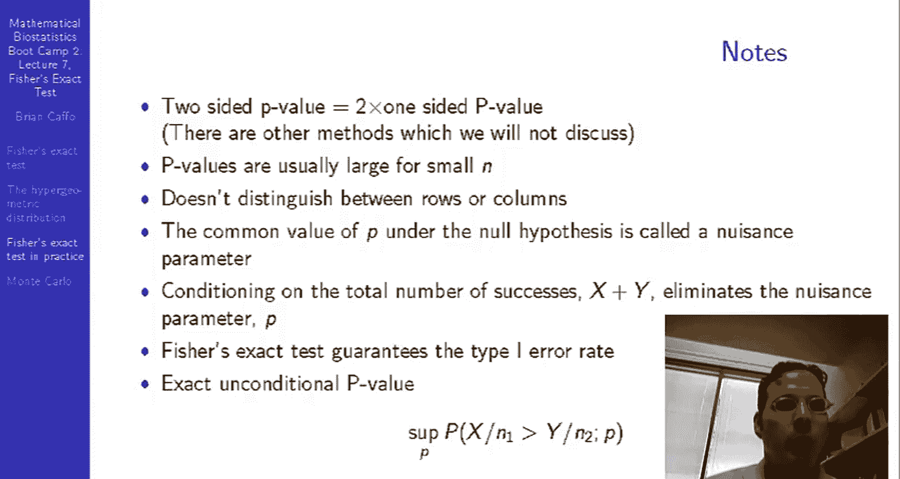
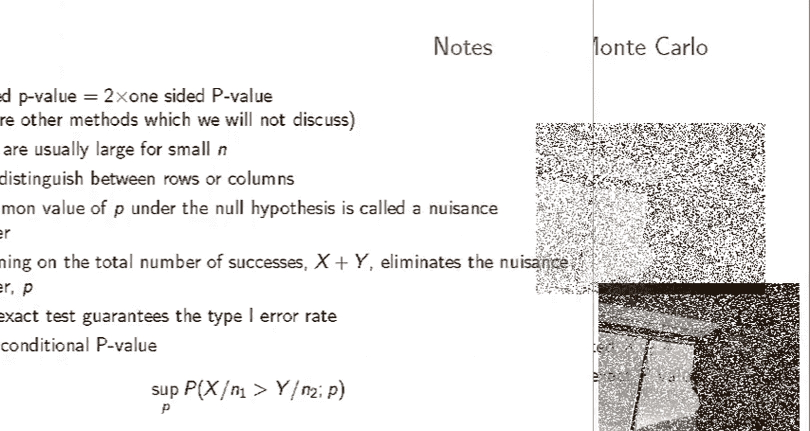
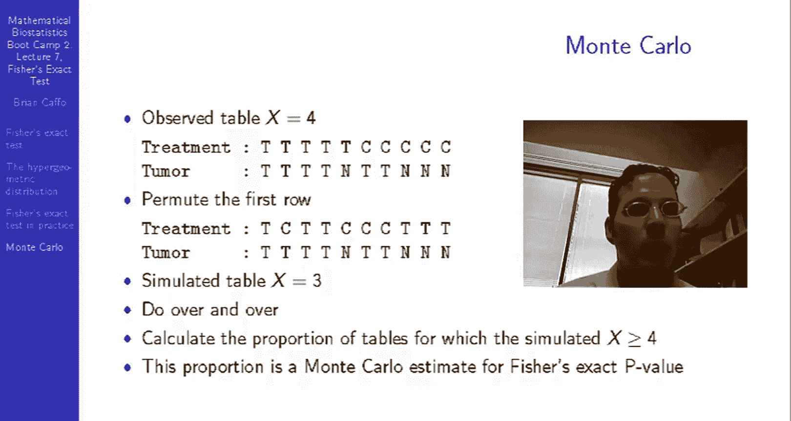

# 约翰霍普金斯大学《数据科学的高级统计｜Advanced Statistics for Data Science》中英字幕（deepseek p53 22_Fisher精确检验实践：蒙特卡洛模拟.zh_en -BV1htPjeYEFH_p53-

Okay， so let's discuss it a little bit so in this case we have more tumors under the treated and control so we at least have an indication but we'd like some sort of inference associated with that so let's see if we can get a P value but we're going to want to calculate an exact P value and our exact P value is going to use this conditional distribution。

The conditional distribution fixes both the row and the column totals。

 and we talked about when Fiishcher originally developed this test， he developed it。

Wanting to fix the margins because he had assumed that the lady who was guessing would have known that he would have randomized equal numbers to T。

Tea first and milk first， so he assumed that she would have fixed those margins as well。

 so that went into why he thought that way。And you know。

 we talked about how this yields the same test regardless of whether the rows or the columns are fixed and that the hypergeometric distribution。

 which we derived as a conditional distribution is identical to the permutation distribution that we discussed randomly permuting treatment and control labels if we were to string the data out as the full data set。

 not just as the two by two table so let's actually and so all kind of versions of all one sided versions of Fer's exact test yield the same inference for two sided the way in which you know so we have the null distribution。

 but we need a test statistic。And it turns out that all test statistics。

Are not equal in two sided test， but I'm going to give you the easiest one but it doesn't exactly match what say for example R does or exactly what was in Fisher's original version。

 so you know I just want you to be aware of that。

Okay， so let's consider our example from before wherere now we're testing that。

The tumor probability for the treated mice is higher than the tumor probability for the control mice。

So this would the P value would just require tables as or more extreme under the alternative than the one observed。

 well and recall we're fixing the margin totals and the observed table was 4213。

A more extreme table would be if not just four mice got tumors from the treated group。

 but if five did right so if we plug in five， then we know this cell has to be zero。

 this cell has to be1 and the cell has to be four because we're fixing the margins。

And we can't find another more extreme table because if we were to say put a six in there。

 then that would have to be negative one instead of zero which can't happen so there's only one table that's more extreme that honors the margins。

Okay， so plugging into the hypergemetric distribution， we get 0。238 for the observed table and 0。

024 for the。For the other table， and so the P value， the probability。

 the conditional probability of obtaining a table as or more extreme in favor of the alternative than was observed is 0。

23a plus 0。024， which works out to be 0。262。So as you can see and you probably guessed is in this data set。

 the only way we could have gotten a 5% significant test is with the most extreme table。

 and that's part of the consequence of you， exact testing of you know these tests and it can be shown that these tests will guarantee the error rate。

Uh that but only guarantee that the error rate is at most say 5% is。

 let's say you compare this P value to 5%。It does not guarantee that the error rate is exactly 5%。

 you can't do that because the data is discrete and there's only so many probabilities available to。

To the P value。There was an effort at one point to introduce supplemental randomization。

To try and get truly exact P values that not only honored the 5% level。

 but gave you exactly a 5% error rate， but no one is very few people are willing to accept that as a solution。

Where things not in your data yield the inference have important consequences to the inference。

 so I think what you wind up having to do is if you want if you if your analysis demands an exact small sample test then you just have to deal with the fact that these small sample tests tend to be a little bit conservative。

 I would say there's also another there's another strategy that comes up too that's pretty good。

What some people will do is they'll calculate the so-cal midP value。

 so they'll only attach half weight to the observed table and that P value is somewhere in between。

 of course， the observed table and the strictly conservative P value and other strategies but of course it's no longer exact。

 so I figure if you want an exact test do an exact test and in this data set for example。

 the only way you could reject。Is if you got the most extreme table。

Okay， so let me just show you briefly how to do this in R matrix C41，2，3， comma 2。

 we'll just create the matrix， type it in and you'll see type dot after you've assigned this matrix to it to double check and there's a function in the stat package I think of R which comes with the base installation of R of Fisher dot test and you just do Fser dot test of a little two by two matrix in this case we say alternative is greater let's see we get。

0。2619， which is what we calculated when we did it directly and it gives you all the information it gives you an odds ratio estimate and a。

Confience interval， which in a subsequent lecture will show you exactly how they calculate this confidence interval。

 or at least we'll give the intuition behind it uses the so called noncent hypergemetric distribution。

Okay， so that's pretty easy to do。

Okay， so the two side of P value is a little bit hard。

There's other ways to do it and R uses another way。Well， I'll describe them。

 but right now I'm saying for the easy thing is calculate double the one side of P value。

 the smaller of the two one side of P values， you have to double you know。

 makes I mean it's easy to remember which P value， which of the two one side of P values you double。

 you know， because if you double the larger of the two one side of P values you wind up with a P value bigger than one usually or always I think。

And so see you know you've done something wrong then so the two side of P value。

 you double the smaller of the one side of P values。

 that mirrors exactly what we do in normal tests and T test and that sort of thing。

So what Fisher did initially was。The other strategy for creating a two sided test is you need a two sided test statistic。

 a test statistic that measures。Whether your。Whether a table is as or more extreme。

Then the observed table， so one example would you could do the chi squared statisticstistic so you could calculate the chi squared statistic。

Of your observed data。And then calculate the hyper geometric probability for every two by two table satisfying the margins。

And then calculate， add up the probabilities associated with those tables with the chi squared statistic bigger I。

e more in favor of the alternative than the observed table， that's one example。嗯。

And that's fine that you could do that right， so you could given the information I've given you。

 you should be able to do that， you should be able to do it with any statistic。

That any statistic that measures the direction of the alternative， of course。

 so you might say well how do how do you pick a statistic in this case。

 since you can do any right because you can calculate the associated hypergemetric probabilities of every table。

 you can calculate the associated statistics than summing up the probabilities for those tables with statistics more extreme than the observed in favor of the alternative is easy。

 but what's conceptually hard is then picking the statistic。

 the problem being that there is no uniformly。Optimmal statistic in this setting。

 there is no so called uniformly most powerful statistics。

 so there's a trade off of power for when you do statistics and for which statistic you choose in its properties。

Which is too bad， but it is what it is， there's no solution， you can work out for a given data set。

What constitutes。you can work out basically every statistic for a given data set and convince yourself that there is no uniformly most powerful solution。

 there's merely trade offs。I should talk a little bit about what Fishcher did in this case。

 so Fisher's statistic was really interesting， Fisher's statistic was the hypergemetric probabilities themselves。

Okay， so he， when he did the test， he would calculate the probability。The hypergemetric probability。

Were both the statistics and the probabilities， so he would add up， you know。

 he would calculate all tables that satisfied the margins。

And calculate every hypergemetric probability。And every table that had a hypergemetric probability smaller。

Then the observed hypergemetric probability， he added all those up plus plus the hypergemetric probability of the observed table and that was his P value so what he's doing then is he's using the hypergemetric probability as the test statistic because as we just talked about you use anything as a test statistic any function of the table is the test statistic and certainly the hypergemetric probabilities are a function of the table his logic went something like this。

U。If something came arose out of not the null distribution， but out of the alternative distribution。

 then those tables would have a low probability under the null distribution so he used that logic to say。

 okay， well the probability under the null distribution is a reasonable test statistic and that was his logic。

er Fisher was a smart guy。Okay， so P values are usually large for small and is the second point。

What do I mean by that when I wrote that oh so yeah that's a poor way to put it but but what I what I mean is the discreteetness of the problem usually dictates that you wind up with a large P value for example here we have the second most extreme table we could possibly obtain in our P value is 26% that's a consequence of a the discreteness and B demanding a。

Demanding a exact test， it is what it is。So the fishser's exact test doesn't distinguish between the rows and the columns。

 transpose the table， you get the same P value out。

The common P under the nopost is called a nuisance parameter。

 so the procedure that we're doing to get rid of it is called eliminating nuisance parameters。

And conditioning on the total number of successes eliminates the nuisance parameters and we're going to go through a couple more examples of this throughout the class of conditioning on a sum or something like that to get rid of a nuisance parameter。

And then Phs's exact test guarantees the type 1 error rate。

 but it doesn't guarantee it's obtained exactly， it only guarantees that it's obtained as a bound。

And here there was another， there's a great fight that occurred in statistics。

 you might not think statistics， nerd fights are fun， but I do。And there was an extremely hard fight。

嗯。series of papers between Fisher and several other people about this procedure。

 and there's another procedure called an exact unconditional test。And the inventor of this Barnard。

Who later I think came around to Fisher's way of thinking about things， said， well。

 why don't we calculate， say for example， the probability of getting a proportion of tumors in the treated bigger than the proportion of tumors in the control。

 we can calculate that。It does depend on this we can calculate that under the nopo if we knew this common proportion。

 right， then it's just a bunch of binomials and sure， you know， maybe it's tedious。

 but we could do it。And he says， okay， well， you know we have this probability for any given P。

 that's our P value， why not then just take the worst case variant version of P。

 right the largest version of the P value and call it it today。It's super simple to describe。

And that procedure in some cases has better power than fisher z ag test， you know。

 I think the massst people find it conceptually maybe a little。

A little I think conceptually people tend to like push's exact test。

 but I like the unconditional test too it has a lot of logic to it I think in terms of it's very simple right it's a lot easier to describe the idea of conditioning is very hard to describe I would say however the。

The randomization idea and permutation idea of Fisher's exact test is very compelling。

And you know so why don't we actually， any rate Barnard's test is interesting。

 you can read up about it， you can read about how they foughtawed over it for decades。

 very fun literature， you know all the， you know if you go back to the biggest names of statistics from before the say 50s or 60s。

 they all weighed in on this problem and and if you get far enough into the world of statistics。

 it's an incredibly fun literature to read。

Okay， last slide， you know， I might just expand on this idea。Of how you can。

 especially because we can generalize this idea to not just two by two tables。In the observed table。

 x equals 4。And the observed treatment。was T T T T，5 T's， and then five C's。

 and the observed tumors were like that and you could do this little collection of two by two tables and say for example an R if you have the data coded in this way you could do table and it would just give you the observed data。

Okay， so one thing you could do is you could permute the treatment labels。

that is exactly the hypergemetric distribution， so you could do a Monte Carlo version of calculating this hypergemetric P value。

 of course we don't need to， but I'm introducing it because later on in the class we'll do it in cases where it's hard to calculate the P value analytically。

And you could in this case we simulated a table and we got x equals3 and we just do this over and over and over again and calculate the proportion of tables for which the simulated tables have an x bigger than or equal to4 I。

e have evidence as or more extreme in favor of the alternative and this is just a Monte Carlo estimate of fiser's exact P value this is exactly a simulation process to give us this hypergemetric probability that we could calculate by hand in the future we're going to have harder problems where we'll need to do Monte Carlo to do it because there's no way to do it by hand。

And that's the end of today's lecture， and next time we'll keep working on contingency tables。

