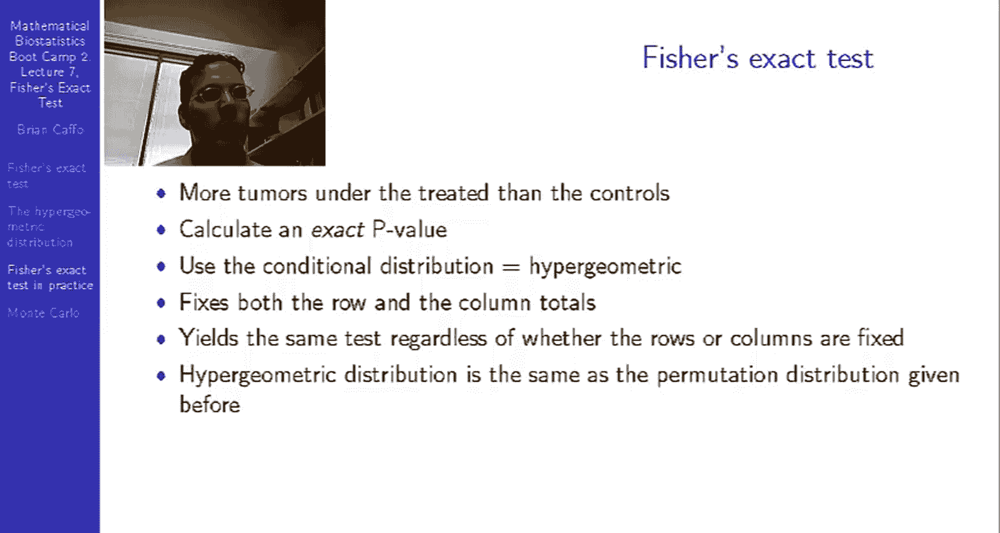
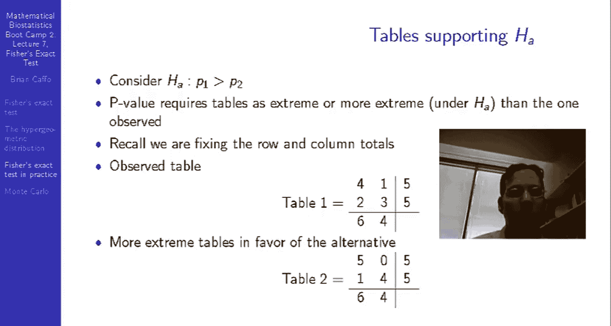
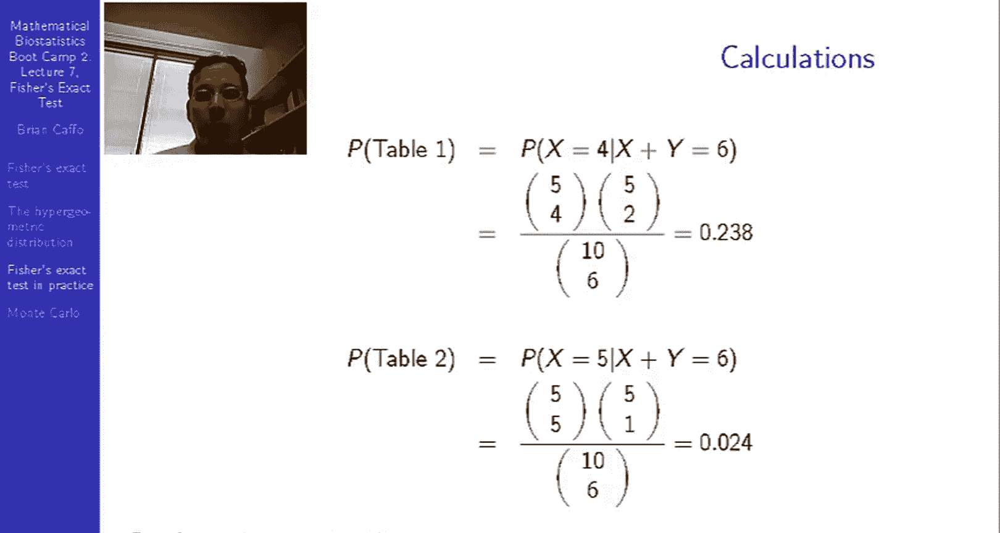
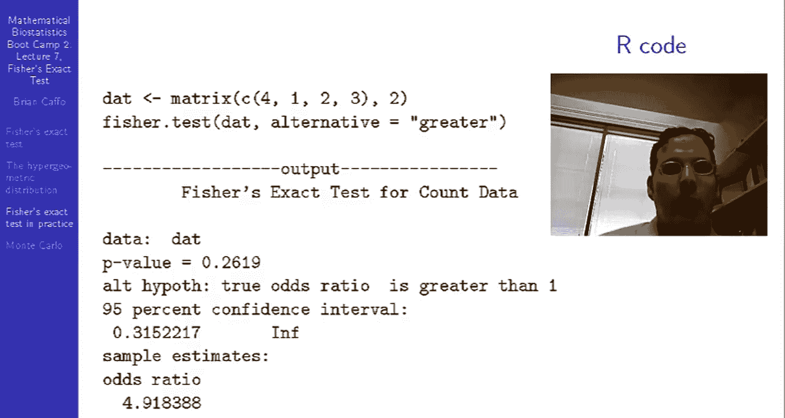
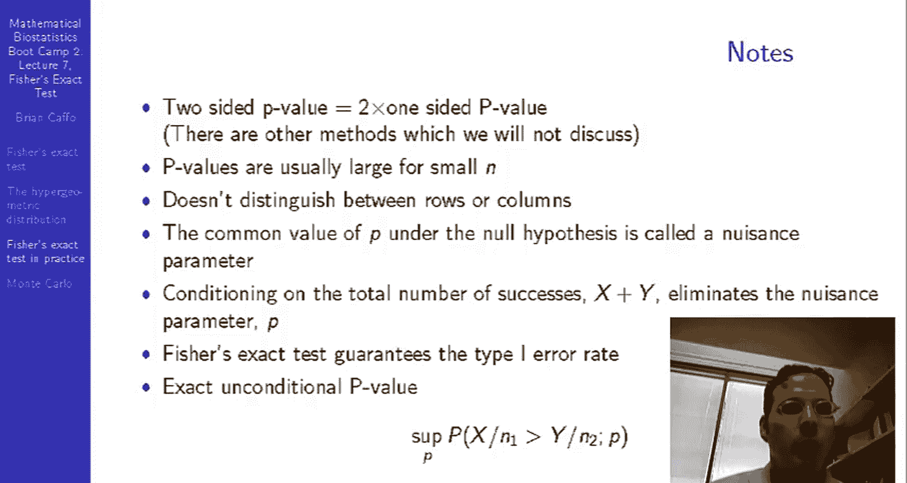
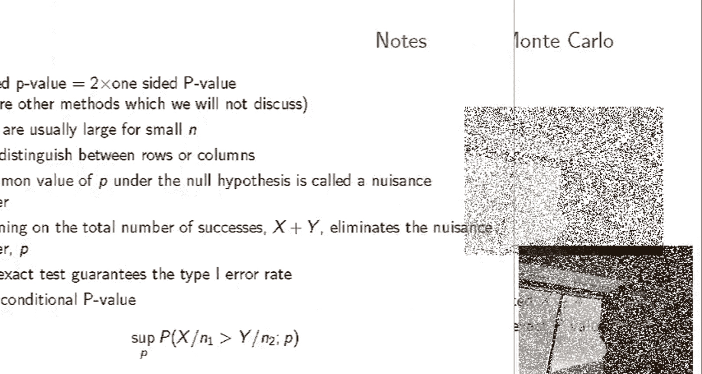
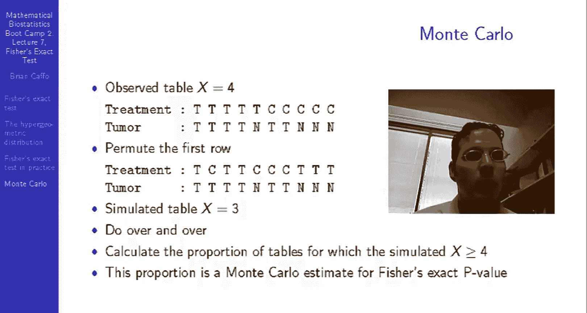

# 高级统计：P53：Fisher精确检验实践与蒙特卡洛模拟 🧪

在本节课中，我们将学习如何计算Fisher精确检验的P值，理解其背后的条件分布原理，并探讨使用蒙特卡洛模拟来估计P值的方法。我们还将讨论双侧检验的复杂性以及Fisher检验的一些重要特性。

---

## 条件分布与P值计算



上一节我们介绍了Fisher精确检验的基本思想。本节中，我们来看看如何具体计算P值。我们的精确P值将使用**条件分布**。这个条件分布固定了列联表的**行合计**与**列合计**。

Fisher最初设计这个检验时，假设那位品茶的女士知道实验者会将“茶先”和“奶先”的杯子数量随机分配得一样多，因此他认为她也应该知道这些边际总数。这就是他采用条件分布思路的原因。

我们之前讨论过，无论行或列是固定的，这个检验都相同。而且，**超几何分布**（我们推导出的条件分布）与我们将数据视为完整数据集（而非仅2x2表）时，随机置换处理组和对照组标签所得的**置换分布**是相同的。



---

## 单侧检验P值计算示例

让我们考虑之前的例子：我们想检验处理组小鼠的肿瘤概率是否高于对照组。P值需要计算在备择假设下，出现与观测表同样极端或更极端的表的概率。记住，我们固定了边际总数。

观测到的表格是：
|          | 肿瘤 | 无肿瘤 | 合计 |
| :------- | :--- | :----- | :--- |
| 处理组   | 4    | 1      | 5    |
| 对照组   | 2    | 3      | 5    |
| **合计** | 6    | 4      | 10   |

一个更极端的表格是：如果处理组有5只小鼠患肿瘤。那么，为了固定边际总数，这个表格只能是：
|          | 肿瘤 | 无肿瘤 | 合计 |
| :------- | :--- | :----- | :--- |
| 处理组   | 5    | 0      | 5    |
| 对照组   | 1    | 4      | 5    |
| **合计** | 6    | 4      | 10   |



不可能有比这更极端的表了（比如处理组6个肿瘤，会导致对照组出现-1个肿瘤）。

根据超几何分布公式计算概率：
*   观测表的概率：`P(X=4) = 0.238`
*   更极端表的概率：`P(X=5) = 0.024`



因此，P值（获得支持备择假设的、与观测表同样极端或更极端的表的条件概率）为 `0.238 + 0.024 = 0.262`。

可以看到，在这个数据集中，只有得到最极端的表格（5,0,1,4）才可能获得5%显著性水平的检验结果。这是**精确检验**的一个后果：由于数据的离散性，P值只能取有限个值。这种检验能保证I类错误率**最多**为5%（如果比较此P值与5%），但无法保证**恰好**为5%。

---

## 在R中实现Fisher精确检验

在R中执行Fisher精确检验非常简单。

以下是操作步骤：
1.  首先，创建一个2x2的矩阵来存储数据。
    ```r
    a <- matrix(c(4, 1, 2, 3), nrow=2, byrow=TRUE)
    ```
2.  使用 `fisher.test()` 函数进行计算，并指定备择假设方向。
    ```r
    fisher.test(a, alternative = "greater")
    ```
3.  运行后，R会输出P值（本例中为0.2619），与我们的手工计算一致。同时还会给出优势比估计及其置信区间。

---

## 双侧检验的挑战

双侧P值的计算稍微复杂一些。R使用的方法与我们即将介绍的不同。

一个简单（但并非R默认）的方法是：**将较小的那个单侧P值乘以2**。这模仿了我们在正态检验或t检验中的做法。如果你错误地将较大的单侧P值加倍，通常会得到一个大于1的P值。

Fisher最初采用的方法是：将超几何概率本身作为检验统计量。他的逻辑是：如果一个表格来自备择分布而非原假设分布，那么它在原假设下的概率就会很低。因此，他计算所有满足边际条件的表格的超几何概率，然后将那些概率**小于或等于**观测表概率的表格的概率相加，作为P值。

实际上，你可以使用任何衡量表格“极端性”的统计量（例如卡方统计量），然后对统计量比观测值更极端的所有表格的概率求和。问题在于，在这个设定下，**没有一致最优的统计量**，选择不同的统计量意味着在检验功效上有所权衡。

---

## Fisher精确检验的重要特性

以下是关于Fisher精确检验需要了解的几个关键点：
*   **行列对称性**：Fisher精确检验不区分行和列。转置表格，你会得到相同的P值。
*   **消除讨厌参数**：在原假设下共同的肿瘤概率`p`是一个**讨厌参数**。我们通过**条件化**于成功总数（即患肿瘤小鼠总数）来消除它。这种“对某个和进行条件化以消除讨厌参数”的思路在本课程中还会出现。
*   **保守性**：如前所述，该检验保证I类错误率**不高于**预设水平（如5%），但由于离散性，通常无法**恰好达到**该水平，因此检验往往是**保守的**。
*   **与其他检验的争论**：历史上，Fisher的检验与另一种称为**Barnard精确无条件检验**的方法有过激烈争论。Barnard的方法是不对边际条件化，而是计算在任何共同概率`p`下得到至少与观测值一样极端结果的概率，然后取所有可能`p`中这个概率的**最大值**作为P值。它在某些情况下功效更高，但Fisher基于随机化的条件检验逻辑也非常有说服力。这场统计学家之间的论战非常有趣。

---

## 蒙特卡洛模拟方法

最后，我们扩展一下思路，特别是因为我们可以将这种思想推广到不仅仅是2x2表。

假设我们的原始数据编码如下：
*   处理标签：`T, T, T, T, T, C, C, C, C, C`
*   肿瘤结果：`1,1,1,1,0, 1,1,0,0,0`（对应表格中4个处理组肿瘤，2个对照组肿瘤）





我们可以通过**蒙特卡洛模拟**来估计Fisher精确检验的P值，而无需直接计算超几何概率。步骤如下：

1.  重复多次（例如10000次）：
    *   随机**置换**处理标签（`T`和`C`）。
    *   根据新的标签组合，计算处理组患肿瘤的小鼠数量 `X*`。
2.  记录模拟中 `X*` 大于或等于观测值 `X=4` 的比例。

这个比例就是P值的蒙特卡洛估计。在这个简单例子中，我们不需要模拟，可以直接计算。但在未来，我们会遇到更复杂的问题，无法手工计算，那时就需要依赖这种蒙特卡洛模拟方法。

---



本节课中，我们一起学习了如何计算和应用Fisher精确检验，理解了其基于条件分布消除讨厌参数的原理，探讨了单侧与双侧P值的计算及其挑战，并介绍了使用蒙特卡洛模拟来估计P值的基本思想。下一讲，我们将继续研究列联表分析。