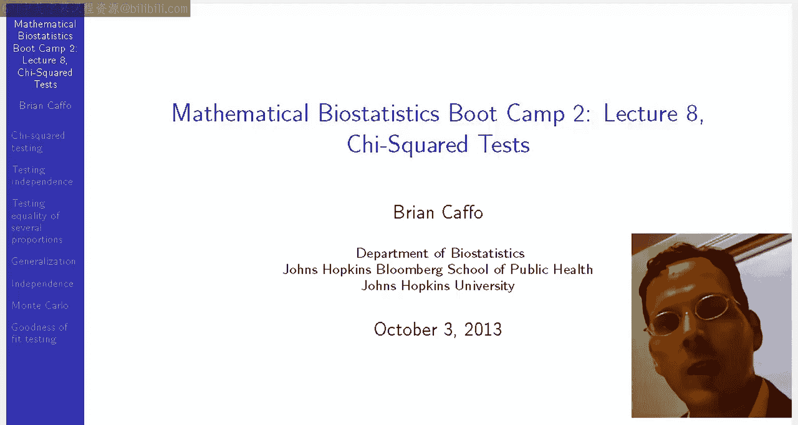
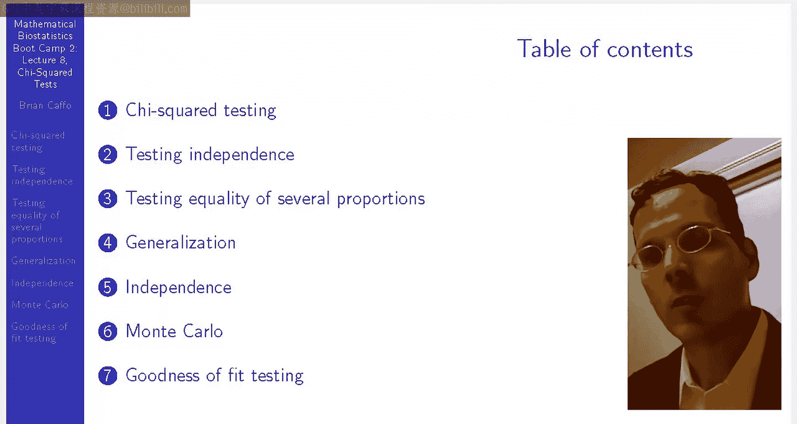
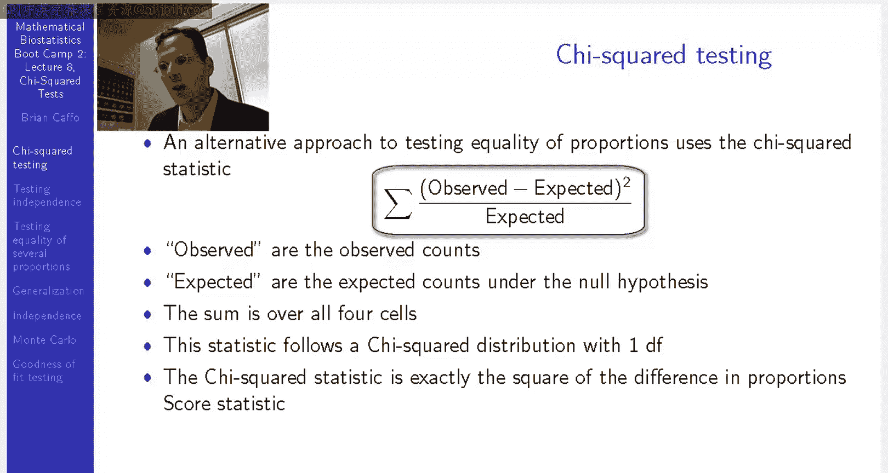
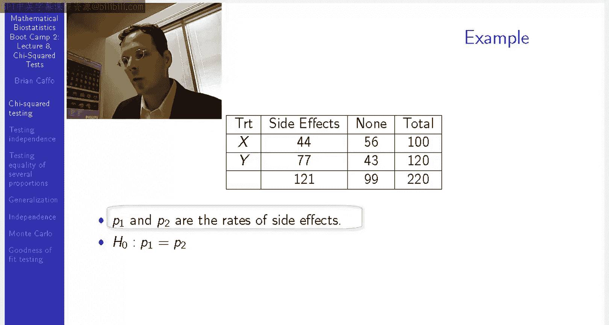
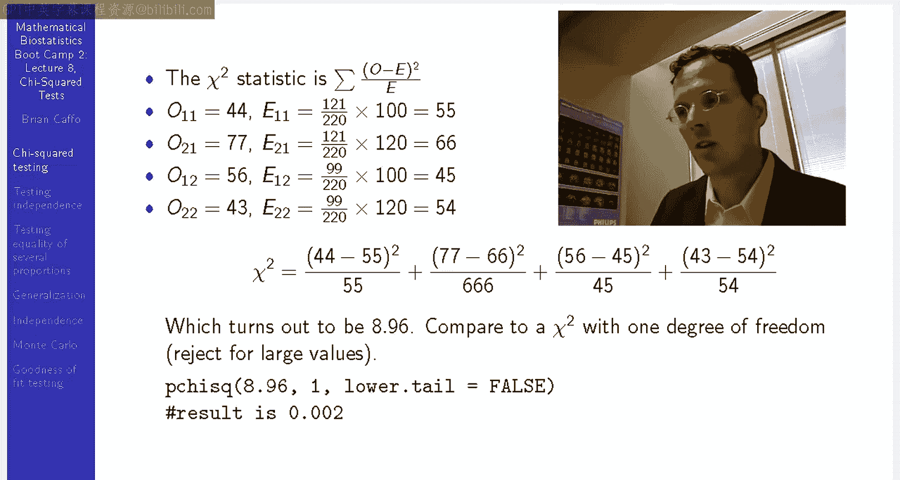
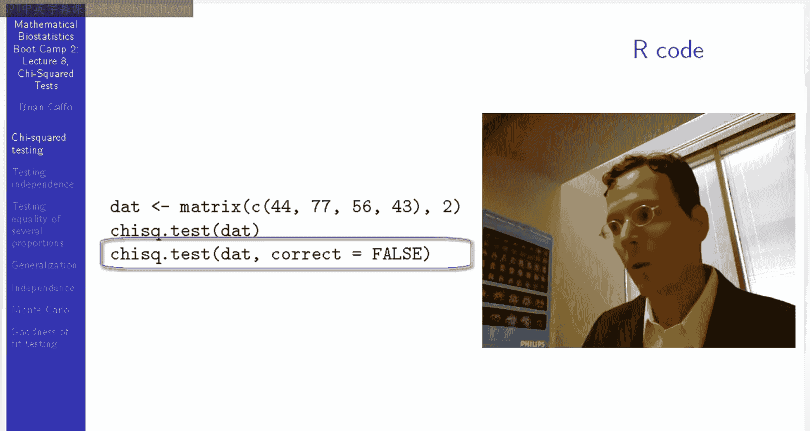
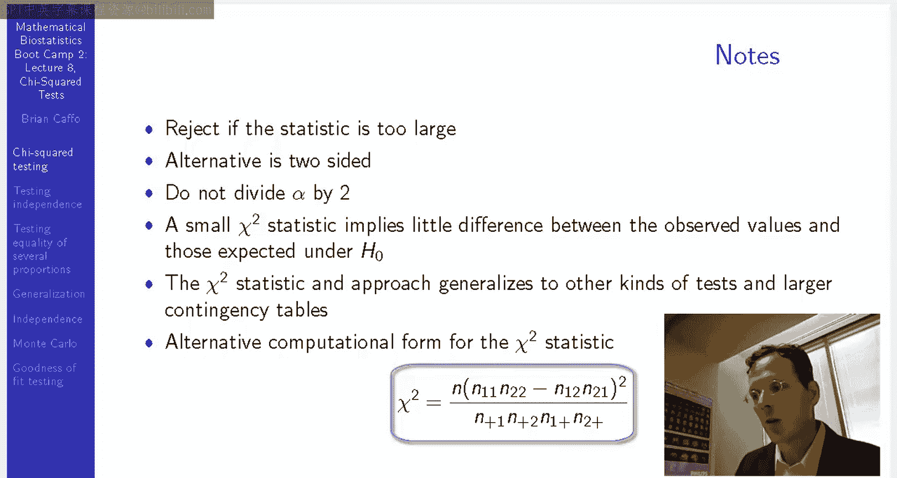
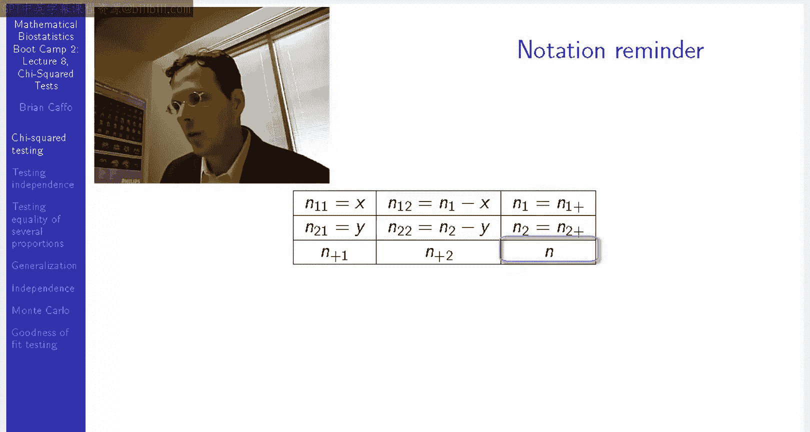
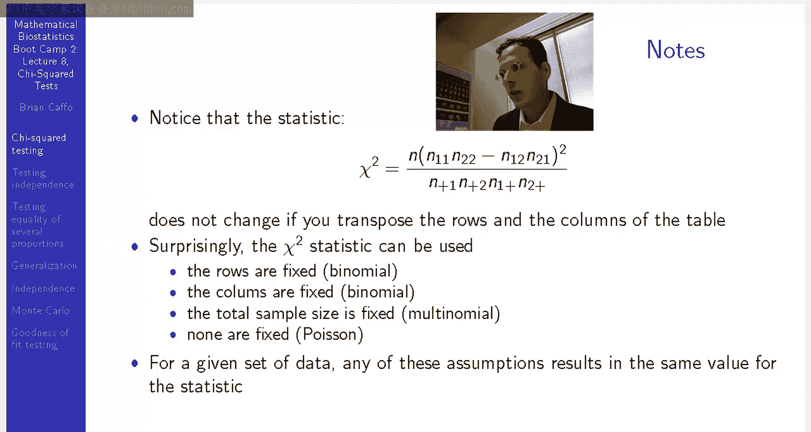

# 约翰霍普金斯大学《数据科学的高级统计｜Advanced Statistics for Data Science》中英字幕（deepseek p54 23_卡方检验.zh_en -BV1htPjeYEFH_p54-

Hi， my name is Brian Kaffho and this is Matheal Biosstatistics Boot Camp 2 Le8 on ChiI Squared test。

Okay， so specifically when we talk about chi squared testing。

 there's lots of different variations of chi squared testing here we're going to be talking about chi squared testing for contingency tables。

And the most classic contingency table test is testing independence。

 we'll relate that to testing independence of several proportions。

 we'll go through the natural generalizations to higher order contingency tables。

 and then we'll talk about Monte Carlo variations to get exact tests of independence we'll finish it off with a discussion of goodness of fit testing。

 which is a special kind of contingency table tests that's useful for testing whether or not data arrive from a particular distribution。

Okay， so we've talked about testing in a two by two table a quality of two proportions。

Save binomial proportions。And an alternative approach to doing this is so called chiI square testing。

And the form for all the chi score test is the same， it's the summation of the observed data。

 the observed cell counts， minus the expected cell counts， and I'll talk about what that means later。

 squared divided by the expected， and we'll talk about where the motivation for this formula comes from as well。

 so here the observed or the observed counts， the expected or the expected counts under the null hypothesis。

And the sum is over all of the cells of contingency tables， successes and failures。

And in the two by two tablecasts for testing at quality proportions。

 this winds up being a chi squared， this distribution under the no hypothesis has a chi squared distribution with one degree of freedom。

嗯。And it turns out and maybe I'll sign this somehow as a homework。

 the KisS score test is exactly the square of the difference in proportion score statistic where you have the common proportion in the denominator for the standard error。

And notice because so notice basically the statistic is a distance。

 the distance between the observed cell counts and what you would expect us to get under the model。

But notice it's squared， so there's no directionality。

 it's just whether its things are kind of different than what you would expect to see under the model。

 so under the model under the hypothesis， so it doesn't test directionality。

 it doesn't test whether it tests it's effectively it's not equal to hypothesis always。

So let's go back to our familiar example where we were we had a treatment here。

 the treatment is x and Y， let's say x is the treatment and Y is the placebo。

We probably more accurately， let's suppose we're comparing two equally effective treatments and we want to see if one has more side effects than the other。

 so X and Y are two different treatments and we want to determine whether or not one has more side effects here we assigned 100 people to x and 120 people to Y。

 we're going to treat the binomial， the counts of the number of people with side effects out of the total as if they were binomial that will be our model。

Okay， and here are the rates of side effects and two proportions P1 for x and P24 y。

 and we're interested in whether P1 equals P2。

Okay， let's see if we can logic our way through implementing this formula。

 so the chiC statistic I've said is the summation of the observed counts minus the expected over the squared over the expected。

Well part of it's easy， right， the observed counts， '011，021，012 and 022。

 if we label the cells of the rows and columns of the two by two table that way， then we have those。

 44， 77， 56 and 43。Now what about the expected accounts， well let's kind of think this through。Okay。

 if the rate of side effects was the same for the two groups for the two treatments。

Then our estimate of the common proportion， just like in the denominator of the score statistic。

 would have to be 121 over 220。And now we don't know that。

 so let's use that as our best estimate as for the overall proportion of side effects。

 regardless of treatment because under the no hypothesis the proportions or the true proportions are assumed equal。

 so that's our estimate of that。And then how many people we expect to see with side effects。

 well if that's the estimate of this common proportion。

 then 100 times that would be we would expect to see 55 and so on then you go through it we would expect to see out of the 120 receiving the second treatment we would expect to see 120 times this proportion or 66 I'm rounding here the expect accounts by the way don't have to be integers they shouldn't be integers you should carry out the calculations to。

You know。To many decimal places， I just， I don't know why I round them。

 I think for didactic reasons I round them up for images here， for integers here。

 but in general the expect accounts do not have to be integers in the same way the observed counts must be integers。

嗯。So anyway， just to remind you， you want to carry these calculations out。

 not not just round them at 55 okay， and so on then and then。

One minus this probability is then 99 over 220。And that's how many non-side effects would times 145 is how many nonside effects we would expect in the X treatment and 99 times 120 or 54 is what we would expect in the Y treatment so these counts here on the right hand side represent what we would expect to see under the null hypothesis using our best estimate for the common proportion so the margins of the 1120 are fixed by the design and the best estimate of our common proportion is that one so this is kind of our best guess is what we would expect to see and if these counts are very different from the observed counts then that would shed some light maybe that the null hypothesis is not true。

Okay， so then our test statistic is 44 minus 55 squared over 55 and so on。

 add all those up and that turns out to be 8。96。Compare that to a chi squared with one degree of freedom and again we're rejecting for large values right because this is the different。

 the distance between the observed and the expected counts we favor the alternative the further away from the expected counts we are so the bigger the test statistic is iss going to favor the alternative so we're going reject for large values so let's do p chi squared 8。

96 it's one degree of freedom when you have a 2 by two table and we'll give you a general rule for when you don't have a  two by two table and we say lower table goes false because we want the upper probability not the lower probability the result is 00 is02 the other way you can think about this of course is a chi squared with one degree of freedom is actually the square of a standard normal。

So it's unlikely for a standard normal to be above two or below minus2 right there's only a 5% chance of that happening so chi squared it's unlikely going to be above four right the square of2 and the square of minus2 so that's going to have about 5% probability。

 so a chi squared of about four is about the same benchmark as a normal of about two。

 a chi squared of about。9 is the same as a normal for a standard normal for about three again remembering that you're testing both bigger than two and less than two or bigger than three and less than three because remember the chi score is a two always does a two side of test so in this case the result is 0002 there is some evidence to suggest that there is a difference in the rate of side effects between the two treatments though of course the side effect the the result of the chi score test doesn't tell you which direction it goes okay so that's how we do it。

And here's some simple R code for executing it in R so you don't have to do the calculations with a calculator。

So we just created a data matrix it's this matrix command here and then chisq。

 testestdat and then you'll notice if you do this you don't get exactly the same test statistic that we got and the reason is because the chi squared approximation。

You know， it's its an it's an asymptotic approximation。

 but the counts are discrete and you can improve the highcr approximation by fudging a little bit。

 you know， in the way that that you know，Am。In a way that kind if you're doing kind of numerical integration with boxes。

 you can maybe do a little bit better with trapezoids or something like it's along that line of thinking and that boils down to adding a little bit to every cell。

And that's called a continuity correction， basically accounting for the fact that the cell counts are counts。

And it can improve on the asymptotic approximation。

 so if you actually put in correcttic equals false it won't do that continuity correction you'll see then you'll get the exact answer。

 same answer that we did you do want to do the so for didactic purposes we're not presenting the continuity correction。

 but when you actually do the test， you want to leave correct dec equals true on there because it does yield a better approximation that's why it's the default in R。

Okay， so let's recap， we're going to reject if the Kais court statistic is too large or is large。

The alternative is always two sided， you're always comparing whether the proportions are different。

You do not divide your alpha by2 even though it is a twosided test。

 remember we're dividing the reason we're dividing the alpha by 2 in the standard Gaussian cases because you're checking bigger than you're checking less than because we've squared the statistic and the chi squared is only a positive statistic。

 we don't need to do that alpha divided by two for the quantile。

A small high squared statistic implies little difference between the observed values and those expected under H not。

 so it supports H not。You could think of the Kaisk statistic as actually a distance。

And then what we'll talk about and it's really kind of a fun subject I think the chi squared statistic and approach generalizes to other kinds of tests and larger contingency tables and it's also one of these phenomenons that often occurs in statistics where the same procedure arises out of several different settings and data structures and so the interpretation changes but the actual procedure stays the same and we'll go through another one next where we think about this problem in a different way and we wind up with an identical procedure and that happens a lot in statistics where even though you think about the problem in a different way。

 you get the same procedure， the mean is frequently a good estimator even if the datas IID exponential or IID normal it's going to estimate the mean of the data well and so the mean pops up all over the place well you the same sort of thing happens in chi- squared testing where you get kind of equivalencies despite very different sampling strategies and assumptions underlying the data。

Anyway， there's a neat computational form in the two by two case it looks like this where I'll have the notation on the next slide。

 but where here the NIJs are the cell counts and you put a little plus in front of an index if you're summing over that cell。

 so these are the margins。

And here briefly is the notation I'm going to be using where IJ indexes， cell count。

I'll call n plus one meaning summing over the first index so that's this margin n plus 2 is this margin n 1 plus is this margin n2 plus is this margin and if I need to refer to n1 and N2。

 let's say those are the row margins and then n will be the sum this corner cell right here。

The sum the total number of observations。

So。You knowKind of an interesting fact about the Kais Court statistic， if you look at it。

 you transpose the table。嗯。The statistics doesn't doesn't actually change its value。

 which is kind of interesting， right， It means it doesn't care about which。

Margin is sort of fixed by the the study design it doesn't care about that and if you errantly were thinking of side effects as being the。

Outcome， you get the same thing as if you were thinking about which treatment they received was the outcome。

 youd wind up with the same test and you know only one of them's the correct。

way in which the experiment was conducted。So that's interesting and it ties into its utility then ties into a lot of these instances where you really want to play around with the interpretation of the。

Of the。What variable is the outcome and what variable is the predictor and we'll talk about that when we talk about case control studies。

 it's interesting that in case control studies some of the fundamental work was done right here at Hopkins by a person named Cornfield。

Anyway rate。So the chiC statistic it can arise， you can state a model for which the chiisC statistic is kind of the obvious thing to do if the rows are fixed so you have binomial you can do it if the columns are fixed which is just maybe a different kind of binomial if you' you know again here we're assuming binomialness of the data in either of these cases but let's imagine if you didn't assume that the data were binomial that the rows or columns are fixed let's say you assume that only the total sample size is fixed so imagine as an example of that you collected instead of randomly assigning 100 people to receive the treatment and randomly assigning 120 of the other people to not receive to receive the other treatment imagine if you just happen to。

Go out and collect a bunch of people and ask them what treatment they had and ask them whether or not they had side effects now granted it's a different experiment。

 the way in which you would interpret the result of a high squared test would be different， but。

But there you might think， oh， while I sampled 220 people。

 that was really my the part that was fixed by the design。And。

knowHowever people fell out in terms of side effects and。And treatment。

 well that's you know part of the randomness and so I'm going to model that whole thing is if they were multinomial with four possible things。

 they could be taking treatment X with no side effects， treatment X with side effects。

 treatment Y with no side effects， treatment Y with side effects， I think I hit all four。

 but you see what I mean there's four possible elements in the two by two table。So in that case。

 it wasn't fixed， and I'll go through it right now。

 but you wind up with the same exact test statistic。

You wind up with the same exact test statistic and chi squared result if you assume multinoialness and a specific null hypothesis。

 namely a test of independence， so I find that cool。And that's why often people don't。

People are a little bit loosey goosey about their assumptions in multinomial settings because they kind of apply in different ways。

I do think there's a lot of problem with that because。Yes。

 the number of the that comes out from the test statistic is the same， but it doesn't。

The interpretation is very different different different experiments lead to very different interpretations。

 very different interpretations of the assumptions in my just example I just gave you in one case we randomized a treatment or in my fictitious case that I'm making up in one case we randomized the treatment and in the other case we just went out and sampled people observationally those are very different interpretations I think I would you know most people would agree that the randomization would kind of average over confounding effects and other things that。

Unobserved variables were in the observational case that wouldn't necessarily be the case。

