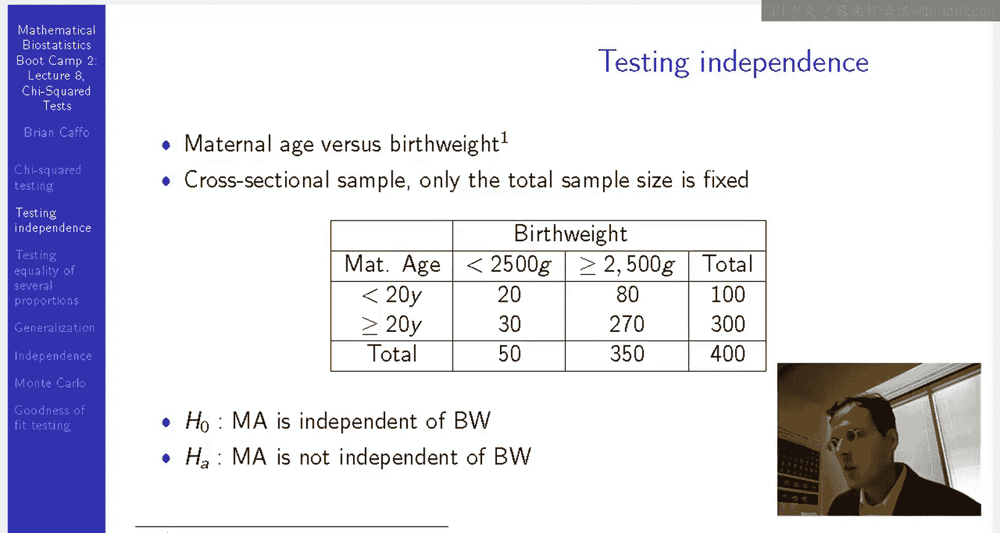
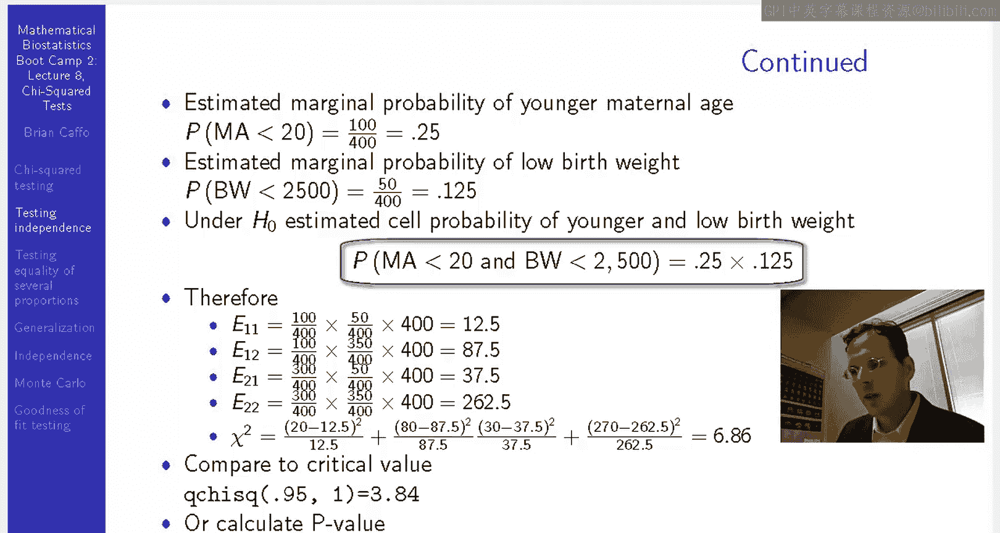
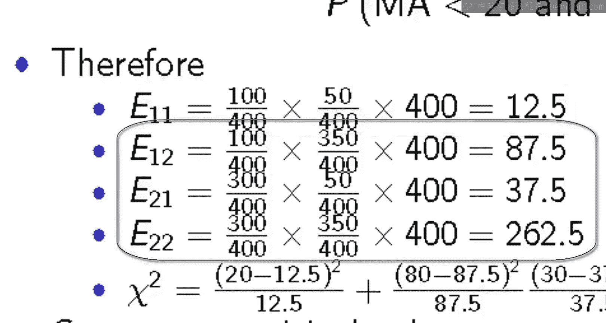
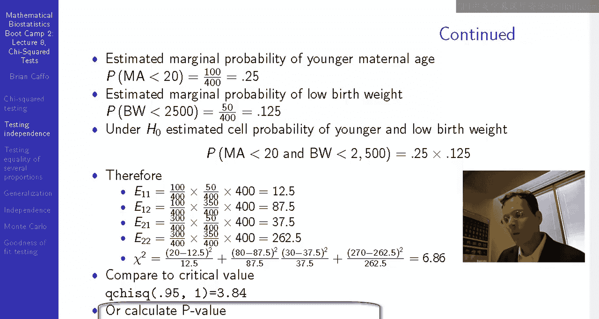
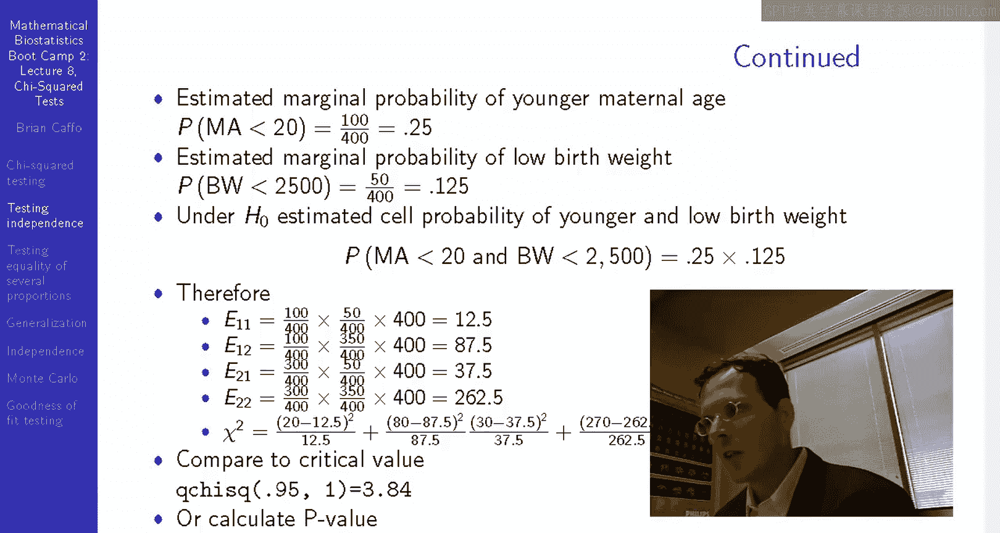
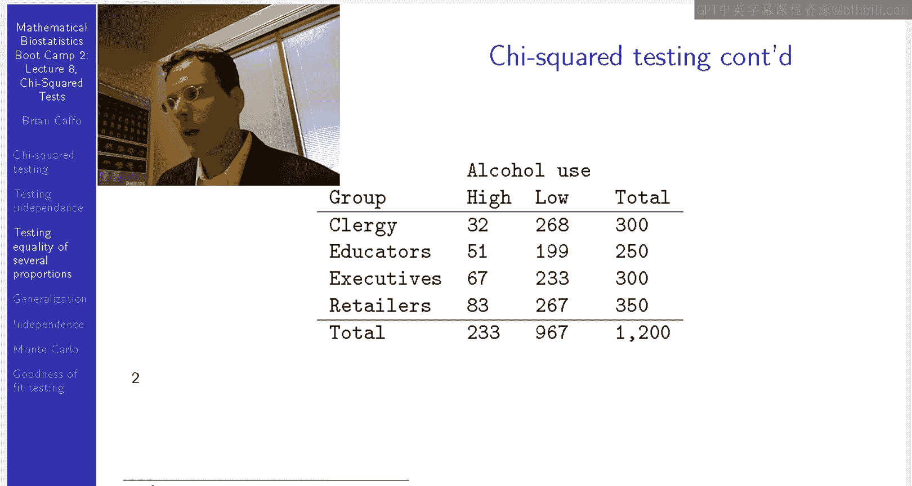
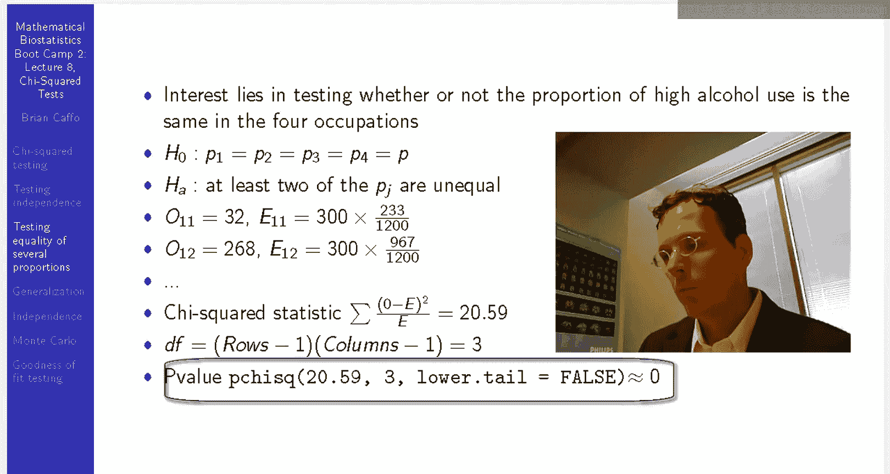
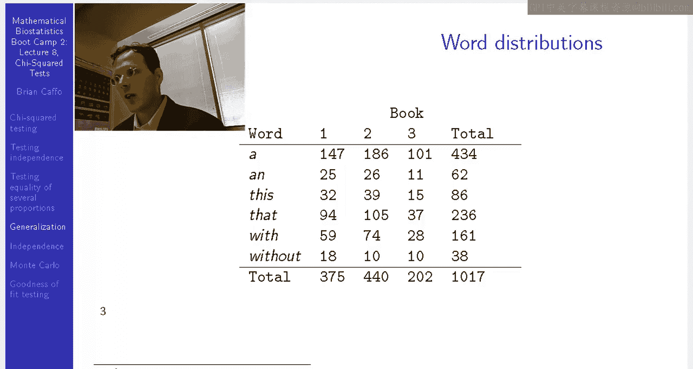

# 约翰霍普金斯大学《数据科学的高级统计｜Advanced Statistics for Data Science》中英字幕（deepseek p55 24_独立性检验.zh_en -BV1htPjeYEFH_p55-

So consider this next example where I took this modified a little bit from Augustgrti's wonderful book on categorical data analysis。

So here we're looking at birth weight cross classified by baby' birth weight。

 cross classified by maternal age。 and so let's assume that the。This。

 the way in which it was sampled as there was， say。

 400 people sampled so that by designing none neither of the two margins were fixed and were're kind of interested then in treating the cell counts as if they were。

Multenommial， a four dimensional multinomial count with n equal to 400 total。Total observations。

And then what we would like to know is if the variable birth weight is independent of maternal age versus the variable birth weight is not independent。

 so let's think about the problem this way and then see if we can logic our way to the expected cell counts。

Okay。Okay， so let's first note。That。Under the。Well， not necessarily even just under the hypothesis。

 just regardless， our estimate of young maternal age is always going to be 100 over 400 and older maternal age it willll be 300 over 400。

 the margins of the table where we disregarded birth weight and the same thing for birth weight disregarding maternal age would be 50 over 400 and then normal birth weight would be what 350 over 400。

Okay。And the cell probabilities would then give you the specific combined probabilities。

 if we wanted to talk about younger maternal age and lower birth weight， that would be this。

 our estimate of this， regardless of the hypothesis or under the alternative hypothesis would be 20 over 400。

But if we're under the no hypothesispo， we're assuming maternal birth weight and maternal age and birth weight are independent。

 then we would kind of logically construct this probability as the multiple of these two marginal probabilities because we're probably estimating the margins a little bit better。

So that would be 0。25 times 0。125 here because we're multiplying the marginal probability of young maternal age times the marginal probability of low birth weight。

Okay。So that only we can only do that under the null hypothesis。

 so let's work on our expected counts， so our expected count for the11 cell of low birth weight and young maternal age is this probability then the number of counts we would expect in there is times the 400 sample size and we get 12。

5 as our expected counts and then you can follow through for all the other three remaining cells in the same way and get the expected counts and then compare them using the same formula observe minus expected squared over expected and we get our chi squared statistic which in this case is 6。

86， we again compare it to a chi squared critical value which is around four of course we talked about it being know the square of the Z statistic so that makes sense that it would be around four。

嗯。And or we could just calculate our chi square P value。

 which would be the probability of getting a test statistic as large as 6。86 or larger。

So I hope everyone can follow these calculations and the idea is that we're basically calculating how distance our observed counts are from kind of our best estimate of what we would expect the counts to be under the hypothesis under the no hypothesis of independence between the row and column variables。

I should also add before I complete this slide that the answer we get from this test of independence is identical to the answer we get from the test of proportions。

 you get the same chi squared value， the same P value。

Now the interpretation might be very different as we talked about before if in one case there was randomization as to which of the rows you lied in versus in this case。

 if it was a multinomial sample， the interpretation of the results is dramatically different and we don't really cover you know a lot of things like epidemiological style sampling designs in this class but。

You knowSuffice it to say the interpretations can be very different but nonetheless the actual number。

 the P value we see is identical depending on either identical regardless of which of the sets of assumptions you make。

 so that's interesting and what's even more interesting is that you can formulate Poson models that then again yield the same conclusions。

So here's another example from Aggrti's categorical data analysis book。

 which is a book I highly recommend， I think it's a real classic in the area。An。But you know。

 but I should。Disclose a conflict of interest that aee is。Great friend and close colleague of mine。

Anyway， so in this example he is looking at a different collection of occupations and looking crossclassifying it by alcohol use。

 so suppose the investigators in this trial or in this study you know went out and found 300 clergy。

 250 educators， 300 executives in 350 retailers and then you know asked them a question about their alcohol use and we'd like to know whether alcohol use differs by occupation。

So。Interest then lies in whether or not in testing。

 whether or not the proportion of hiyaka use is the same in the。In the four occupations。

So if we label P1 the clergy， the proportion of high alcohol use among the clergy and so on。

 we want to test whether they're all equal， but we don't want to specify what proportion it is。

 so we let's say P is the common proportion across all occupations。

 and then the alternative would be the opposite of that that at least two are unequal。Am。

So our estimate of P， this common unknown proportion。

 that obvious estimate of it would be 233 over 1200， and the obvious well， and then of course。

 the estimate of 1 minus p would be 967 over 1200。So what would so our observed first count is 32。

 what would be our expected first count Well our estimate if under the no hypothesispo where occupation is irrelevant we expect about 233 over 1200 percentage to be high alcohol users so we multiply that times the row count 300 and we would get the observed cell count。

 then the low alcohol usage 268 well you they have know these have to add up to the margins by the way both the observed and the expected counts have to add up to the margins so you could take 300 minus the。

11 cell count to get it， but otherwise you could just say 300 times the probability of low alcohol usage。

 which is then 1 minus 233 over 1200 or 967 over 1200 and you would repeat that down and down for for each occupation。

 calculate our chi squared statistic， observe minus expected squared over expected some over all of them you get 20。

20。6。And we need to compare it to a chi square critical value， but the degrees of freedom change。

 and it turns out that the general rule for the degrees of freedom for the chi squared in these settings is rows minus1 times columns minus1。

 so in this case there's one， two， three，4 rows and two columns so the degrees of freedom is three。

 so then here's our P value p chi squared。20。59， three degrees of freedom， lower tail goes false。

 it's about zero， it's pretty clear that some of them are different。

Okay， here's another example and we're going to do so this is from Rice's book mathematicalthematic Stas and data analysis。

 which is another， first of all I have no affiliation is never met Rice so it's easier for me to say this。

 but I love this book I think it's wonderful this mathematical statistics and data analysis book so if you're looking for a book recommendation。

 I like that one。In addition I really like Ai's book。

 but I'm willing to stipulate my conflict of interest in recommending it， but I do really like it。

 I read it all the time。So anyway， in this book， he has this interesting example where he had a bunch of word。

Words taken from some novels that were were one of them was prepared where two of them were known to be Jane Austen novels and one of them was was in question as to whether or not it was from。

Written by that author， let's say they found it later。And。

There's may other ways you would want to analyze this data for this reason。

 but we want to use it as an example for the chi squared。

Don't think too hard about specifically how you would analyze this data because I doubt this would be what you would arrive at immediately。

 but it's not unsensible， by the way， it's reasonable。So。So imagine， let's say book three。

 I just spitball here， imagine book three is this book where you don't know whether or not it's from the same author in this case。

 it was Jane Austen。嗯。And you want to test whether。

 you know the word distribution of these words is equivalent across the three books and you sampled so many words from each of the books Okay。

 so that's the setting and let's see if we can figure out some expected cell counts to do a chi squaret。

