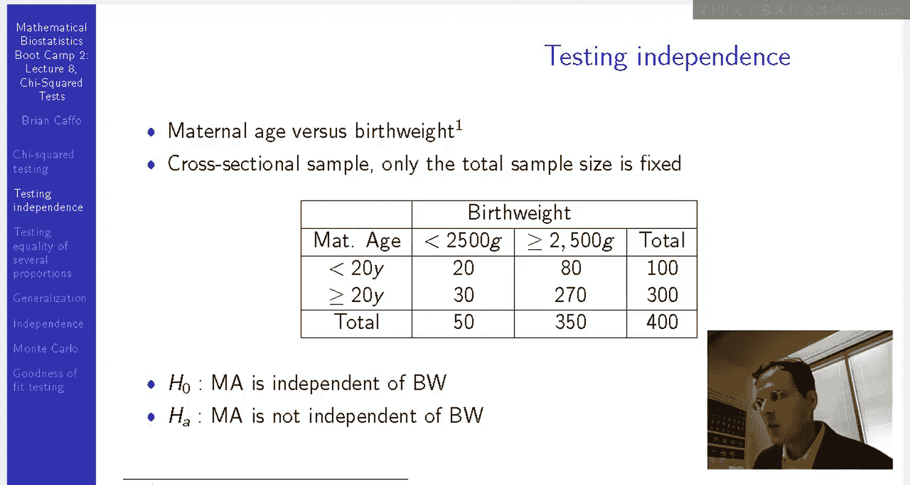
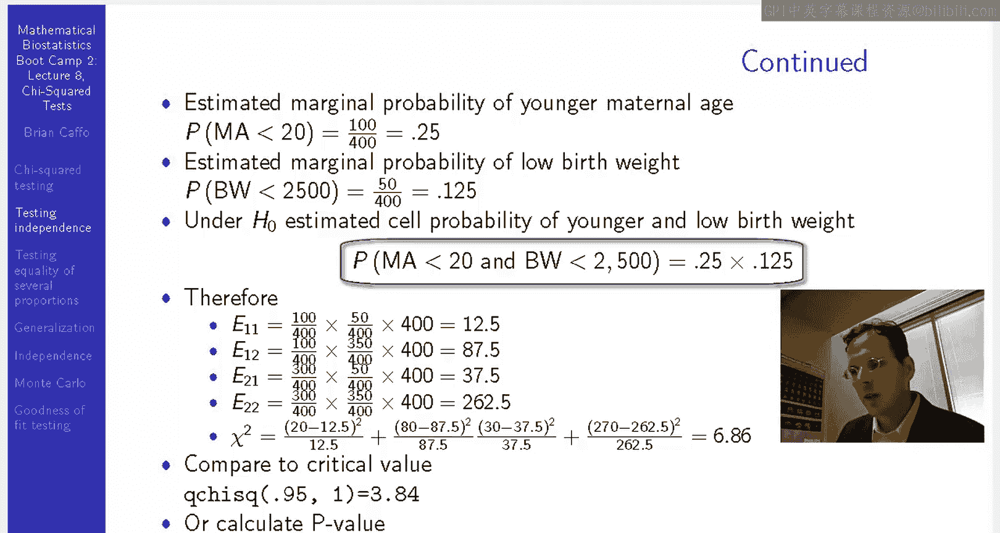
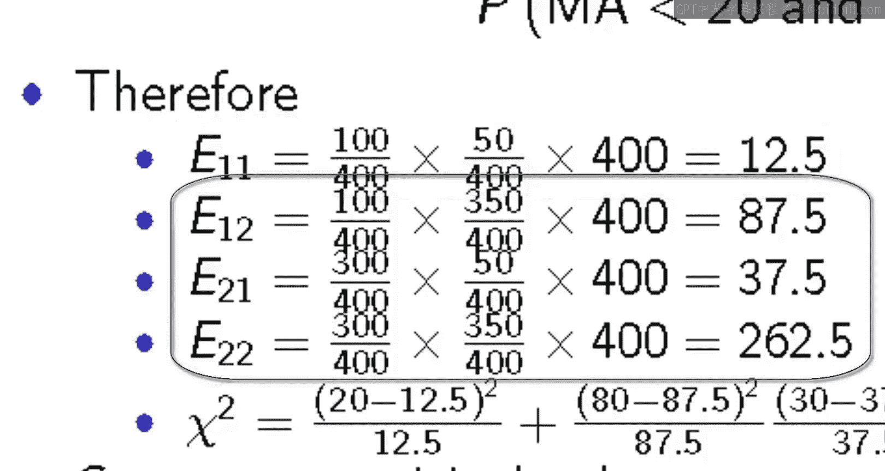
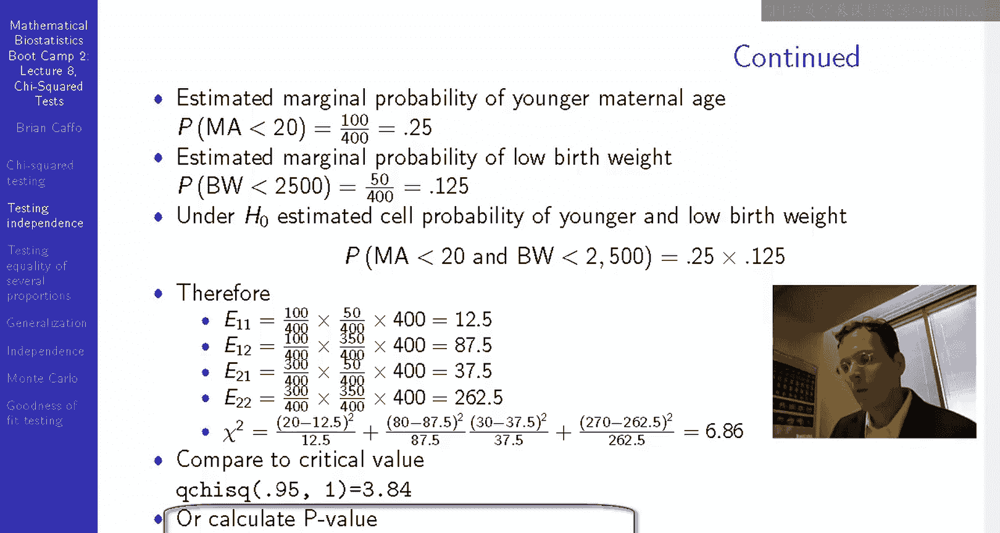
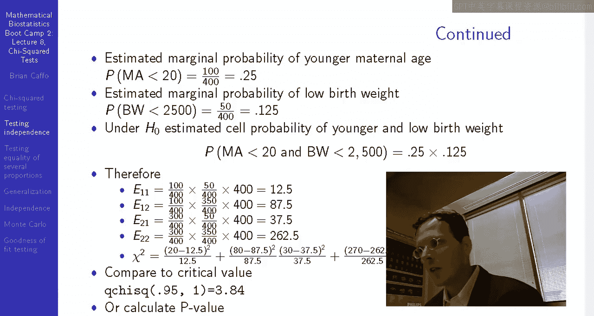
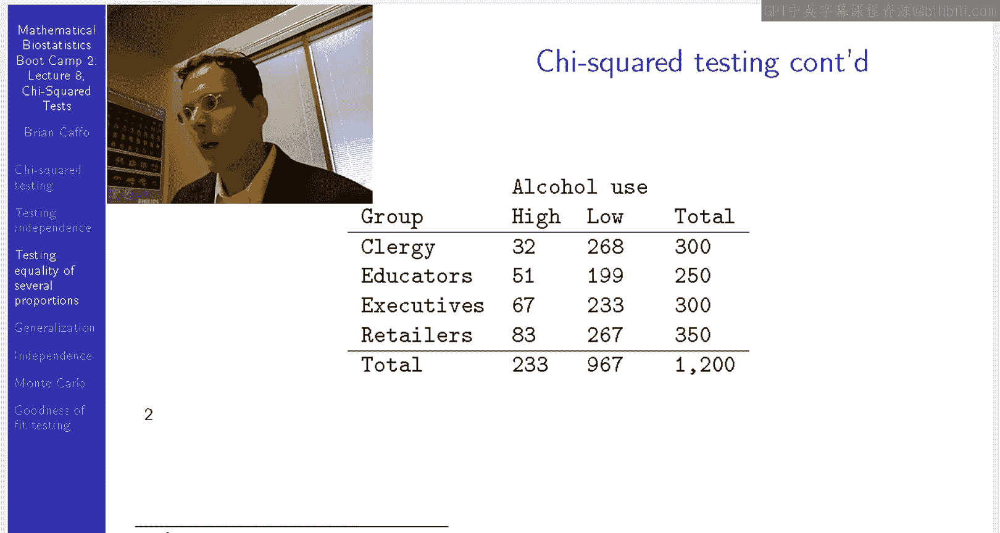
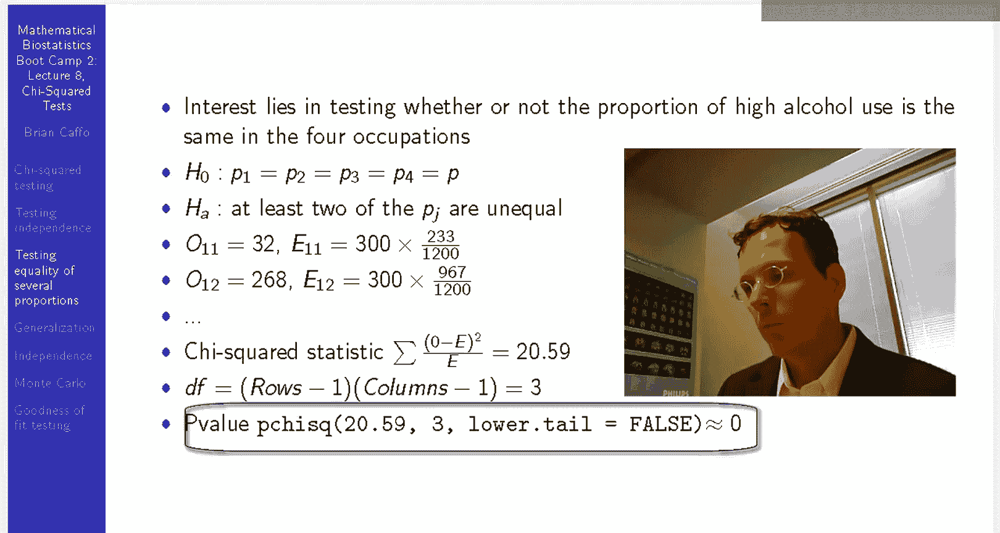
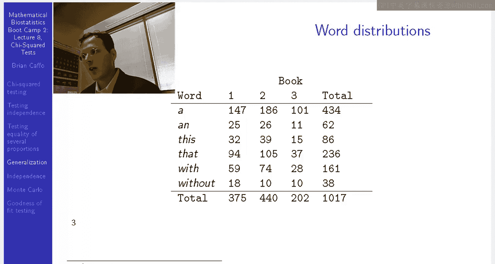

# 数据科学的高级统计：第24章：独立性检验 📊

在本节课中，我们将学习如何使用卡方检验来评估两个分类变量之间是否独立。我们将通过几个具体的例子，逐步讲解如何计算期望频数、卡方统计量，并解释结果。

---

## 概述

独立性检验用于判断两个分类变量之间是否存在关联。其核心思想是：在“变量独立”的零假设下，计算每个单元格的期望频数，然后比较观测频数与期望频数之间的差异。如果差异足够大，我们就有理由拒绝“变量独立”的假设。

上一节我们介绍了列联表和比例检验，本节中我们来看看如何将类似的方法应用于独立性检验。

---

## 示例一：婴儿出生体重与母亲年龄

这个例子改编自Agresti的《分类数据分析》一书。我们研究婴儿出生体重（低体重/正常体重）与母亲年龄（年轻/年长）之间是否独立。假设我们随机抽取了400名婴儿，得到了以下列联表：

首先，我们计算边际概率。无论假设如何，我们对年轻母亲比例的估计总是 `100/400 = 0.25`，年长母亲比例为 `300/400 = 0.75`。同样，低出生体重婴儿的比例为 `50/400 = 0.125`，正常体重婴儿比例为 `350/400 = 0.875`。

在零假设（变量独立）下，每个单元格的联合概率应等于对应行和列边际概率的乘积。例如，年轻母亲且婴儿低体重的概率估计为 `0.25 * 0.125 = 0.03125`。

以下是计算期望频数的步骤：

1.  期望频数 = 单元格概率 × 总样本数。
2.  对于“年轻母亲 & 低体重”单元格：`0.03125 * 400 = 12.5`。
3.  按此方法计算所有单元格的期望频数。

然后，我们使用卡方公式计算统计量：
**χ² = Σ [(观测频数 - 期望频数)² / 期望频数]**

计算结果为 `χ² = 6.86`。我们将其与自由度为 `(行数-1)*(列数-1) = 1` 的卡方分布进行比较。临界值约为4，因此6.86的统计量提供了拒绝独立假设的证据。

我们也可以直接计算P值，即得到大于等于6.86的卡方统计量的概率。

这个检验的核心是计算观测频数与零假设（行列变量独立）下最佳估计期望频数之间的距离。

需要补充的是，这个独立性检验的结果与之前学过的比例检验结果完全相同（相同的卡方值和P值）。然而，两者的解释可能截然不同，这取决于抽样设计（例如，行是否被随机分配）。尽管假设和解释不同，但计算出的P值是相同的。更有趣的是，泊松模型也能得出相同的结论。

---

## 示例二：职业与酒精使用

这是Agresti书中的另一个例子，研究不同职业（神职人员、教育工作者、高管、零售商）的酒精使用情况（高/低）是否存在差异。假设研究者分别找到了300、250、300、350名这四种职业的人进行调查。

我们想检验四个职业群体中高酒精使用者的比例 `P1, P2, P3, P4` 是否全部相等。零假设是它们都等于一个共同的比例 `P`，备择假设是至少有两个比例不相等。

共同比例 `P` 的估计值是总的高酒精使用者数除以总人数：`233 / 1200`。`1-P` 的估计值是 `967 / 1200`。

以下是计算期望频数的过程：

1.  对于“神职人员 & 高使用”单元格：期望频数 = 该职业总人数 × 估计的共同高使用比例 = `300 * (233/1200)`。
2.  对于“神职人员 & 低使用”单元格：期望频数 = `300 * (967/1200)`，或者用 `300` 减去第一个单元格的期望频数得到（因为行合计必须固定）。
3.  对所有职业重复此计算。

然后计算卡方统计量：`χ² = 20.20`。
此处的自由度公式为：`(行数 - 1) * (列数 - 1) = (4-1)*(2-1) = 3`。
计算P值：`P(χ² ≥ 20.59 | df=3) ≈ 0`。结果非常显著，表明不同职业的酒精使用情况存在差异。

---

## 示例三：小说词汇分析

这个例子来自Rice的《数理统计与数据分析》一书。研究者从几部小说中抽取词汇，其中两部已知是简·奥斯汀的作品，第三部作者存疑。他们想通过分析特定词汇的使用频率分布，来检验第三部小说是否与已知的两部出自同一作者。

虽然对于此类问题可能有更专门的分析方法，但使用卡方检验来比较三本书的词汇分布是否相同是合理的。思路是：在零假设（三本书词汇分布相同）下，计算每个词汇在每个书中的期望出现次数，然后进行卡方检验。具体计算过程与前述例子类似，需要根据总的词汇边际频率来估计共同的词汇分布概率，进而计算期望频数。

---

## 总结

本节课我们一起学习了卡方独立性检验。我们了解到，该检验通过比较观测频数与“变量独立”假设下的期望频数，来判断两个分类变量之间是否存在关联。我们掌握了计算期望频数、卡方统计量和相应自由度的通用方法 `(r-1)*(c-1)`，并通过多个实例加深了理解。重要的是，虽然不同的抽样设计（如多项抽样 vs. 固定行合计）会导致对结果的不同解释，但检验的计算过程是相同的。