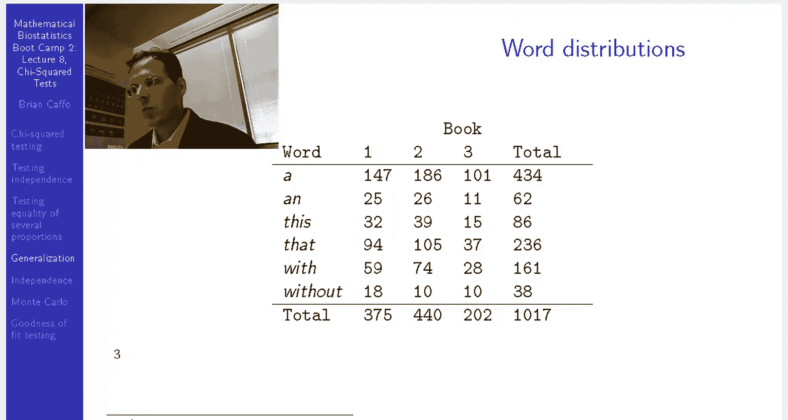
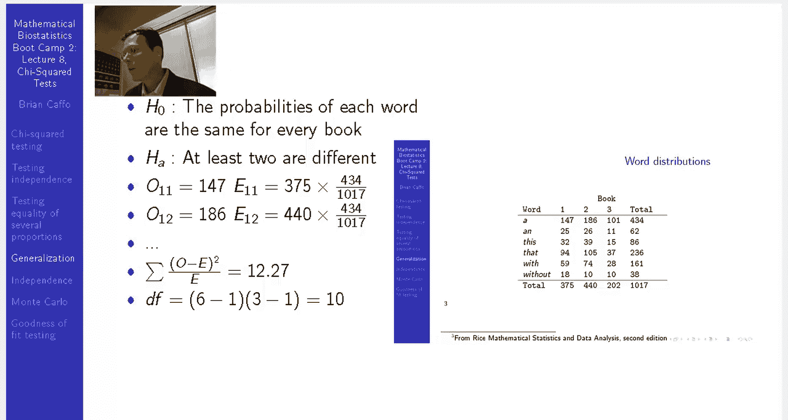
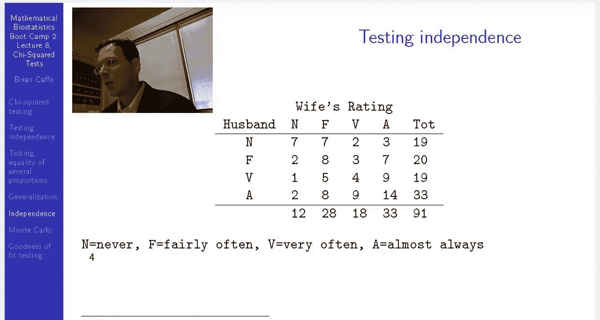
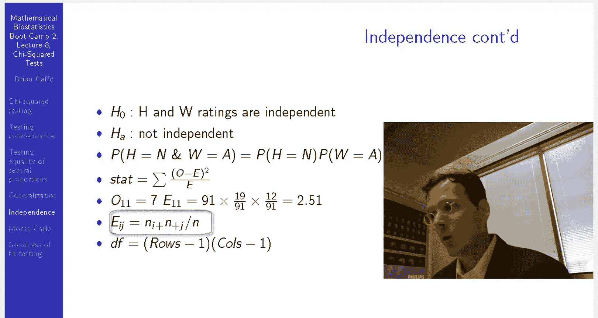
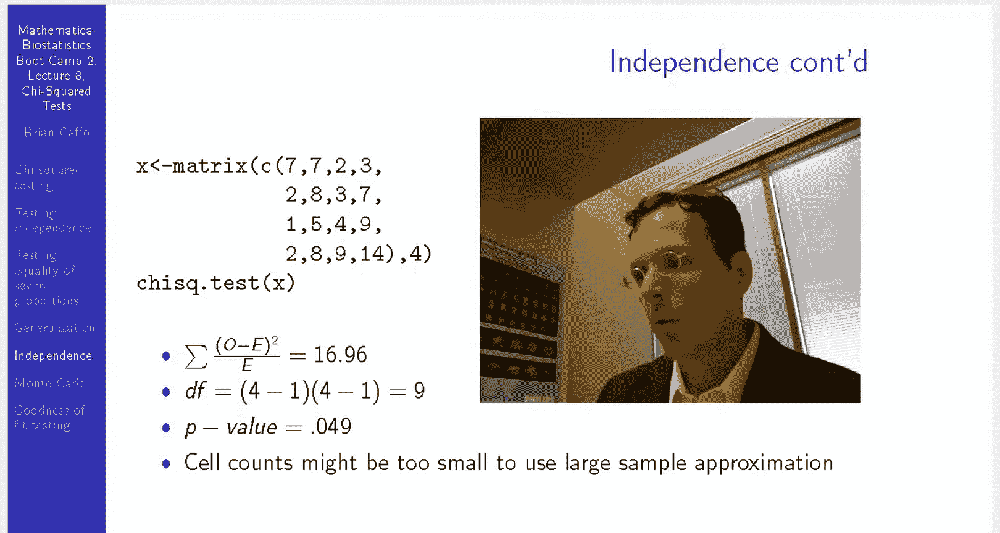
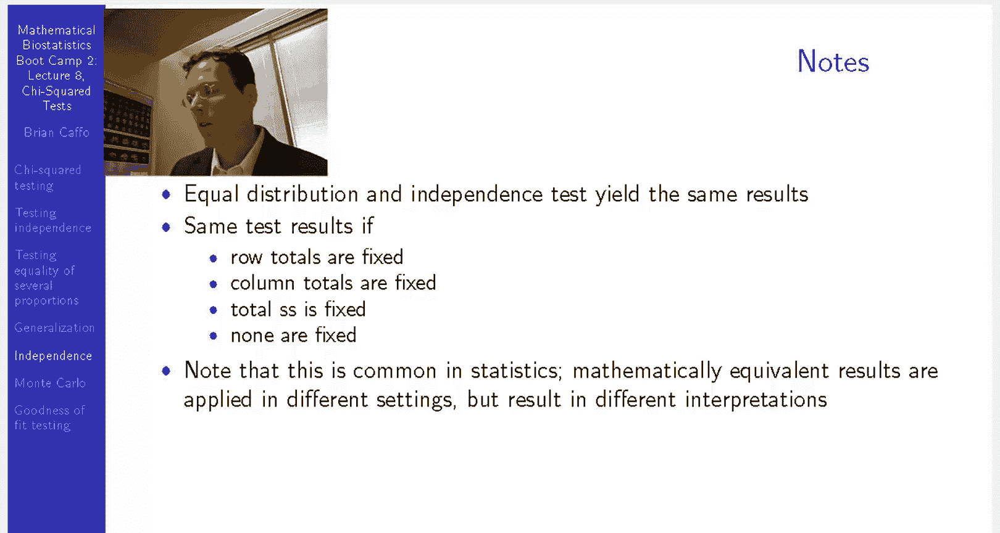
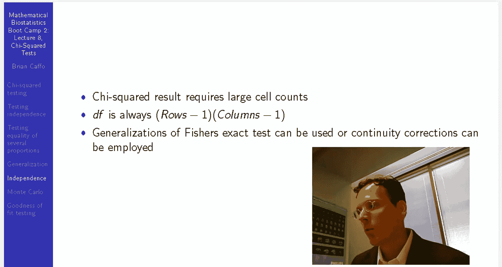
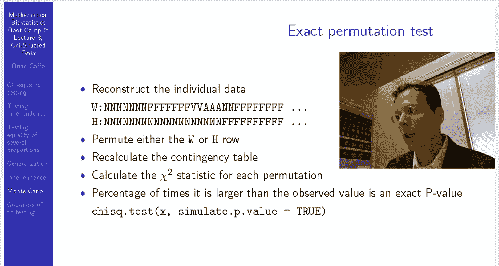

# 约翰霍普金斯大学《数据科学的高级统计｜Advanced Statistics for Data Science》中英字幕（deepseek p56 25_泛化.zh_en -BV1htPjeYEFH_p56-

Okay， here's another example and we're going to do so this is from Rice's book mathematicalmatic Staistics and data analysis。

 which is another， first of all， I have no affiliation has never met Rice。

 so it's easier for me to say this， but I love this book。

 I think it's wonderful this mathematical statistics and data analysis book so if you're looking for a book recommendation。

 I like that one。In addition I really like Ai's book。

 but I'm willing to stipulate my conflict of interest in recommending it， but I do really like it。

 I read it all the time。So anyway， in this book， he has this interesting example where he had a bunch of word。

Wors taken from some novels that were were one of them was prepared where two of them were known to be Jane Austen novels and one of them was was in question as to whether or not it was from。

Written by that author， let's say they found it later。And。

There's may be other ways you would want to analyze this data for this reason。

 but we want to use it as an example for the chiis squared。

Don't think too hard about specifically how you would analyze this data because I doubt this will be what you would arrive at immediately。

 but it's not unsensible， by the way， it's reasonable。So imagine， let's say book three。

 I just spitball here， imagine book three is this book where you don't know whether or not it's from the same author in this case。

 it was Jane Austen。嗯。And you want to test whether。

 you know the word distribution of these words is equivalent across the three books and you sampled so many words from each of the books okay。

 so that's the setting and let's see if we can figure out some expected cell counts to do a chi score test。

Okay， so our no hypothesispo is that the distribution of these words is the same for every book and that at least two are different。

 so in this case we have kind of a multinomial for every column that we're interested and we want to test equivalentvalence of those multinoial probabilities across the columns。

Okay， so if the book was irrelevant。We would look at these row margins and would say the word A should appear roughly 434 over 1017 times。

 okay？So our 11 cell was 147。But in that book， there were 375 you know。

 words of this type that were sampled and we're multiplying them times the what we would expect to see of that word if book were relevant。

And that's 434 over 1017， 1017， and that's how you get that expected cell count， follow through。

 take the observed。One， two sell， now that's how many times the word A appeared in book two。

 it came up 186 times， how many will we expect out of 440 words？

From our estimate viewing book is irrelevant that would be 434 over 117 times 440 and you would compare that then to 186 to see how much the observed count deviates from the expected count now then you would move on to the next word An right so An was disregarding book seen 62 out of 1017 words。

And so we would take 375 and multiply at times 62。Times divided by 1017 and compare that to 25 to see if the number of ans in book1 was different than what we'd expect。

And so on and you can go through all the calculations and the sum of the observed minus expected squared over expected is 12。

27。Deges of freedom are  six minus1 times3 minus1 in this case， working out to be 10。Now again。

And now at this point， I would ask you as an exercise to figure out what the chi score probability is。

 chi score P value is based on 10 degrees of freedom using R。

Now I should make some comments about sampling assumptions and these sorts of things about how the reasonableness of modeling the words this way。

 so you know， but this goes without saying in all of these problems。

We're making assumptions on how the experiment was conducted and that the model that we're applying is relevant so in this case you could probably say yeah that's not so bad about sampling assumptions if you under if you were to make some you know you know assume that there's you know there's lots of words in the book。

You know， we're only sampling， you know， you know， 300 or so of these very generic words so that we could。

 you know， so that modeling that process is multinomial， that doesn't seem so bad to me， at least。

Assuming that's how the experiment was conducted。But you always want to think about that。

 how does what I'm doing so the chiI squared test， how does its assumptions accurately reflect the way in which the experiment was conducted。

 you know anyone can of course just take a table， click some buttons and get a P value。

 but that P value is supposed to represent a probability that probability is supposed to you know quantify the randomness in the experiment and that randomness is only。

You know that is only being modeled or that's only being quantified through this statistical model。

 and so our results are only meaningful insofar as that model is a meaningful reflection of reality。

Okay， so here is kind of a funny one。 I also got this from Ag Gry's book。

 Both these books have lots of wonderful discussions of。Contiinency table stuff。So in this case。

 they were rating couples， husband and wife's ratings of sexual funds。

 so N was never F was fairly often， V was very often， A was almost always。

AndSo let's say they sampled 91 couples， and then they cross classified them。You know， let's。

Let's talk about。In this case， kind of the logical way。

 the logical or a logical first question to ask would be。

 you know are the ratings independent of one another is the wife's rating。

 independent of the husband's rating and so on。And。

And so you can make all the relevant jokes about the experiment at home right now while we move on。

Okay， so now in this point， we're going to talk about that the ratings between the row variable。

 which was husband's ratings and the column variable。

 which is wife's ratings that they're independent versus the alternative that they're not independent。

So let's talk about what happens under independence。

 the probability that a husband rated N and the wife rated A would factor in the probability that the husband rated n times the probability that the wife rated A。

Okay， so again， we don't have these probabilities， we're going to have to estimate them。

 but for the chi squared test， we're going to estimate them under the null hypothesis and compare them to what we observe in the cell counts。

So let me just do one of them。So the first。a row probability is 19 over 91 because if you disregard wife's ratings。

 the husband rated N 19 total times out of 91。And the wife rated and 12 times out of 91 if you disregard the husband's ratings。

嗯。And so our expect accounts under independence would be the probability of that specific cell。

19 over 91 times 12 over 91， which we can multiply these because we've made the assumption of independence under the null hypothesis。

 and then we multiply that times the potential， the number 91， the total number of couples to get 2。

51， we're going to compare that to 7。Then you do that。

Throughout and you get the expected counts are this formula right here， if you'd like the row。

Total times the column total then divided by n instead of n squared because you multiply by n So that EIj is the cell you copy for every cell。

 but the logic is clear as to where that formula comes from and the degrees of freedom are again rows minus1 times columns minus1 and I'm going to let you again now I'm going to do even less and I'm going to let you calculate the statistic and compare it to the chi squared distribution。

I would note this is what I find this fascinating， so I'll keep repeating it。

 but it is interesting that in all of the cases， all of the cases that we covered。

 you could just execute the formula by execute the chiis score test by using this formula。

 the EIJ equals N plus times n plus J over n， you wind up in every case with the identical chi score statistic。

 and I suggest you try go back to some of these other examples and calculate the chi score statistic that way。

So any rate， and that's why often in textbooks the KaisSC statistic is only presented as this formula right here。

 but again I even though the statistics stays the same。

 the interpretation of the results depends on the design of the experiments and which margins are fixed by the design and so on。

I think that's an important caveat， but nonetheless， in terms of actually doing this stuff。

 if you have to program it， for example。You can always just use this simple formula and not have to really spend too much time thinking about。

 oh yeah， what's fixed and what's not while you're doing the calculations。

 of course you want to think about that while you're doing the interpretation but while you're doing the calculations you can just use this formula right here。

 which is extremely convenient then。

Oh and apparently I lied when I said I'm going to let you do this on your own because here on the next slide I do it。

 so I define a a four by four matrix here， the x matrix， you just dod chiiusq。

 test X that'll give it to you again， remember doing the continuity correction so if you do it by hand。

 you probably won't get exactly the same numbers。If you do this formula。

 observe mice expected scored over expected， you get around 17 degrees of freedom are。Three squared。

And the P value works out to be just under 5%。So a couple caveats I should say a couple caveats one is the chi squared approximation is an asymptotic approximation using the central limit theorem it may not be clear how the central limit theorem is kicking in here but it is and so you have to worry about whether or not the。

The central limb theorem is a good approximation， but fortunately for you in a slide or two。

 we're going to talk about how you can do exact Monte Carlo finite sample approximations。

You should get excited about that now。嗯。So often I think in textbooks you'll see them talk about whether the cell counts are large enough to use a large sample approximation。

 my recommendation is just always use this small sample one in chiSQ。

 test you can do an exact equals true argument and just get the exact small sample test which you know then gets rid of the need to do that and for the test of independence you can do it without。

Without actually。Too much computing， you have to have a pretty big table to not be able to do it。嗯。

For more elaborate chiis score test you can't do the exact ones。

 I have an R package called exact loglin test， which does kind of crazier distributions。

But you know it's not maybe the most trivial R package to use and then there's this software called Stat exact where they do quite a few exact versions of contingency table tests so anyway rate but all the chi square test in terms of comparing them to the chi square distribution that is an asymptotic test it relies on the central limit theorem you are you know you can you can use these rules that say the cell counts have to be so large but in reality as with all。

Ki with all asymptotic approximations， you're putting your faith in the idea that the asymptotics have kicked in on your behalf。

But the checking that the cell counts are large is a way to give yourself some hope that that's true。

I had one other point I wanted to make。 So let's see， I think I made the point that the。

That the test all of the test if we had use this chi squared independence formula we would have gotten the same chi scoredd statistic for all the tests in every case the degrees of freedom is always roses minus1 times columns minus1 Oh last thing yeah now I remember what I wanted to say so where in the world does this observe minus expected squared over expected where does that statistic come from it actually comes from the Poisson distribution。

And it turns out that the expected value， the expected are the sort of expected cell counts。

 and it turns out in the Poson， the expected value is the variance as well of a Poson random variable。

 so you can kind of think of this as each O is a Poson count。Minus it's mean。

And then divided by its standard deviation， and if you square all that， right。

 then you wind up with this statistic O minus E squared over E。So you might think of this guy。

 the o minus e squared over e， one of the elements of the sum as being like a little Z statistic。

 and then you're adding up a bunch of z statistics squared。

Wwhich as Z statistic squared is a chi squared1 so when you're adding them up you get a chi squared now because we're estimating components of the expected counts then we lose degrees of freedom that way and if you want to do a careful accounting of how the asymptotic work works then you have to account for but that's where this formula comes from it comes from the Poson distribution and it really you think of it as a bunch of squared Z statistics and of course the asymptootics are a little bit more delicate than that but honestly not that much more delicate than that so that's where that formula comes from。

Okay， so just to rehash these equal distribution tests like we did for the word counts that yields the same thing as the independence test they're all the same test and you know under the same under under。

Kind of the sort of similar modeling assumptions， I'm sorry， similar testing assumptions， you know。

 if your model' is kind of binommial or multinomial with a row totals fixed。

 binommial or multinomial with a column totals fixed。

 the total sample size is fixed and you assume multinomial and test independence。

 none are fixed and you do a Poisson model and you test some form of row versus column addivity。

 all of these wind up in exactly the same chi squared statistic， the same P value。

 the same rejector not result。So and if this bothers you basically the best thing you know。

 I've tried， I think throughout the lecture to describe this on numerous occasions。

 but if it's still bothering you and gnawing at you。

 what I would say is this is really common in statistic。

 mathematically equivalent results are applied in different settings。

They have different interpretations， but the actual statistics the mathematical results are equivalent。

 so that's how I like to rationalize it to myself that all these things are coincidentally the same。

So some final comments on that asymptotic test the chi squared result require is an asymptotic test。

 so it requires that something be going to infinity， you know in the multinomial。

 the multinomial case， it's the overall sample as to go to infinity if you have you know multinomial columns then I all of all of the column totals have to be going to infinity and there's various strategies for checking whether or not this you're close enough for the asymptotics to be reasonable。

But we'll talk about an exact test that will get rid of the need to think about that the degrees of freedom are always rows minus1 times columns minus1 and that's what we'll talk about now is that generalizations of fishisheries's exact test can be used。

 or you know there's this other thing that continuity corrections can be used that will make the asymptotic approximations accurate even for relatively small sample sized type problems。

So let me。Let me show you how you can actually use Monte Carlo to calculate an exact P value for contingency tables。

 Imagine if we got the the individual data points， not just the contingency table with the individual data points。

 So for the first couple it was NN and for the second couple was NN for the third couple is NN for the fourth couple is N and so on。

 And then oh now here's a couple that was fn and so on。

 And here I've clearly sorted them in some way。 but but this is the raw data If you were to if you were to then take this data and create the counts of the number of NNs。

 Fns， VNs， ANs and so on， Fs AFs and so on you would get exactly the contingency table in the。Am。

From a couple of slides ago。And here's the interesting fact。

 so this is the husband's data and the wifeS data， so think about it if they were independent then the matching the pairs of husband and wives would be irrelevant。

 whether or not you know you were talking about this specific couple or you just had a husband and a wife their answers should it shouldn't matter whether you blind them up together with their correct husband and wife or not。

 so what you could do is either take the wife。rowow here I have or the husband row here either way or both。

 but that would be unnecessary and then just permute it。

And then what you get is a realization of the contingency table where we've operated under the assumption that you know which particular member of the the pairing of the couple is irrelevant。

 other words that husband and wives are independent， but notice if we were to permute that。

 that data。And reconstruct the contingency table。We would still have the same number of husbands answering and husbands answering F。

 wives's answering and wife's answering F， wife's answering V， wife's answering A and so on。

 so in other words this procedure would constrain the margins but would permute the interior of the table which is exactly what Fser's exact test did right and this is exactly the same thing as the Monte Carlo version of Fser's exact test it's just a general know with more possible outcome values for the row and the column variables。

So you do this and you recalculate the contingency table。

 you calculate the chi squared statistic for each permutation。

 and the percentage of times it's larger than the observed value is a so called exact P value。

And in R， it's actually pretty easy to do this because you do chiiusq。

t x and simulate dot p value equals true， and then it does this exact Monte Carlo version of the test。

Which is really is really really neat， so this is just a generalization of Fisher's exact test。

And yeah it's a very nifty little result and it has a lot of intuition to it right it makes sense to think that well under the null hypothesis of independence we should be able tomute the couple you know permute which specific pair it was and recalculate the con table and we should get roughly the same discrepancy between the observed and the expected counts notice you know I said use the chi squared statistic。

 so we're using the chi squared statistic， but we're not we have an exact small sample p value。

 this P value is valid regardless of the size of the data so of course then it tends to be a little bit conservative but so it's using the chi squared statistic but is not using the asymptotic the central limit theorem to compare your statistic to the chi squared distribution I would say there's other choices for the test statistic and because the way in which we're calculating our our null distribution is's through this permutation process we could use whatever。

We want right here。And so you know the chi square distribution。

 the chi square statistic is not necessarily a bad choice。So anyway。

 this is an interesting way to get an exact P value for contingency table test where you're interested in looking at things like independence between the rows and the columns。

