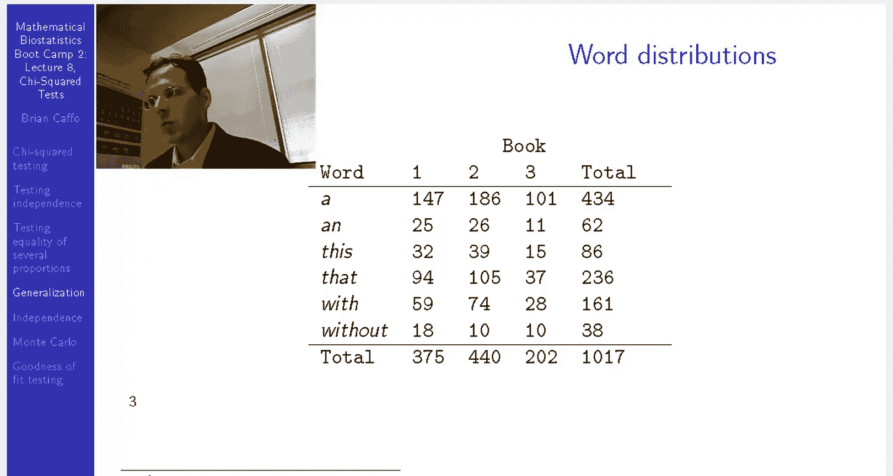
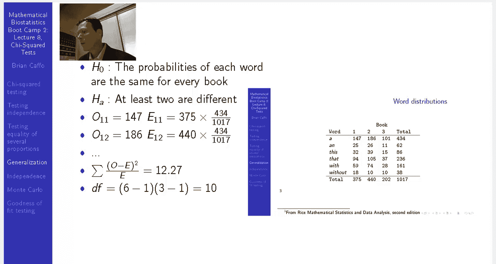
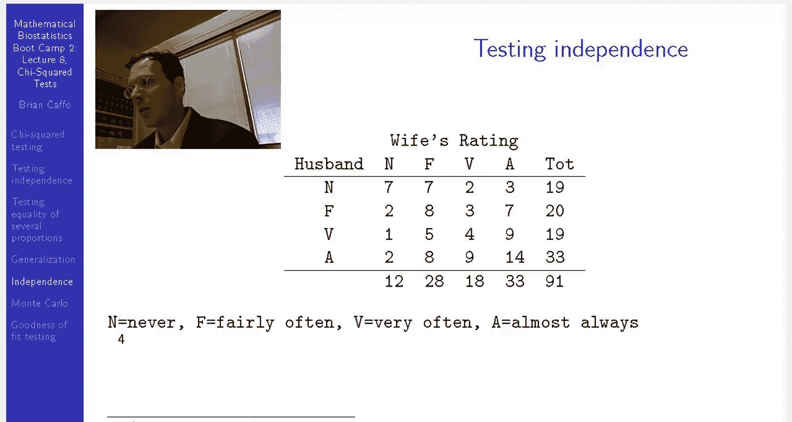
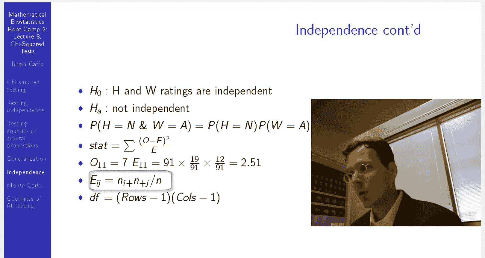
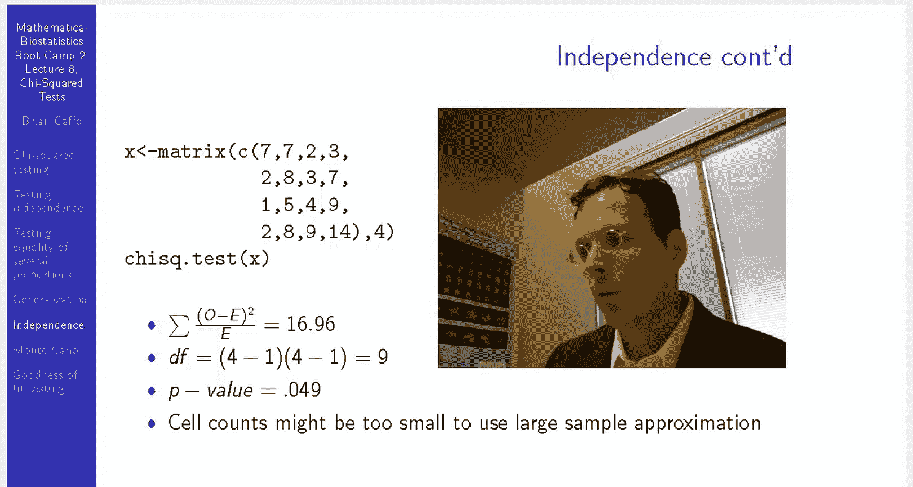
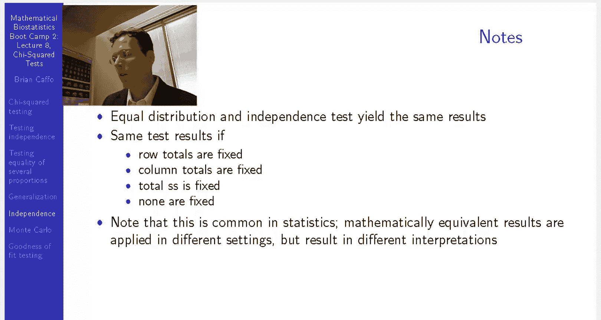
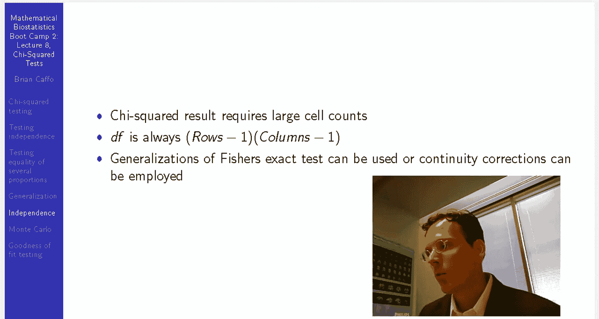
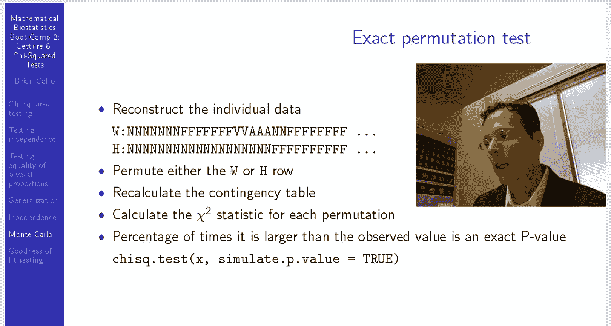

# 高级统计学：25：列联表分析进阶 🧮

在本节课中，我们将继续学习列联表的卡方检验，并通过几个具体例子来理解其应用、假设和计算方法。我们将看到，尽管不同实验设计的解释不同，但最终的检验统计量计算公式是统一的。最后，我们将介绍一种基于蒙特卡洛模拟的精确检验方法，它不依赖于大样本的渐近近似。

---

上一节我们介绍了卡方检验的基本思想，本节中我们来看看几个来自教科书的经典例子，以加深理解。

## 例一：文学作品作者鉴定 📚

这个例子来自Rice的著作《数理统计与数据分析》。书中有一个有趣的案例：研究者从几部小说中抽取了一些常用词。其中两部已知是简·奥斯汀的作品，第三部作品的作者身份存疑。研究者想通过检验这三本书中这些词的分布是否相同，来判断第三本书是否也出自简·奥斯汀之手。

我们的零假设 **H₀** 是：这些词在三本书中的分布相同。备择假设 **H₁** 是：至少有两本书的分布不同。

在这个问题中，每一列（每一本书）都可以看作一个多项分布。我们想要检验的是这些多项分布的概率向量在不同列之间是否相等。

如果书的身份无关紧要（即零假设成立），那么单词“A”在所有样本中出现的总比例应为 `434/1017`。因此，对于第一本书（样本量为375），我们期望看到单词“A”的次数为：
`E₁₁ = 375 * (434 / 1017)`
然后，我们将这个期望值 `E₁₁` 与观测值 `O₁₁ = 147` 进行比较。

以下是计算期望频数的通用步骤：
1.  计算每个单词在所有书中的总出现次数（行边际和）。
2.  计算每本书的总单词数（列边际和）。
3.  对于表中的每一个单元格 `(i, j)`，其期望频数为：
    `E_ij = (第i行的边际和) * (第j列的边际和) / (总样本量)`

按照此方法计算所有单元格，并代入卡方统计量公式：
`χ² = Σ (O_ij - E_ij)² / E_ij`
计算得到的统计量值为 **12.27**。

此检验的自由度为 `(行数 - 1) * (列数 - 1)`。在本例中，行数为6（单词种类），列数为3（书本数量），因此自由度为 `(6-1)*(3-1) = 10`。

**关于模型假设的思考**：我们需要考虑实验的抽样方式是否满足卡方检验的模型假设。例如，假设我们从每本书中随机抽取了大量单词中的一小部分常见词，那么将这个过程建模为多项分布是相对合理的。在进行任何统计检验时，我们都必须思考：检验的假设是否准确地反映了实验进行的方式？一个随意的P值只有在所使用的统计模型能有意义地反映现实时，其解释才有效。

---

在分析了文学作品后，我们来看一个行为科学中的例子，它展示了卡方检验在检验独立性方面的应用。

## 例二：夫妻性生活频率评价 👫

这个例子来自Agresti的著作。研究者调查了91对夫妻，分别询问丈夫和妻子对性生活频率的评价。评价等级分为：从不(N)、偶尔(F)、经常(V)、几乎总是(A)。然后将结果交叉制表。

一个很自然的首要问题是：丈夫的评价与妻子的评价是否相互独立？

我们的零假设 **H₀** 是：丈夫的评价（行变量）与妻子的评价（列变量）相互独立。备择假设 **H₁** 是：两者不独立。

在独立性的假设下，某个单元格（例如，丈夫评N且妻子评A）的概率等于丈夫评N的概率乘以妻子评A的概率。我们使用样本数据来估计这些边际概率。

以第一个单元格（N, N）为例：
*   丈夫评N的边际概率估计为 `19/91`。
*   妻子评N的边际概率估计为 `12/91`。
*   在独立性假设下，该单元格的期望概率为 `(19/91) * (12/91)`。
*   将其乘以总对数 `91`，得到期望频数：`E₁₁ = (19 * 12) / 91 ≈ 2.51`。
*   我们将此期望值 `2.51` 与观测值 `7` 进行比较。

以下是计算期望频数的通用公式，适用于所有单元格：
`E_ij = (第i行的边际和 * 第j列的边际和) / 总样本量n`

此检验的自由度同样为 `(行数 - 1) * (列数 - 1)`。

**一个重要的观察**：无论是前面检验分布同质性的例子，还是这里检验独立性的例子，尽管实验设计和原假设的解释不同，**计算期望频数的公式和最终卡方统计量的形式是完全相同的**。这就是为什么许多教科书直接给出这个通用公式。然而，在解释结果时，我们必须牢记实验设计（哪些边际和是固定的）所带来的不同含义。

---

我们注意到，上述卡方检验依赖于大样本的渐近近似。接下来，我们探讨一种不依赖于此的精确检验方法。

## 蒙特卡洛精确检验 🔁

卡方检验的渐近结果基于中心极限定理，当样本量较小时，近似效果可能不佳。传统的经验法则是检查期望频数是否足够大，但更可靠的方法是进行精确检验。

对于像夫妻评价这样的独立性检验，我们可以采用**置换检验**（一种蒙特卡洛模拟方法）来获得精确的P值。

**基本思想**：
1.  在零假设（独立性）下，丈夫和妻子的回答应该是没有关联的。这意味着，将妻子的回答顺序随机打乱，再与丈夫的回答重新配对，应该不会改变数据的本质结构。
2.  具体操作：我们保持丈夫的评价序列不变，随机置换妻子的评价序列，从而生成一组新的“虚拟夫妻”配对数据。
3.  根据这组新数据，重新计算列联表和卡方统计量。
4.  重复上述置换过程成千上万次，得到在零假设下卡方统计量的一个经验分布。
5.  计算原始观测数据的卡方统计量值，看看在这个经验分布中，有多少比例的模拟统计量值大于或等于观测值。这个比例就是**精确的P值**。

这种方法实际上是**费希尔精确检验**在大于2×2列联表上的推广。它的优点是：
*   不依赖于大样本假设，即使样本量很小也有效。
*   直观易懂：如果独立性成立，那么随机打乱配对不应该产生系统性的差异。

在R语言中，可以非常方便地执行此检验：
`chisq.test(x, simulate.p.value = TRUE)`
其中 `x` 是列联表数据。这条命令会自动进行蒙特卡洛模拟，并报告精确的P值。

---

本节课中我们一起学习了列联表卡方检验的深入应用。我们通过两个例子（作者鉴定和独立性检验）了解到，尽管研究问题和零假设的表述不同，但核心的检验统计量计算方式是统一的。我们强调了模型假设对结果解释的重要性。最后，我们介绍了基于蒙特卡洛模拟的精确检验方法，它通过置换数据来构建零分布，从而摆脱了对大样本渐近近似的依赖，为小样本分析提供了更可靠的推断工具。记住，选择合适的检验方法并理解其背后的假设，是得出正确科学结论的关键。