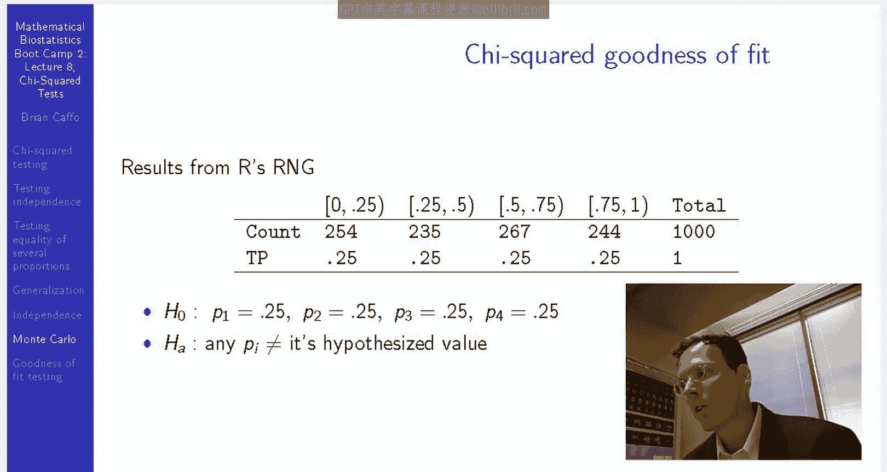
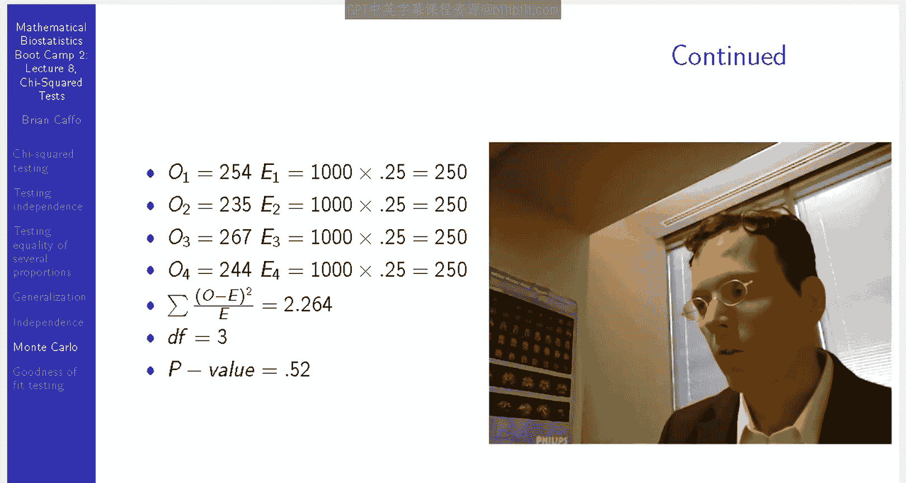
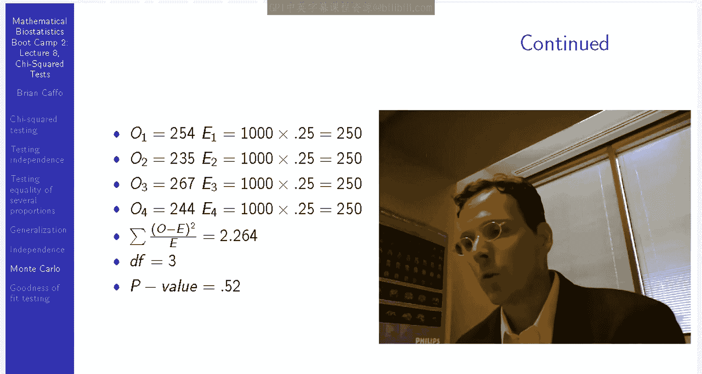
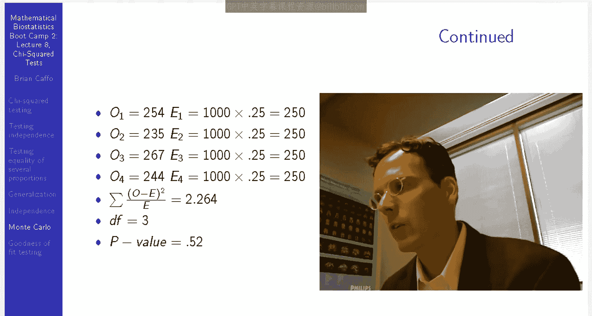
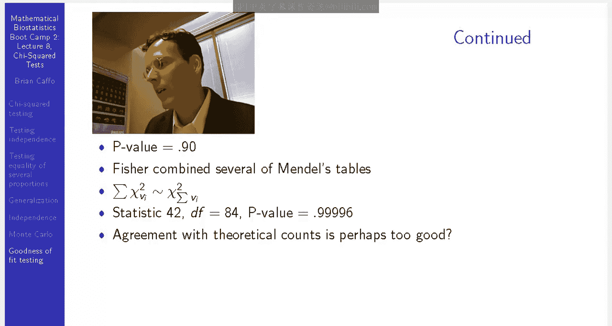
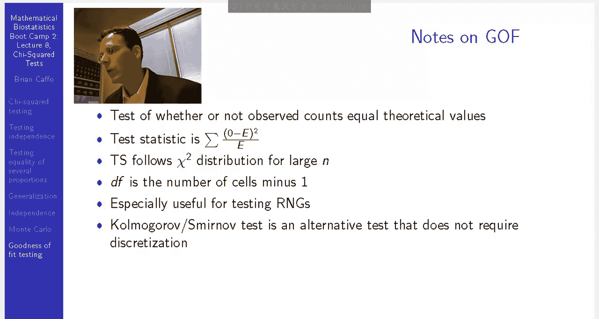

# 约翰霍普金斯大学《数据科学的高级统计｜Advanced Statistics for Data Science》中英字幕（deepseek p57 26_拟合优度检验.zh_en -BV1htPjeYEFH_p57-

Okay， so now let's switch gears and talk about goodness of fit testing。

Now this is the one instance I'm going to talk about where the degrees of freedom for the chi Guard is not。

Rs minus1 times columns minus1。Okay， so imagine if you wanted to test。

Ours uniformform random number generator so remember a uniform is a number that's continuous number between0 and1 where in essence kind of each every value is equally likely what that means on the continuum scale is that the density is a brick that starts at zero ends at one is height1 so R simulates uniform numbers and why don't we you know test it out to see using the chi squared distribution to see。

Whether or not we're getting kind of what we would expect。

 so I simulated  a thousand random uniforms。And how many uniforms would I expect to see between 0 and 。

25 between 0。25 and 0。5 between 0。5 and 。75 and 0。75 and 1， well because it's uniform。

 it says that about 25% of them should be。From there， because it's uniform。

 it says that 25% should be between 0。25 and 0。5 and so on。Okay。

 so what we could do is simulate these0， we have 254， 235， 267， 244。And we could calculate the the。

 you know， how many we would expect to see under the。嗯。

The true probability density function that or the assumed probability density function。

 So here our null hypothesis is that this first probability is exactly 0。25。

 the second probability is exactly 0。25。 the third probability is exactly 0。

25 and the fourth probability is exactly 0。25。And the alternative is that any。

One of these probabilities is different from its hypotheized value。Okay。

 and so that is that would be our test and that would be you know comparing the observed counts to the expected counts in this case would be you know a not unreasonable way to check ours random number generation。

Okay， so we observed 254 from the。Obser from the in reality when we simulated it。

 the expected would be 1，00 times 0。25， which is 250。

 and you can carry through the calculations they're all 250 in this case of course。

And so our observed minus expected squared over expected sum works out to be about 2。3。

This is three degrees of freedom the P values is 0。

52 now it shouldn't surprise you that we get a large P value in this case because we're checking whether our's uniform random number generator。

 which we know is probably a pretty good uniform random number generator whether or not it generates reasonably uniform numbers where we've broken the intervals up into four you know the test applies regardless of how we break up the intervals we have made some of them small some of them large and so on and there's maybe you know you could pick what's the most appropriate way to break up the intervals but either way this。

A。You know， the logic behind doing this goodness of fit testing applies I would note that the degrees of freedom is the。

iss the just the number of cells minus one and the reason in this case is because we don't。

 you know we're not estimating anything under the no hypothesis we're actually specifying。

The probabilities。 so we don't。啊。That's what changes the degrees of freedom。嗯。

So let me also comment a little bit about testing random number generators。

 you know if you were going to do this， know you would be concerned。

 you know you would want to generate thousands and thousands of variables you'd probably want very fine intervals that you were looking at and then the other thing is。

That。This is only testing one aspect of the random number generation。

 It's only testing the uniformity， how uniform on the range it is。

 But there's other aspects of randomness that that you would like to test。

 like whether or not you can detect whether。The next value is。

It's somehow related to the previous or something like that some sort of autocorrelation or runs behavior and those sorts of things are what people do to stress random number generators which by the way are actually perfectly deterministic。

 there is no randomness built into them， the computer isn't picking off the clock or something like that somehow generating randomness it's a deterministic sequence of numbers。

 they do those deterministic sequence of numbers in such a way that it's very hard to develop a statistical test that'll tell you it's not exactly uniform and IID。

There's a whole discipline to this， it's quite interesting。嗯。Let's see。

The other thing I would say about random number generator is I can't do this obviously in this class。

But if you were to ask students in a class to generate random uniforms or random integers。

 and you could of course， create a goodness of fit test to evaluate it。It's unbelievable how quickly。

You can determine that， you people aren't good at generating random numbers in the sense of being equally distributed。

 people can't distribute， you know， just ask a room full of people to write out digits between one and 10。

 collect them up and you will be able to diagnose immediately that that was not generated uniformly。

And IID from the digits1 to 10 it's an interesting experiment you might want to try it sometimes one of the easiest ways to do it is people don't give enough runs of specific numbers so that you know if you collect enough random digits。

 there should be one to10， there should be some instances of three consecutive sevens。

 but if you ask people to write out a bunch of random digits。

 they'll never write out three consecutive sevens for whatever the reason。

Just goes to show our intuition about what randomness is is not very accurate。

 we have to have the mathematics because our intuition is flawed anyway。

Let's move on to another example of。Goodness of fit testing。

Okay， here's a famous example of goodness of fit testing。So。In Mendel's pea plant experiment。

If you do out the punt square， you get under the what is called the law of Independent assortmentment。

 you should get about 75% of the yellow and 25% of the green plants。

And so here's the observed data 6022， 2001， total 8023， and here's the expected data。

How would you get the expected data well the true positive true positive the true probabilities。

 I hypothesize true probabilities let me put it to that way if the independent assortment laws were correct。

 you would get 0。75 and 0。25 so you're multiplying 0。75 times 8023 to get 601725， 0。

25 times 8023 to get 2005。75。Using the observed minus expected squared over expected statistic。

 you get a。A very small chii squared statistic。Continuing on to the next slide。Am。You know。

 this is a one degree of freedom test because it's you know， cells minus1， two minus1。

 one degree of freedom。The P value works out to be 0。90 in other words， the probabilities fit。

The expected observed cell counts fit the expected probabilities quite well。

At any rate there was an interesting kind of famous discussion that occurred over this is that the well-known statistician Fisher。

 combined several Mendel's tables， used the fact that sums of independent chi squared should be chi squared。

 he got with the degrees of freedom adding up that he got an associated P value of perhaps exactly almost exactly one。

 and his accusation was then that maybe the data fit the Mendel's hospital hypothesized probabilities too well that maybe something Fsy was going on。

 so anyway you can read about that it was kind of an interesting little study。

Okay， so for the final slide on。Goodness of fit testing。

 let's just summarize it test whether or not observed counts are。Consistent with theoretical values。

 theoretical hypothesized probabilities， the test statistic remains the same chi squared test statistic。

 it follows a chi squared distribution minus1， the degrees of freedom are the number of cells minus one。

嗯。This is especially useful for testing random number。Generators。I。You know。

 this is all for discrete。Discrete data we had to discretize the uniform distribution to use the chi square goodness of fit test there's a test called the Commorov smearnov test that's an alternative that doesn't require discretization you know it's often accused of having low power but you know it's。

Depends on what alternatives you're searching for and that sort of thing。

But it is another test for very well known test for goodness of fit testing。

So that today's lecture covers a lot of chiI scoress testing in nutshell and if you want to just remember a couple of things make sure you remember the observed。

 the minus expected squared over expected， some of those guys is the statistic you know。

 remember the way in which you got the expected cell counts using independence that applies regardless of the qua across all the settings that we considered today。

Remember that the degrees of freedom for the goodness of fit testing was a little bit different in the way in which you set up a goodness of fit test was a little bit different。

 but still uses the same observed minus expected squared over expected statistic okay？

And we'll see you next time。For the。Let's see， what is this， I think the last lecture in this module。

