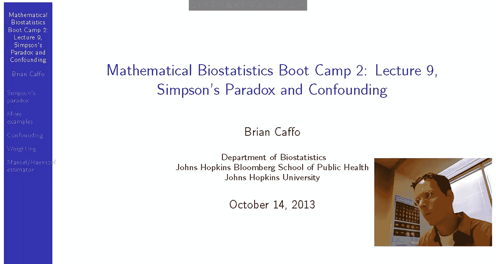
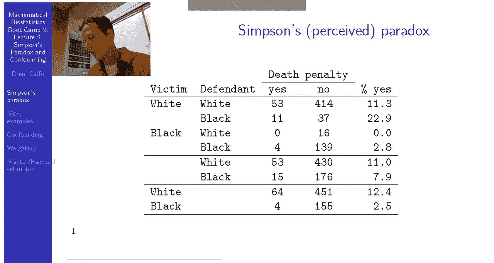
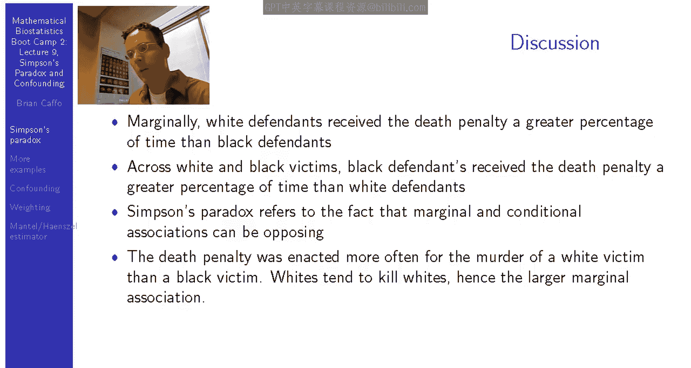

# 约翰霍普金斯大学《数据科学的高级统计｜Advanced Statistics for Data Science》中英字幕（deepseek p58 27_辛普森悖论.zh_en -BV1htPjeYEFH_p58-

Hi， my name is Brian Caho， and this is Mathe Biosstatistics boot Campamp 2。

 Le 9 on Simpson's Paradox and Confounding。

In this lecture we're going to talk about a phenomenon called Simpson's paradox I don't find it to be a paradox。

 but it's called Simpsons paradox， we'll talk about some examples like the Berkeley data of Simpsons paradox and then we'll talk about this related to the treatment of confounding and then I want to cover a particular way to handle confounding through weighted estimators and then talk a little bit about the Cochrane mantle handssel estimator。

Okay， so consider this data right here， which is taken from Aggressti's categorical data analysis book。

 I think I've mentioned this book in the past。So in this instance。

 there was a cross classification of defendants from criminal trials。

Where they crossclassified by the race of the victim， these are all murder trials。

 so the race of the victim versus the race of the dependent and then whether or not the person got the death penalty and here I present all of the possible cells plus all the possible marginals。

 so for example here you see the eight cells that classify victims race in here we only factoring in two race denominations white and black and death penalty so there's eight cells。

嗯。And then here I have the margin for the defendant white versus black summed over victim's race。

 and then here I have the victim white versus black summed over the defendant's race okay。

 so let's actually investigate this so we're looking at the percentage of people that got the death penalty so if you look。

White defendants received the death penalty， a fewer percentage of the time， 11 to 22%。For both。

White victims and black victims，0 of the。Of the white defendants。Receive the death penalty。

For the black victims versus 2。8%， okay？But then something kind of paradoxical occurs if you disregard the race of the victim。

It actually comes out that white defendants receive the death penalty。

 a greater percentage of the time， 11% to 8%。Okay。And then if you look at the race of the victim。

Disregarding the race of the defendant， actually in the instance where the victim was white。

 the defendant received the death penalty， a higher percentage of the time 12% to 2。5%。

 but let's forget this lasts to race of the victim marginal and let's just compare the table itself in which case in both cases。

 the white defendants got the death penalty， a smaller percentage of the time than the black defendants。

 regardless of the race of the victim versus the marginal here。

 11 to 8% where the white defendants got the death penalty a greater percentage of time than the black defendants So what's happening if you were asked to you know this was related to a court case about whether or not the death penalty was being equally applied。

And so what would you conclude the if you condition on the race of the victim。

 you get a totally different， the opposite answer than if you look at the race of the defendant disregarding the race of the victim。

 so what is the right answer？

So let's just discuss a little bit about what's going on so marginally white defendants receive the death penalty a greater percentage of time than black defendants across white and black victims。

 black defendants received the death penalty a greater percentage of time than white defendants and Simpson's paradox refers to the fact that marginal conditional associations can be opposing in this case if you。

Take the margin across victims's race， you get a different answer than if you condition on victims's race。

HereSo here the death penalty was enacted more often for the murder of a white victim than of a black victim。

 and then whites tend to kill whites， just demographically hence the larger marginal association。

And I want to you know kind of do a little bit of a commentary before I go through more of examples so I'm going to cover several examples。

 first of all， when you state Simpson's paradox in the following it doesn't seem that paradoxal at all and the paradox is。

The apparent relationship between two variables can change when factoring in a third variable and then that seems obvious。

 of course that's true。 it just seems difficult when you start to get mired in the specifics and later on I'll go through the math to say that there's nothing paradoxical about the mathematics of Simpson's paradox。

And Larry Wassterman on his blog， The Normal D has the most wonderful discussion of why Simpson's paradox is。

嗯。Difficult and what the mistake people are making and the mistake people are making is they're equating the statements。

 the causal statements。With the probabilistic statements and the probabilistic statements can be misleading and paradoxical and you're trying to make。

You know， difficult conclusions in the light of noisy evidence。So in addition。

 even if you knew the exact probabilities， the probabilities themselves can exhibit the paradox。

 however， the causal statements cannot exhibit a paradox。Okay， so the problem。

 I think his his statement is that the the real confusion is equating the cause in this case。

 if you were the cause would be， you would say that。嗯。For example。

 juries tend to convict causally convict black defendants more often than they convict white defendants。

 if you were to make that causal statement then it is impossible for marginal and conditional associated conditional causal statements to disagree。

And so， you know， the real details of this， you know I'll put up the link to his blog post。

 which is wonderful， but the real details of investigating the causal statements is beyond the scope of this class。

 we're not going to cover causal inference in this class but。

But I think it was a great discussion on his part to basically show or demonstrate that it is this conflation of cause with describing probabilities and associations that is the apparent paradox。

 but mathematically there is no paradox and I think when we go through it you'll see。

