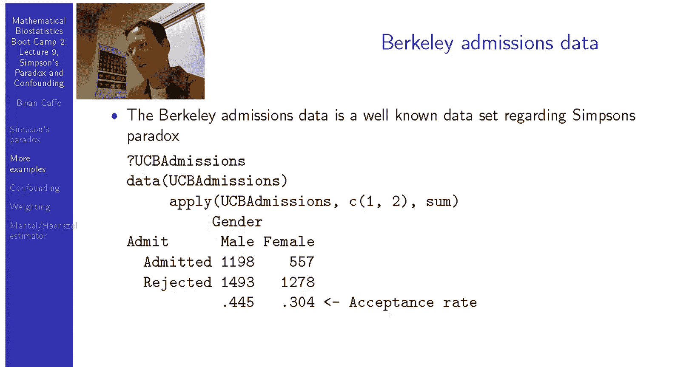
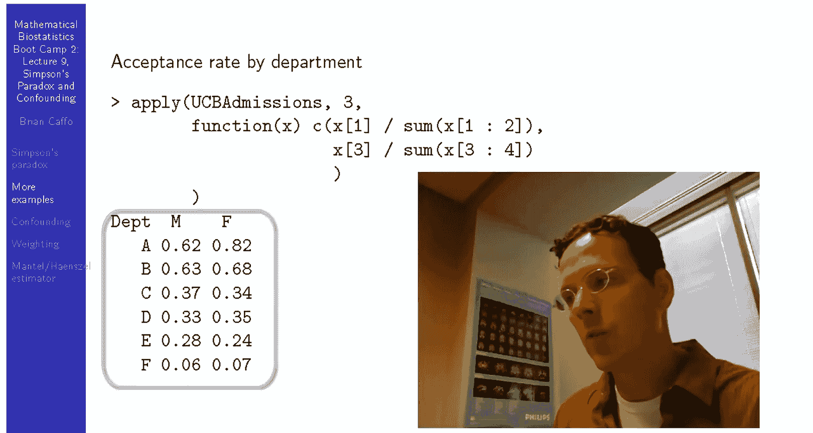
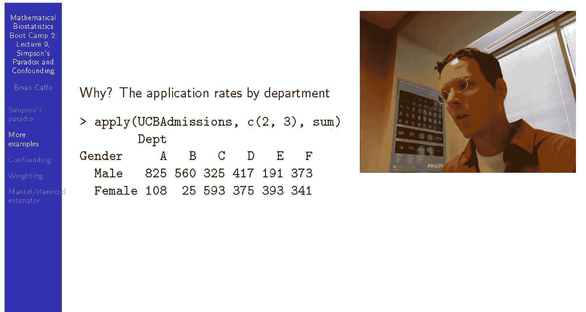
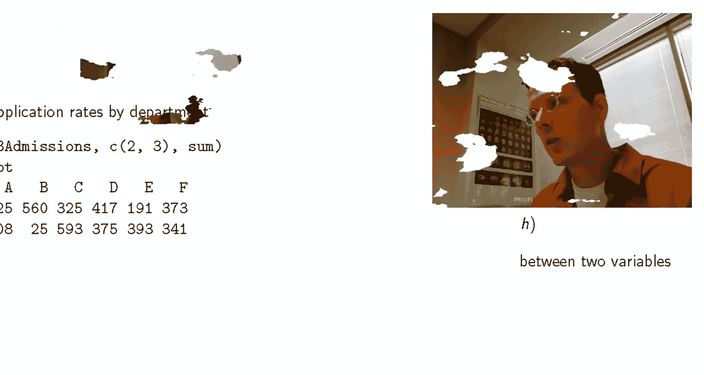
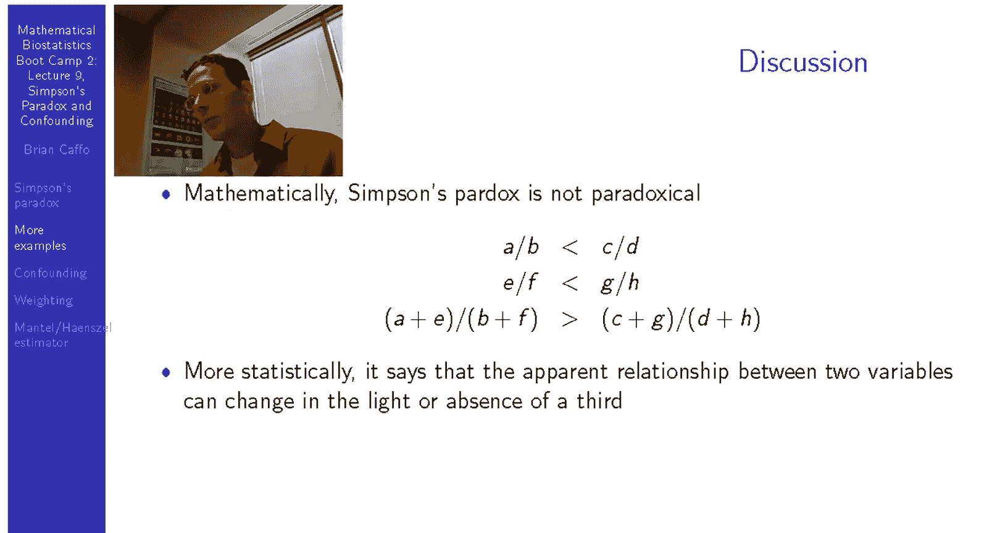

# 约翰霍普金斯大学《数据科学的高级统计｜Advanced Statistics for Data Science》中英字幕（deepseek p59 28_辛普森悖论：更多案例.zh_en -BV1htPjeYEFH_p59-

So here's another example that was on Wikipedia which is a wonderful example。

 it's kind of a famous example in this area just to describe the numbers how this numerically can happen。

 so in American baseball， a batting average， so if you've never seen or heard of baseball。

 you know baseball is a game where a player look it up a player goes up with a bat and the pitcher throws the ball really hard it's really。

 really quite difficult to hit a baseball， especially in the professional leagues。

And throw the ball 100 miles an hour。 So the player swings the bat and tries to hit the ball。

 The percentage of basically not exactly， but the percentage of time that the player hits the ball is going to be their socalled batting average right and really good players can do this。

 let's say 30% of the time。 you know， excellent players， but most players are worse than that。

 Okay so here's two players in their batting average。

 So player  one had 10 at bats in the first half of the season and got four hits。

 Play2 had 100 at bats and got 35 hits。 So the player one's batting average was 40% player two's batting average was 35%。

The second half of the season， player one got 25 hits out of 125% batting average。

 the second half of the season player2 got two out of 10 hits， 20% batting average。

 so in both the first half and the second half of the season。

 player one had a better batting average than player two。Right， however。

 if you just add up these numbers，29 hits out of 110 at bats for the whole season for player 1 and 37 at bats for 110 for the whole season for player 2。

 you get 26% for player 1 and 34% for player 2， So player 2 has a better batting average。

 So it seems paradoxical that a person can have a better batting average for both the first half and the second half of the season but have a worse batting average overall。

 but， of course， the numbers work out， right， you see it。 The numbers actually work out。嗯。

And so you know， I put in consider the number of at bats here because that's coming into play that the player ones had this very good batting average when they had relatively few at bats and a modest batting average when they had。

Lots of that bats and vice versa for the other players， so that's I think。

 really the culprit in this case。Okay， and another very famous example of。

The famous example of Simpsons Paradox is the So-called Berkeley Ads data。

 and it's fine and it's an R， so I'll cover it a little bit and you can explore it because you can to get it。

 you can just do help UC UCB admissions。And then that'll describe the data set data UCB admissions will load it up and then here I give a little command apply UCB admissions C12 sum gets the the appropriate marginal so here we looked at。

Whether or not so for admission versus rejected by gender， and we get that males。

 the acceptance rate was higher for males than it was for females disregarding anything。

Everything else。Okay， but I give another command here and then it shows the now the admissions rate。

 I'm not showing the counts because the table is getting a little bit unwieldy。

So I'm showing the admission rates by department， department A， B， C， D， E F。

 and E and F and then what you can see among you know for department A。

 males got admitted fewer percentage of time， department B。

 males got admitted fewer percentage of time department C males got you know and got admitted a slightly larger percentage lower for D slightly larger for E and lower for F so clearly the。

Admissions。Gender imbalance in the admissions is dependent on whether you're conditioning。

 the evidence of gender imbalance and admissions is dependent on whether or not you're conditioning。

On department。And there's different application rates and you can explore this yourself。

 there's different application rates by gender for each of the departments。

And so look here， in fact， I you don't even have to exploit yourself。

 I apparently have it on here on the next slide， so gender， male， female， by department。

And you can any rate， you can explore this a little bit more。Because the data is just in R。

 I don't think you have to have any other packages installed。

 you can just do data UCPA admissions and play around with it。

So let me。So let me talk a little bit about you know what in the world is going on here because it's always it's confusing。

 it seems confusing you know to me there's a couple things that help me understand Simpson's paradox。

 First thing is the math there's no problem with the math right if you're saying that you know A over B is less than C over D and E over F is less than G over H。

 but if you can find integers that satisfy the following equations。

You know where B has to be greater than A and F has to be greater than E and so on。

 but if you can find integers that satisfy these equations。

 then you found an example of Simpson's paradox， you just have to put the context around it。

But it doesn't seem at all paradoxical when you state it as a couple of relationships between integers。

This way。嗯。Right， then it just doesn't seem very paradoxical anymore。

's it's the context that adds the paradox and。And you know just from a statistical standpoint。

 it says the apparent relationship between two variables can change in the lighter absence of a third。

 which again doesn't sound that paradoxical， It's only when we conflate the probabilistic statements and the evidence associated with the probabilistic statements visa V the data with the causal statements right。

 so the problem is we're going to try and get at the cause their truth。

By virtue of the probabilistic statements in the associations obtained from the data。

 but that's a quite hard thing。know the question in all these cases is what's the right answer。

 what should you condition on or should you not condition？And that's a hard problem。

 we're not going to really cover that in this class。To me。

 the real answer of this is that it's quite hard。To exactly figure out when you've conditioned enough。

Right。And in some cases， no conditioning is exactly the right answer and in some cases conditioning is exactly the right answer to really handle this formally。

 you've got to do something called causal inference basically。And。That。

That is really the discipline that's really the subdisp of statistics that is really entirely designed towards addressing this question in a formal manner。

In the meantime， but I guess let me say this in the meantime。

 what can you do and the idea is to not decouple the statistics from the scientific discussion。So。

In the case of the death penalty， you know， you would want to。You know， have a discussion about。

Hypotheses for the causal mechanisms between the various associations doesn't make sense to be conditioning on the race of the victim and the Berkeley admissions data you'd want to talk about well are there very different acceptance rates by departments and then are there different application rates by gender to each department and you know does the fact that say。

You know are women applying to departments that are harder to get into that would explain the marginal association quite well and is that really the driver and that's a discussion kind of in a sense。

 a discussion that's informed by the statistical but extra statistical and at this point。

 I think it is this kind of interplay between the data in a scientific discussion is the best solution I can offer to you for dealing with confounding when you take further statistical courses you can learn some of the formal mechanisms for trying to account for confounding but suffice it to say it's one of the harder issues and statistics knowing how to balance the overadjustment with under adjustmentjustment in terms of confounding is one of the central problems in observational data analysis and it's what makes observational data analysis so hard compared to say。

 for example， where you randomize treatment or something like that。

