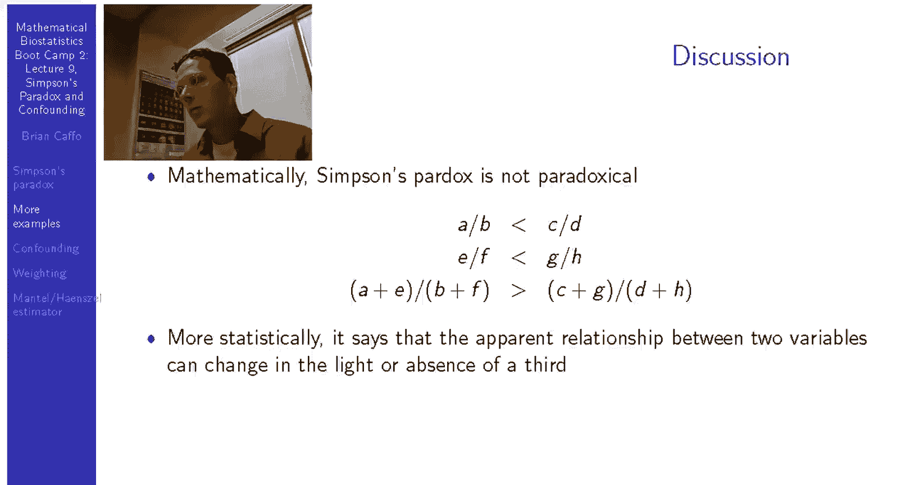
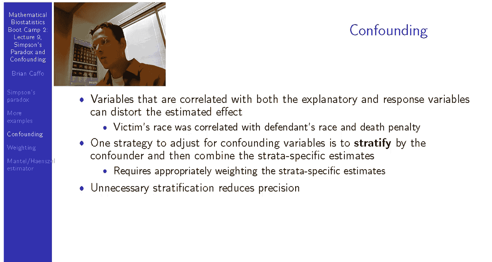
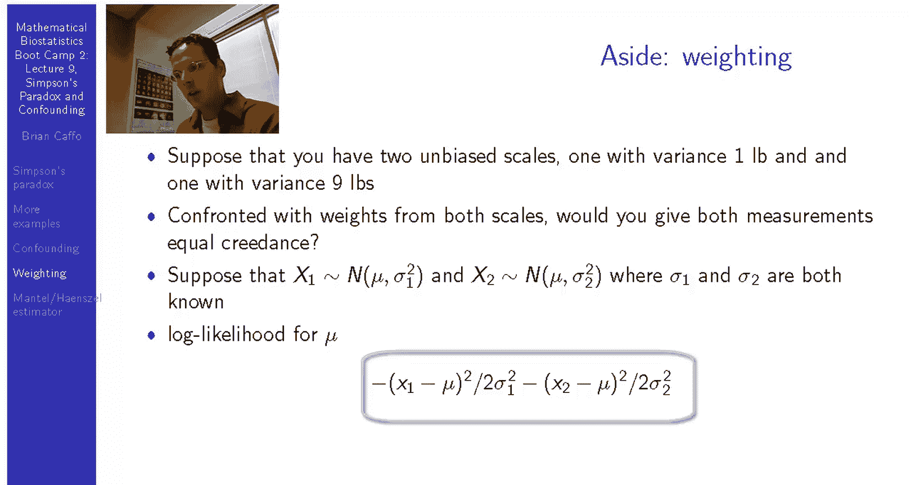
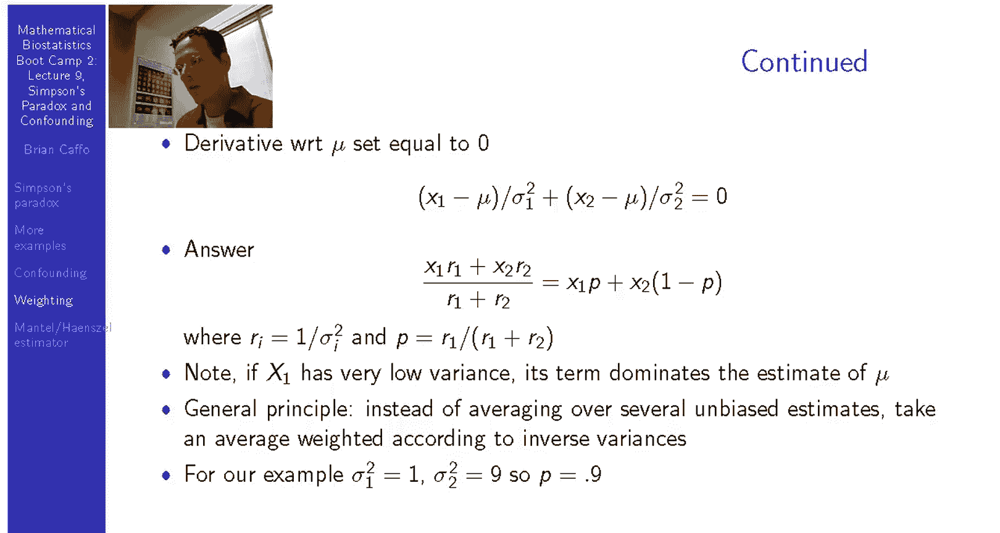

# 约翰霍普金斯大学《数据科学的高级统计｜Advanced Statistics for Data Science》中英字幕（deepseek p60 29_加权法.zh_en -BV1htPjeYEFH_p60-

So I've been using the word confounder a lot and confounding， so let me define it。

So variables that are correlated both with the explanatory and response variables are confounders and they can distort an effect an estimated effect。

So in this case， victim's race was correlated with both the defendant's race and whether or not the death penalty was executed。

嗯。And。This is this is I think， a kind of old school definition of confounding there's a modern definition given by causal inference that causal inference classes that I think you。

You might be if you're interested in the field of statistics will be worth learning。

I think ultimately with with a confounder here， we haven't really distinguished between something that's causally related with the race and the death penalty versus something that has a statistical association with race and death penalty in this class we're mostly going to be talking about things that have a statistical association with the explanatory and response variables where there is kind of a plausible。

Causal connection between them。Okay。You know， again。

 putting aside the rather difficult and lengthy discussion of what is a confounder。

 how do we select our confounders， this you how do we you know that discussion putting it to the side。

 let's assume we have a single confounder， how do we adjust for it。know there's several ways。

 regression is probably the biggest and most common way to adjust for confounders。

 but kind of an old school way in categorical data analysis is to stratified by the confounder and then combine the straight of specific estimates。

And so this requires appropriate weighting of the straighter specific estimates and we'll talk in a minute about how do you do the appropriate weighting and unnecessary stratification has its own set of problems so you know again。

 you know just bringing back this discussion。The solution to the confounding problem is not just to stratify or adjust for everything in sight。

 right that's not the solution because that has its own host of consequences。Ban。For example。

 in any of these Simpsons paradox。Examples， imagine you had a giant database and you were interested in say the death penalty and then you had a giant database with lots of other variables for sure you could find one variable that reverses the association。

 but has no bearing on。Whether or not a person received the death penalty right。

 so so adjusting that for that confounder will reverse the association。

 but has no no business being adjusted for。 And so it's a hard topic you know。

 admittedly it's a hard topic of selecting confounders and achieving balance between the right amount of confounder adjustment and the。

With overadjustment balancing between that and over adjustmentjustment。

 so let's stipulate for the time being we have a confounder we want to adjust for it and what I really want to talk about is the method of stratifying and then combining straightit as specific estimates and because then we'll be able to teach you some nice methodology and then as you take more statistics courses you'll learn more about the delicate surgery of dealing with statistical confounding。

Okay， so here I have an aside， but it's an important aside。

 supposeupp you have two scales and what I mean by scales I mean things for weighing。Objects。

And let's assume both the scales are so called unbiased。

 they both have some variance associated with。weigh the same thing over and over again you get different answers。

 but one has a variance of one pound and the other has a variance of9 pound。 they're both unbiased。

So confronted with weights from both scales， would you give both measurements equal credence。

 so let's us suppose we weight an object。And that our first weight was this variable x1。

 and we're assume that it's normal mu in the variance of the first scale sigma 1 squared。And then x2。

 because both scales are unbiased， we're going to assume that it's normal and it has the same population mean mu and the same a different variance。

 sigma 2 squared。WhereAnd let's assume both Sigma 1 and Sigma 2 are known。

 we want to estimate mu this unknown weight of the object。Okay。

 so we measured it with one scale with one precision， another scale with another precision。

 we're assuming both scales are unbiased in that if we measured the same object over and over and over again。

 the average would be about right。So if if we characterize this in this way。

 I'm hoping what everyone can do in the class is set up the likelihood， multiply the two。

Add the two log likelihood or multiply the two log likelihoods and take the log。嗯。

And then come up with the fact that the log likelihood from mu disregard any terms that don't involve mu。

 and I'm hoping everyone can come up with the fact that the log likelihood for mu looks like this bottom equation right here。

Okay。And you you can let's solve for a maximum likelihood estimate。

 so the easiest way to do that right now would be to take the derivatives set the derivative equal to0。

 and you get this answer x1 times r1 plus x2 times r2 divided by r1 plus r2， or in other words。

 x times p plus x2 times 1 minus p where p is r1 over r1 plus r2 and1 minus p is r2 over r1 plus r2。

And then in this case， RI is 1 over sigma squared sub I， and then p is， of course。

1 over R1 divided by R1 plus r2。So why does this make sense， this makes a lot of sense to me now。

 but the first time you see it， you might say this makes no sense。

 but let me describe why this makes a ton of sense。Okay， so notice what each RI is。

 it's one over the variance， so if let's say Sigma1 is huge in other words。That scale stinks。

 it has this huge variance， then the weight R1 times x1。

 the weight given to the measurement from that scale is very low。And then conversely。

 if Sigma 2 is very small。Then I get R1， which is1 over sigma squared。

 will be a huge number and then x2 is given a gigantic weight。

 and then we divide by R1 plus r2 so that when we weight these two things， x1 and x2。

 we get a convex combination， p times x1 plus1 minus p times x2 so that it's an average。

 it's just a weighted average。ok。And by the way， you can do this always if you want to take a generalized form of average right。

 you know， and you want R1 is the weight for x1 and R2 is the weight for x2。

 they have to be positive， of course。And you want to turn it into an average。

 then just divide the whole thing by r1 plus r2 and then you'll turn it into p times 1 and1 minus p times the other if r1 equals r2。

 there'll be the strict arithmetic average of the two numbers。

 if R1s different from R2 it'll weight one of the observations more than the other well the answer in this case is that we want to weight by the inverse of the variance giving high variance measurements。

 low weight and low variance measurements high weight， which to me then makes a ton of sense。Okay。

 so anyway， the general principle， instead of averaging over several unbiased estimates。

 take an average weighted according to the inverse of the variances。 and this is so。

Ingrained in statistical practice now that people do it without thinking。

 they don't go through this exercise of deriving maximum likelihood equations。So in our case。

 sigma1 squared was9 was one1， sigma 2 squared was 9。

 so in this case you can work it out P works out to be 0。9， so it works out to be 0。

9 times the first measurement plus 0。1 times the second measurement。

 the first measurement getting a lot more weight because the scale you you has one ninth the variance of the other one。

