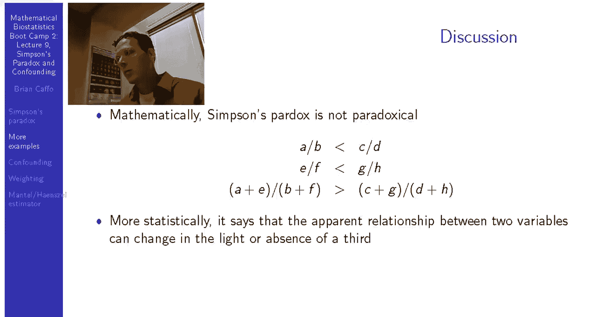
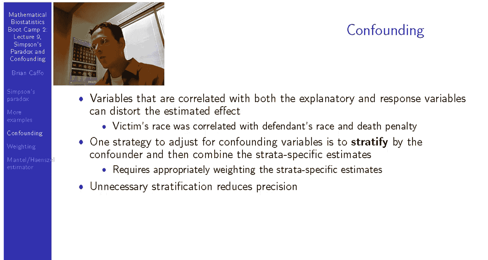
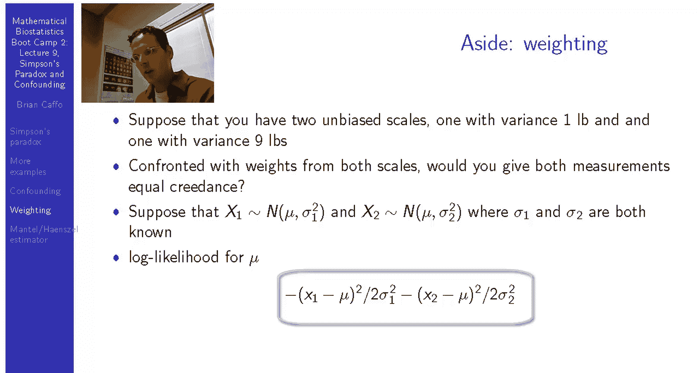
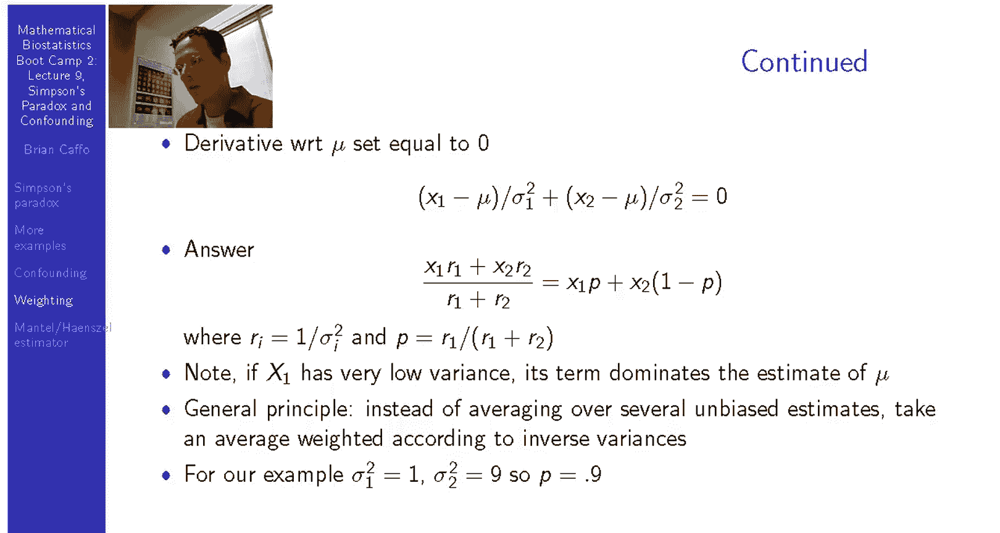

# 高级统计学：第29讲：加权法

## 概述

在本节课中，我们将学习如何处理混杂变量。我们将首先定义什么是混杂变量，然后介绍一种经典的调整方法：分层后合并估计值。这种方法的核心在于如何为不同层（或组）的估计值分配合适的权重。我们将通过一个简单的称重例子，直观地理解加权平均的原理，并推导出最优权重的公式。

---

## 混杂变量的定义

我频繁使用了“混杂变量”和“混杂”这两个词，现在让我来定义它们。

与解释变量和响应变量都相关的变量被称为混杂变量。它们会扭曲对效应（例如，估计的效应）的评估。

在本例中，受害者的种族与被告的种族以及是否执行死刑都相关。

我认为这是一种较为传统的混杂变量定义。在因果推断领域，有更现代的定义。如果你对统计学领域感兴趣，学习这些定义会很有价值。

最终，对于这里的混杂变量，我们并未严格区分与种族和死刑存在因果关系的变量，还是仅存在统计关联的变量。在本课程中，我们主要讨论与解释变量和响应变量存在统计关联，且它们之间可能存在合理因果联系的变量。

好的，再次说明，我们暂时搁置关于“什么是混杂变量”以及“如何选择混杂变量”这些复杂而冗长的讨论。

---

## 调整混杂变量的方法

假设我们有一个单一的混杂变量，我们如何对其进行调整？

调整混杂变量有几种方法。回归分析可能是最常见、最主要的方法。但在分类数据分析中，一种较为传统的方法是：先按混杂变量进行分层，然后合并各层特定的估计值。

这需要对各层特定的估计值进行适当的加权。我们稍后将讨论如何进行适当的加权。不必要的分层会带来一系列问题。因此，再次强调，解决混杂问题的方法不仅仅是盲目地对所有变量进行分层或调整，因为那会带来其他后果。

例如，在任何辛普森悖论的例子中，假设你有一个庞大的数据库，你关注死刑问题，并且数据库中包含许多其他变量。你几乎总能找到一个变量，它能逆转关联方向，但实际上与一个人是否被判死刑毫无关系。因此，调整这个变量会逆转关联，但它本身并不应该被调整。

所以，选择混杂变量并在“调整不足”与“过度调整”之间取得平衡，是一个困难的课题。我们承认这一点。

---

## 本节重点：分层与合并

目前，我们暂且假设我们有一个混杂变量需要调整。我真正想讨论的是：先分层，然后合并各层特定估计值的方法。因为这样我们可以教你一些很好的方法论。随着你学习更多的统计课程，你将更深入地学习处理统计混杂的精细技巧。

上一节我们介绍了调整混杂变量的背景和挑战，本节中我们来看看一种具体的调整方法：加权合并。

---

## 一个重要的旁注：加权平均的原理

这里有一个重要的旁注。假设你有两个秤（我指的是称重用的工具）。假设两个秤都是无偏的，但它们都有一定的方差（即反复称量同一物体会得到不同的结果）。一个秤的方差是1磅，另一个的方差是9磅。它们都是无偏的。

面对来自两个秤的称重结果，你会给予它们同等的信任吗？

假设我们称量一个物体。第一次称量得到变量 `x1`，我们假设它服从正态分布 `N(μ, σ1²)`。然后得到 `x2`，因为两个秤都是无偏的，我们假设它服从正态分布 `N(μ, σ2²)`，具有相同的总体均值 `μ`，但方差不同。

我们假设 `σ1` 和 `σ2` 都是已知的。我们想要估计这个物体的未知重量 `μ`。

我们用一个具有一定精度的秤测量了一次，用另一个具有不同精度的秤又测量了一次。我们假设如果反复多次称量同一物体，两个秤的平均值都会是正确的。

如果我们这样描述，我希望班上的每个人都能建立似然函数，将两个似然相乘（或将两个对数似然相加），然后取对数。

然后得出关于 `μ` 的对数似然（忽略任何不涉及 `μ` 的项）。我希望每个人都能得出，`μ` 的对数似然看起来像下面这个方程：

`log L(μ) ∝ - (x1 - μ)²/(2σ1²) - (x2 - μ)²/(2σ2²)`

我们可以求解最大似然估计。最简单的方法是求导并令导数等于0。

你会得到这个答案：`(x1 * r1 + x2 * r2) / (r1 + r2)`。换句话说，就是 `x1 * p + x2 * (1 - p)`，其中 `p = r1 / (r1 + r2)`，`1 - p = r2 / (r1 + r2)`。

在这个例子中，`r_i = 1 / σ_i²`，那么 `p` 当然是 `(1/σ1²) / (1/σ1² + 1/σ2²)`。

为什么这有道理？现在我觉得这非常有道理，但第一次看到时，你可能会觉得这毫无道理。让我解释为什么这非常有道理。

注意每个 `r_i` 是什么：它是方差的倒数。所以，假设 `σ1` 非常大，换句话说，那个秤很差劲，方差很大，那么赋予那个秤测量值 `x1` 的权重 `r1` 就会非常低。相反，如果 `σ2` 非常小，那么 `r2`（即 `1/σ2²`）将是一个巨大的数字，`x2` 就会被赋予极大的权重。

然后我们除以 `r1 + r2`，这样当我们加权 `x1` 和 `x2` 时，我们得到一个凸组合：`p * x1 + (1-p) * x2`，所以它是一个平均值，只是一个加权平均值。

顺便说一下，你总是可以这样做。如果你想取一种广义形式的平均值，`r1` 是 `x1` 的权重，`r2` 是 `x2` 的权重（当然它们必须是正数）。如果你想把它变成一个平均值，只需将整个式子除以 `r1 + r2`，那么它就变成了 `p` 乘以一个数加上 `(1-p)` 乘以另一个数。如果 `r1` 等于 `r2`，那就是两个数的严格算术平均。如果 `r1` 不同于 `r2`，它会给其中一个观测值更多的权重。

在这个例子中，答案是：我们希望根据方差的倒数进行加权，给予高方差测量值低权重，给予低方差测量值高权重。这对我来说非常有道理。

总之，一般原则是：对几个无偏估计值进行平均时，不要简单平均，而是根据方差的倒数进行加权平均。这个原则在统计实践中已经根深蒂固，以至于人们现在不假思索地使用它，而无需经历推导最大似然方程的过程。

在我们的例子中，`σ1² = 1`，`σ2² = 9`。在这种情况下，你可以算出 `p = 0.9`。所以结果是 `0.9 * 第一次测量值 + 0.1 * 第二次测量值`。第一次测量值获得了更多的权重，因为那个秤的方差是另一个的九分之一。

---

## 总结

本节课中，我们一起学习了：
1.  **混杂变量**的定义：与解释变量和响应变量都相关，并能扭曲效应估计的变量。
2.  调整混杂变量的一种经典方法：**分层后合并估计值**。
3.  合并各层估计值的核心在于**加权平均**。我们通过一个称重的例子，推导出最优的加权方式是**根据方差的倒数进行加权**（`权重 = 1 / 方差`）。这确保了更精确（方差更小）的估计值在最终合并结果中获得更高的权重。

这种方法为后续学习更复杂的混杂调整技术（如回归分析）奠定了重要的基础。理解加权原理有助于我们更深刻地把握统计调整的本质。