# 约翰霍普金斯大学《数据科学的高级统计｜Advanced Statistics for Data Science》中英字幕（deepseek p61 30_CMH检验.zh_en -BV1htPjeYEFH_p61-

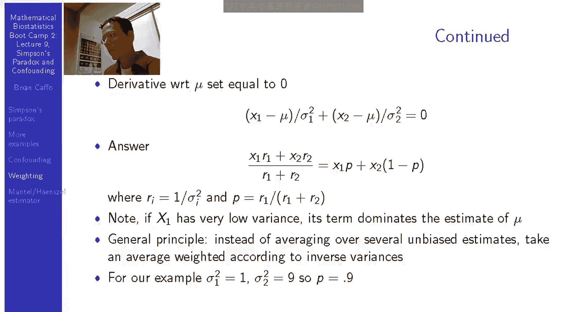

So there's a great example of this。Imagine just going back。To our death penalty example。

And here we had two， two by two tables， we had the defendants race。

And whether or not they got the death penalty。 And then we stratified that by a third variable victim's race。

 So let me let N Ij K be the I J K entry of table K。 So in this case。

 Ks 1 to2 K equal1 was be the first victim's race， Kl2 is be the second victim's race。

 and then I and J would index defendants race and whether or not the person got the death penalty。

 So in our first example， we had two，2 by tables stacked run on top of the other K indexes the first K equal1 index。

 the first one K equal2 index the second one。 and then N Ij。

Indexed the individual elements of that two by two table。So then the case odds ratio。

 the case sample odds ratio， so remember the odds ratio was the cross product。Ratio。

 so the main diagonal divided by the off diagonal， So n11 times n22 divided by n12 times n21。

 So in this case， everything indexed by K referencing the K table。

 So the K sample odds ratio is sigma hat sub K。Then the mantle hands estimator is exactly our weighted。

Average of these straightta specific estimates， it's summation weight R times theta hats sub k divided by the sum of the as。

 and by the way， you know， you know， when we had two， when we had two。

 it was R1 times x1 plus r2 times x2 divided by R1 plus R2。 But if we had three。

 it would be R1 times x1 plus r2 times x2 plus R3 times x3 divided by the sum of the R's。

 if we had4 the same thing。 anyway， this is the mantle hands estimate。

 this is the sum of the weights。Times the straightest specific odds ratios Theta hats O K divided by the sum of the weight。

 So we just get a weighted average， a sial。Convex combination。

Of the straightest specific odds ratios。And then what are the weights， Well， okay。

 so the weights in this case are this little formula right here。

 and I'll describe where they come from， but the。嗯。

The motivation for the weights is that they're inverse variances that's 100% the motivation for the weights。

 they're inverse variances from a hypergemetric distribution so you can just think of we're exactly doing the same thing we did with the scales only now in terms of the odds ratio and then this simplifies the socalled mantle handssel estimator。

 here's the formula right here I would suggest that you look in Agressti's book page 235 and the version I was looking at。

 but you can look it up the versions probably changed Rosner's book which is very comprehensive page 656 they give the standard errors it's a long formula I'm sure you can find it on the Internet as well。

 This is the so-called mantle handssel estimator named after the two great epidemiologist mantle and Hansel。

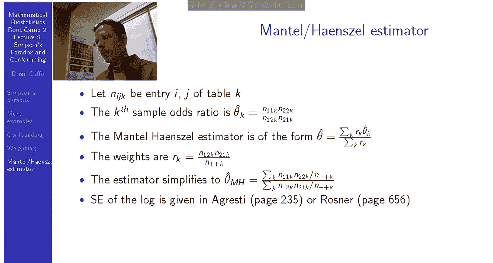

Okay， so here's an example。And here's a great example of this mantle hands estimator so here we had an active drug T and C being a placebo control I guess。

 and then we here we had success versus failure and I'm going to abstract what the specifics were of the experiment and then what people were concerned about was whatever policies and practices existed at the various centers in which the data were collected so they stratified by center12。

3，4，567， eight centers so they got eight odds ratios right and they were worried that the center was afound there's several reasons actually you might want to do the mantle hands estimator in this case but let's talk about it in terms of confounding first so imagine if you thought that the center was specifically associated with the treatment application。

 some centers tended to apply the treatment more than others and that the center was associated with the success of the treatment because of different policy。

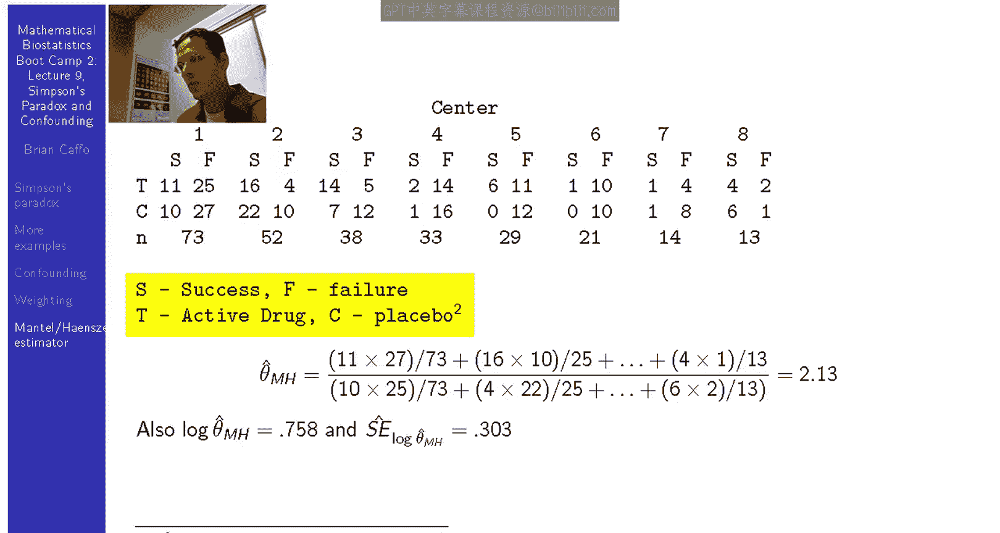

associated with the center and how the treatment was delivered or something like that。

 then you would want to adjust for the center as a potential confounder and then here you would you know and we're going to adjust for this confounder by stratifying by center。

 getting an odds ratio specific to every center and then averaging over the odds ratio but factoring in the inverse variance of the odds ratio。

 some centers have more patients right this one at 73 this one at 14 so we want to wait the one with stay 73 more than the one with 14 because they have a better。

 more precise odds ratio。And so that's what the mantle Handel does。And so you get this。

 you get a nods ratio of 2。13。

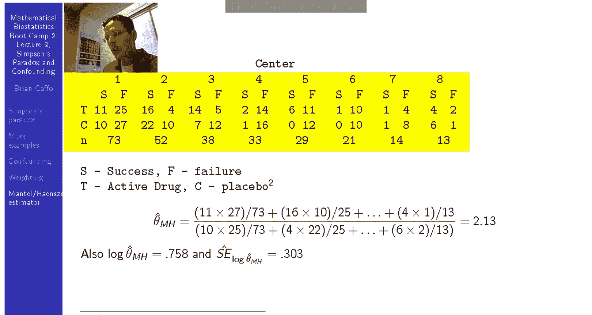

The log odds ratio is 0。758 and the standard error because of the standard error calculation it uses a delta method type argument。

 standard error of the log odds ratio works out to be 0。303， you would take 0。

758 add and subtract say two standard errors and expedentiateiate the endpoints to get a confidence interval row of the odds ratio。

嗯。Let me talk a little bit about the。

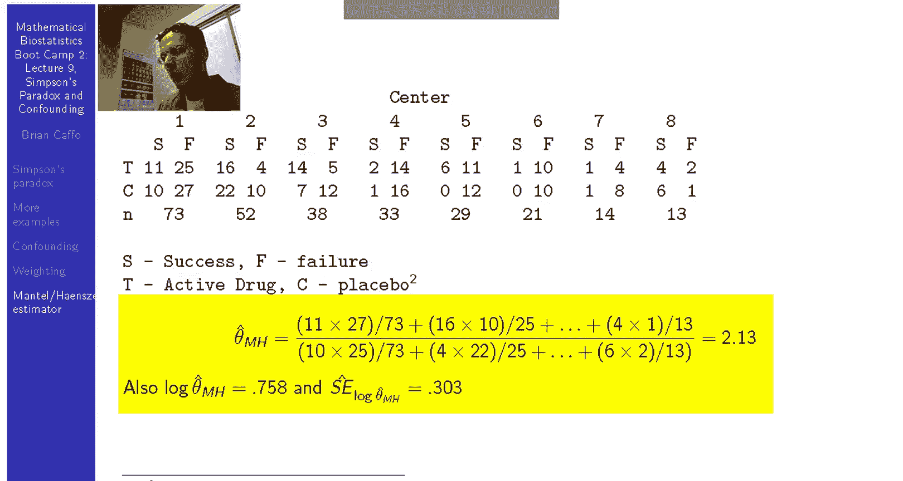

嗯。Another rationale for why we might want to。To do some sort of stratified estimate。

 it's also often the case In this case， we think that that that centers at some level this random effect type。

嗯。MoMoifier of the treatment of efficacy。And we are willing to think of these centers as sort of a random draw from the population of centers。

Then in that case， it still actually makes a lot of sense to combine them because。

We're not so much interested in center specific effects。

 we don't care if the treatment works at center number one What we care is if it works overall。

 and it turns out you know even if the center isn't just a confounder。

 but it really modifies the effect of the treatment，Then。You know。

 some places are just better at doing the treatment than the others。

 then really kind of what you in it。 But if you're willing to make that the center make the assumption that the centers are this sort of。

嗯。Random draw from a population of centers。 Then this CMH estimate makes a lot of sense saying， okay。

 across averaging across centers， here's the effect of the of the treatment。

 And that's another instance where you， where you would consider doing something like。CMH。I'm sorry。

 a mantohandsel log a common odd ratio estimate， so this is what is often called of as the commonods ratio。

 the commonods ratio across the centers。

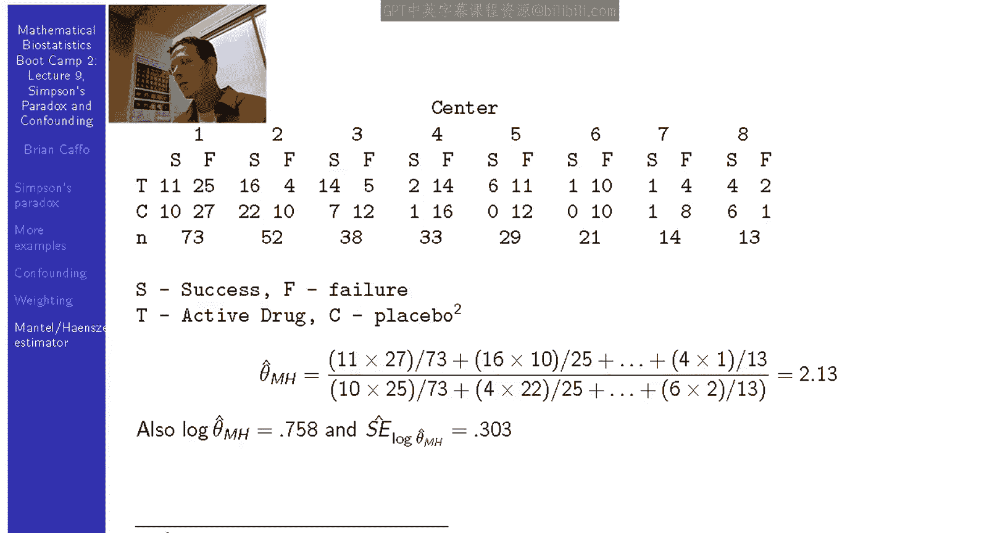

So then there's a famous test for testing whether or not。

The odds ratios are the common odds ratios are equal to one。

 So the test is usually stated as the non hypothesis that all of the straightest specific。

Ods ratios are equal and they happen to be equal to one versus the alternative。

There's some amount of dispute over the alternative， but I'm going to teach the alternative this way。

 the alternative is that they're all equal。Right。But they're not equal to one， okay？

So notice this is different than the alternative that they're not necessarily equal even。

So here we're assuming that we have a common odds ratio under the nulllan alternative and we just want to test whether that common across st a odds ratio is one versus not。

And it turns out that CMH tests。Applies to other alternatives。

 but it's more powerful for the particular alternative given above。嗯。

And I'll also mention that this test is exactly the same as testing for conditional independence of response。

And exposure given the stratifying variable。And so this Cochramantle handssel test。

The way it's executed is it conditions on the rows and the columns for each of the contingency tables。

Exactly like Fisher's exact test resulting in hypergemetric decay， Hygemetric distributions。

 and then leaving only the upper left hand cell of each table free。

 just exactly like we did in Fisher's exact test， only this time doing it for each specific cell。

 So let me I'll go through the mechanics now。

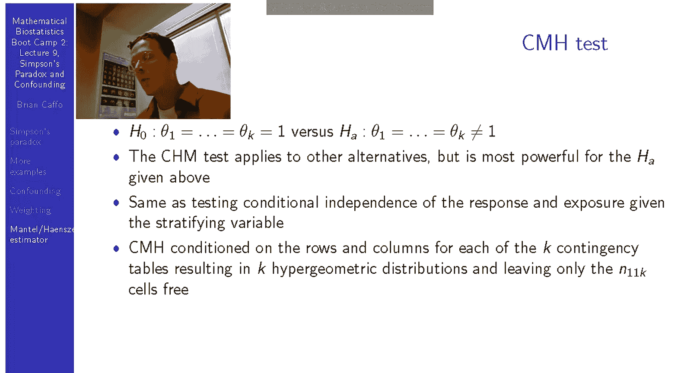

Okay。So under this conditioning and under the null hypothesis， under both those circumstances。

 then the expected value of the upper lefthand cell of each table is this value。

 the variance of the upper left hand cell is this value。

 so the Cochrane mantle hesel test statistic works out to be this guy right here kind of the sum of the deviations of the upper left hand cells from their expected values。

 but summed up and then squared unlike the chi square test where there。Squared and then summed up。

 so summed up and then squared。And then regardless of how many tables you have under the nulllypostas。

 this is a chi squared one。So remember this is a different test than the chiIS score testing we talked about in the previous lecture so that's why it's a different test statistic and the idea of testing conditional independence or testing for this confounder relationship is a different idea and that's why you get a different test statistic I think it's a little bit beyond the scope of this class to derive the CMH test statistic but the idea here you want to test for whether or not the odds ratio is one。

 given that it's common across alltrarata versus the odds ratio given that it's common across Altrata is not one。

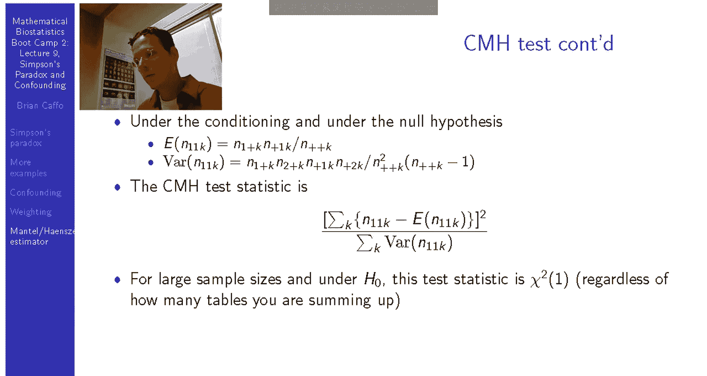

So here I'm going to。To implement it， it it's a bit a bit of a pain to。

To actually execute the CMH test by hand。 so here I'm putting the data into an array。嗯。In this case。

8， two by two tables， and then you can do this mantle handssel tests correct equals false I put again correct equals false here so that if you do the calculations by hand。

 you'll get an agreeing result to the R output you generally want to leave this correct equals true。

 The result is the test statistic is 6。38。 compareare that to a chi squared one value or you know again。

 you only reject for larger values it's the test statistic again。

 it being a two sided test because it's a squared statistic。And so in this case， the P value is 0。

012， so the test presents evidence to suggest that a treatment and response are not conditionally independent given center。

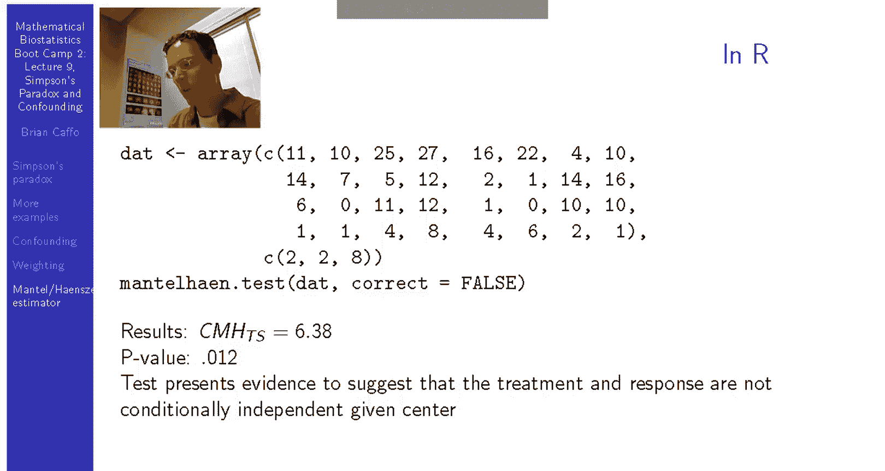

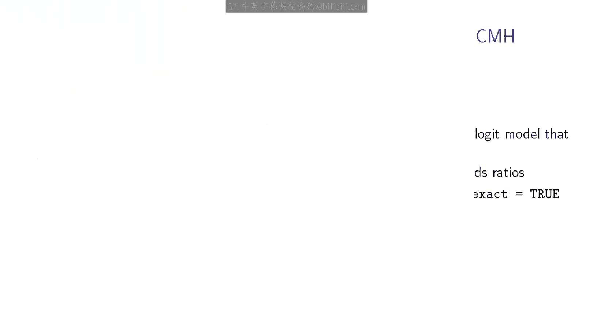

Some final notes on this testing is。know it's possible to perform an analogous test using a kind of what I consider to be a little bit more modern of approach using a random effects Loit model。

And the reason I like， but again， we're not， you know。

 we haven't covered regression so we can't cover mixed models and then we can't cover generalized linear mixed models and all the。

Machinery that you would need to cover this。It's possible anyway。

 this I think you know you should take the time if you're going to work as a statistician or use a lot of sta in your life。

 you should take the time to build your way up to where you're studying mixed effect models and generalize linear mixed effect models and there you can do exactly things like what the CMH test is。

Doing only you can do it in a very general way。That allows for other variables to be specified in the model and so on。

 the reason for presenting it this way in this class is to just give you a sense about the idea of confounding to give you a sense of what。

What you can do just in particular in the case of two by two tables。And then later on。

 I'm hoping that you'll take some more statistics classes and learn about mixed models in general linear mixed models。

嗯。It's also you know， so here we assumed all the odds ratios are equal versus the alternative that they were all equal but not equal to one。

 it's also possible to test whether or not all the odds ratios are equal there's a test for that I think it's called Wolf's test。

And that's a very good test， I don't have time to cover it。

The final thing I would mention also is that you know we have these。

K hypergemetric distributions that we used in the CMH test statistic。

 so you can probably guess that you can exactly do some sort of exact test in this case。And you can。

 you know just in R， you can just do exact equals true as an argument in the mantle handssel test。

 but you could probably envision how it's done Imagine as within each center you were to permute the do this permutation process that we talked about for Fisher's exact test。

 Imagine if you were to do that now within each strata。

 then recreate the chi squared statistic each time the mantlehands chi squared statistic each time and do that over and over and over again and that simulation would yield an exact P value。

 So I think you could actually probably。诶嗯。Come pretty close to doing exactly what the exactly equal true argument is doing in R by that permutation process。

 of course they in this case they can do the calculations exactly without Monte Carlo。

 so it's faster， but conceptually that's exactly what they're doing。Okay。

 well that's the end of the lecture and so this was a teaser on the idea of confounding and confounding is。

I mean， the one probably the biggest obstacle to。🤢，Generating knowledge from observational data。

 data where you don't have a heavy amount of control over the design of the experiment。

Which is most data， right， the easy data to collect is observational data。

So this gives you a teaser in how that data is collected and or I mean how that data is analyzed and there's a tremendous artrc to analyzing that data that I hope as you learn more statistics you'll get more refined at that art and just like any other art you can spend a lifetime perfecting your craft and you'll never really。

Hit a limit。It's a very hard topic。And then again， I highly recommend considering learning something about causal inference。

 which is the most modern attempt at addressing this problem in a mathematically formal way。

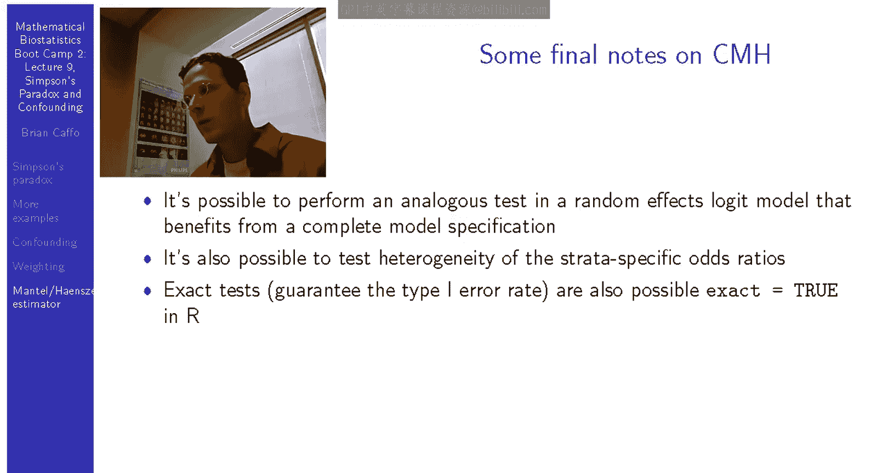