# 约翰霍普金斯大学《数据科学的高级统计｜Advanced Statistics for Data Science》中英字幕（deepseek p62 31_病例对照抽样.zh_en -BV1htPjeYEFH_p62-

Hi， my name is Brian Kaho， and this is mathematical Biosstatistics Boot camp 2。

 Le 10 on case control data。

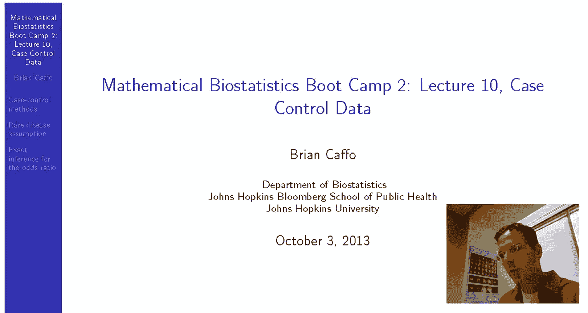

In this lecture， we're going to briefly talk about case control methods we'll talk about an instance where。

Uing retrospective case control data and a so-called rare disease assumption。

 we can estimate prospective odds ratios and then because this is kind of a lot focused on the odds ratio。

 I thought I'd talk a little bit about exact inferenceprints for the odds ratio。

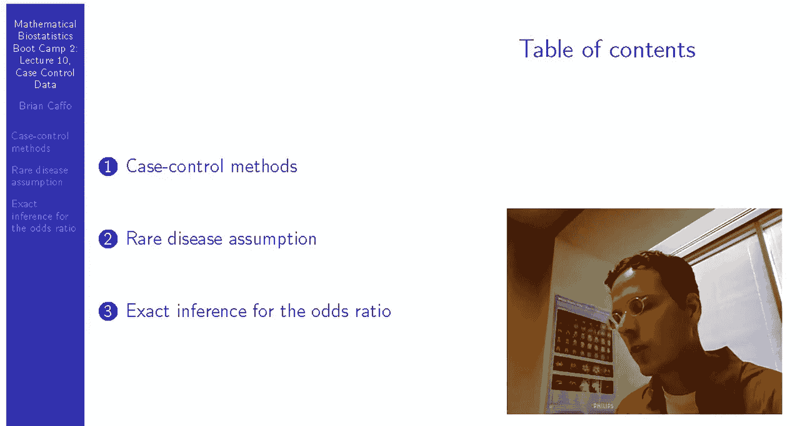

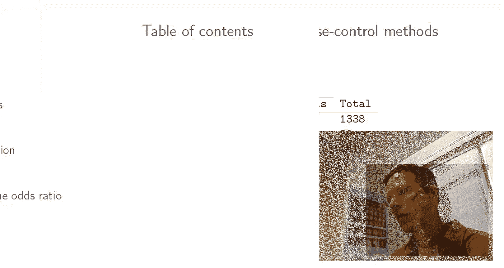

Okay， so let's talk about retrospective kind of case reference sampling。And again。

 this is a deep subject we're going to scratch the surface of it。So in this case。

 imagine if we wanted to study study lung cancer and here we had some cases and controls and we ascertained whether or not they were smoker。

Now there's two ways we could collect it well， there's conceptually two ways we could collect this data。

 one is we could follow a bunch of people up over time。

Some of them would smoke and some of them wouldn't。

And then we could see who obtained lung cancer that that's very hard to do。 right， I mean。

 I think conceptually， you can all see that that。Experiment is basically impossible。

A much easier experiment would be to go to hospital records。

And find a bunch of people that were cases that had lung cancer。

 let's say in this case we found 709 of them。And then we also found 709 controls that were at some level comparable。

And then we retrospectively determine whether or not they were smokers。 Now in this case。

 the 709 is fixed， right， And it's whether or not they were a smoker that we are kind of has the ability to vary。

Now I should also say that the most common way to do case control methods would be for every case to try and very closely match a control so that for every case there's a specific matched control but in this case。

 we're not doing it。 let's say we had a group of cases。A group of case。

 hospital records and a group of control hospital records in。

Our group of control patients and we figured out， you know。

reasonablea strategy for getting control patients and now these 709 is fixed。

 so what we wanted to ascertain is who was a smoker and not and whether or not the cases had a greater proportion of smokers and to kind of make prospective conclusions from this retrospective data。

So just in terms of probability， right？We cannot estimate the probability of。

Being a case given that you were a smoker directly from the data。

 but we can estimate the probability of being a smoker given that you were a case right and so we want to work with that you know kind of proable probability rubric。

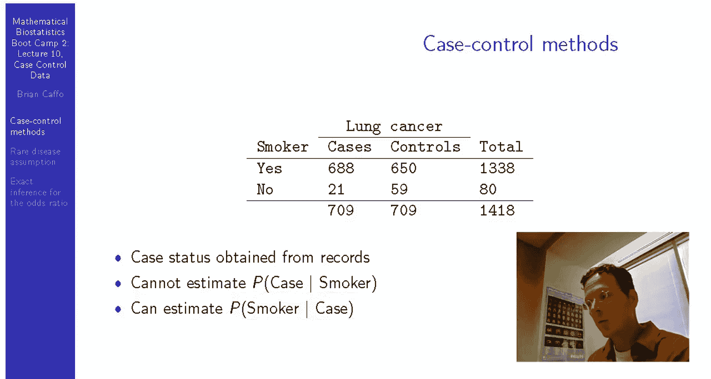

What is interesting？Is we can estimate an odds ratio。

So the odds ratio that we would want to estimate is the odds of being。A case。

 given that you were a smoker relative to the odds of becoming a case relative to being a non given that you were a non smoker。

 okay。So we want the odds of developing lung cancer given that you smoked compared to the odds of developing lung cancer。

 given that you didn't smoke， what turns out that that odds ratio is exactly equal to the odds of odds of being a smoker。

 given that you're a case relative to the odds of being a smoker， given that you are a control。

So in the bottom one， we can' estimate the top one， we cannot。

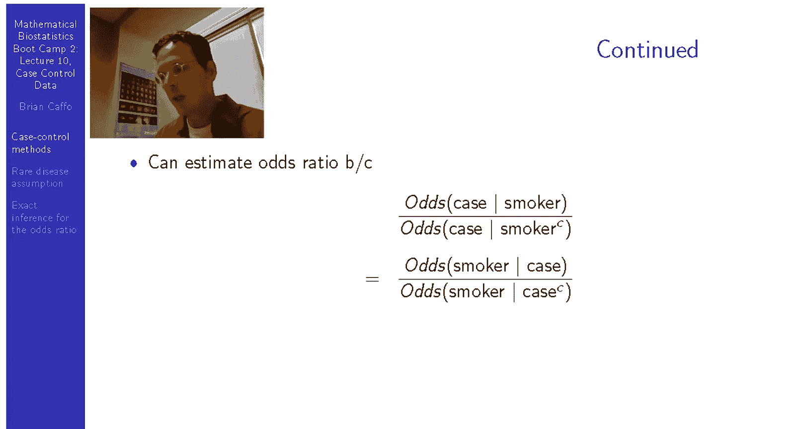

So here I just directly go through the calculations。

 the odds of being a case given that you're a smoker divided by the odds of being a case given that you're a non smoker。

 the odds ratio of interest。and let me just replace case and not with C and S a case case in non case with C and C bar and smoker and nonsr with S and S bar and here I just turn to the calculations。

 you can go through these three steps and make sure that you agree。

So here I carry through the calculation and look， this works out to be the probability of being a case and a smoker times the probability of a not case and a not smoker divided by the probability of being a case and a nonsmor divided by the probability of being not a case and not a smoker。

 so it's sort of like the probability cross product ratio。

 the probability of caseness and smokerness， times the probability of being not case and non smoker divided by the kind of off diagonal probabilities。

Now， and I say this actually proves the result， and I think it does because honestly， you know。

 you can just see that if you were to exchange the words case and smoker top at the top。

That nothing changes when we get down to the bottom line here， right。

 because probability of C comma S is the same as probability S comma C。嗯。

So I think you can tell to me that this is exactly equal or if you want to be very particular。

 you can then keep working and get to odd the other odds ratio。But to me。

 this proves the result from the previous page。

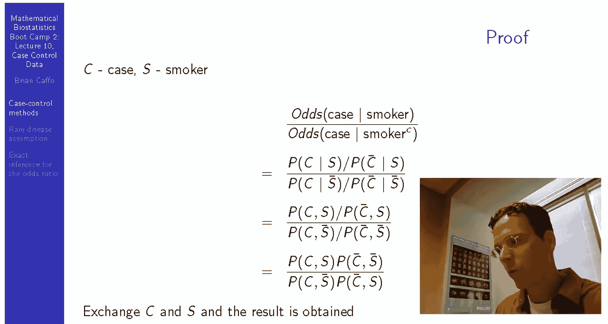

And you know， itd also remind you that is these are the probability statements。

 but we estimate those probability and odds ratios from。Data and of course。

 the sample odds ratio is the cross product ratio N11 and22 divided by N12 and 21。

And the odds ratio is invariant to transposing the rows in the column。

 so you our estimator has this kind of invariance property， which we would hope。

 it would be weird if we said that the two odds ratios probabilities were equal。

 but oh the sample estimates were not equal depending on which one you were treating as the outcome and which one you were treating as predictor。

So that's nice， by the way， the sample odd ratio is unchanged if a row our column is multiplied by a constant。

And then the last thing， this is what we'll talk about the odds ratio turns out to be related to the relative risk。

 so you know the thing is if you want odds ratios we've just kind of demonstrated that the odds ratio works out really well and you can kind of reverse conditioning a little bit when talking about the odds ratio。

 but we'll talk about specifically the relative risk。

 which is what people often want to estimate to me。And how it relates to the odds ratio。

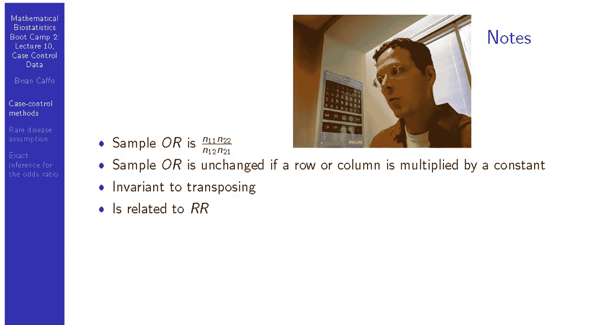

Okay， so the odds ratio is here， right？Probability of a smoker given that you're a case divided by the probability of non smoker given that you're a case。

And so on， you can read this top line okay。Then。We can。Reverse the odds ratio， right？嗯。

Using the argument from the other page， right？So now we have probably a case given smoker。

Divided by probability of non case given smoker， divided by probability case given non smoker。

 divided by probability of non case given non smoker。Okay。Then in the next line。

 just everything is multiplied out， denominators are raised up to numerators and so on。And then。

Look at this。嗯。First term here， probably a case given smoker divided by probably a case given non smoker。

That's the relative risk right that's if you know we want to determine who develops lung cancer comparing who smoked to who didn't smoke。

 that's the relative risk， the ratio of the two probabilities。

And then that's multiplied times these things， but I wanted to refer them with respect to case status。

 so I just won minus each of the probabilities。And what you can see is if this ratio。

That we're multiplying the relative risk times if it's about one。

 then the odds ratio is approximating the relative risk。So， and you know， often is the case if the。

These two numbers， one minus this number and one minus that number that they're similar enough if in fact。

 the case is very rare in other words。Regardless of whether or not you smoke the probability that you get this disease。

 let's say lung cancer is quite small。If that's the case， is so called rare disease assumption。

 if that's true， then this ratio will be about one and then the odds ratio will。

Approxmimate the relative risk。 and that's what people often talk about the rare disease assumption。

 and they use the retrospectively collected data， along with the odds ratio to then approximate the relative risk。

 It's so common， often people don't even really talk about what they're doing。 They just do it。

 I think that's so common in the epi literatures。It's generally not described in a say American Journal of epidemiology article or something like that。

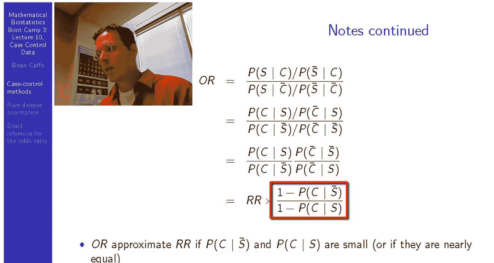

So Ill just make the small point that。The disease has to be rare among the exposed and the non exposed。

 not just rare overall。 So here's a simple example。 Chuck Rody reminded me of this at one point。

 So here we have the exposure， yes or no disease， yes or no。 We have 9，1，1，9，99。So just。

From the data。 And let's assume that this is just cross sectional data。

 So all the margins and everything are estimable。 So the probability of disease。

 the estimated probability of disease。Is about 1%。The odds ratio works out to be。Almost 9，000。啊。

The relative risk works out to be about 900。 So clearly。

 the odds ratio is not estimating the relative risk。 And in this case， like I said。

 because of the sampling， I'm assuming。The two are are estimate directly estimable from the data。

 So in this case， what what happens is is。Disease is is rare among the。Among the exposed， I'm sorry。

 D is rare overall， right？Let's see where is a 10 out of 1010。But D is not rare among the exposed。

Right， so among the exposed， you actually had nine times the number of people having the disease rather than not。

 So anyway， I think， you know， this， this is a， if you look at the equation， right， it's it's clear。

You know， both the P of C given S bar and P of C given S both have to be small。

In order for the rare diseases assumption to apply any and。That's the real。Criterria。

 I think this is just a numerical this is a numerical illustration in hypothetical circumstances where we can estimate all the probabilities well and we can show that the two aren't approximately equal to each other。

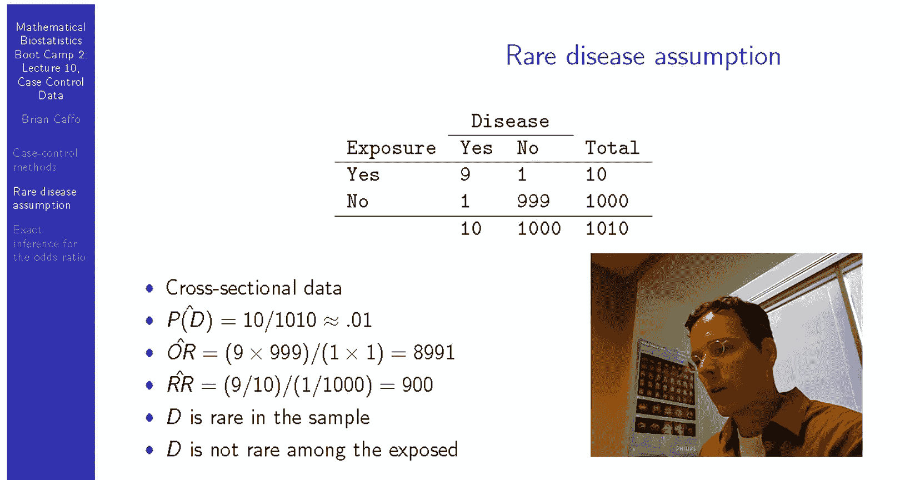

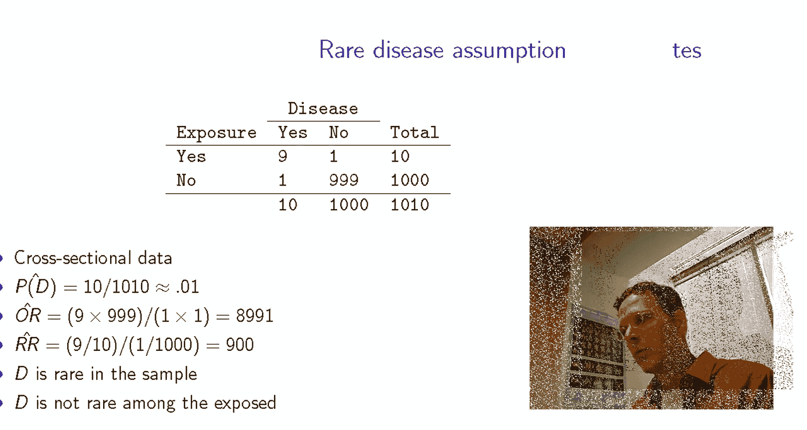

So let's just recap about the odds ratio， so an odds ratio of one applies no association。

Ods ratio greater than one is a positive association， odds ratio。

 less than one is a negative association， for retrospective case control studies。

 odds ratios can be interpreted prospectively。For diseases that are rare among the cases and controls。

 the odds ratio approximates the relative risk。And the Delta method standard error for the odds ratio is the square root of one over the cell counts added up。

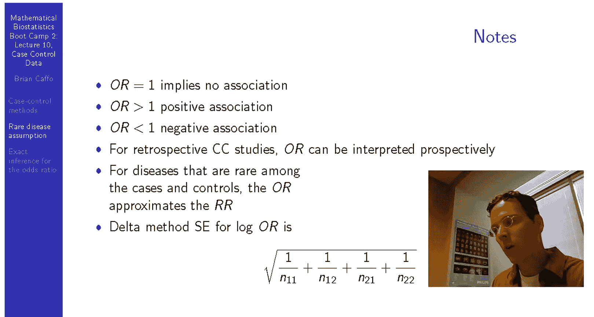

Oh and just to remind you that's the standard error for the log odds ratio。

 not the standard error for the odds ratio so let's just go through our example heres we have our lung cancer cases and control smokers yes or no。

 we get our odds ratio it works out to be3 we get our standard error for the all log odds ratio it works out to be 0。

26 if we want a confidence interval it's log of 3 plus or minus2 standard errors we get 0。59 to 1。

61 we would compare this interval to whether or not zero is in that interval if we expentiate it then we would compare whether or not1 is in the interval in this case if we expentiate it we get 1。

8 to 5。0 so1 is not in the interval you know in our estimated odds of lung cancer for smokers 3 times that the odds for nonsmokers。

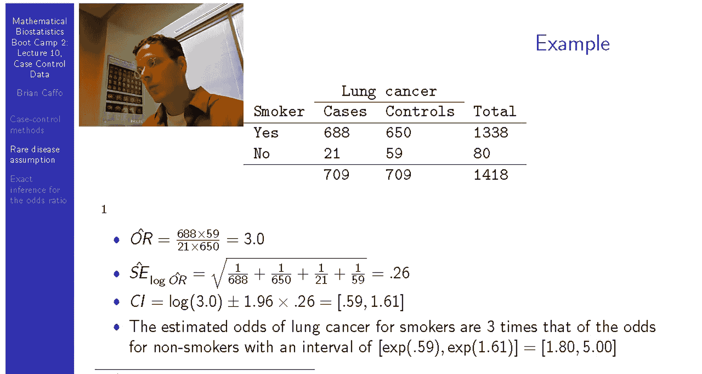