# 高级统计学：第10讲：病例对照抽样 📊

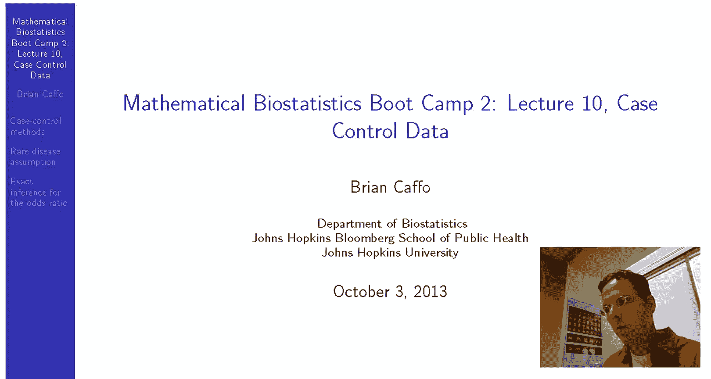

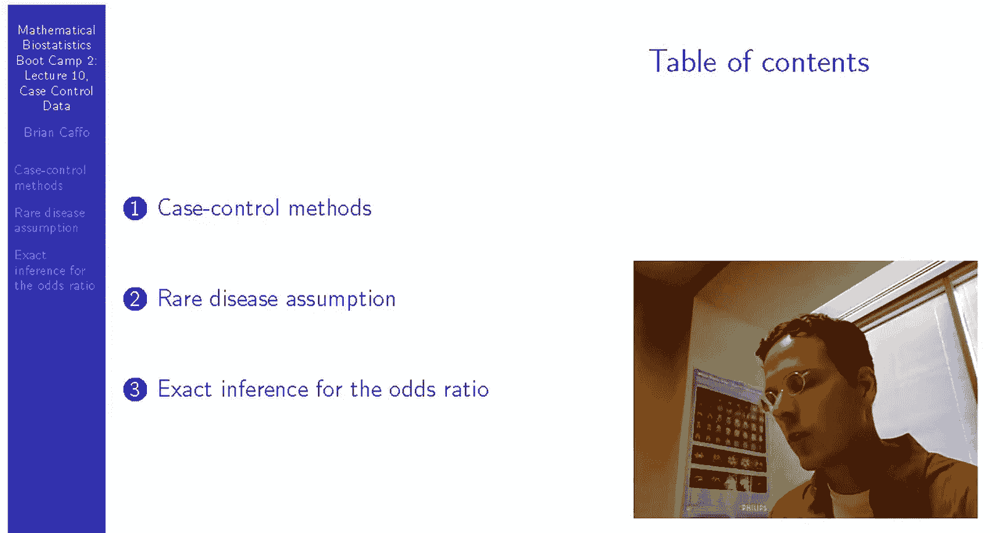

在本节课中，我们将学习病例对照研究方法。我们将讨论如何利用回顾性的病例对照数据，在所谓的“罕见病假设”下，估计前瞻性的比值比。由于本讲内容主要围绕比值比展开，我们也将简要介绍比值比的精确推断方法。

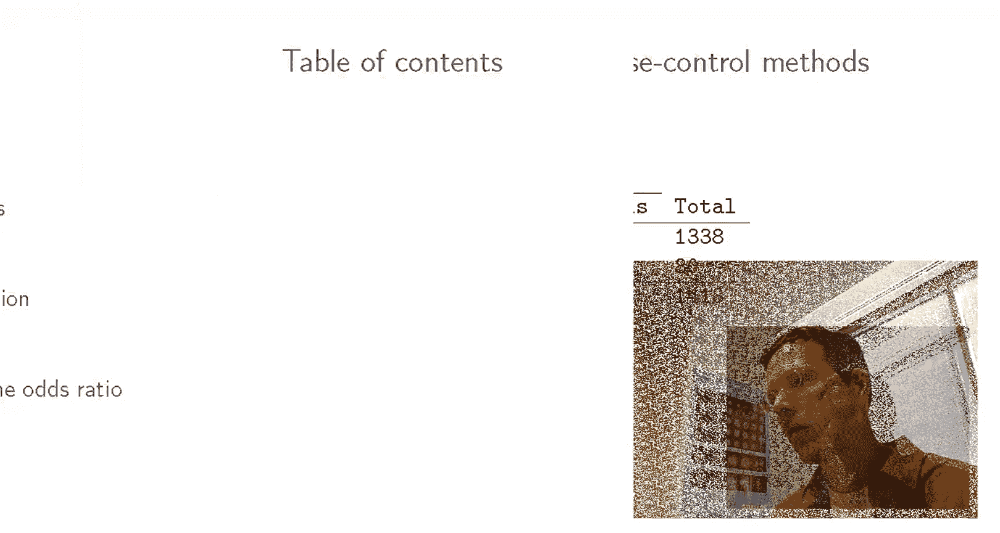

---

## 回顾性病例对照抽样

上一节我们介绍了病例对照研究的概念，本节中我们来看看具体的抽样方法。这是一个深入的课题，我们仅触及表面。

假设我们想研究肺癌。我们有一些病例和对照，并确定他们是否吸烟。从概念上讲，有两种收集数据的方式：
1.  我们可以长期随访一群人，其中一些人吸烟，一些人不吸烟，然后观察谁患上了肺癌。这种方法非常难以实施。
2.  一个更简单的方法是查阅医院记录，找到一组肺癌病例（例如709人），再找到一组在某种程度上具有可比性的对照（例如709人），然后回顾性地确定他们是否吸烟。

在第二种方法中，病例和对照的数量（709）是固定的，而他们是否吸烟是我们要测量的变量。最常见的病例对照研究是为每个病例匹配一个对照，但在这个例子中，我们假设我们有一组病例和一组对照。

我们想通过这种回顾性数据来推断前瞻性结论：病例组中吸烟者的比例是否更高？从概率角度看，我们无法直接从数据中估计“如果你是吸烟者，成为病例的概率”，但我们可以估计“如果你是病例，你是吸烟者的概率”。我们将在这种概率框架下工作。

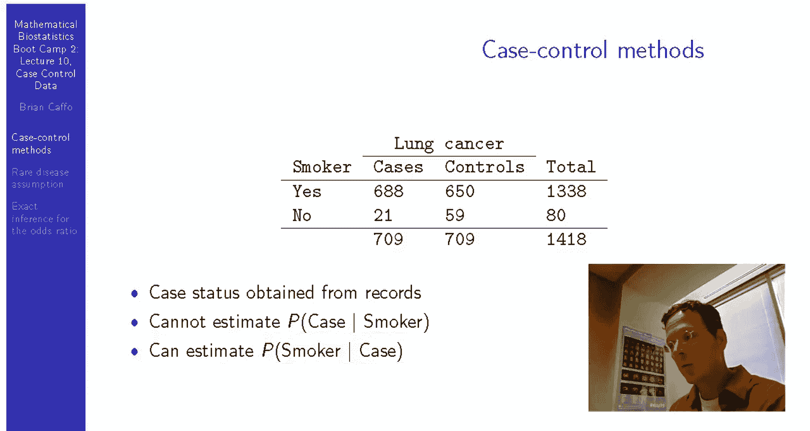

---

## 比值比的估计

有趣的是，我们可以估计一个比值比。我们想要估计的比值比是：吸烟者患肺癌的几率与不吸烟者患肺癌的几率之比。

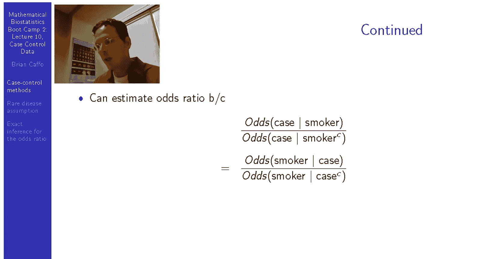

**公式表示：**
`OR = (P(病例|吸烟) / (1 - P(病例|吸烟))) / (P(病例|不吸烟) / (1 - P(病例|不吸烟)))`

然而，这个比值比恰好等于另一个比值比：病例中吸烟的几率与对照中吸烟的几率之比。

**公式表示：**
`OR = (P(吸烟|病例) / (1 - P(吸烟|病例))) / (P(吸烟|对照) / (1 - P(吸烟|对照)))`

我们可以从数据中估计第二个比值比，但无法直接估计第一个。通过数学推导可以证明这两个比值比是相等的。样本比值比的估计量是列联表的交叉乘积比：

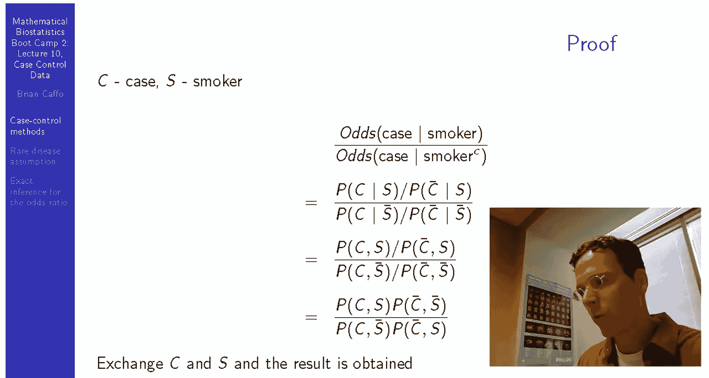

**公式表示：**
`样本OR = (n11 * n22) / (n12 * n21)`

其中 `n11`、`n12`、`n21`、`n22` 是2x2列联表中的四个单元格计数。这个估计量具有不变性：无论我们将哪个变量视为结果，哪个视为预测因子，样本比值比都是相同的。

---

## 比值比与相对危险度

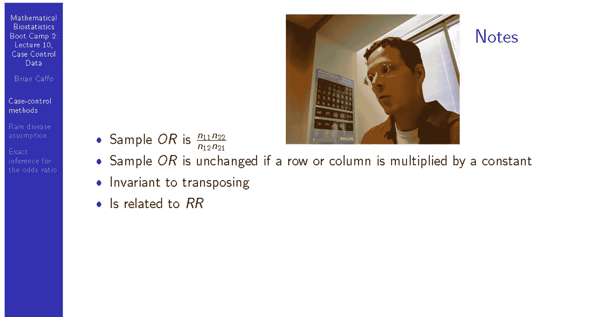

人们通常更想估计相对危险度，即两个概率的比值。那么比值比与相对危险度有什么关系呢？

通过数学变换，我们可以得到相对危险度与比值比之间的关系。当疾病在暴露组和非暴露组中都“罕见”时（即患病概率都很小），比值比会近似等于相对危险度。这就是所谓的“罕见病假设”。

**公式推导：**
`OR ≈ RR * [(1 - P(病例|不吸烟)) / (1 - P(病例|吸烟))]`
当 `P(病例|吸烟)` 和 `P(病例|不吸烟)` 都很小时，括号内的比值接近1，因此 `OR ≈ RR`。

需要强调的是，疾病必须在暴露组和非暴露组中都罕见，而不仅仅是总体罕见。否则，比值比可能严重高估相对危险度。

---

## 比值比的解释与推断

现在我们来总结一下比值比的关键点。

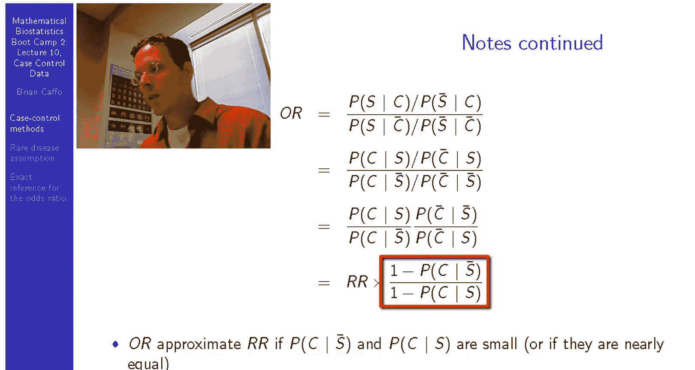

以下是关于比值比解释和应用的要点：
*   **无关联**：比值比为1表示暴露与疾病无关联。
*   **正关联**：比值比大于1表示暴露增加疾病风险（正关联）。
*   **负关联**：比值比小于1表示暴露降低疾病风险（负关联或保护作用）。
*   **前瞻性解释**：在病例对照研究中，估计的比值比可以解释为前瞻性的效应度量。
*   **近似相对危险度**：在罕见病假设下，比值比可以近似作为相对危险度的估计。
*   **标准误**：对数比值比的标准误可以通过Delta方法计算，公式为各单元格计数倒数之和的平方根。

**公式表示：**
`SE(log(OR)) = sqrt(1/n11 + 1/n12 + 1/n21 + 1/n22)`

---

## 实例分析：肺癌与吸烟

让我们通过一个实例来应用这些概念。以下是肺癌病例与对照的吸烟情况数据：

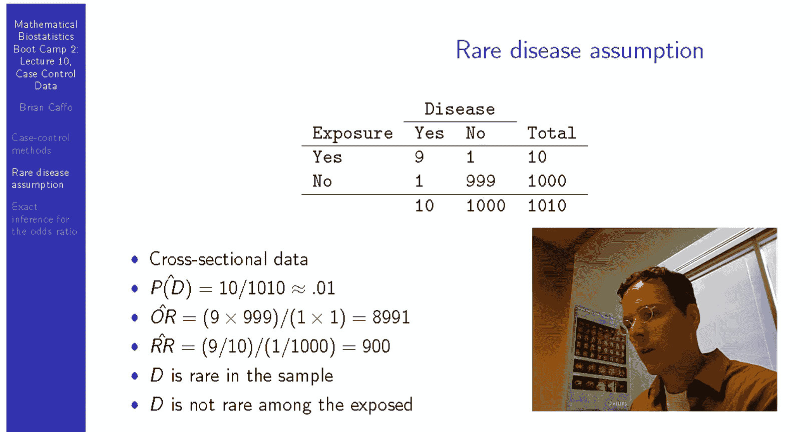

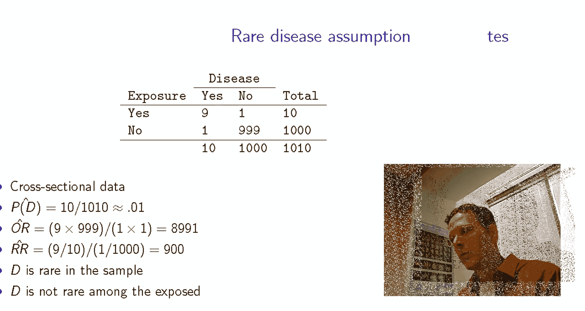

|          | 吸烟者 | 非吸烟者 | 合计 |
| :------- | :----- | :------- | :--- |
| **病例** | 688    | 21       | 709  |
| **对照** | 650    | 59       | 709  |
| **合计** | 1338   | 80       | 1418 |

计算过程如下：
1.  **计算样本比值比 (OR)**：
    `OR = (688 * 59) / (21 * 650) ≈ 3.0`
    这意味着吸烟者患肺癌的估计几率是非吸烟者的3倍。
2.  **计算对数比值比的标准误**：
    `SE(log(OR)) = sqrt(1/688 + 1/21 + 1/650 + 1/59) ≈ 0.26`
3.  **构建对数比值比的95%置信区间**：
    `log(3.0) ± 1.96 * 0.26` → `(0.59, 1.61)`
4.  **指数化得到比值比的置信区间**：
    `exp(0.59, 1.61)` → `(1.8, 5.0)`

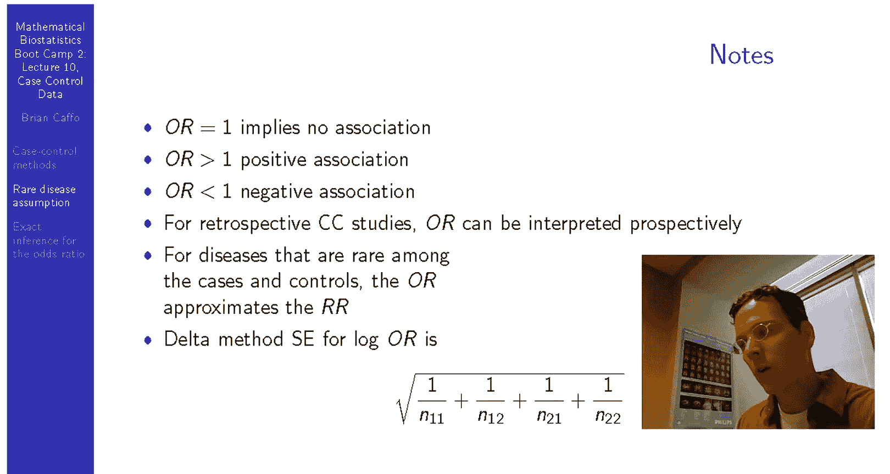

由于比值比的95%置信区间 `(1.8, 5.0)` 不包含1，我们有证据表明吸烟与肺癌之间存在统计学上的显著正关联。

---

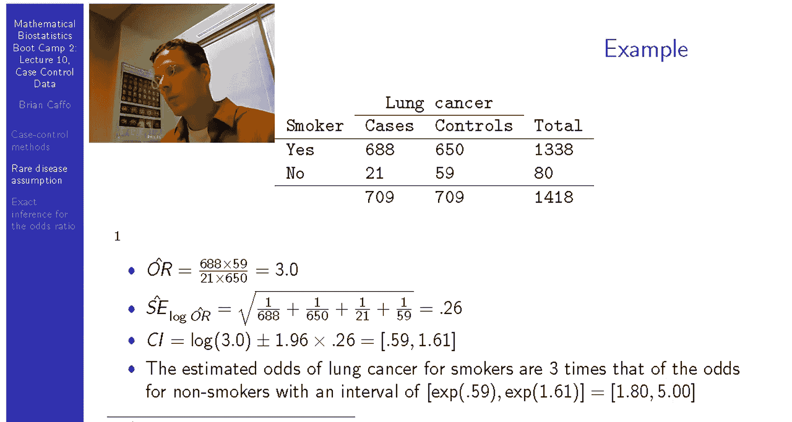

本节课中我们一起学习了病例对照研究的基本原理。我们了解到，通过回顾性收集的病例和对照数据，可以估计暴露与疾病之间的比值比。在罕见病假设成立的情况下，这个比值比可以很好地近似前瞻性的相对危险度。我们还学习了如何计算和解释比值比及其置信区间，并通过一个肺癌研究的实例进行了演示。