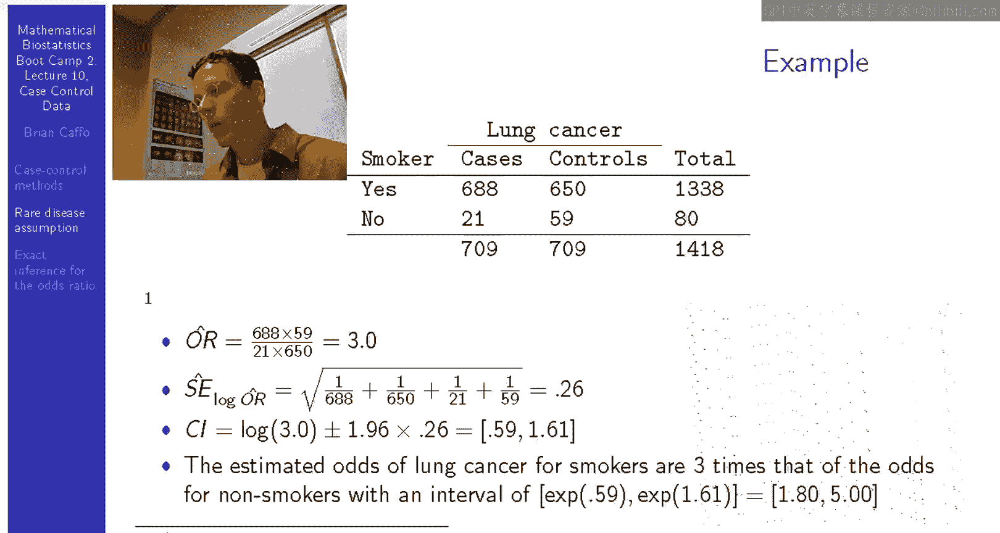
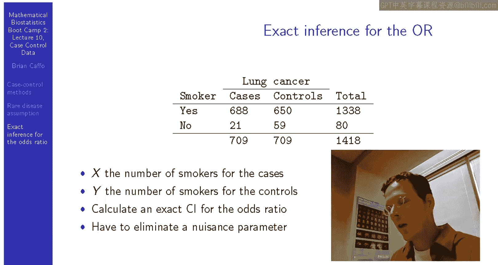
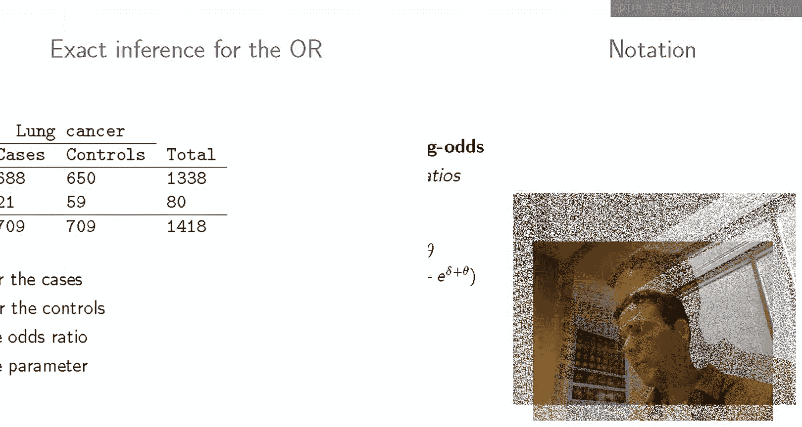
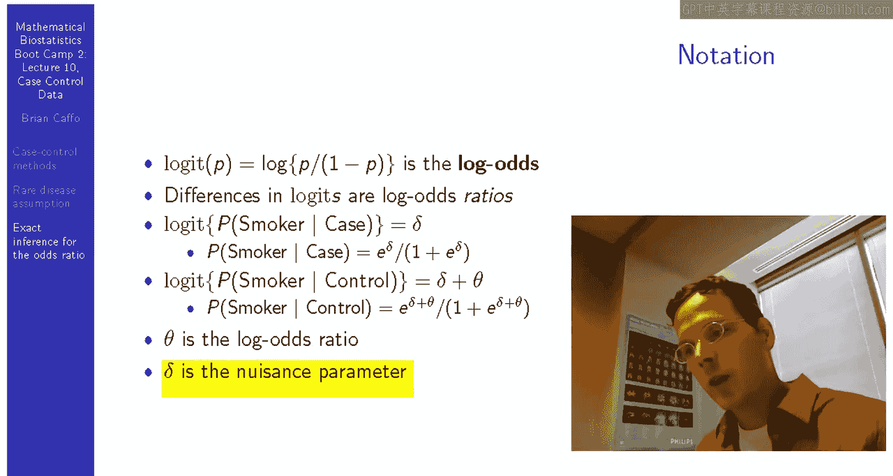
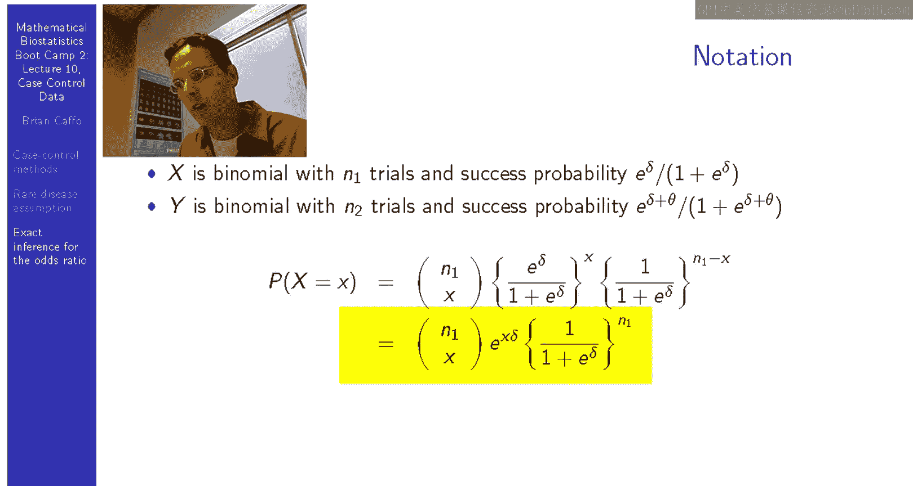
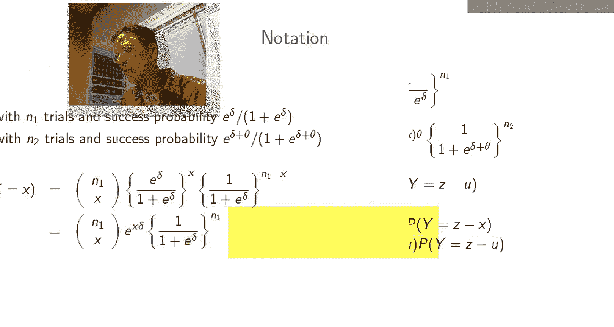
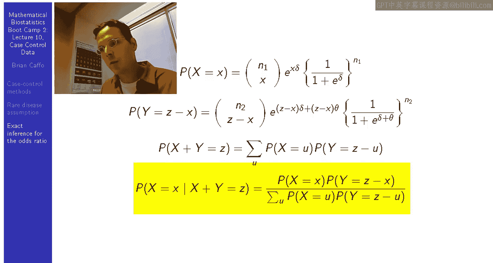
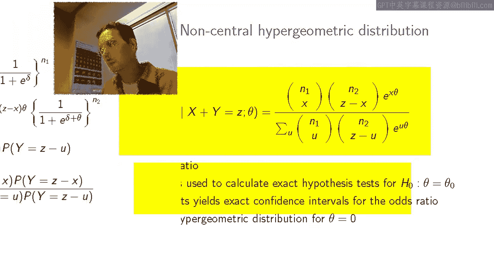
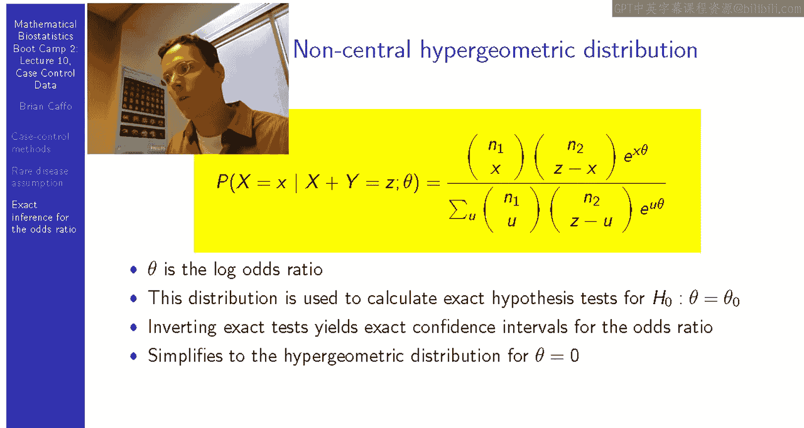
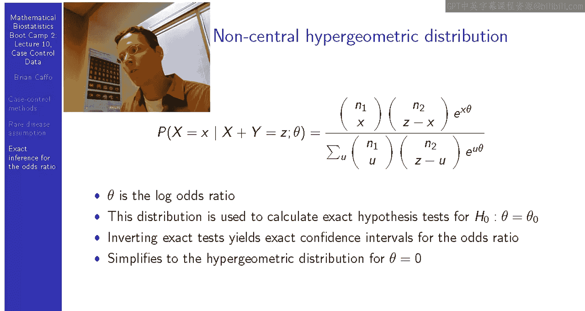

# 约翰霍普金斯大学《数据科学的高级统计｜Advanced Statistics for Data Science》中英字幕（deepseek p63 32_优势比的精确推断.zh_en -BV1htPjeYEFH_p63-

Okay， so let's talk about exact inference for the odds ratio。

 this is the last thing I'll talk about in this lecture。

Let's let X be the number of smokers for the cases and Y be the number of smokers for the controls。

And remember， in this case is x and Y are the random numbers because we're thinking about case reference sampling。

 so x and Y are the random numbers， the 709 margins are fixed and we're going to assume that both of them are say binomial。

And we want to calculate an exact confidence interval for the odds ratio， not an approximate one。

 so the square root went over the cell counts formula is an approximate one。

And I'll show that you have to eliminate a nuisance parameter and I'll show you how to do that。

So let's define the logit function as the log of the odds， so logit P is log p over 1 minus P。

 that's the logit function。So notice the differences in logits are a log gods ratios。

 So if you logit P1 minus logit P2， that's the log odds ratio for P1 to P2。

 So as an example Loit P so let's。Let's define the logit of the prob of being a smoker。

 given that you're a case as Delta。And by the way， this implies that the probability that your smoker given a case is e to the delta over 1 plus e to the delta。

 so if you invert the logic function， you get that。

The logit of the probability of being a smoker given that you're a control。

 let's call that delta plus theta， so it's a different number。

 but we're describing it relative to delta but because we're not constraining theta。

 it can still be any number， but theta， okay。Then we get probability of being a smoker。

 given a control works out to be e to the delta plus theta divided by 1 plus e to the delta plus theta。

In this case， theta works out to be the log odds ratio。Okay， so actually just。

Of course it's the loggos ratio because if we subtract it to logits。

 the delta cancels out and we get theta， so theta is the loggos ratio。

And in the way that we've parameterized this。Delta。

 this other parameter is a so called nuisance parameter， we don't care about that。

 what we care about is the log odds ratio。嗯。Comparing smokers to case status。

Okay， so let's keep working on the。The model here， so here we're going to assume that x is binomial with n1 trials and then we already stipulated that the probability that the logit is delta so the probability is e to the delta over 1 plus e to the delta。

 and then y is binomial with n2 trials and success probability E to the delta plus theta divided by 1 plus e to the delta plus theta。

So then our probability x is the capital X takes on realized value little x is going to be this binomial probability and you can kind of work with it and get to where it's this formula right here and one choose x。

 etcter。

Then so this is just carrying this over from the previous slide。

This is the probability X takes on realizedized value little x。

 and then I'm going to look at the probability y takes on realizedized value z minus x and you'll hopefully see y in a minute and that's just plugging directly into the binomial formula and again I have z minus x right here instead of a particular value。

 say little y。Okay。Now。嗯。The probability that。🤢，X plus y。

 the random variable x plus y takes on realized value。 Z is a little bit harder。To calculate。

Because X and Y are not identically distributed if they were identically distributed then it would X would be the sum of a bunch of Bernoulli trials。

 Y would be the sum of a bunch of Bernoulli trials。

 so x plus y would be the sum of a bunch of IID Bernoulli trials。

 so they're still both the sum of a bunch of Bernoulli trials but not the same okay。

So here's what we can do， we can factor this into， let's suppose that we decompose z into U and z minus u。

 u parts going into x and z minus u parts going into y。

 then that probability would be this product right here probably x is u and y is z minus U。

And so the probability x plus y takes on the value Z is going to be sum over all the possible values of U。

 in other words， all the different ways we could allocate some of it， some of the。

Some of the elements of Z to x， then whatever we can allocate the remaining to y so that's a quick little formula you can do。

Okay， now we're going to get to the point。So now let's look at the probability x takes on particular value x。

 given that the sum x plus y takes on particular value z。

 and I'm just going to plug in these three lines up here right so the probability X Act takes on value x is going to be the probability this。

This numerator probability right here， probably x equals x， probably y equals z minus x。And so。

Just to elaborate on that point。The probability x takes on value x and x plus y takes on value Z is this。

TheThe and probability， then given that because we're stipulating that x is value X。

 that's the same thing as that probably y takes on value z minus little x。

 and then we can factor those probabilities into the product。 So that's the numerator right here。

And then the denominator， I'm just plugging directly in the probability x plus y takes on value Z。

Okay， so then you put it all in， just you know， if you can follow the mathematics。

 hopefully you follow the mathematics， if you can， if you're having trouble with this because I realize it's a little bit in depth。

 then if you plug it all in you wind to put this formula right here。

And again this you this is very similar to our development of Fser' exact test。

 the only difference is now we haven't assumed the no hypothesis to be true。

 and so what we have here is it depends on theta， this log odds ratio okay。So here。

 but notice it doesn't depend on delta right， so we've gotten rid of delta and that's this idea of conditioning away the nuisance parameter here。

 conditioning on x plus y it conditions away the nuisance parameter。So， but nonetheless。

 now we have a distribution for our two variables because remember if I know you know I've。

I don't need to talk about x and y if I've conditioned on x plus y， if I know x， then I know Y。

 given that I know x plus y。So you can use this distribution to calculate exact hypothesis tests for theta equal to theta not other than zero。

 the specific case zero results in Fs's exact test， the ordinary hypergemetric distribution。

And then you can invert these tests to yield exact conference intervals for the odds ratio and that is exactly what R does if you do Fer do test it'll give you a conference interval for the odds ratio it is exactly doing this。

嗯。This procedure right here， it's inverting the so called this distribution here。

 which is called the non central Hygemetric distribution。

And so we're not going to go through any calculations with this because as you can tell at this point it's gotten rather involved。

 but I did just want to show everyone。Where these exact odds ratio calculations come from。

 they basically come from this formulation of the problem as a non central hypergeometric distribution。

So what I'm hoping you got from today's lecture though。

 was a little bit of information about the odds ratio about some of its more general purpose uses。

 for example， in case control studies， and then also now to talk about a little bit about where some of the more complex formulas for performing inference。

On the odds ratio come from。