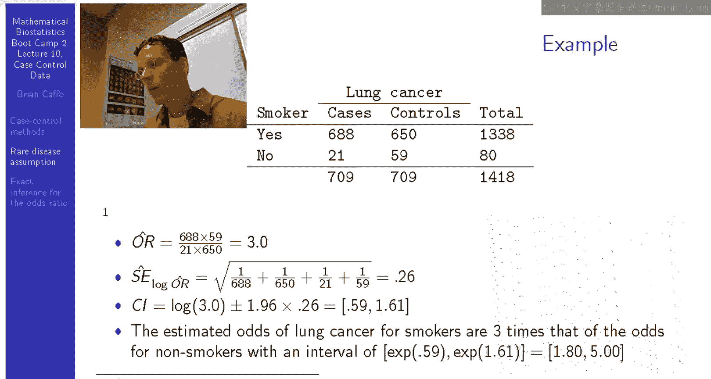
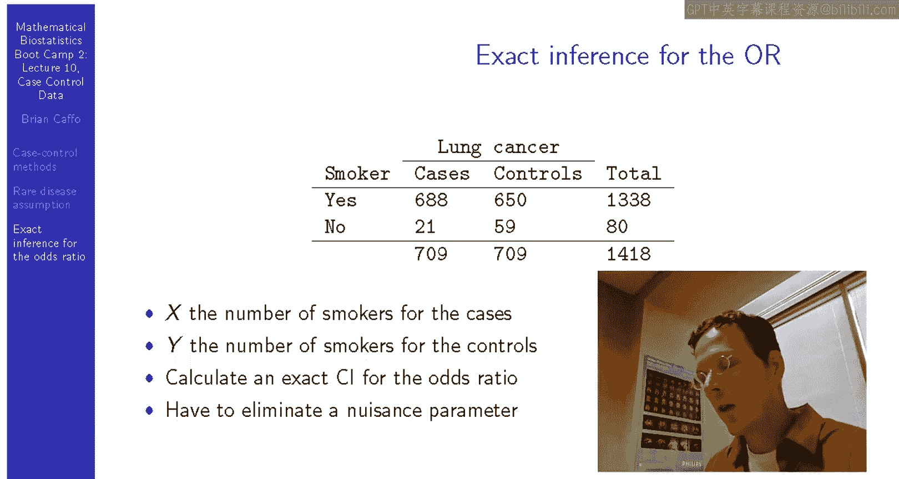
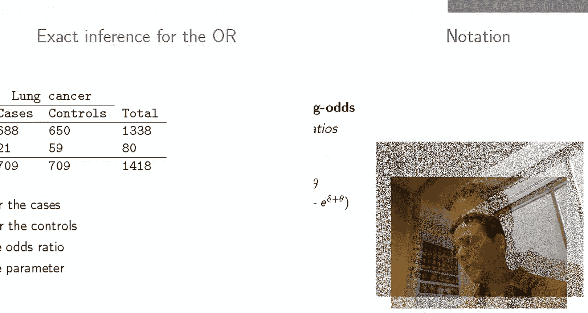
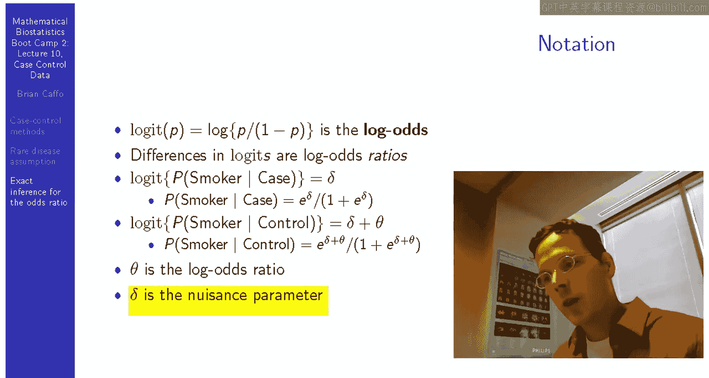
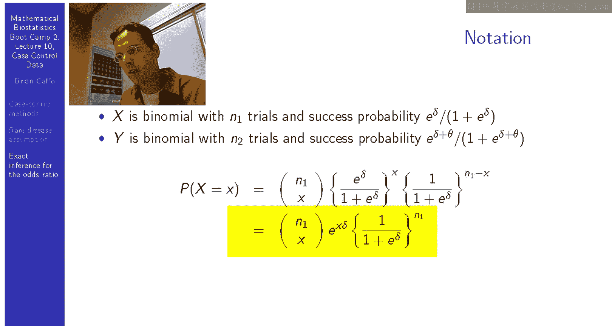
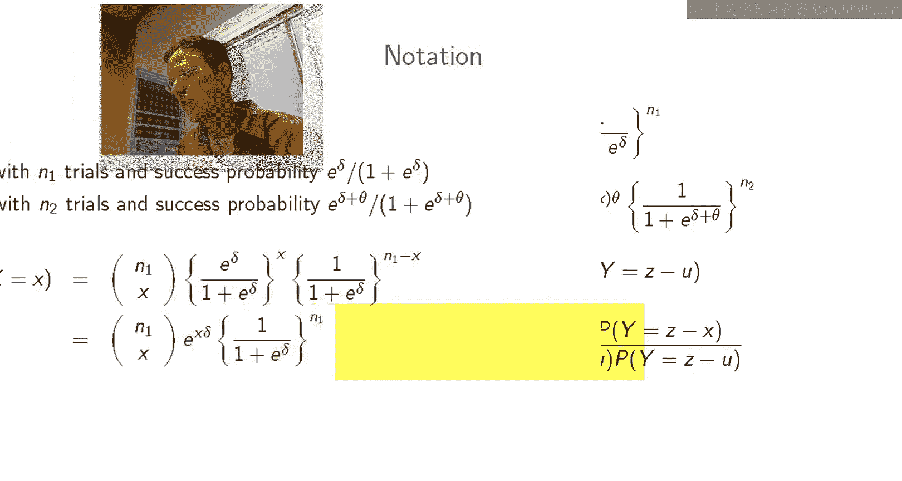
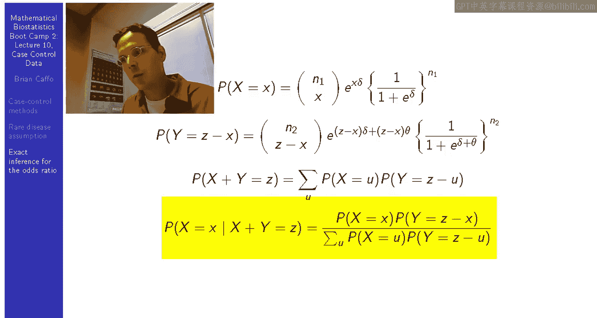
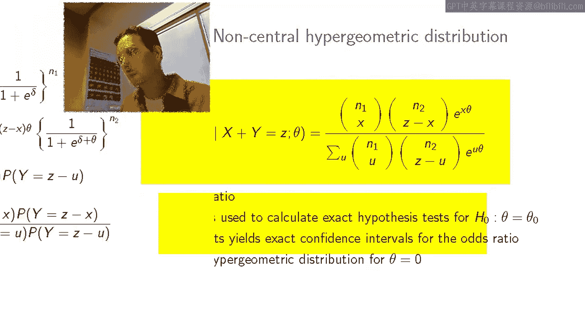
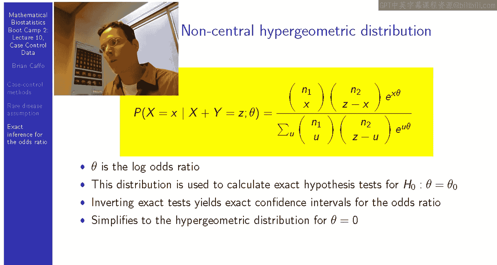
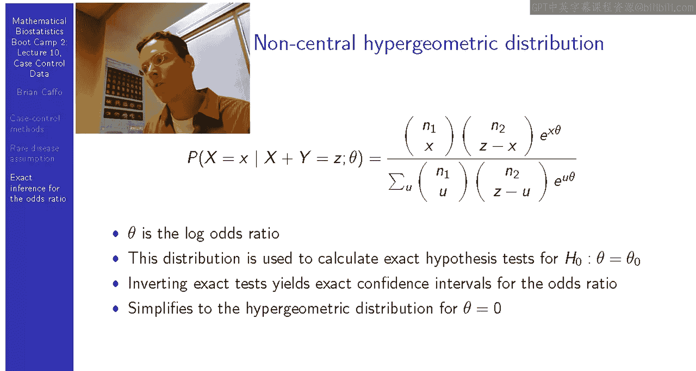

# 高级统计学：第32讲：优势比的精确推断 📊



在本节课中，我们将学习如何对优势比进行精确推断。我们将探讨如何通过条件化方法消除干扰参数，并推导出用于计算精确置信区间的非中心超几何分布。





---

## 概述

上一节我们讨论了优势比在病例对照研究中的应用及其近似推断方法。本节中，我们将深入探讨如何对优势比进行**精确推断**，而非依赖近似公式。我们将从定义相关随机变量开始，逐步推导出精确推断所需的条件分布。

## 模型设定与参数化



首先，定义随机变量。令 **X** 为病例组中的吸烟者人数，**Y** 为对照组中的吸烟者人数。在病例对照抽样中，**X** 和 **Y** 是随机变量，而行列边际总数（例如709）是固定的。我们假设两者均服从二项分布。

我们的目标是计算优势比的**精确置信区间**，而非使用基于单元格计数的近似公式（如带平方根的公式）。为此，我们需要消除一个干扰参数。





定义**logit函数**为几率的对数：
```
logit(p) = log( p / (1 - p) )
```
请注意，两个logit值之差就是对数优势比：
```
logit(p1) - logit(p2) = log( OR(p1, p2) )
```

让我们进行参数化：
*   令病例组吸烟概率的logit值为 **δ**。这意味着：
    ```
    P(吸烟 | 病例) = e^δ / (1 + e^δ)
    ```
*   令对照组吸烟概率的logit值为 **δ + θ**。这意味着：
    ```
    P(吸烟 | 对照) = e^(δ+θ) / (1 + e^(δ+θ))
    ```
在此参数化中，**θ** 即为对数优势比（log odds ratio），因为两个logit相减时 **δ** 被消去。我们关心的参数是 **θ**，而 **δ** 是一个**干扰参数**，我们并不关心它。

## 构建条件分布

基于上述设定，我们假设：
*   **X** ~ Binomial(n1, e^δ / (1 + e^δ))
*   **Y** ~ Binomial(n2, e^(δ+θ) / (1 + e^(δ+θ)))

我们可以写出 **X** 和 **Y** 取特定值的概率。然而，直接处理这些概率会涉及干扰参数 **δ**。为了消除 **δ**，我们考虑在给定总和 **T = X + Y** 的条件下，**X** 的分布。

计算 **X + Y = z** 的概率需要一些技巧，因为 **X** 和 **Y** 并非同分布。我们可以将 **z** 分解为 **u** 和 **z - u** 两部分，分别分配给 **X** 和 **Y**，并对所有可能的 **u** 求和：
```
P(X + Y = z) = Σ_u [ P(X = u) * P(Y = z - u) ]
```





现在，我们关注**条件概率** `P(X = x | X + Y = z)`。根据条件概率的定义和上述分解，我们可以推导出：
```
P(X = x | X + Y = z) = [ P(X = x) * P(Y = z - x) ] / P(X + Y = z)
```
将二项分布的概率公式代入并进行化简，关键的发现是：**最终表达式仅依赖于我们关心的参数 θ，而干扰参数 δ 被完全消去了**。这个过程称为“通过条件化消除干扰参数”。

## 非中心超几何分布与推断

上一节我们得到了条件分布的具体形式，这个分布被称为**非中心超几何分布**。

*   当原假设为 `θ = 0`（即优势比为1）时，该分布退化为普通的超几何分布，这正是**费希尔精确检验**所基于的分布。
*   当 `θ ≠ 0` 时，我们可以利用这个分布计算关于 `θ` 的精确假设检验（例如检验 `θ = θ_0`）。
*   通过**反转这些检验**，我们可以得到优势比 `e^θ` 的**精确置信区间**。这正是统计软件（如R语言中的 `fisher.test` 函数）在计算优势比置信区间时所采用的方法。



以下是该过程的核心步骤总结：
1.  通过条件化 `X + Y` 消除干扰参数 **δ**。
2.  得到服从非中心超几何分布的条件分布，其参数为 **θ**。
3.  利用该分布进行假设检验或反转检验以构建精确置信区间。

## 总结



本节课中，我们一起学习了优势比的精确推断方法。我们从病例对照研究的背景出发，定义了模型并引入了logit参数化。核心在于通过**条件化总和 `X + Y`** 来消除干扰参数 **δ**，从而得到仅依赖于对数优势比 **θ** 的**非中心超几何分布**。这个分布为计算优势比的精确假设检验和置信区间提供了理论基础。虽然具体计算较为复杂，通常由统计软件完成，但理解其推导过程有助于我们深入认识优势比推断的本质。