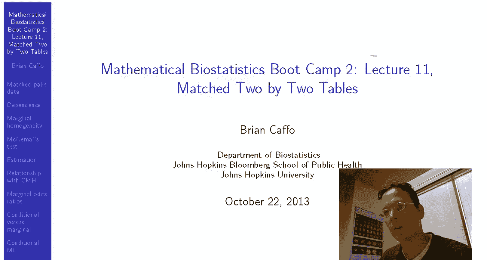
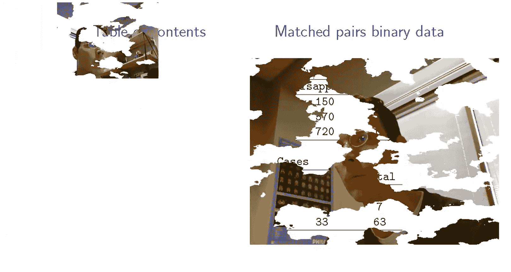
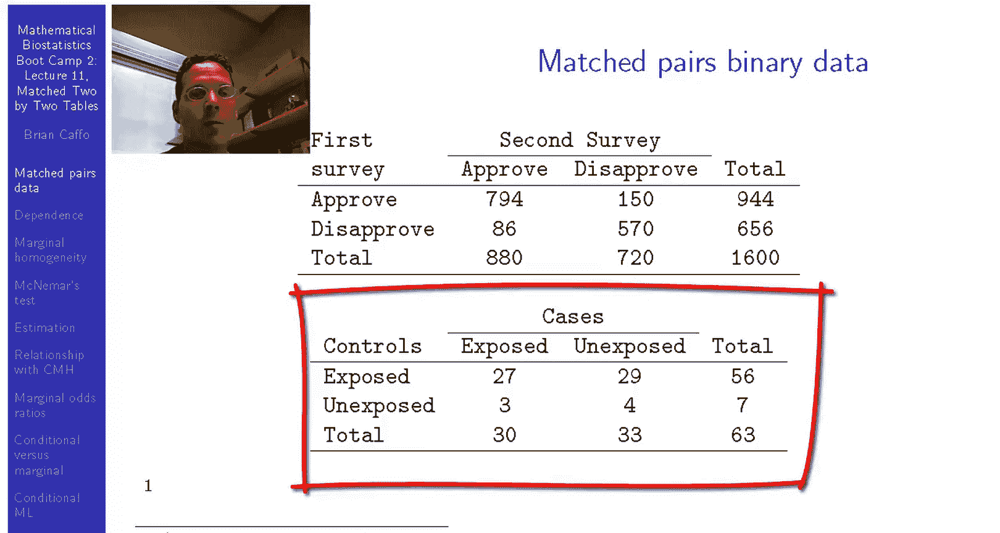

# 约翰霍普金斯大学《数据科学的高级统计｜Advanced Statistics for Data Science》中英字幕（deepseek p64 33_配对2×2列联表.zh_en -BV1htPjeYEFH_p64-

Hi， my name is Brian Kaho， and this is mathematical Bistatistics Boot Camp 2。

 and today we're going to be talking about match 2 by two tables。

Okay， so today we're going to be talking about match Pariss data， which。

It's basically going to be like the pair T test but only now we're going to have binary data。

 so to discuss that we'll have to talk about the subject of dependence then we'll go over some specific test associated with match pairs。

 contingency tables。And then talk about some other details like relationships with the Cochramantle Handsel test。

So here I have some example from some example data from Agressti's categorical data analysis of match pairs binary data。

So。The data in this case was a survey where they were asked approval or disapproval of the politician I believe it was a prime minister or British Prime minister on two occasions。

 so they had a first survey approve or disapprove and then they had a second survey approve or disapprovve。

Okay， so in this two by two tables a little different than some of the other ones we've studied。

 so in this case 794 of them approved on both occasions。So。

You know every one of these 794 measurements then represents two measurements where a person where 794 people said approve once。

 then approve again， 150 said approve the first time then disapprove the second time， okay。So。

A related， a very common example of match Paris data is case control data。

 so here we have cases and controls， we have an exposure and then an unexposed group。

And in this case， we have 27 that were exposed， that were both cases and controls。

 29 that were exposed controls and unexposed cases and so on。

So how did this data wind up being matched since a person for most exposures can't be bothexposed and unexposed。

 for example， you can't both smoke and not smoke。So the way this usually works is they will say。

 let's say this is a retrospective study。They would take a collection of cases from charts and ascertain whether they were exposed or unexposed。

 and then they would go find with respect to lots of demographic variables like age and other things very closely matched subjects。

 closely matched controls， and then ascertain whether those controls were exposed or unexposed。

So this process of matching pairs each individual observation because they were matched on all these other variables like age and。

Perhaps in other demographics， so it's different from an instance where you have a bunch of cases then you just select a bunch of controls and hope that they're comparable in this case you've made subjects directly comparable by at least on everything that you can think of that's important you've matched on So here's two very common instances of matched binary data。

