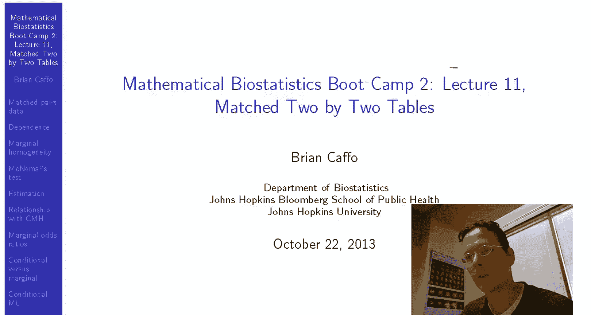
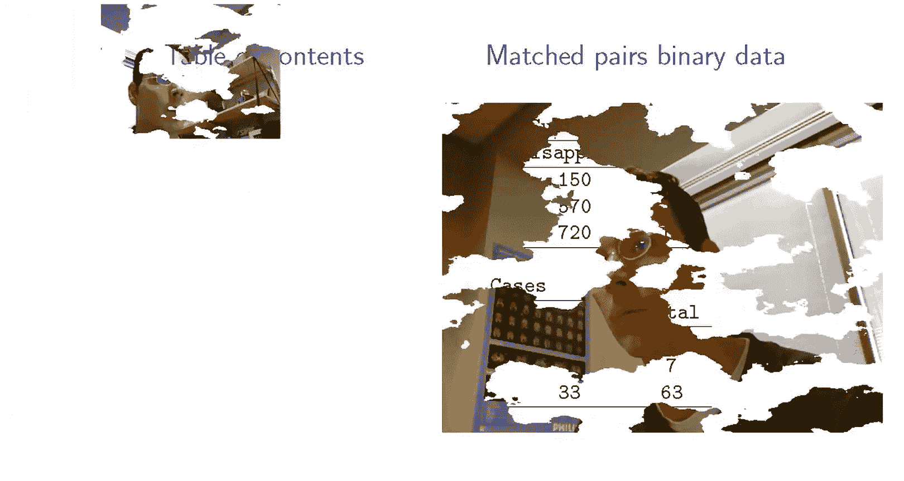
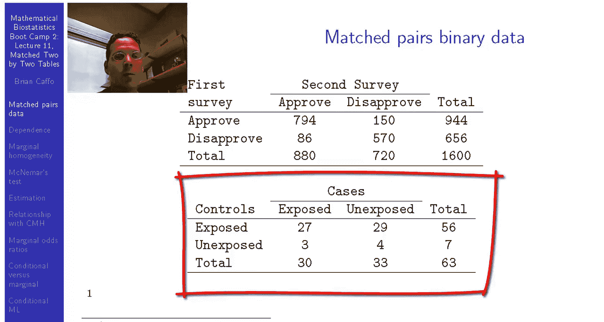

# 高级统计学：第33章：配对2×2列联表 📊

在本节课中，我们将学习如何处理和分析配对设计的二元数据。我们将探讨数据的依赖性，介绍专门用于配对列联表的统计检验方法，并通过具体例子来理解其应用。

上一节我们介绍了独立样本的列联表分析，本节中我们来看看当数据来自配对设计时，情况有何不同。

## 配对数据的依赖性

配对数据意味着每个观测单位（如一个人）被测量了两次，或者两个观测单位因某些特征（如年龄、性别）而被“匹配”在一起。这导致两次测量之间不是独立的，而是存在依赖关系。这与配对t检验的思想类似，但此处我们的数据是二元的（例如“赞成/反对”、“暴露/未暴露”）。

## 配对2×2列联表示例

以下是两个常见的配对二元数据实例。

### 实例一：重复调查数据

此数据来自Agresti的《分类数据分析》，是一项关于政治家支持率的重复调查。
*   794人在两次调查中都表示“赞成”。
*   150人第一次“赞成”，第二次“反对”。
*   86人第一次“反对”，第二次“赞成”。
*   570人在两次调查中都表示“反对”。

在这个2×2表中，每个单元格代表的是**人**的数量，而每个人贡献了两次测量结果。

### 实例二：病例-对照研究数据

在病例-对照研究中，配对是另一种常见形式。
*   27对：病例暴露，对照也暴露。
*   29对：病例暴露，对照未暴露。
*   3对：病例未暴露，对照暴露。
*   4对：病例未暴露，对照也未暴露。

这里的关键是，每个“对”是一个观测单位。研究者会为每个病例精心匹配一个在重要特征（如年龄）上相似的对照，然后分别检查他们的暴露状态。因此，数据是以配对形式组织的。

## 配对数据的检验方法

由于数据是配对的，我们不能使用标准的卡方检验，因为它假设观测是独立的。针对配对2×2表，最常用的检验是**McNemar检验**。

McNemar检验的核心思想是，它只关注那些结果不一致的配对（即一个成功一个失败的配对）。检验的公式基于不一致配对的数量。

设：
*   **b** = 第一次成功、第二次失败的配对数量。
*   **c** = 第一次失败、第二次成功的配对数量。

在原假设（两次测量的成功率相同）下，统计量近似服从卡方分布：
`χ² = (b - c)² / (b + c)`

以下是应用McNemar检验的步骤：
1.  构建配对2×2列联表。
2.  识别不一致配对的数量 **b** 和 **c**。
3.  将 **b** 和 **c** 代入上述公式计算卡方值。
4.  与自由度为1的卡方分布比较，得出p值。

## 与其他检验的关系

McNemar检验与Cochran-Mantel-Haenszel检验在特定条件下存在联系。当CMH检验用于分层分析，且每层仅有一个配对时，其结果与McNemar检验等价。这体现了不同统计方法在处理相同数据结构时的一致性。

## 总结

本节课中我们一起学习了配对2×2列联表的分析方法。我们首先理解了配对数据带来的依赖性，然后通过政治调查和病例-对照研究两个例子认识了这种数据结构。核心内容是**McNemar检验**，它通过分析不一致配对的数量来检验两个相关比例是否相等。最后，我们简要提到了它与CMH检验的关联。掌握该方法对于分析重复测量或精心匹配的二元数据至关重要。