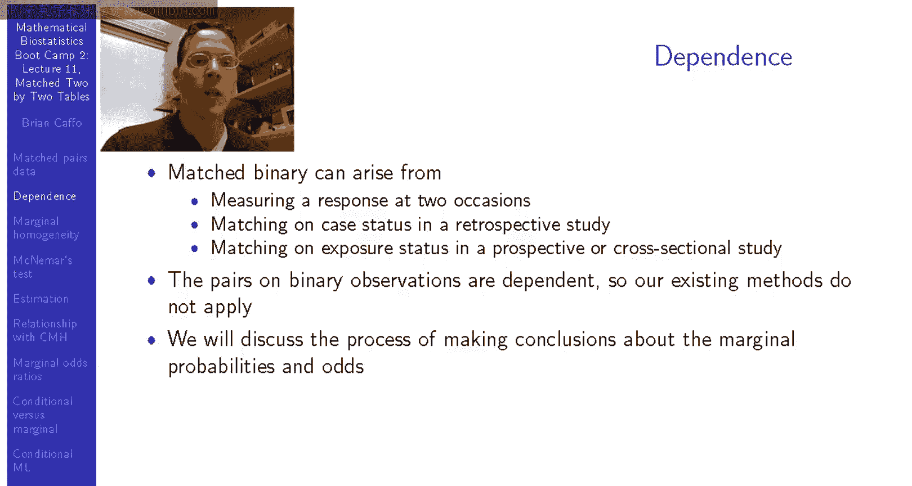
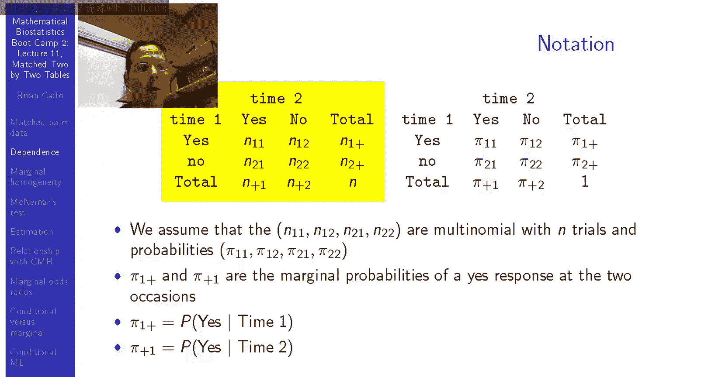
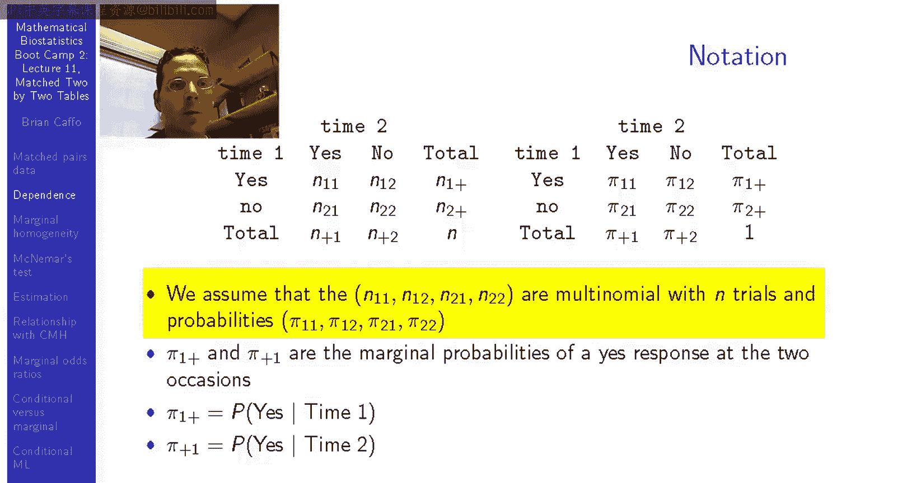
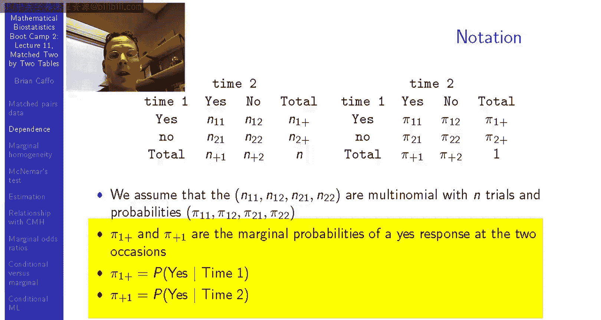
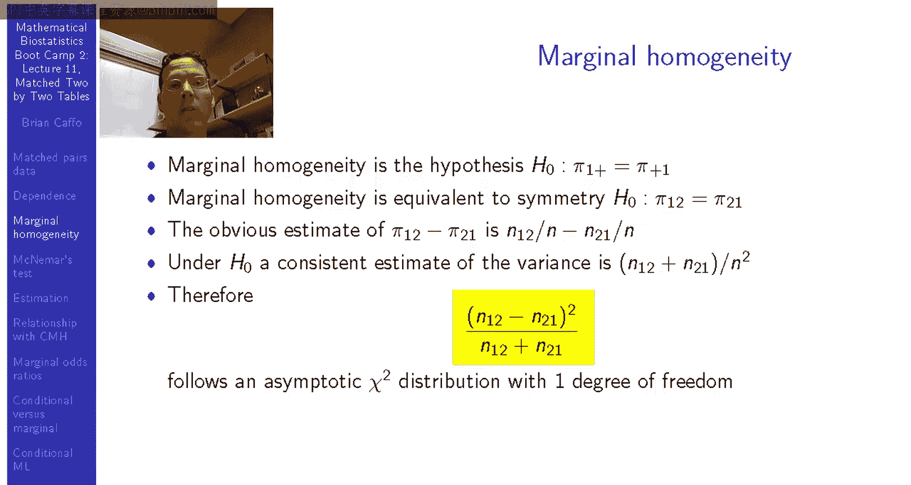
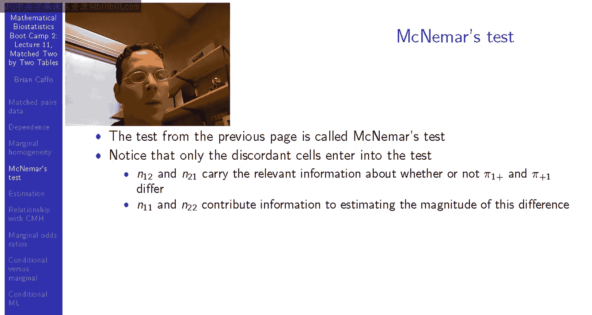
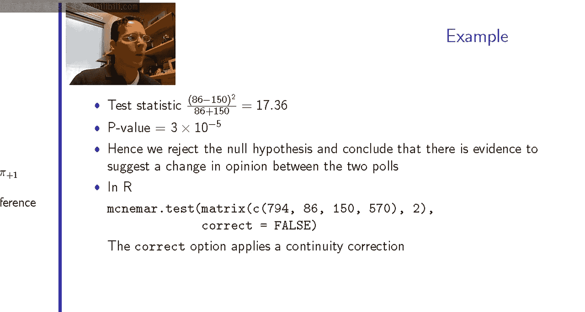
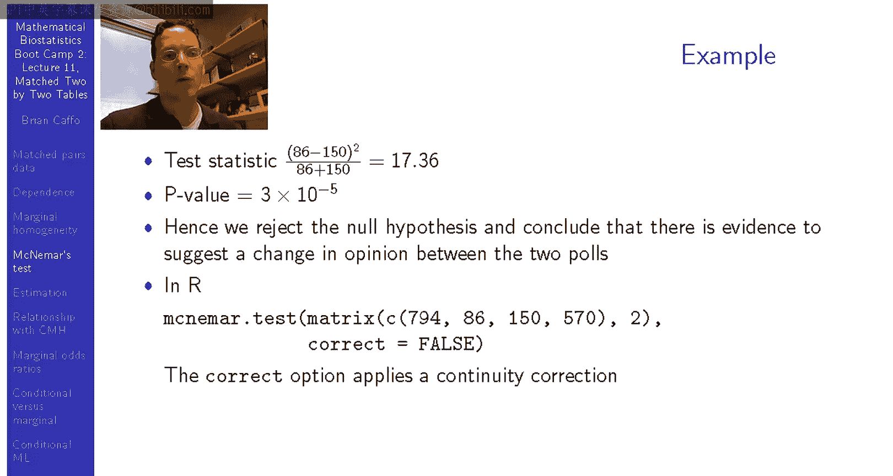

# 约翰霍普金斯大学《数据科学的高级统计｜Advanced Statistics for Data Science》中英字幕（deepseek p65 34_依赖性与边际同质性.zh_en -BV1htPjeYEFH_p65-

Okay， so just expanding on these points， matched binary data can arise from several circumstances。

 for example， when measuring responsive to occasions。

Or matching on case status in a retrospective study。

Maching on exposure status in a prospective study or a cross sectional study。And all of these cases。

 matching in general， right， matching in general induces a dependence and that has to be accounted for in the analysis。

So the pairs on binary observations are。Independent， or I'm sorry。The pairs are dependent。

 in other words， your response at time1 is correlated with your response at time two。

 so our existing methods don't apply， however， we assume that person one who responded at time one and time two is independent of person two who responded at time1 and time two。

 so there we're assuming independence across pairs but dependent within pairs。

Okay， so let's look at some notation。So here we're going to use our standard contingency table notation where we have N11。

 N12， N2，1，N22 for the four cells， and then we have n plus 1 n plus 2， n1 plus N2 plus。Am。And so。

 here's our data。The ends。And we're going to assume that the four cell counts， n11， n12。

 n21N22 are multinomial with n， which is the sum of them。Trials。

And then the associated probabilities is conveniently labeled pi 11， pi 12， pi 21， and pi 22。

So in other words。We're going to assume that every pair of measurements。Every time1。

 time two collection pair of measurements。Is going to be a one or a zero in exactly one1 in one of these four locations。

 So the person will have either said yes at both occasions， a yes and then a no。

 a no and then a yes or a no and then a no， so there are going to only be a one in each one of those occasions。

And the probability， of being。The probability of being a one in that particular cell is pi I J。

And then the multinomial is just the sum of all of these multivariate Bnouloleles。Okay。

And then we would denote the margins with plus n1 plus for the row margin。

 pi1 plus for the row margin of the probabilities and so on。

And so pi1 plus and pi plus1 are the marginal probabilities of a yes response at the two occasions disregarding the other occasions。

 So pi 1 plus is the probability of saying yes at time1。

 regardless of whether or not you said yes at time 2 and pi plus1 is the probability of saying yes at time2。

 regardless of whether or not you said yes at time 1。

O。

So marginal homogeneity is the hypothesis that these two marginal probabilities are the same。

 that's how it gets its idea， marginal homogeneity， pi 1 plus equals pi plus 1。

 and of course because there's only two probabilities right if pi 1 plus equals pi plus 1。

 pi 2 plus equals pi plus 2， so the marginal probabilities are the same。

 and so we call it marginal homogeneity。You can do a very quick calculation。

 right P 1 plus is pi 11 plus pi 12 pi plus 1 is pi 11 plus pi 21 right and the pi 11 is common in both of those if you subtract them out。

 this hypothesis is identical to pi 12 equal to pi 21。Okay。

 and so that hypothesis is referred to as symmetry because it is the off diagonal elements of the table and it's basically saying that the true probability matrix。

 the true probability 2 by two table would satisfy being identical under the transpose if you were to transpose the table。

And so that property is called symmetry and hence this marginal homogeneity hypothesis is equivalent to symmetry only in the case of a two by two table and in more general cases。

 it's not true。So we clearly have an estimate for all of the pis。

 so pi 12 estimate is just the n12 divided by n， pi 21 estimate is n21 divided by n and so on。

Simply the proportion the estimates of the true probabilities of landing in each cell would be the proportion of people who landed in each cell。

 so the obvious estimate of the difference between pi 12 and pi 21 I。e。

 how far away from symmetry are you are or in other words how far away from marginal homogeneity you are。

Is just n12 over n minus n21 over n。And it turns out。

 and this is maybe a little bit involved for us to go through。

 but under H9 a consistent estimate of the variance turns out to be n12 plus n21 divided by n squared。

嗯。And so if you were to。Take this numerator and take this as our statistic N12 over n minus n21 over n and divide it by the standard error square root n12 plus N21 divided by square root of n12 plus n21 divided by n。

Divide those two， you would get a so-called Z statistic。

 the preference the preference in this case is typically to square that statistics。

 I think that matches the traditional development and so the square of that statistic works out to have this convenient form n12 minus n21 squared over n12 plus N21。

And this follows a chi square distribution because of course the Z statistic。

Squared follows a high square distribution with one degree freedom。

So this is the famous Magnamas test statistic， and you reject marginal homogeneity if this test statistic is large。

So this test is called Mcda Mars test。And。Notice what's interesting about McnaAs test is that only N12 and N21 are used。

 they're the only ones that carry the relevant information about pi 1 plus and pi plus1 being different。

An。嗯。Now。N11 and N22， the concordant cells contribute to the magnitude of this difference。

 but in testing whether or not they differ， it's only the discordant cells N12 and N21 where people disagreed from time1 to time2 so that's an interesting fact about this test and it's called Magna Mars test。

And it's a very famous statistic。

Okay， so let's look at our test statistic from the approval writing example。

 we have 86 and 150 is the off diagonal cells so that's 86 minus 150 quantity squared over 86 plus 150 that works out to be 17。

36 the P value is extremely small then right because。

a chiis card with one degree of freedom it's going to be unlikely to be extremely unlikely to be above9。

 three squared where three is a way out in the tail of a standard normal hence we reject an eye hypothesispo and conclude that there appears to be some sort of change in the opinion between the poles at any rate in R you can just do macnamar do test you have to give it a matrix and again this is one of these options these one of these instances where if you。

If you want to get exactly the statistic you work out by hand。

 you have to put correct equals false because it does a continuity correction by default you want in general to leave the continuity correction in。

 I'm just putting it as false here so you get it matches exactly your by hand calculations。

