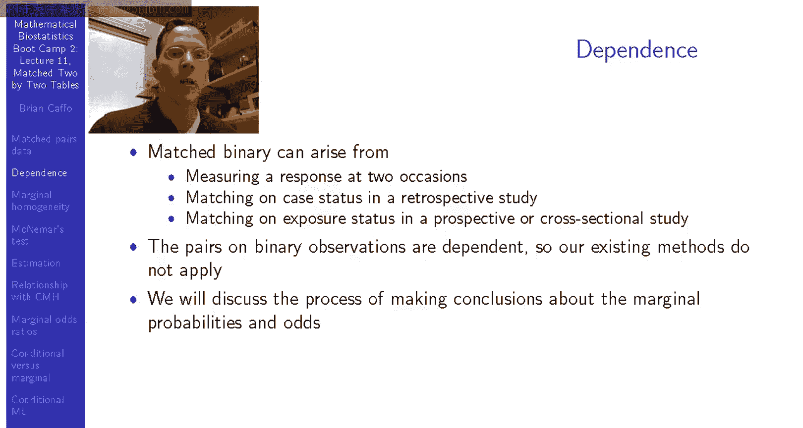
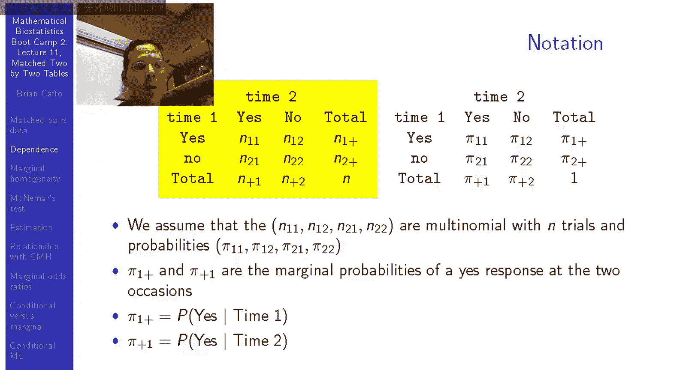
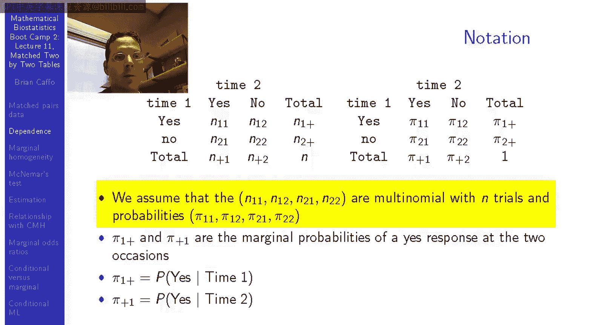
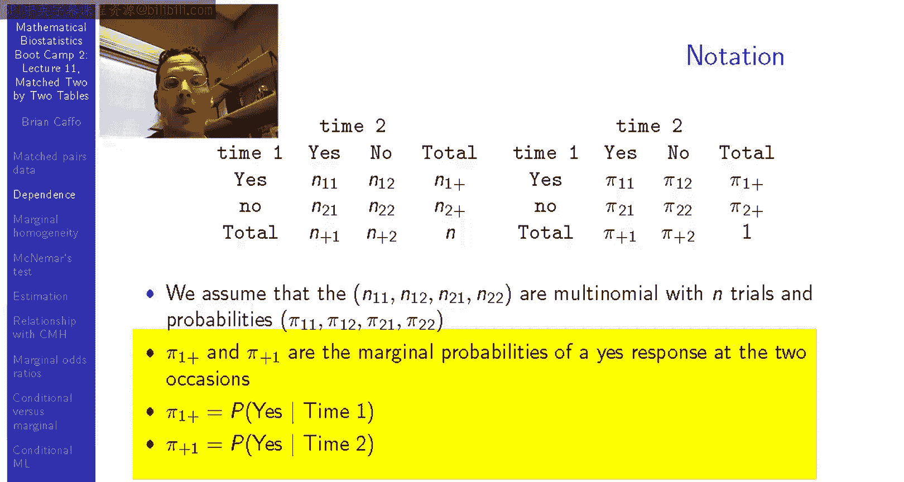
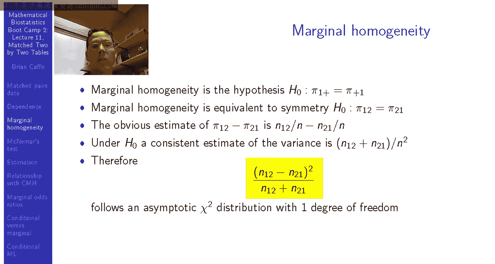
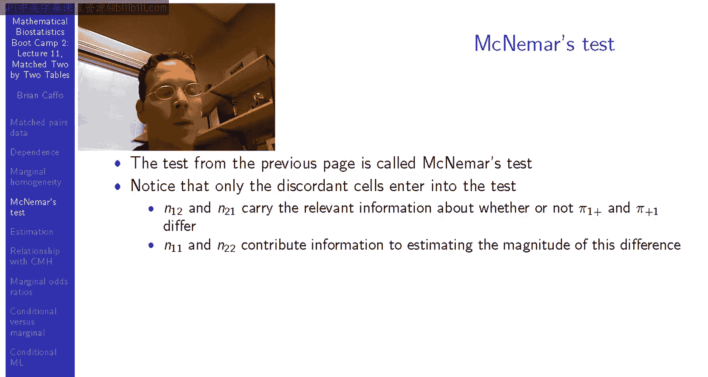
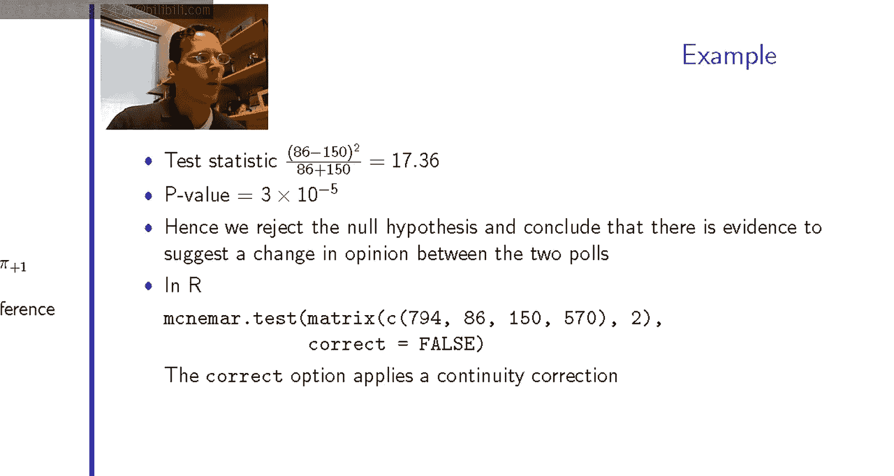
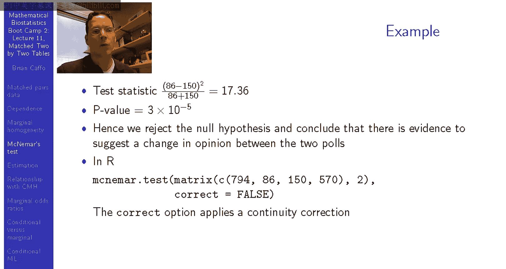

# 数据科学的高级统计：34：依赖性与边际同质性

在本节课中，我们将学习如何处理匹配的二元数据。匹配数据在分析时会产生依赖性，因此不能使用我们之前学过的方法。我们将重点介绍边际同质性的概念，并学习如何通过麦克尼马尔检验来检验它。

## 匹配二元数据的来源

匹配的二元数据可能出现在多种情况下。以下是几种常见的情形：



*   测量不同时间点的响应。
*   在回顾性研究中，根据病例状态进行匹配。
*   在前瞻性或横断面研究中，根据暴露状态进行匹配。

在这些情况下，匹配通常会在数据中引入依赖性，在分析时必须加以考虑。



## 数据中的依赖性与独立性

对于匹配的二元数据，配对内的观测值是**依赖**的。例如，一个人在时间点1的响应与其在时间点2的响应是相关的。然而，我们假设**不同配对之间是独立的**。也就是说，第一个人在两个时间点的响应与第二个人在两个时间点的响应是相互独立的。

因此，我们的分析模型假设：**配对间独立，但配对内依赖**。



## 列联表与符号表示

为了分析这类数据，我们使用标准的2x2列联表表示法。假设我们有 `n` 对观测值，每对观测值（时间点1和时间点2）的结果会落入以下四个单元格之一：

*   `n11`: 两个时间点都回答“是”的对数。
*   `n12`: 时间点1回答“是”、时间点2回答“否”的对数。
*   `n21`: 时间点1回答“否”、时间点2回答“是”的对数。
*   `n22`: 两个时间点都回答“否”的对数。




这四个单元格的计数 `(n11, n12, n21, n22)` 服从多项分布，总试验次数为 `n = n11 + n12 + n21 + n22`，对应的概率为 `(π11, π12, π21, π22)`。

我们用加号表示边际总和：
*   `n1+ = n11 + n12`：时间点1回答“是”的总数。
*   `n+1 = n11 + n21`：时间点2回答“是”的总数。
*   对应的边际概率为 `π1+` 和 `π+1`。

## 边际同质性与对称性

上一节我们介绍了数据的表示方法，本节中我们来看看核心的假设——边际同质性。

**边际同质性** 是指两个时间点的边际概率相等，即：
**`π1+ = π+1`**

由于概率总和为1，这也意味着 `π2+ = π+2`。通过简单计算可以发现，这个假设等价于：
**`π12 = π21`**

这个性质被称为**对称性**，因为它要求概率表关于主对角线对称。**在2x2表中，边际同质性等价于对称性**，但在更大的列联表中，这不一定成立。

## 麦克尼马尔检验

为了检验边际同质性（即 `π12 = π21`），我们使用麦克尼马尔检验。检验统计量基于不一致配对的数量（即 `n12` 和 `n21`）。

检验统计量的计算公式为：
**`X² = (n12 - n21)² / (n12 + n21)`**

在零假设（边际同质）下，这个统计量近似服从自由度为1的卡方分布。如果计算出的 `X²` 值很大，对应的P值很小，我们就拒绝零假设，认为两个时间点的边际概率存在显著差异。

值得注意的是，这个检验**只使用了不一致配对 `n12` 和 `n21`** 的信息。一致配对（`n11` 和 `n22`）虽然影响差异的大小，但在检验差异是否存在时，信息主要来自那些响应发生变化的配对。



## 实例分析

让我们看一个总统支持率调查的例子。假设调查数据如下：

*   `n12 = 86` （第一次支持，第二次不支持）
*   `n21 = 150`（第一次不支持，第二次支持）





计算麦克尼马尔检验统计量：
**`X² = (86 - 150)² / (86 + 150) = 4096 / 236 ≈ 17.36`**

查自由度为1的卡方分布表，`X² = 17.36` 对应的P值非常小（远小于0.05）。因此，我们拒绝边际同质的零假设，得出结论：两次调查之间，公众的支持率发生了显著变化。

在R语言中，可以使用 `mcnemar.test()` 函数进行计算。默认情况下，函数会进行连续性校正。如果希望结果与手工计算完全一致，可以设置参数 `correct=FALSE`。

```r
# 假设数据矩阵为 mat
# mat <- matrix(c(n11, n12, n21, n22), nrow=2)
mcnemar.test(mat, correct=FALSE)
```

## 总结



本节课中我们一起学习了如何处理匹配的二元数据。我们了解到匹配会引入配对内的依赖性，因此需要特殊方法。我们定义了边际同质性的概念，并发现它在2x2表中等价于对称性。最后，我们重点掌握了**麦克尼马尔检验**，这是一个利用不一致配对信息来检验边际同质性的重要方法。通过实例，我们看到了如何应用该检验得出统计结论。