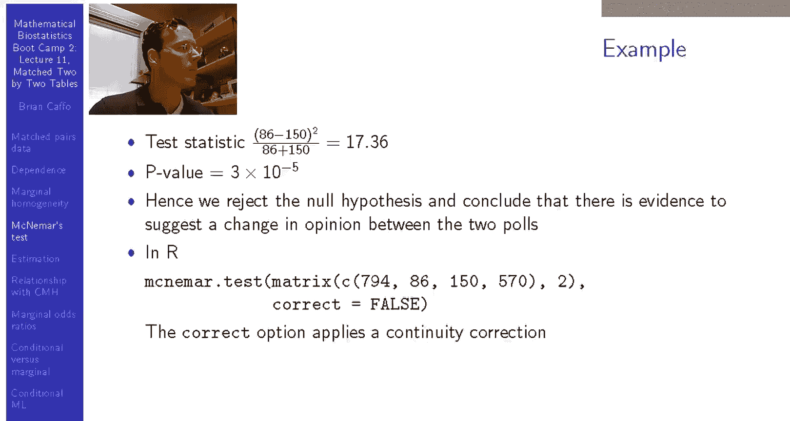
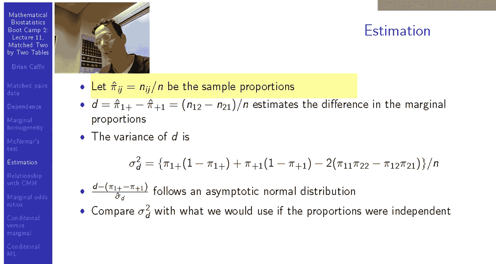
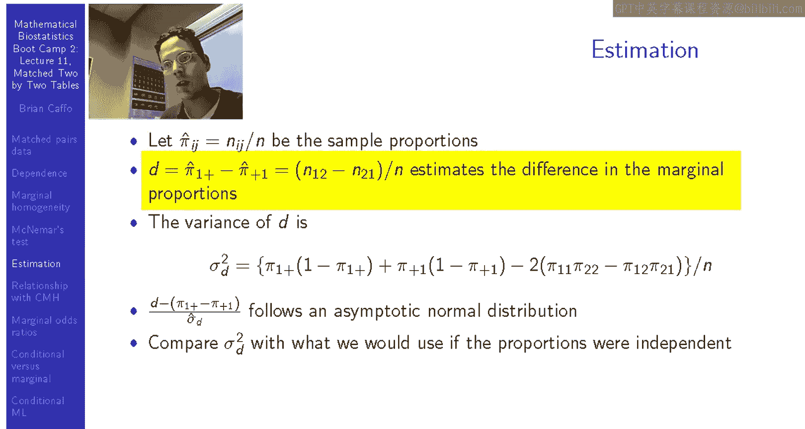
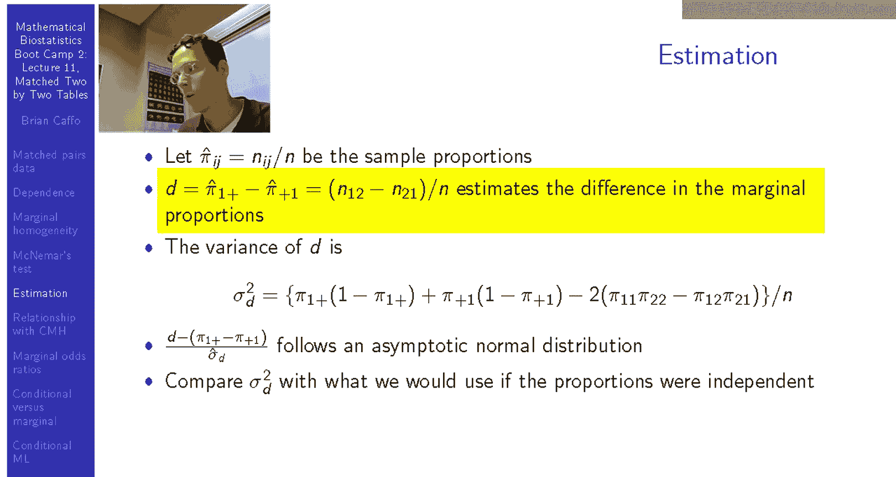
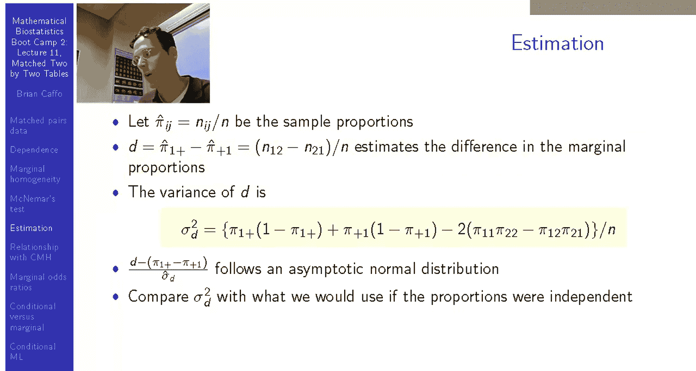
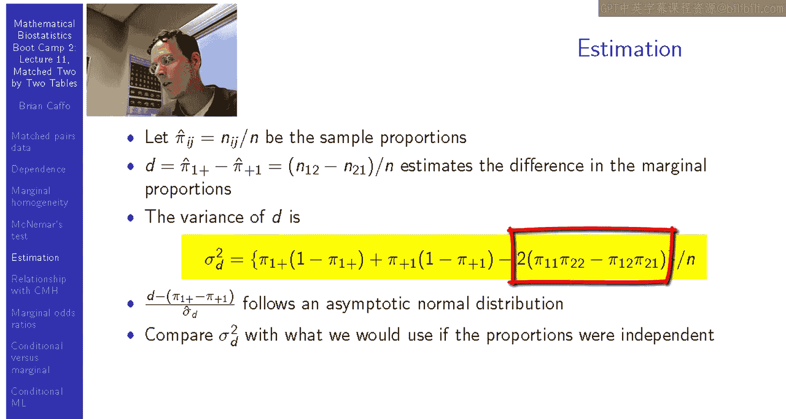
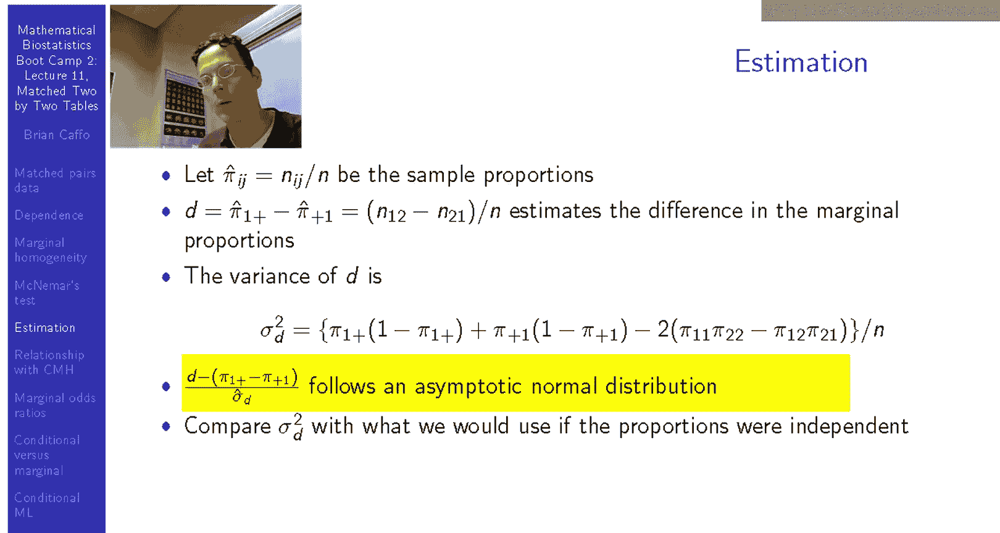
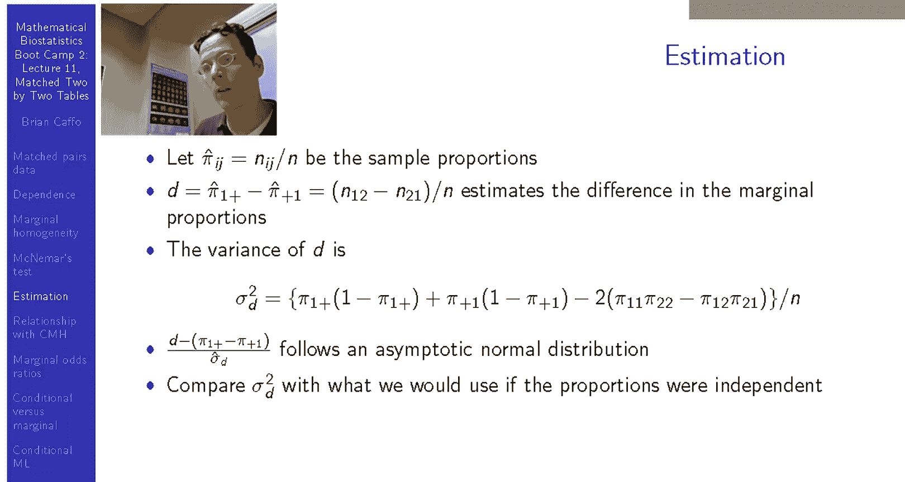

# 约翰霍普金斯大学《数据科学的高级统计｜Advanced Statistics for Data Science》中英字幕（deepseek p66 35_比例边际差的估计.zh_en -BV1htPjeYEFH_p66-

So。It's not just enough to have a testing procedure。

 we'd also like to have some sort of confidence interval。

So let's let Pi I J hat be the sample proportions。And。

Imagine if we want to estimate D equal to the difference in the marginal proportion。 So in this case。

 this would be the difference in the marginal probability of an approved vote so。

So then this is equal to n12 minus n21 over n。 So that estimates the difference in the marginal proportions。

So we talked in the previous slide about the variance of this estimator。

 but the variance of this estimator under the nu hypothesis。

 let's talk about the variance of the estimator in general and the variance works out to be this format。

 this form pi1 plus1 minus pi1 plus plus pi plus11 minus pi plus1， so that's the。

You know， divided by n， that would be the kind of。A difference in binomial type variants that you would expect to see。

And because the samples are correlated， we have this correlation term minus twice pi 11， pi22。

 minus pi 12， pi 21， okay， and so that's subtracting off the correlation here。嗯。What would happen？

If basically there's a lot of。Counts in these off diagonal cells， pi 1，2 and pi 2，1， right。

 then pi 1，2 and pi 21， pi 12 times pi 2，1 would be a big number。 We'd have minus。

Twice that big number， which would result in a larger variance。Am。

If the off diagonal cells are really small and most of the data lie on the main diagonal。

Then pi 12 at times pi22 would be very large and we'd have minus twice that。

Number and we'd wind up with a much smaller variance than the standard kind of difference in binomials variance okay。

So we could take D minus the true difference in proportions divided by the standard error estimate here。

 and that follows an asymptotic normal distribution。

And。We can use that again to create conference intervals。

 I think I hope everyone at this point in the class could do something like that。

So this last bullet point here， I say compare Sigma D to what we would use if the proportions were independent。

So compare the result to if instead of asking the same people on two occasions whether or not they approve。

 what if we asked a different set of people each time， then this minus twice part would go away？Okay。

But what do we kind of think we kind of think。That。

People who approve on the first occasion would be more likely to approve on the second occasion。

 you might think if you're in the US if you're a Democrat。

 you might you know approve of say President Obama on a first question you would be more likely to approve on the second question on the second time point and the same thing of the people who would disapprove if you were a Republican and you disapprorovve on the first time point you'd be more likely to disapprove the second time point。

 so in that follows you know that's a very frequent form of correlation。

Where the measurements tend to be concordant， they tend to agree。

So that is exactly this case where pi 11 times pi22 will be much larger than pi12 times pi 21。

 in other words things will tend to lie on the main diagonal of that two by 2 table of the match2 pi 2 table in that people will tend to agree。

And so if that's the case， this covariance term here will be positive。

 so we'll have minus twice this positive number and you'll get a dramatic reduction。In the variance。

 so in other words。Failing to account。For the fact that the same people were asked twice。

In this case would be a really kind of dumb thing to do because you have a reduction。

 you don have a reduction in precision， you get a much wider conference interval。

If if you fail to do that， so I think it's interesting in general。

 but even if it resulted in a wider interval to account for the dependency。

 you'd still want to do it because that will give you the correct interval rather than one that's based on completely incorrect assumptions。

