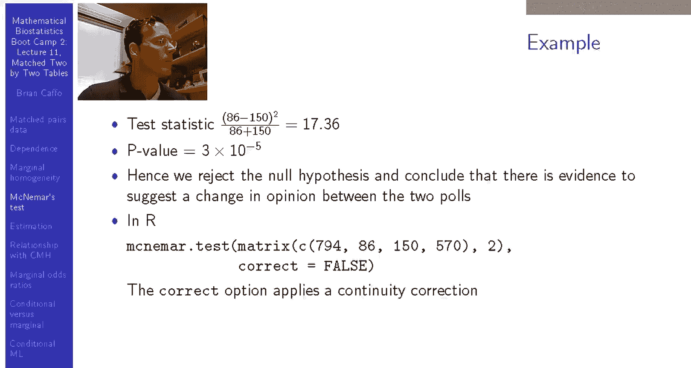
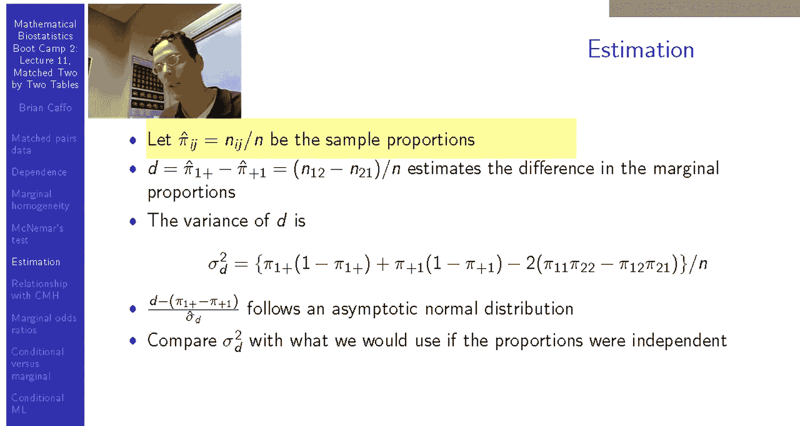
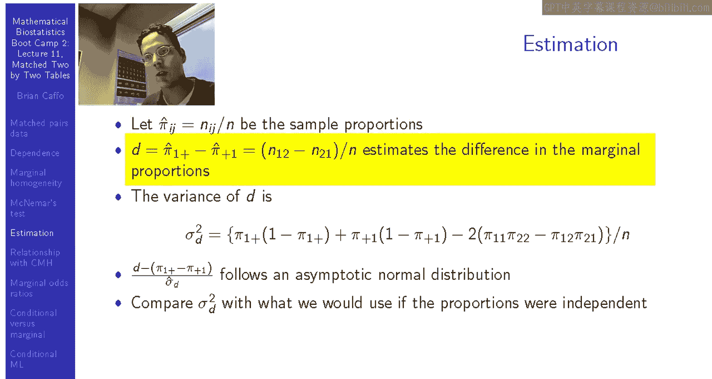
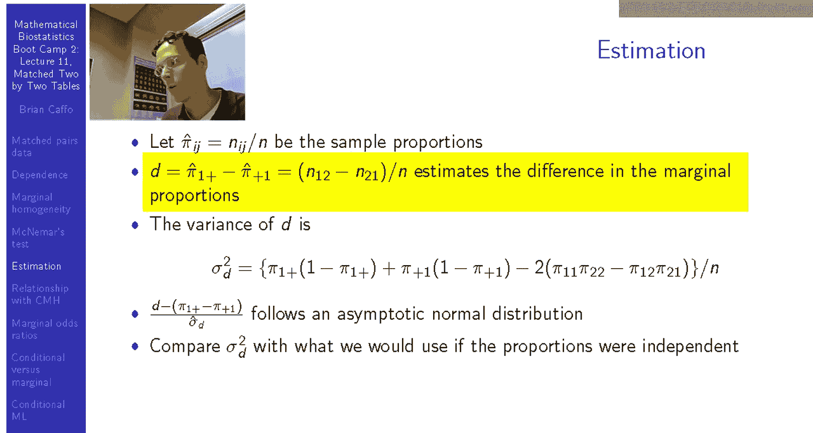
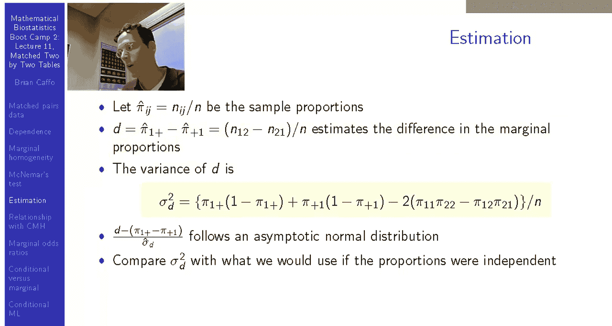
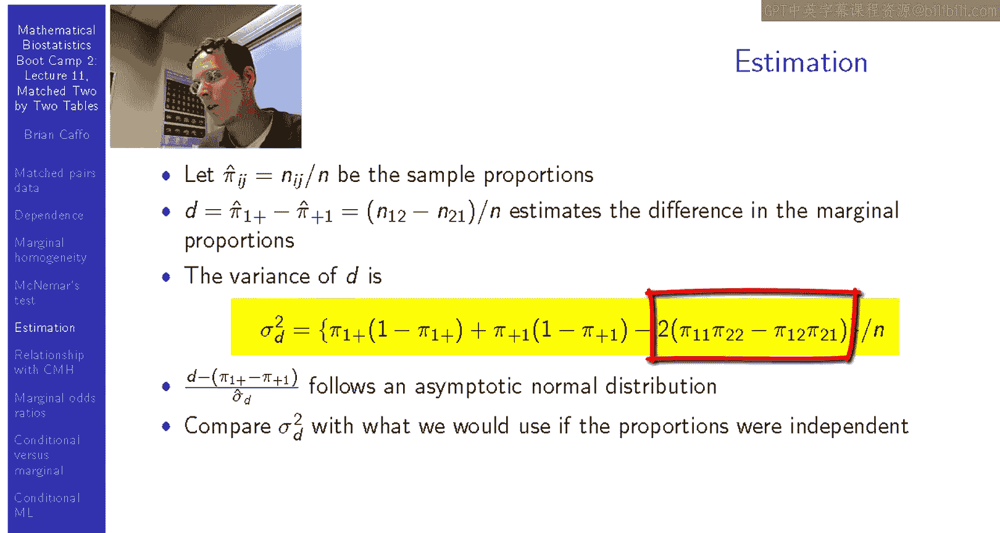
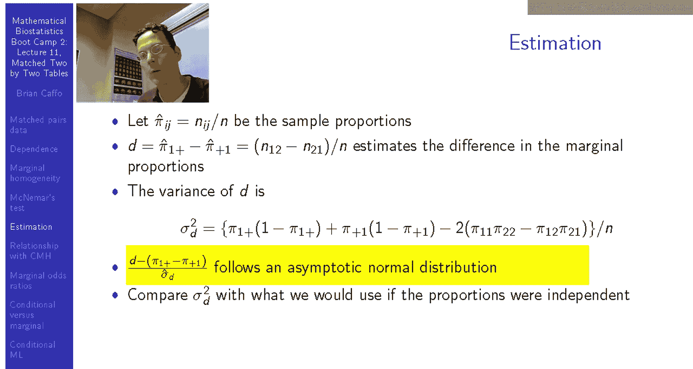
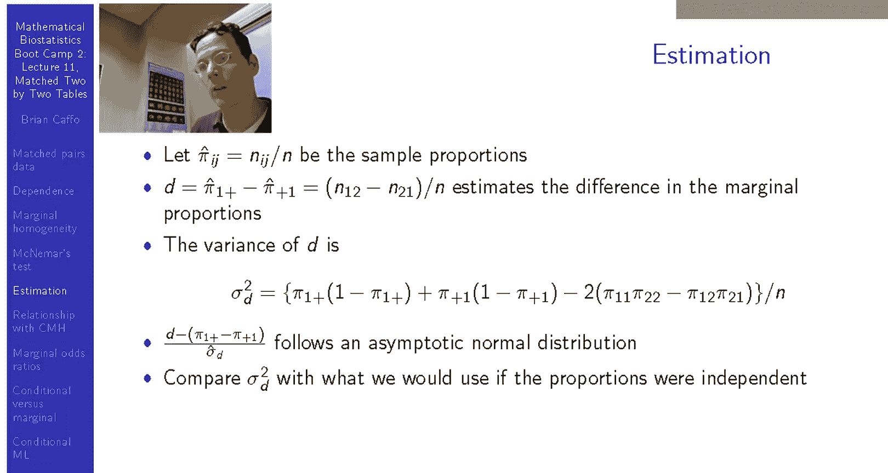

# 数据科学的高级统计：35：比例边际差的估计 📊

在本节课中，我们将学习如何估计配对比例数据中的边际比例差，并构建其置信区间。我们将探讨估计量的方差计算，并重点分析数据相关性对方差估计的影响。

## 概述

仅有假设检验程序是不够的，我们还需要构建某种置信区间。假设我们想要估计边际比例之间的差值 `D`。在之前的例子中，这将是“赞成票”的边际概率之差。

## 估计量的定义与计算

设 `π_ij_hat` 为样本比例。我们想要估计的边际比例差 `D` 定义为：

**D = π_{1+} - π_{+1}**

其中，`π_{1+}` 表示第一次调查中赞成的边际比例，`π_{+1}`` 表示第二次调查中赞成的边际比例。

这个差值 `D` 的估计量可以表示为：

**D_hat = (n_{12} - n_{21}) / n**

这里，`n_{12}` 表示第一次赞成、第二次不赞成的人数，`n_{21}` 表示第一次不赞成、第二次赞成的人数，`n` 是总样本量。这个公式直接估计了边际比例之差。

## 估计量的方差

上一节我们讨论了在零假设下该估计量的方差。现在，我们来探讨一般情况下估计量的方差。其方差公式如下：

**Var(D_hat) = [π_{1+}(1-π_{1+}) + π_{+1}(1-π_{+1}) - 2(π_{11}π_{22} - π_{12}π_{21})] / n**

这个公式可以理解为两个二项分布比例之差的方差形式，但由于样本是相关的，我们需要减去一个相关性项 `-2(π_{11}π_{22} - π_{12}π_{21})`。

以下是关于方差项的具体说明：

*   **主效应部分**：`[π_{1+}(1-π_{1+}) + π_{+1}(1-π_{+1})] / n` 是如果两次测量独立时，比例差的标准方差形式。
*   **相关性调整部分**：`-2(π_{11}π_{22} - π_{12}π_{21})` 用于调整两次测量之间的相关性。
    *   如果非对角线单元格（即意见改变者 `π_{12}` 和 `π_{21}`）的计数很多，那么 `π_{12}π_{21}` 会是一个较大的数。减去两倍的这个大数，实际上会导致**方差增大**。
    *   如果非对角线单元格很小，数据主要集中在主对角线上（即意见一致者 `π_{11}` 和 `π_{22}`），那么 `π_{11}π_{22}` 会很大。减去两倍的这个大数，会得到一个比标准二项分布差值方差**小得多**的方差。

## 构建置信区间

基于上述方差估计，我们可以构建统计量：

**(D_hat - D) / SE(D_hat) ~ 渐近正态分布**

其中，`SE(D_hat)` 是 `D_hat` 的标准误，通过对方差公式中的总体比例 `π` 替换为样本比例 `π_hat` 来估计。

利用这个渐近正态性，我们可以为标准误创建一个置信区间。我相信到了课程的这个阶段，每个人都应该能够完成类似的操作。

## 与独立情况下的方差比较

最后，让我们将实际方差 `σ_D^2` 与假设比例独立（即两次调查询问的是不同人群）时我们会使用的方差进行比较。

如果数据是独立的，那么调整相关性的 `-2(...)` 部分就会消失。然而，在实际的配对设计中，我们通常预期测量值之间存在一致性（concordance）。例如，在美国，第一次赞成奥巴马总统的人，第二次更可能再次赞成；第一次不赞成的人，第二次也更可能再次不赞成。这是一种常见的正相关形式。

在这种情况下，`π_{11}π_{22}` 会远大于 `π_{12}π_{21}`，即数据倾向于落在配对列联表的主对角线上。这使得协方差项 `(π_{11}π_{22} - π_{12}π_{21})` 为正。因此，减去两倍的这个正数，会带来方差的**显著减小**。

换句话说，如果忽略“同一人被询问两次”这一事实（错误地使用独立假设下的方差），将是一个不明智的做法，因为这会导致你**损失精度**，得到一个**更宽的置信区间**。即使考虑依赖性会导致区间变宽，你仍然应该使用正确的方法，因为这样才能给出基于正确假设的置信区间，而不是基于完全错误假设的区间。

## 总结

本节课中，我们一起学习了如何估计配对比例数据的边际比例差 `D`。我们推导了估计量 `D_hat = (n_{12} - n_{21}) / n` 及其方差公式，该公式包含了针对数据相关性的调整项。我们讨论了数据的一致性如何影响方差大小，并强调了使用正确方差公式（考虑配对设计）对于构建准确置信区间的重要性。忽略数据的配对结构可能会导致不精确甚至错误的推断结果。