# 约翰霍普金斯大学《数据科学的高级统计｜Advanced Statistics for Data Science》中英字幕（deepseek p67 36_配对2×2列联表补充内容.zh_en -BV1htPjeYEFH_p67-

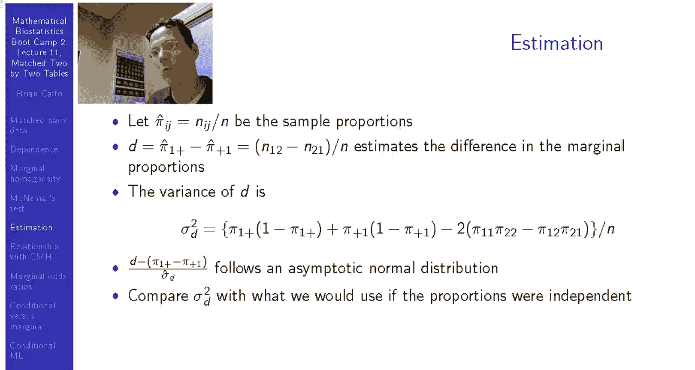

Okay， so let's go through our example， our density estimate is I'm not density。

 our D estimate of the difference in the marginal proportions works out to be 0。04。

I you you can plug into the Sigma hat d squared formula here， it works out to be about 0。095。And。A。

For the sigma， not sigma D squared， and then the confidence interval you can do right here。

 it's plus or minus the standard error， the difference plus or minus two standard errors and we get about 0。

06 to，02。And notice what happens though， if you ignore the dependence。

And just chop off this covariance term here and forget about it。

 then you wind up with a much significantly inflated。Standard Air Sigma D works out to be about 。

0175。

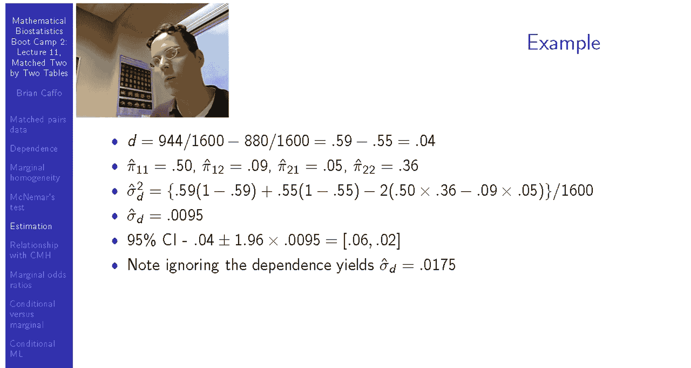

So there's kind of an interesting。Relationship between the Cochramental Hansel test。

And the match2 by two table。 So imagine if you took each pair and represented their time first and second and gave their responses yes or no。

Am。And so we can really think of this as an extremely stratified setting， right。

 where every strata just has the two measurements first second。And， and。If you you do that。

 then there's only four possible tables， time for second response， yes， no， we get a 1100， a 1001。

 a 0110， and then a 00 and a 11 like this。Okay so imagine if you the table like represented all the tables like this。

 and I hope you can agree with me that this would exactly reproduce the two by two table if you knew all these tables。

 you would exactly reproduce the two by two table。

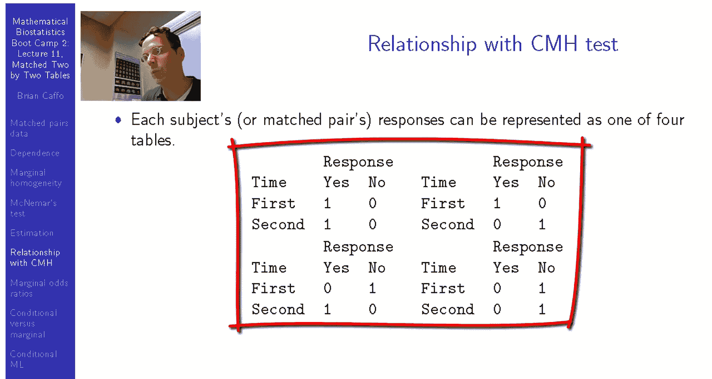

So here's a kind of a famous old result that the magna Mars test is equivalent。

To the Cochramantle handssel test where the subject is the stratifying variable and each two by two table is the observed two by two table from the previous slide so you can almost think it's。

And again， I put here that this representation is only interesting for conceptual purposes。And。

But I think it is interesting to note that you can really view the subject or if you're doing matched pairs。

 if you really think of that as an incredibly stratified circumstance where there's you only two two counts per table and analyze the data that way with a Croramantle handssel test。

 you wind up with exactly the same test as Mcna Mars test。

 it's just kind of a conceptually neat idea that I don't know， it's kind of a fun little fast。

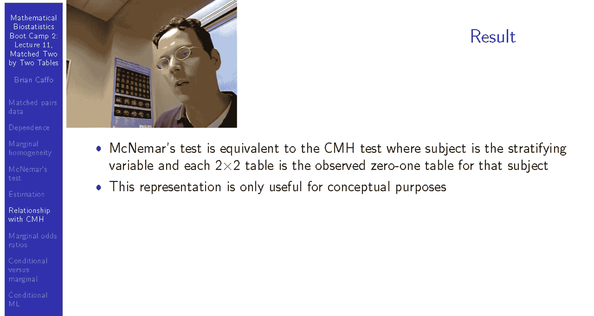

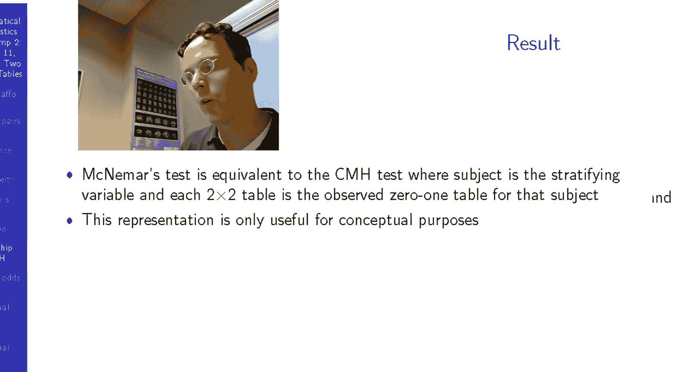

Another fun little fact is that Mc Mars test has an exact version。

And so consider the only the off diagonal cells， the discordant cells。

 and then under the nu hypothesis。Am。Pi 12 over pi 12 plus pi 21 is 0。5 right。

 just look back at the null hypothesis， if the two are equal， then1 over the sum would be 0。5。Okay。

 then。It turns out also under HO that N to1。Given the sum right， so N21 or N12。

 given the sum is binomial with success probability 0。5 and N1 plus N2 trials。

So you can exactly use this to come up with an exact P value for matched pairs data basically what we're doing is saying under the nu hypothesis whether。

That the two off diagonal probabilities are identical。

 whether you landed in the upper right hand cell or the lower left hand cell is a coin flipped for every match pair and we would have evidence against the null if a lot more wound up in one of those two cells and so this is an example of it's actually highly related to the and we'll cover this as well。

 the so-called non-parmetric sign test。And what you're saying is kind of under the no hypothesis。

 you know， things should be exchangeable whether they agree in terms of approving then disapproving or disapproving then approving。

Related to our approval example。嗯。And so let's actually work out an example。

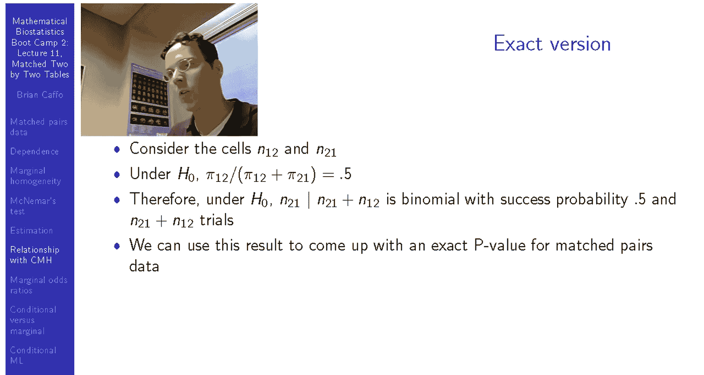

Okay， so here we want to test。H not that pi 21 equals pi 1，2 versus H A pi 21 less than pi 1，2。

 And I put in parentes that this is pi1 plus less than pi plus1。Pi plus one is less than pi 1 plus。

So pi plus1 is the approval at time2 and pi1 plus is the approval at time1 disregarding time2， okay。

 so this is testing whether or not the approval at time two is lower than the approval at time1。Okay。

 so that's the direction that the margin is looking at。So we saw 86 people in。

That disapproved on the first survey。And approved on the second survey the N21 cell。

And we want to test whether or not that's smaller than what would be expected by chance。

 so we went the probability of getting data as or more extreme in favor of the alternative。

 so probably x is less than or equal to 86， and then because we're doing the exact version will condition on the total sample size。

 the 86 plus 150， the number of off diagonal counts。

And we'll use a binomial with success probability 0。5， and that probability is about  zero。

So we reject the null hypothesispo this for a two sided test just double the smaller the one sided test for the purposes of this class。

You， if you do it in R， it'll maybe do a slightly better procedure than that。

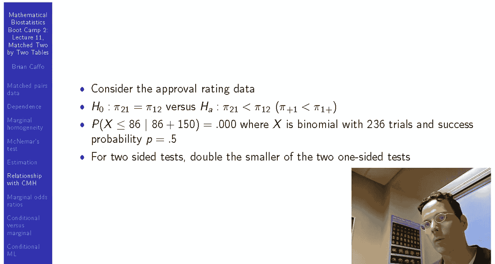

Okay， I want to cover another thing that's often omitted when discussing these things。

The marginal odds ratio would be the odds of approval。At the first。Arm。

I'm sorry the comparison of the odds of approval at time one relatively the odds of approval at time two。

 so here I put time one in the numerator of the odds ratio。

And time two in the denominator of the odds ratio so what I have are the odds of approval at time one in the top versus the odds divided by the odds of approval at time two in the denominator。

 so that is it's a marginal odds ratio because these are all marginal probabilities。

And that is of interest exactly in the same way， the difference in the marginal probabilities is of interest。

Am。So but it's a different setting right it's a different setting than if we just sampled some people at time one and a different set of people at time two and we could assume theyre independent。

 these are exactly the same two people sampled twice so we need to。To account for that at any rate。

 just like the ordinary odds ratio， the way that we conduct the odds ratio interval。

 the marginal odds ratio confidence interval was first we first calculate directly the marginal log odds ratio it's given by theta hat here and then standard the variance of that estimator。

 hence you square rooted to get the standard error is given by this guy right here where you put hats over everything and estimate them with the relevant sample proportions。

In order to get the estimated standard error， and so you can use that to create a conference interval for the marginal log odds ratio when you have matched paired would match two by two data。

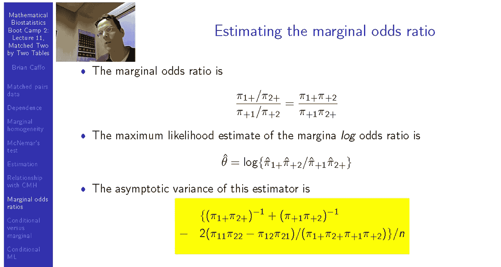

Okay， so in the approval rating the marginal odds ratio compareds to the odds of approval at time1 to the odds of approval at time two。

 the log odds ratio works out to be 0。16， the standard error works out to be 0。

039 and then the confidence interval for the log odds ratio then would be 0。

16 plus 2 standard errors， it gives you this right here about 0。084 to 0。236。

 you want to compare these to 0 because it's all in the log scale and then expentiate it if you want the confidence interval for the marginal odds ratio rather than the marginal log odds ratio。

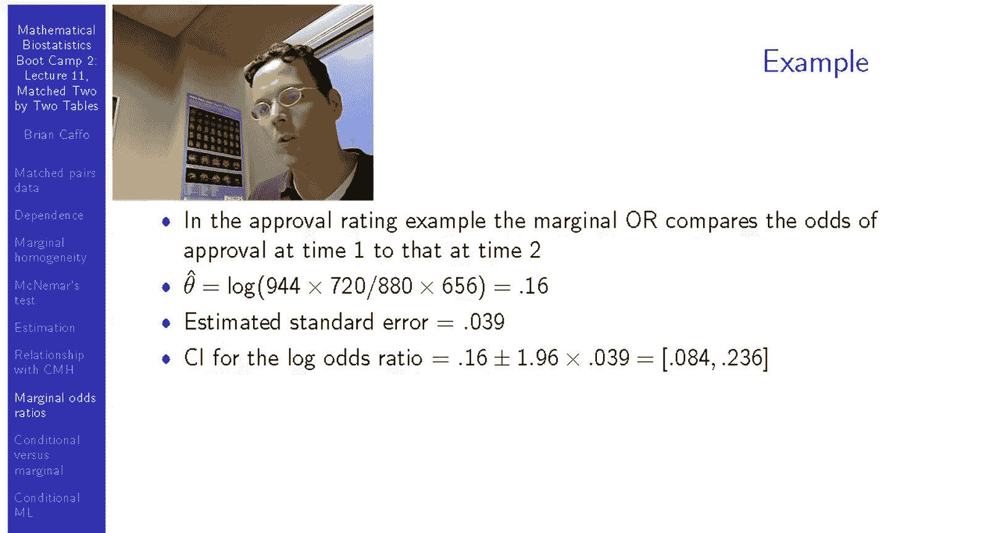

Okay I wanted to cover something that always comes up when I teach this class in person because several people have seen a different formula for the odds ratio for two by two tables and so I want to cover the one that they see and there's a difference one of them is a conditional odds ratio and the other is a marginal odds ratio so imagine if we created a logit model for our approval rating data where we say theit the probability that person I says yes at time1 is alpha plus UI and a logit to person the probability of the person's I says yes at time two is alpha plus gamma plus UI so UI is this person specific effect alpha is common across both times and gamma is the log odds ratio comparing the approval rating for a given person at time two to time1 right so notice you have to compare the same person because otherwise these UIs would not cancel out when you took the difference。

These two logits。So each UI contains a person specific effects so a person with large UI is likely to answer yes at both occasions。

 a person with small or negative UI is likely to answer no at both occasions。

 so in then gamma here is the log odds ratio comparing a yes at time1 to a response of yes at time two。

And in this case， gamma is a subject specific effect。

 you only interpret gamma if in fact these UIs cancel out， and that's where you get the conditional。

This so called conditional formula for the odds ratio。

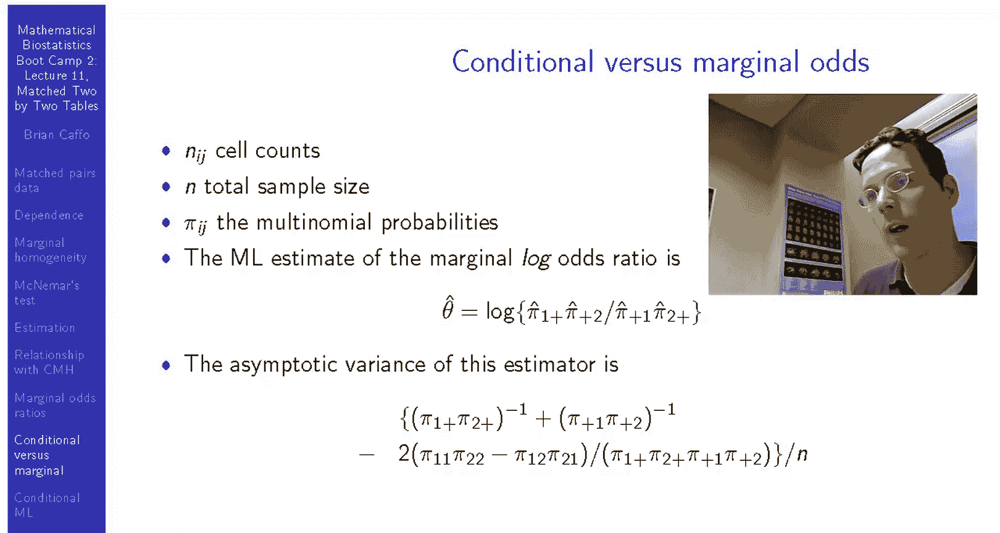

So one way to eliminate UI is to do a so called conditional estimator。

And the condition on the total number of yes responses。For each person。嗯。嗯。

So what you wind up with is only looking at the discordant cells again and then the conditional ML estimator for this log odds ratio and its standard error turned out to be log of the ratio of the off diagonal counts and the standard error turns out to be square root of one over the off diagonal counts so I think people prefer this because it's a simpler formula but notice it has a very different interpretation in one case we were comparing the marginal probabilities in the other case we had this formulation where we had these person specific random effects that had to cancel out in other words one of them。

Averged across people， and then the other one conditioned on people。

So they have different interpretations， one is called the marginal one is called a marginal odds ratio and its confidence interval and this one is called a subject specific odds ratio and its confidence interval。

 so they have different interpretations the difference in interpretation is。Extremely subtle。

 but it still exists and。That's why you get different answers。

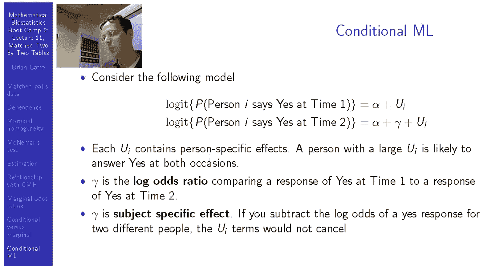

So let me just summarize here the marginal M。嗯。Has a marginal interpretation。

And the effect is averaged over all these UI values if you want to put it back to the same model。

 the conditional ML estimate has a subject specific interpretation。And so， you know， if you asked me。

 when would you want to use one versus the other， I kind of think if you were talking about kind of policy type questions。

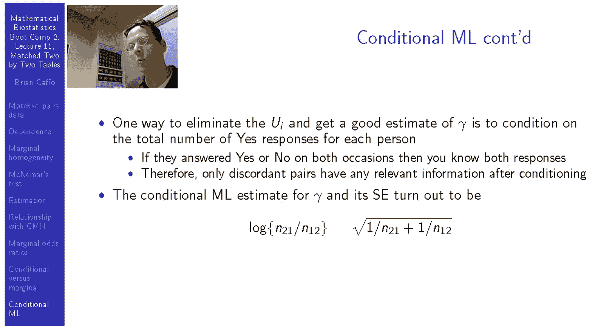

Then you would want marginal statements。And then if you want like kind of clinical type questions。

 then you probably want subject specific type statements， but it you， it's not perfectly clear。

But nonetheless， that's where the difference comes from， it's the fact that basically the logit。

Is not a linear function。And so you get a difference between sort of averaging over people and then。

Creating odds ratios or creating odds ratios then averaging odds ratios you just get different answers And so that's the difference between those two I think it's a very subtle thing and I think for the purposes of this class you can ignore it I just wanted to present it in case you were among the subset of people that happened to see this formula log n21 over N12 plus this standard error that the reason that it's different is because we're kind of taking a different approach and the reason I do the marginal approach especially in this class is because we talk about everything related to two by two match2 by two tables that we discuss is marginal so we talk about Macna Mars test。

 the exact version of magna Mars test and then the marginal odds ratio everything is related to the marginal probability so if you're okay with that then just leave it but if you're not okay with that and you need to know why is this different from the formula that you saw before perhaps in an epi class or in another biostatch class that's the reason it's a different formulation。

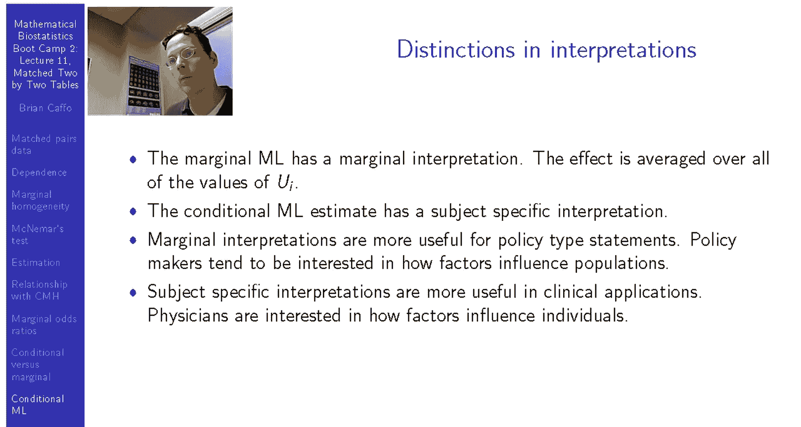