# 高级统计：36：配对2×2列联表补充内容 📊

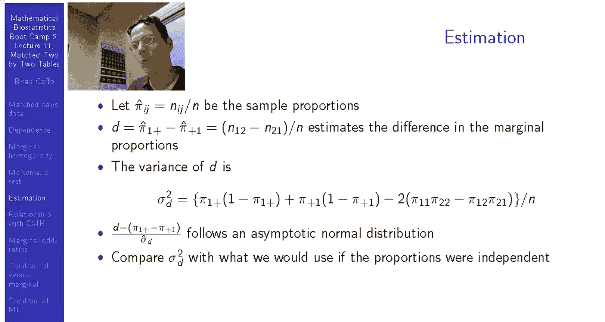

在本节课中，我们将深入探讨配对2×2列联表的分析，重点学习边际比例差异的估计、置信区间的构建，以及McNemar检验与Cochran-Mantel-Haenszel检验之间的关系。我们还将介绍边际比值比与条件比值比的区别，帮助初学者理解这些核心概念。

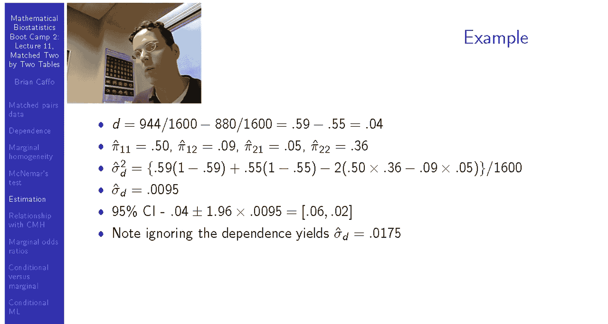

---

## 边际比例差异的估计与置信区间

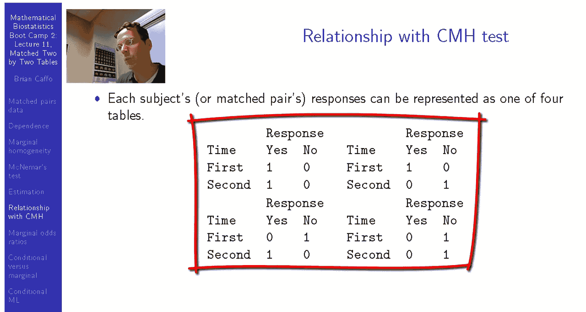

上一节我们介绍了配对2×2列联表的基本结构。本节中，我们来看看如何估计两个时间点边际比例的差异，并为其构建置信区间。

在我们的例子中，边际比例差异的估计值 **D̂** 为 0.04。其方差的估计公式为 **σ̂²_D**，计算结果约为 0.095。由此，我们可以构建置信区间：**D̂ ± 2 × SE(D̂)**，得到区间约为 (-0.06, 0.02)。

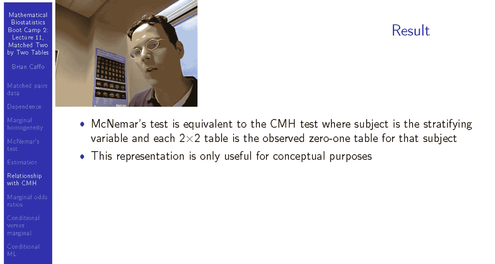

需要注意的是，如果忽略数据间的依赖性（即忽略协方差项），计算出的标准误会显著膨胀，约为 0.0175。这强调了在配对设计中考虑数据配对性质的重要性。

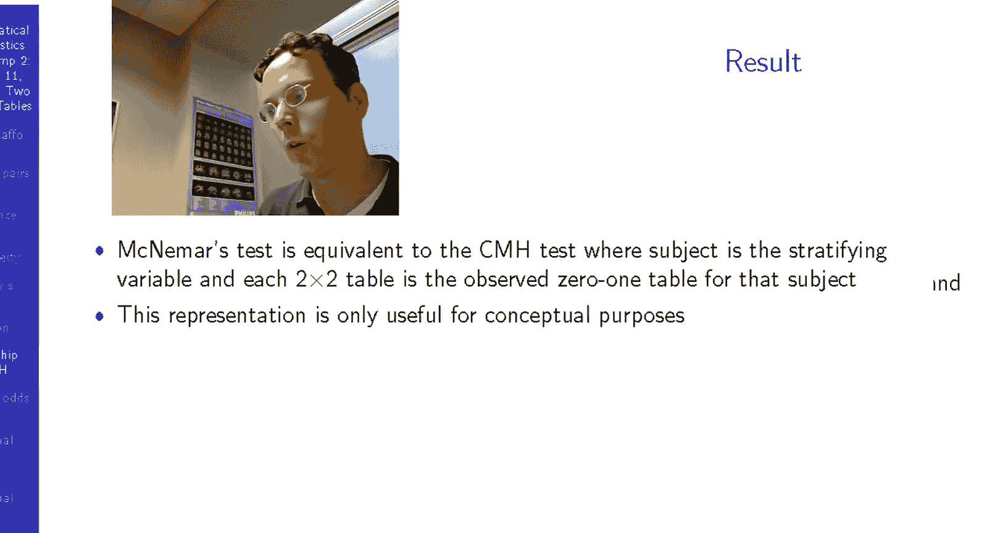

---

## McNemar检验与Cochran-Mantel-Haenszel检验的关系

理解了边际差异的估计后，我们来看看配对分析与分层分析之间的一个有趣联系。

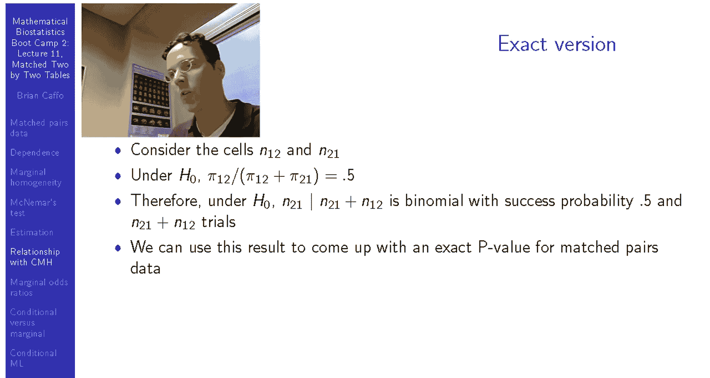

我们可以将每一对配对观测视为一个极端的分层，每个层（即每个受试者）只有两次测量（第一次和第二次）。这样，每个层只会产生四种可能的2×2表。如果将所有层的表格汇总，就能精确地重现整体的配对2×2列联表。

一个著名的结论是：**McNemar检验等价于将受试者作为分层变量的Cochran-Mantel-Haenszel检验**。这种表示方法虽然在实践中不直接用于计算，但在概念上非常有趣，它揭示了配对设计可以被视为一种特殊的高度分层情况。

---

## McNemar检验的精确版本

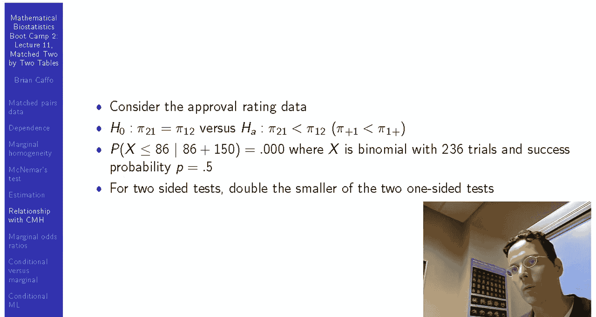

除了渐近检验，McNemar检验还有一个基于二项分布的精确版本。

在零假设下，我们只关注不一致的对子（即非对角线单元格）。具体来说，在给定不一致对子总数 **N = n₁₂ + n₂₁** 的条件下，**n₂₁** 服从成功概率为 0.5 的二项分布。这允许我们计算精确的p值。

以下是计算精确p值的步骤：
1.  设定假设：例如，**H₀: π₂₁ = π₁₂** vs **Hₐ: π₂₁ < π₁₂**。
2.  计算在零假设下，观察到当前或更极端数据的概率：**P(X ≤ n₂₁)**，其中 **X ~ Binomial(N, 0.5)**。
3.  如果p值很小，则拒绝零假设。对于双侧检验，通常将单侧p值乘以2。

在我们的例子中，**n₂₁ = 86**, **N = 236**，计算出的单侧p值约为0，因此我们拒绝零假设，认为两个时间点的边际比例存在差异。

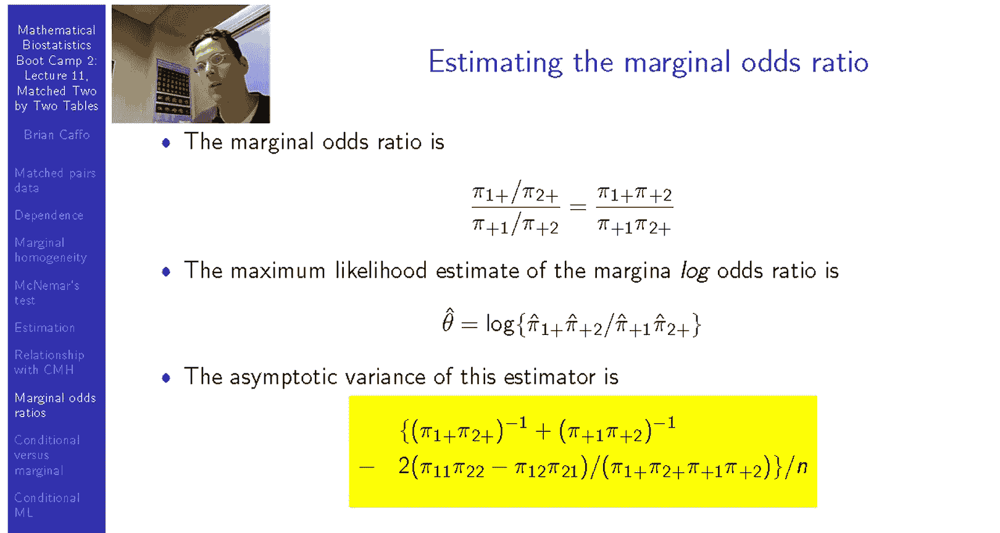

---

## 边际比值比及其置信区间

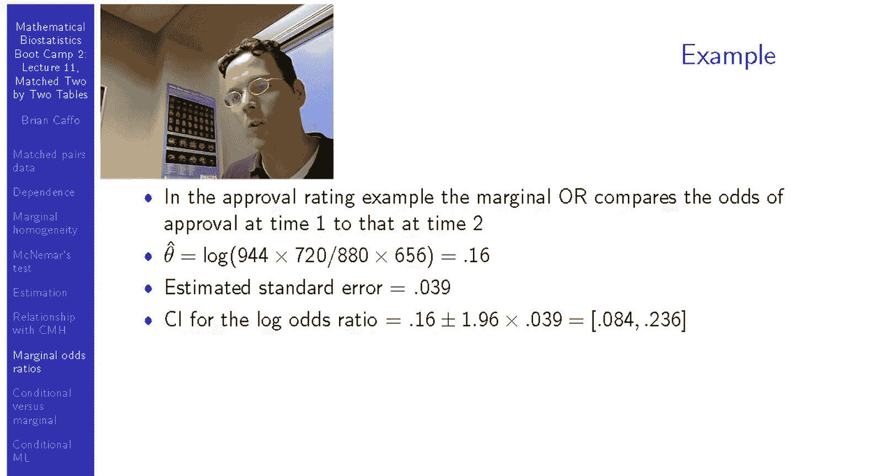

除了比例差异，研究者有时也关注边际比值比。它比较的是时间点一的赞同比值与时间点二的赞同比值。

边际对数比值比 **θ̂** 的估计公式为：
`θ̂ = log( (p₁₊ / (1 - p₁₊)) / (p₊₁ / (1 - p₊₁)) )`
其标准误 **SE(θ̂)** 有特定的估计公式。利用 **θ̂ ± 2 × SE(θ̂)** 可以构建对数比值比的置信区间，再通过指数运算得到比值比的置信区间。

在我们的例子中，边际对数比值比估计值为0.16，标准误为0.039，其95%置信区间为(0.084, 0.236)。取指数后，比值比的置信区间为(e^0.084, e^0.236)。

---

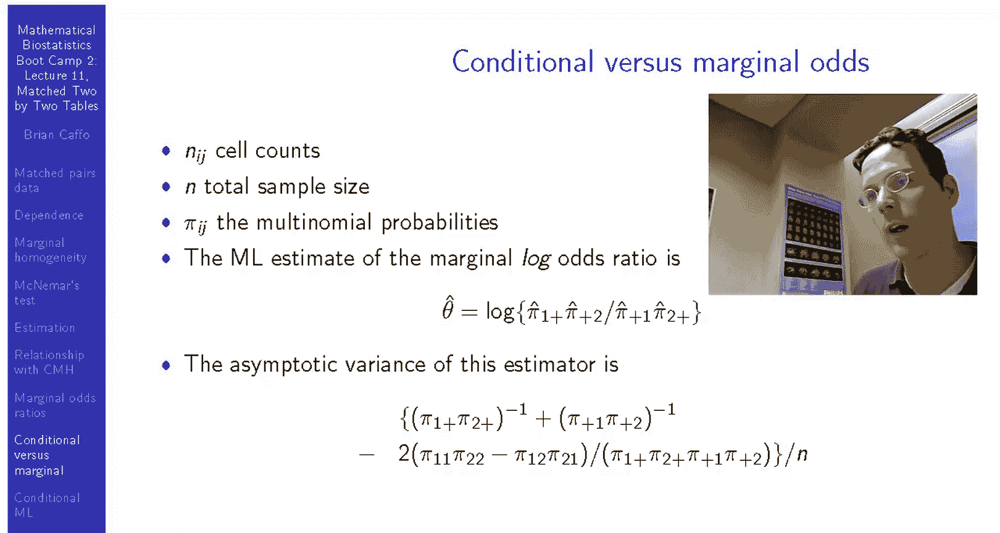

## 边际比值比与条件比值比的区别

最后，我们来澄清一个常见的困惑：为什么有时会看到不同的比值比公式？这源于**边际比值比**和**条件比值比**的不同定义。

考虑一个带随机效应的logit模型：
`logit(P(Y_i1=1)) = α + U_i`
`logit(P(Y_i2=1)) = α + γ + U_i`
其中 **U_i** 是受试者特异性效应。这里的 **γ** 是**条件（或受试者特定）比值比**，它比较的是同一个受试者在两个时间点的 odds。

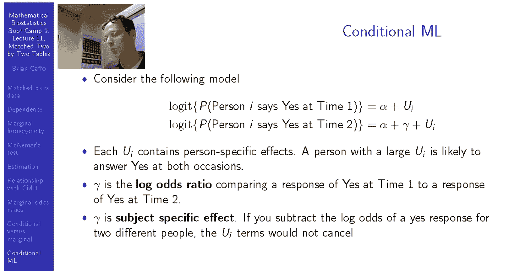

条件比值比的一个常用估计量是：
`γ̂_cond = log(n₂₁ / n₁₂)`
其标准误为：`SE(γ̂_cond) = √(1/n₂₁ + 1/n₁₂)`
这个公式非常简单，但它与之前介绍的边际比值比有不同的解释。

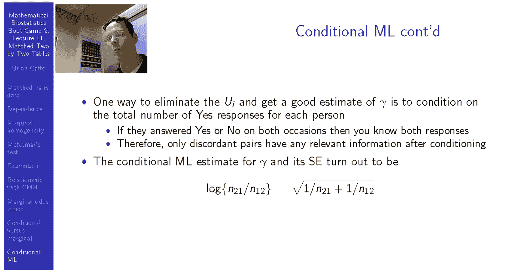

两者的核心区别在于：
*   **边际比值比**：解释为在总体层面平均后的效应。它回答“总体中，时间点二的赞同几率相对于时间点一如何变化？”这类政策性问题。
*   **条件比值比**：解释为受试者个体层面的效应。它回答“对于一个给定的个体，其时间点二的赞同几率相对于时间点一如何变化？”这类临床性问题。

由于logit函数是非线性的，对概率进行平均后再计算比值比，与先计算个体比值比再进行平均，通常会得到不同的结果。这就是两者数值存在差异的根本原因。在本课程中，我们主要关注边际方法，以保持与McNemar检验和边际比例差异分析的一致性。

---

## 总结

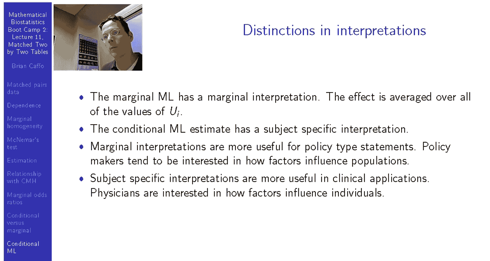

本节课中我们一起学习了配对2×2列联表的多个高级主题。我们首先学习了如何正确估计边际比例差异并构建其置信区间，强调了考虑数据依赖性的重要性。接着，我们探讨了McNemar检验与Cochran-Mantel-Haenszel检验在概念上的等价关系。然后，我们介绍了McNemar检验的精确版本。最后，我们详细区分了边际比值比和条件比值比，理解了它们不同的估计公式、解释和应用场景。掌握这些概念有助于更全面地分析配对分类数据。