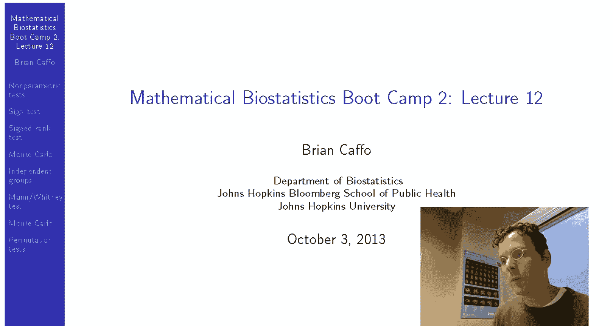
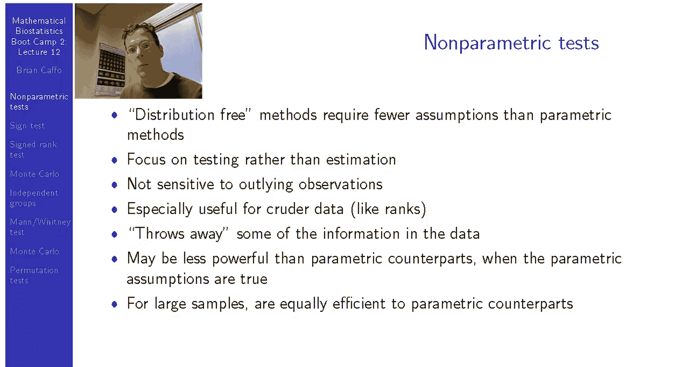
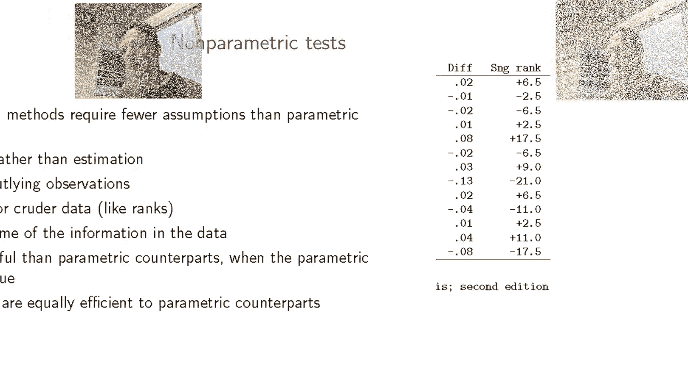
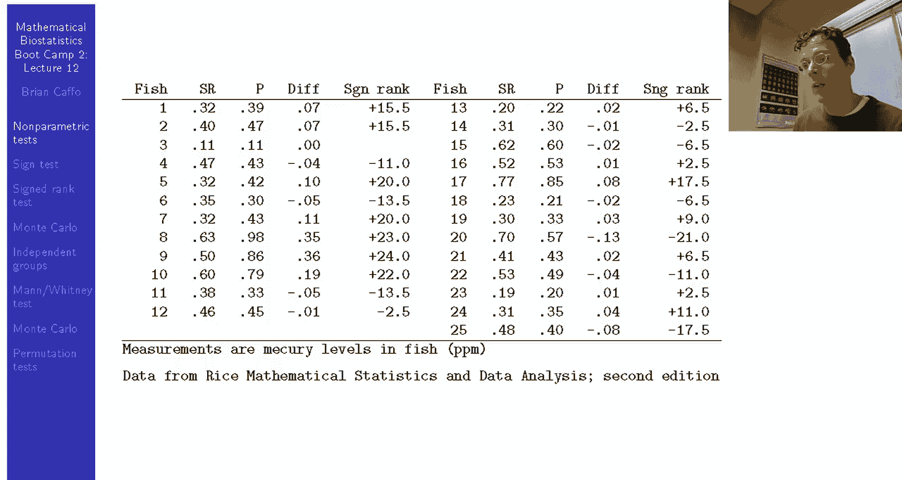
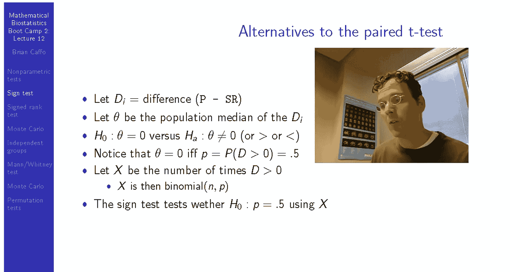
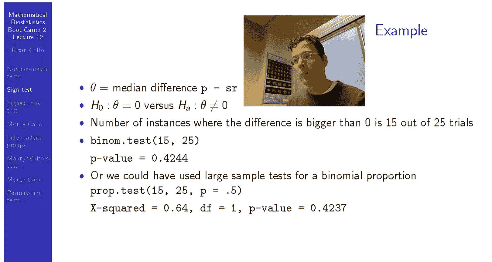
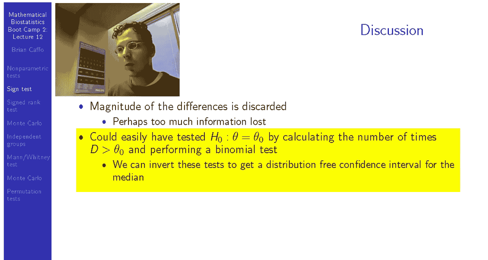

# 约翰霍普金斯大学《数据科学的高级统计｜Advanced Statistics for Data Science》中英字幕（deepseek p68 37_符号检验.zh_en -BV1htPjeYEFH_p68-

Hi， my name is Brian Kaho， and this is mathematical Biosstatistics bootc Leture 12。

 We're going to be talking about non parametric statistics。

Okay， in this video we're going to be talking about nonparmetric tests。

 which includes the signed test which was useful for paired test。

 which is kind of related to Mcna MarRS tests， the signed rank test which is also for repaired data。

 we'll talk about Monte Carlo versions of that test。

 we'll talk about independent group test and then from that the man Whitney test and Monte Carlo versions of that and then their relationship to permutation test which are very closely related。

Okay， so very briefly， we're going to be talking about here about so-called nonparmetric tests。

 but very kind of classical nonparmetric tests， and these are often called distribution free。

 that of course doesn't mean that there are assumption free， they involve assumptions， for example。

 sampling assumptions such as IIiness， but they require fewer assumptions than parametric methods。

 they have a tendency to focus a little bit more on testing rather than estimation。

 but which maybe is a problem but there are estimation techniques that follow。

 though they also tend not to be very sensitive to outlying observations。

And they're especially useful for data like ranks if the data actually come in the form of ranks because they often involve transforming data to ranks。

嗯。They're not uniformly wonderful because they do throw out some information which is their problem and because of that they may wind up being less powerful than their parametric counterparts when the parametric assumptions are true。

 of course。And then you know， for larger sample sizes。

 they become about as efficient as their parametric counterparts so they are are。

Are pretty good tests。

So here's some data from this wonderful book from Rice called Mathematic Staistic and Data analysis I highly recommend this book I use the second edition I don't know if that's what they're still on anyway this data concern 25 fish they were taking mercury levels from the fish in parts per million and they had them at two locations on each fish so fish1 they had a measurement of 0。

32 and 0。39 and so on okay and then just for reference here I've added the difference between those two measurements subtracting the P from the SR1 each time and then I'll show the ranking and the signed ranks I'll explain those in a minute but this is the data we're going to use is motivating data here we want to test whether the mercury levels taken at location P differ from those of location SR。

Where here。嗯。You know we're taking two measurements per fish trying to control for the fish to fish variability by taking both measurements the on each fish。

 having each fish serve as its own control， but we're going to be talking about nonparmetric tests so what we're interested in or concerned about is the validity of the assumptions that go into typical tests such as normality。

Okay， so let's let DI be the difference for each fish， in this case I'm subtracting P minus SR。

And then let's let theta be the population median of the difference DI。

And we want to test to whether that median is zero versus the median being non zero。

Now by the definition of the median， if theta equals zero。

 only if the probability of a difference being greater than that value 0 is exactly 0。

5 right that's the definition of a median， same thing for less than zero and so as a test statistic。

 why don't we just count the number of times that d is bigger than 0。

 and if it's excessively large or excessively small then that's going to dispute the idea that the median is exactly zero。

So just as an example if all the differences were positive。

 then zero couldn't be the median because you wouldn't expect a large sample where every single measurement was larger than the population median okay anyway then x here each difference if we're assuming the fish pairs our IID then each difference is a coin flip with a 50% chance of being above the median or 50% chance of being below the median so the number of times it's larger than 0 is binomial and in P and in this case p is 0。

5 so our sign test just test whether p is 0。5 using this data X and you can do an exact binomial test like we've talked about before。

Okay， so let's go back to our example， so theta is the median difference between of p minus SR。

 our no hypothesis is that theta equals 0 versus the alternative that's different zero。

The number of instances where the difference is bigger than zero， in this case go back to the table。

 it works out it to be 15 out of 25 fish。And the binomial test then is the question of whether 15 is large。

 15 positive instances out of 25 is large now our expected number out of 25 is 12 and a2 so we don't know whether 15 is excessively large。

 when this case it turns out that no 15 is not excessively large， it has a point。

 42% chance of happening under the null hypothesis for two sided test in this case。You know。

 and again， you know we could have used a large sample test。

 I don't know why because we can do an exact test in this case。

 but we could have used a large sample test and that's prop dot test and you get a chi square statistic then of 0。

64， a P value that's quite similar， 0。42。So at any rate。

 the idea is that this is simply just testing if you're going to assume that levels of one are higher than the other。

 then you're just going to count the number of pairs from the match pairs where it's higher and is that excessively large relative to a coin flip for each pair so that's the sign test then you might be wondering what's wrong with this so let's discuss some potential problems with this test。

Because it doesn't use very many assumptions， right。

 it doesn't we aren't using very many assumptions， we're using it the fish pairs are IID。嗯。

And that's about it， right， that's the only assumption that we're using。

But let's talk about what's maybe some of the problems。

Okay so the biggest problem is of course that the magnitude of differences is discarded。

 so it's potentially not as powerful as you'd hope right。

 you know it'd be different if all you know maybe if you only got half of them as being positive。

 but all the ones that were positive were much larger differences and all the ones that were negative were really small differences then that would be different than if they were kind of spread equally between above and below zero。

So I would say that， but then the other thing I would mention is there's nothing specific about zero。

 you could have tested any median the equal to theta not by calculating the number of times the difference is bigger than any specific value。

 testing whether that the median is bigger than any specific value。What's interesting about that？

Then know we won to talk about this， but it is kind of interesting right that you can do this for any value of theta。

 so that means you can find the values of theta for which you fail to reject and the values of theta for which you reject。

And then of course， if you can do that， by a grid search or say something like that。

 then you can invert that and get a confidence interval for the median and so this is kind of an interesting way。

 a very highly nonparmetric way to get a confidence interval for the median of a set of data。

