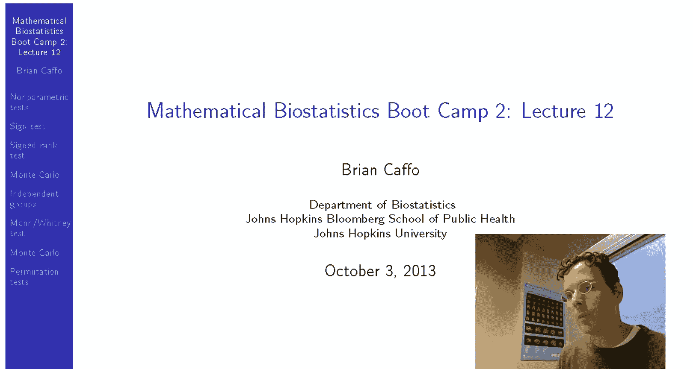
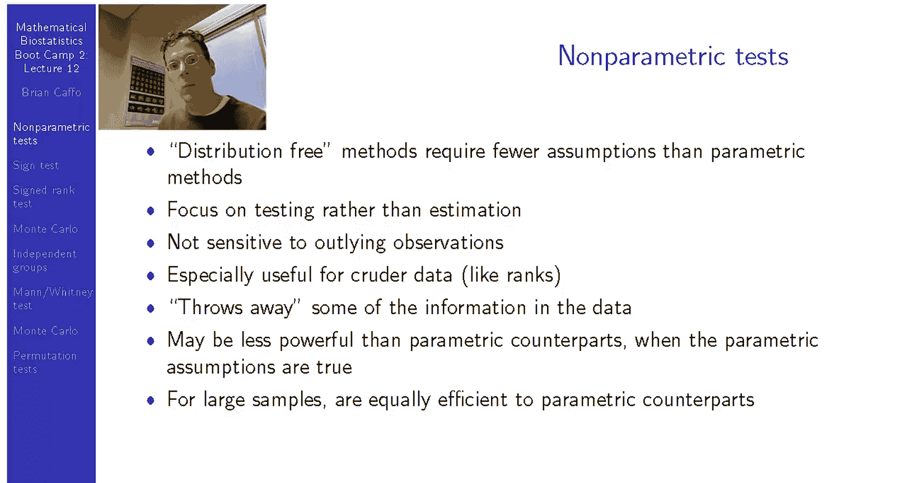
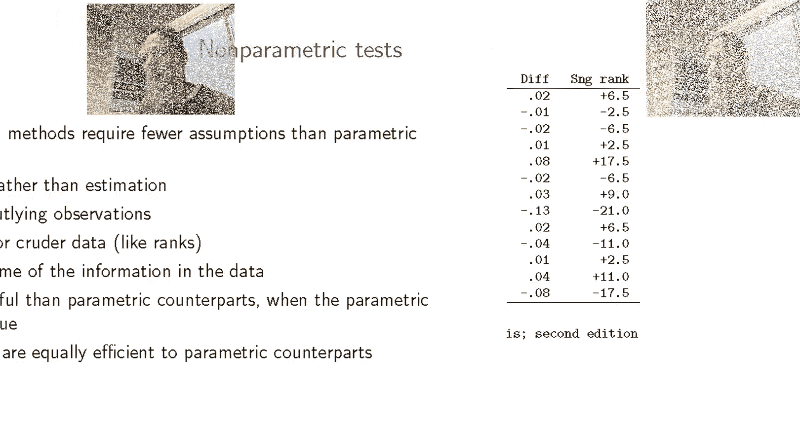
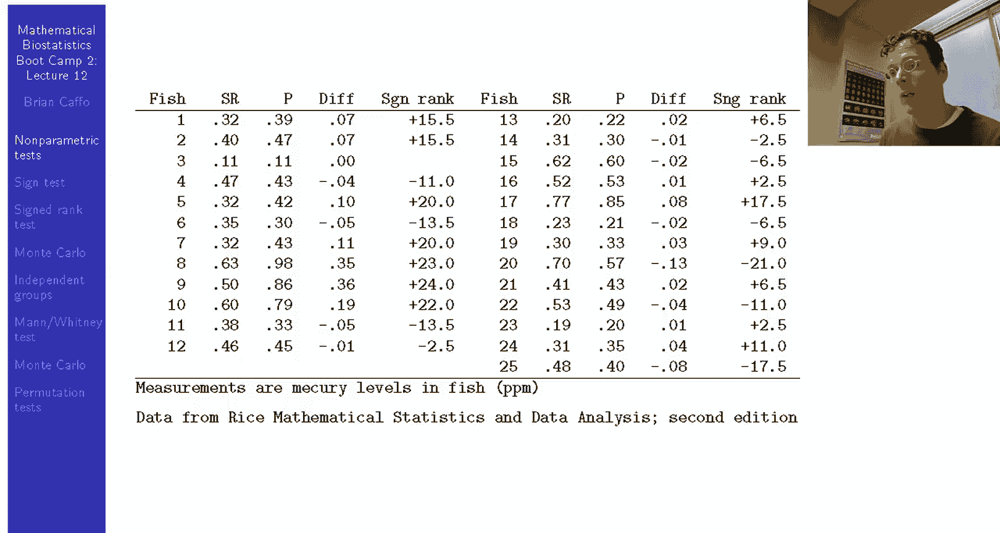
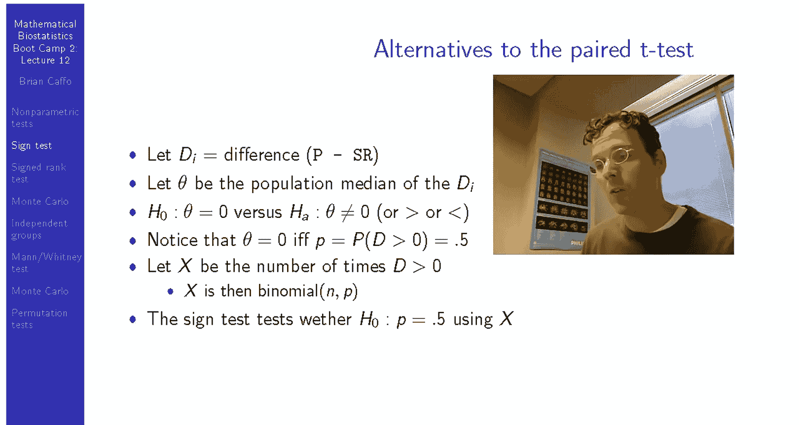
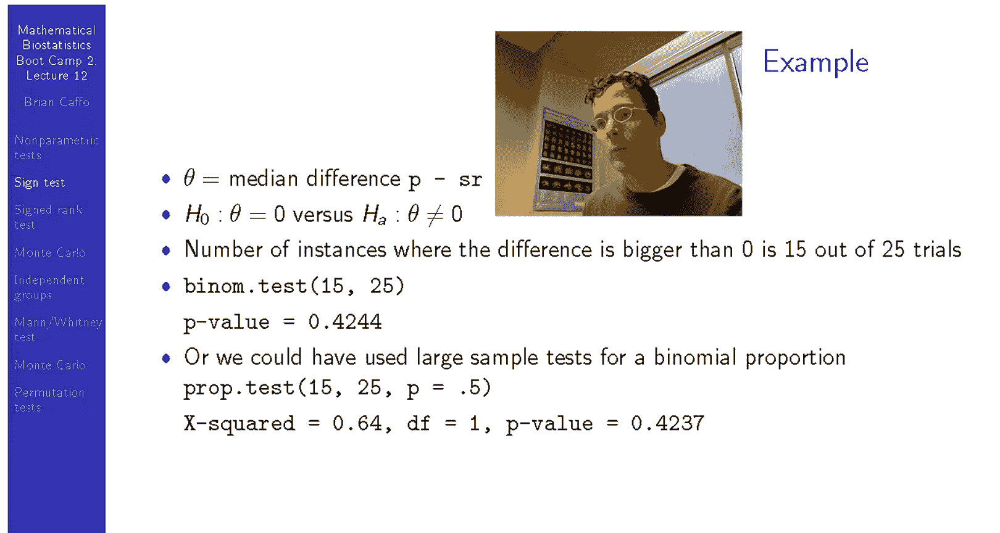
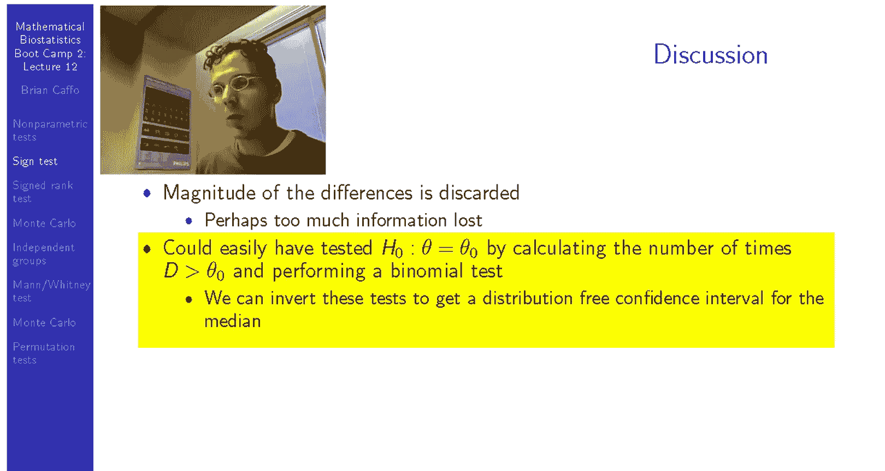

# 高级统计学：12：非参数统计 🧮



在本节课中，我们将要学习非参数统计方法。这些方法通常被称为“无分布”方法，因为它们对数据分布形态的假设较少，尤其适用于不满足正态分布假设的数据。我们将重点介绍几种经典的非参数检验，包括符号检验、符号秩检验以及曼-惠特尼U检验，并探讨它们与置换检验的关系。

## 符号检验 📊

上一节我们介绍了非参数检验的基本概念，本节中我们来看看符号检验。符号检验主要用于配对数据，其核心思想是忽略差异的具体数值大小，只关注差异的方向（正或负）。


### 核心概念与公式

假设我们有 `n` 对配对数据。对于第 `i` 对数据，计算其差值 `d_i`。设总体差值的中位数为 `θ`。我们的零假设是 `θ = 0`，即两组数据没有系统性差异。

检验统计量 `X` 定义为差值 `d_i` 大于 0 的个数。在零假设下，每个差值有 50% 的概率为正，50% 的概率为负。因此，`X` 服从二项分布：

`X ~ Binomial(n, p=0.5)`

我们可以通过计算 `X` 的观测值是否极端（过大或过小）来判断是否拒绝零假设。

### 应用示例：鱼类汞含量数据





我们使用一个关于鱼类汞含量的研究数据作为示例。该研究测量了 25 条鱼在两个不同部位（P 和 SR）的汞含量（单位：ppm）。每条鱼都提供了配对测量值，目的是控制鱼与鱼之间的个体差异。

以下是分析步骤：

1.  **计算差值**：对于每条鱼，计算 `d_i = P_i - SR_i`。
2.  **统计正差个数**：统计 `d_i > 0` 的个数。在本例中，25 条鱼中有 15 条鱼的 P 部位汞含量高于 SR 部位。
3.  **执行二项检验**：检验观测到的 15 次正差是否显著偏离了期望值（12.5次）。精确二项检验得到的 P 值为 0.42，表明没有足够证据拒绝零假设。大样本近似检验（如比例检验）也得到了相似的结果。

### 符号检验的优缺点

以下是符号检验的主要特点：

*   **优点**：
    *   假设极少，仅要求配对观测是独立同分布的。
    *   对异常值不敏感。
    *   可以推广用于检验任何指定的中位数 `θ_0`，并可通过网格搜索等方法构建中位数的置信区间。
*   **缺点**：
    *   完全忽略了差异的**幅度**信息，只使用了方向信息。这可能导致检验功效低于参数方法（如配对 t 检验），尤其是在参数假设成立时。
    *   当样本量较小时，功效可能不足。



## 符号秩检验 📈

上一节我们介绍了符号检验，它丢弃了数据的大小信息。本节中我们来看看符号秩检验，它在符号检验的基础上进行了改进，通过引入差异的排序信息来提高检验功效。

### 核心概念与步骤

符号秩检验，也称为 Wilcoxon 符号秩检验，不仅考虑差异的方向，还考虑差异的绝对大小。其基本步骤如下：

1.  计算每对数据的差值 `d_i`。
2.  忽略差值为 0 的对子。
3.  取差值的绝对值 `|d_i|`。
4.  对这些绝对值进行排序，得到每个 `|d_i|` 的秩（rank）。
5.  将原始差值的符号（正或负）赋予对应的秩，得到“符号秩”。
6.  计算所有正符号秩之和 `W+` 作为检验统计量。

在零假设（差值的中位数为 0）下，`W+` 的分布是已知的。如果正差异的幅度普遍大于负差异的幅度，那么 `W+` 会比较大，从而可能拒绝零假设。

### 蒙特卡洛版本



对于样本量较大或分布复杂的情况，我们可以使用蒙特卡洛模拟来近似检验统计量的分布，从而计算 P 值。这种方法通过随机重排数据的符号（或进行其他随机化）来模拟零假设下的数据生成过程。

## 独立组检验与曼-惠特尼 U 检验 👥

前面两节我们讨论了配对数据的非参数检验。本节中我们来看看如何处理两个独立组数据的比较，这里我们将介绍曼-惠特尼 U 检验。

### 核心概念

曼-惠特尼 U 检验用于检验两个独立样本是否来自同一总体。它是参数检验中两独立样本 t 检验的非参数对应方法。

### 检验步骤与代码逻辑

其核心思想是将两组数据合并后排序，然后检验其中一组的秩和是否异常。以下是逻辑步骤：

1.  将两组数据 `A` 和 `B` 合并。
2.  对合并后的所有观测值进行排序，赋予秩次（最小的为 1，次小的为 2，依此类推；对于并列值，取平均秩）。
3.  计算第一组数据 `A` 中所有观测值的秩和 `R_A`。
4.  检验统计量 `U` 可以通过 `R_A` 计算得出。`U` 值衡量了 `A` 组数据相对于 `B` 组数据的“领先”程度。
5.  将观测到的 `U` 值与零假设（两组分布相同）下的理论分布进行比较，得到 P 值。

```python
# 伪代码示例：曼-惠特尼 U 检验逻辑
import numpy as np
from scipy.stats import mannwhitneyu



# 假设 group_A 和 group_B 是两个独立样本的数据
group_A = np.array([...])
group_B = np.array([...])

# 使用现有库函数执行检验
statistic, p_value = mannwhitneyu(group_A, group_B, alternative='two-sided')
print(f"U 统计量: {statistic}, P 值: {p_value}")
```

### 与置换检验的关系

曼-惠特尼 U 检验与**置换检验**密切相关。置换检验是一种更通用的重抽样方法：
*   在零假设下，两组数据来自同一分布，因此观测值的组别标签是可以互换的。
*   置换检验通过随机打乱组别标签成千上万次，每次计算一个统计量（如两组均值之差），从而构建出零假设下该统计量的经验分布。
*   将实际观测到的统计量与此经验分布比较，即可得到 P 值。

曼-惠特尼 U 检验本质上是基于秩的特定统计量的置换检验。当数据被转换为秩之后，其检验结果与基于原始数据的某些置换检验是渐近等价的。

## 总结 🎯

本节课中我们一起学习了非参数统计的基础知识。我们从最简单的**符号检验**开始，它仅利用配对差异的方向信息。然后，我们学习了**符号秩检验**，它通过引入差异的排序信息提高了检验功效。接着，我们将目光转向独立组比较，介绍了**曼-惠特尼 U 检验**，这是两样本 t 检验的非参数替代方法。最后，我们探讨了这些检验与更通用的**置换检验**之间的紧密联系。



非参数方法的优势在于对总体分布假设要求宽松，对异常值稳健，特别适用于小样本、等级数据或分布未知的情况。但其代价是可能损失一部分信息，导致在参数假设成立时功效略低于参数方法。理解这些方法的原理和适用场景，能帮助我们在实际数据分析中做出更合适的选择。