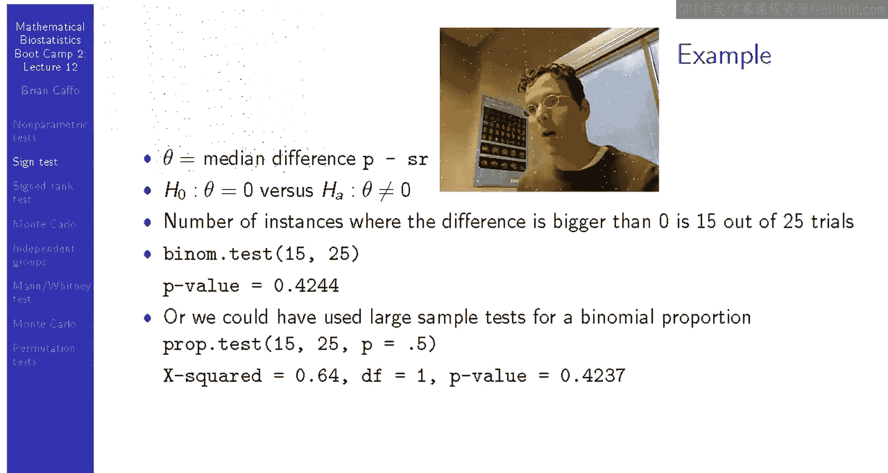
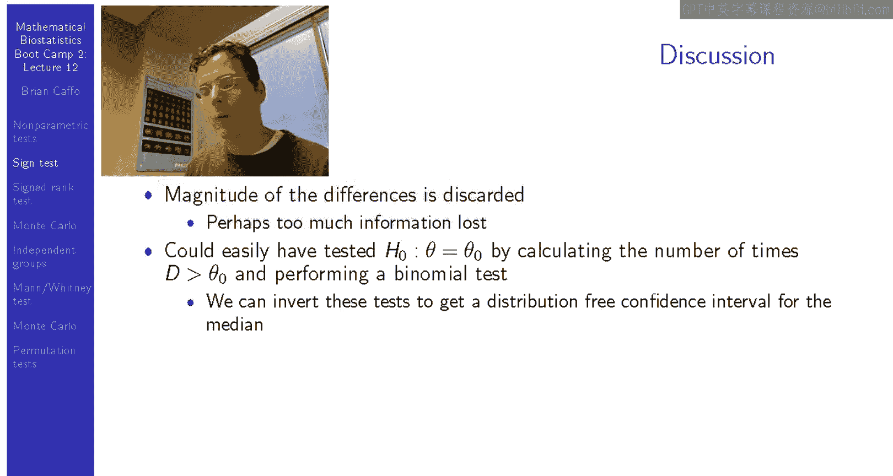
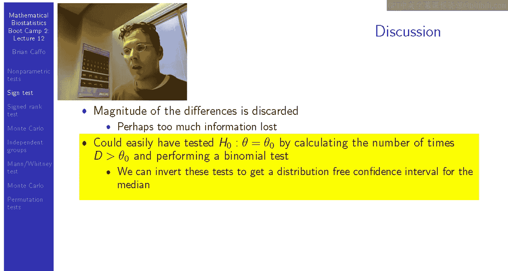
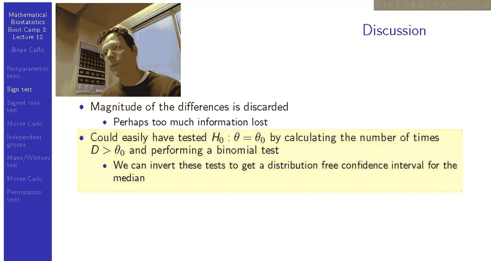
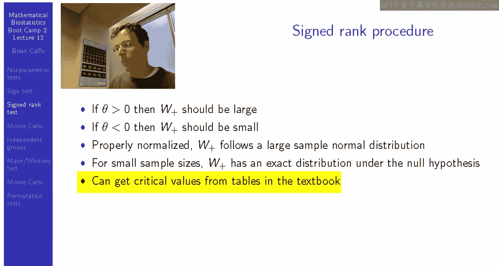
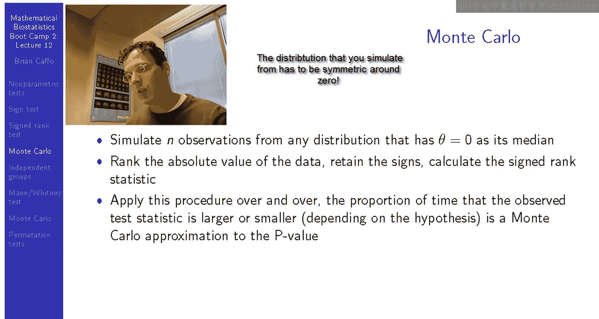
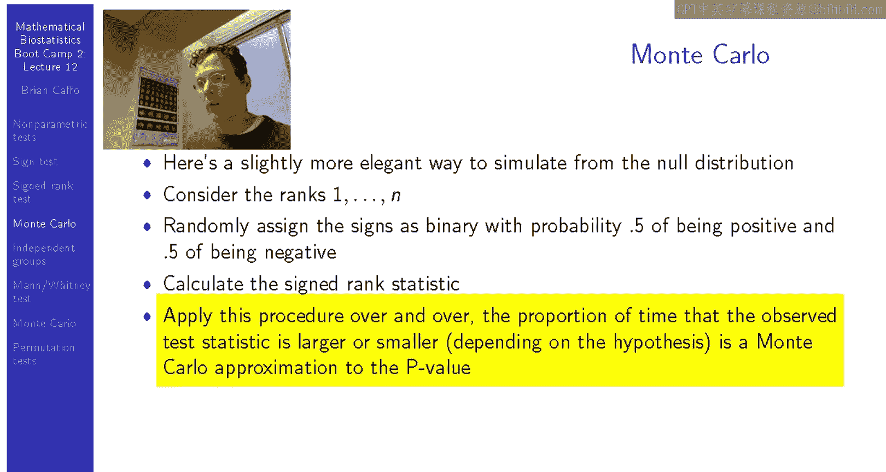
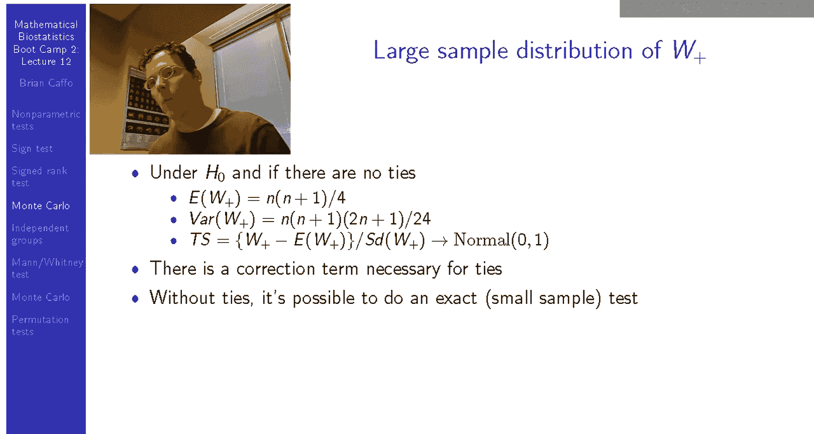
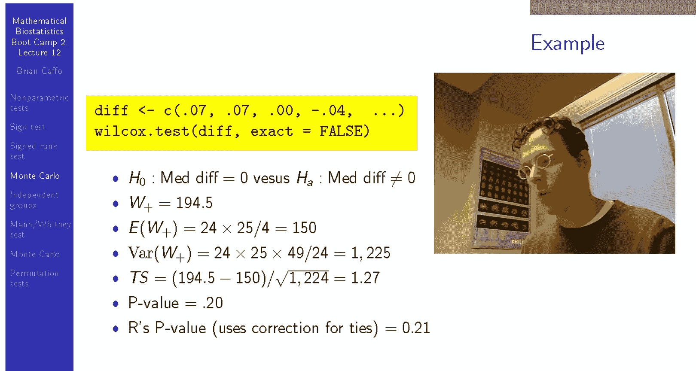
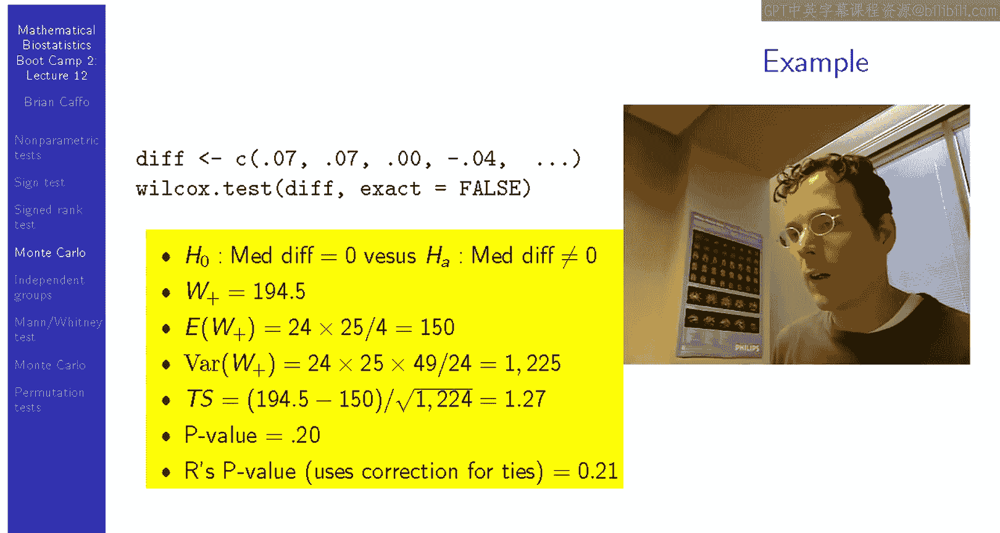

# 约翰霍普金斯大学《数据科学的高级统计｜Advanced Statistics for Data Science》中英字幕（deepseek p69 38_符号秩检验.zh_en -BV1htPjeYEFH_p69-

Okay， so the biggest problem is of course that the magnitude of differences is discarded。

 so it's potentially not as powerful as you'd hope right。

 you know it'd be different if all maybe if you only got half of them as being positive。

 but all the ones that were positive were much larger differences and all the ones that were negative were really small differences then that would be different than if they were kind of spread equally between above and below zero。

So I would say that， but then the other thing I would mention is there's nothing specific about zero。

 you could have tested any median the equal to theta not。

 by calculating a number of times the difference is bigger than any specific value。

 testing whether that the median is bigger than any specific value。

What's interesting about that？Then you know we won to talk about this。

 but it is kind of interesting right， that you can do this for any value of theta。

 so that means you can find the values of theta for which you fail to reject and the values of theta for which you reject。

And then of course， if you can do that， by grid search or say something like that。

 then you can invert that and get a confidence interval for the median。

 and so this is kind of an interesting way， a very highly nonparmetric way to get a confidence interval for the median of a set of data。

So Will Coxson thought about this problem of。Discarding the magnitude of the differences and he said。

 well， why don't we， instead of using just the signs。

 why don't we also use the ranks of the differences？

So this using the rank save some of the information regarding the magnitude of the differences。

 we're still testing whether the meaning is zero versus the three potential alternatives。

And we can create a statistic and I'll say that appropriately normalized this statistics follows exactly a normal distribution。

But if there's no ties then the exact small sample distribution is known and then why use the normal distribution the one benefit of the normal distribution in this case is because the small sample distribution is known。

 we can evaluate how accurate the normal distribution is in general。

 so it's different than a standard normal distribution where you don't know。The exact small sample。

 the associated small sample distribution， so you can't tell how well the normal approximation is working。

 so I would say at least。That one aspect of normal approximations in nonparmetrics test is a little bit different than normal approximations in general because we can evaluate how we have a much better sense of how well the normal approximation is working。

So here's the signed rank procedure， so we take all the pair differences just like we did before。

We take the absolute values of the differences， which is new， no we haven't done that。

 and then we rank these absolute values from least to greatest throwing out the ties。

 throwing out the zeros。Is what I mean。嗯。And if there's ties， right。

 there's a difference between ranks of zero and ties， if there's ties。In other words。

 two differences are identical but non zero， then we use the average rank。

 we assign the average rank to those。And then after we've done the ranking。

 we multiply them by the sign of the difference plus one for positive difference and minus one for a negative difference。

 and then we calculate the sum of the positive ranks and that's the sign rank test now so think about what this is doing let's suppose we did have the case where all the big measurements were positive and all the smaller measurements were were negative。

Smaller differences were were negative， smaller and absolute value differences。

 Then what you'd see is that all the small ranks would have a negative sign and all the large ranks would have a positive sign。

 So the sign rank statistic would be very different。

From what you would expect by chance where the signs are distributed equally among the ranks。

Versus the sign test by itself， which if roughly equal numbers were above and below zero。

 then you would get the same， then you could get a statistic that was highly looked a lot like it was from thenll。

So just to reiterate this point， if the median is large， then w+ should be large。

 if the median is small， then W+ should be small， and this W+。

 it does follow a normal distribution for large samples。

For small sample sizes and large sample sizes， but especially for small sample sizes。

 we can work with an exact nu distribution under the null hypothesis and you can get critical values from a table。

 but you can get the critical values inR pretty easily。

So， you know， it's maybe a bit involved to exactly work with the。

Nell distribution will' do some of it of the exact distribution of the statistic。

 We'll do some of it， but I wanted to at least talk about Monte Carlo so you could at least see that。

 yeah， you know， okay， so we can pretty easily。Figure out what the exact distribution is provided there's no ties。

Um so。What you could do， so if this procedure is invariant to the distribution being used。

 you have what you could do is simulate n observations from any distribution that hasta as it zero。

ta theta is zero， its median is zero。And then rank the absolute values of the data， retain the signs。

 calculate the sign rank statistic， and apply this procedure over and over again。

 and you'll have just used Monte Carlo to get the exact distribution。

 especially because we're assuming this distribution is invariant to or we could use any distribution。

 like for example， the normal distribution， the standard normal， and that would。

That would give you the exact small sample distribution， but we can actually go further than that。

Under than。This distribution under the no hypothesis， right， the signs。

Are equally likely to be distributed anywhere among the ranks。

 So all you have to do is actually take the ranks of the numbers between one and n。

And just randomly allocate the signs。Okay， and that's exactly the you know flip a coin。

For each rank values， so take the rank one， flip a coin with success probability 。5， take the rank2。

 flip a coin and so on， and then you've just generated this distribution exactly。

 you haven't had to mess around with a normal distribution or something like that。

 but know I present it this way just to show you conceptually that well。

 if this distribution if this test really doesn't depend on the distribution。

Then you could pick any distribution and just simulate under a null distribution。

 but I'm contending that it's even easier than that all you have to do is take the ranks i。e。

 the integers from one to n and flip a coin for each rank and then you'll have exactly giving a plus one and a minus one for a head or a tail for each rank and then you'll have exactly calculated the null distribution of the signed rank stat so it works out very conveniently。

Okay， so I in fact actually say this explicitly on this slide here where here's a little bit more elegant way to do it。

 take the ranks one to N， randomly assign the signs as binary with probability 0。

5 of being positive and 0。5 being negative， and then calculate the sign rank statistic。Anyway rate。

 if you wanted a Monte Carlo P value， you would just apply this procedure。

 simulate over and over again and calculate percentage of times your test statistic was more extreme。

 and then that would be the probability of obtaining a test statistic as or more extreme。

 the average of the number of instances where your test statistic was your simulated test statistic was more extreme than your observed test statistic would be a Monte Carlo approximation to your P value。

And then let me just go through the large sample distribution， I'm not going to derive it。

 am I going to drive it？ya。It's actually pretty easy to drive， to be honest。

If you think about it right it's really a binary times one to n。

 so it's really pretty easy to work with but let's。So maybe it's a homework assignment derived the。

Derrive these things that I put right here。 You need， you need some。

Some finite sum results for the sum of the integer from1 to n and some of the integer squared。

 but other than that it's a pretty easy problem， but let's not waste time with that because I don't see the true benefit of using the large sample approximation when you can use the small sample one anyway。

Unless there's ties or something like that， at any rate。

 the expected value of our statistic is n times n plus1 over four under the nu hypothesis。

 the variance is this guy right here， and so our test statistic is just w plus。

Minus its expected value divided by its standard error that limits to a normal 01。

Do you know you can do the correction for ties if you want。

 but under the no hypothesis we can still do an exact small sample test， so why not just do that？

Okay， so here let's go to our example， here we take our differences。We can do Wilcox。t， di。

 exact equals false。And then it's going to actually go through。

 I go through the calculations right here， it'll agree with the results of Wilcox。test， I think。

Now that I'm looking this， I'm not sure you may have to put correct equals false or something to make sure you're not correcting for。

Ts。Maybe double checked to make sure that they're。They're the same they should be either exactly the same or very close and the correction for ties is the distinction which we don't really cover the little technical details like that in this class any rate you get a expected value w plus is 150 the variance is 1225 so our test statistic is our observed w plus 194。

5 minus is expected value 150 divided by the standard error works except to be 1。

27 of course that's not significant on the Z scale。And so our P value， in fact， works out 3。21。

So what is this suggesting， this is suggesting that we can't rule out that the median is in fact。

