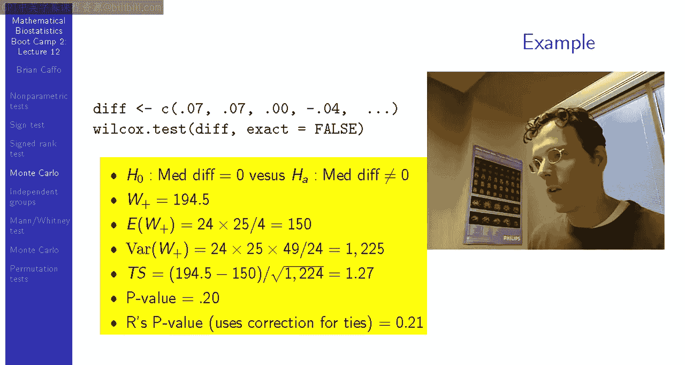
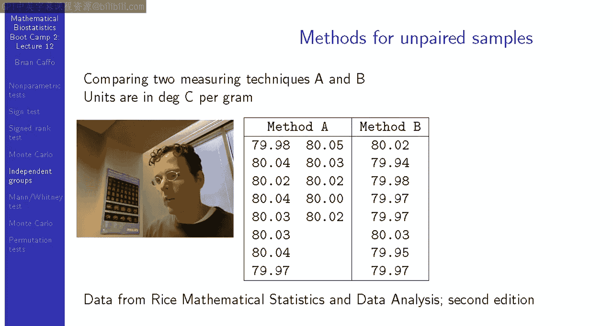
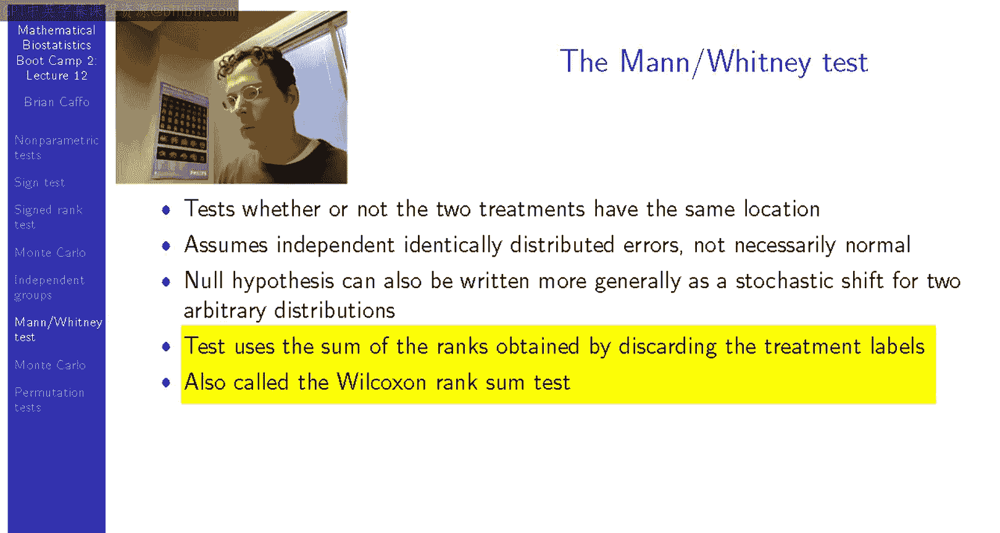
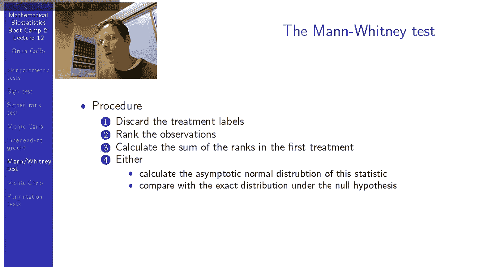
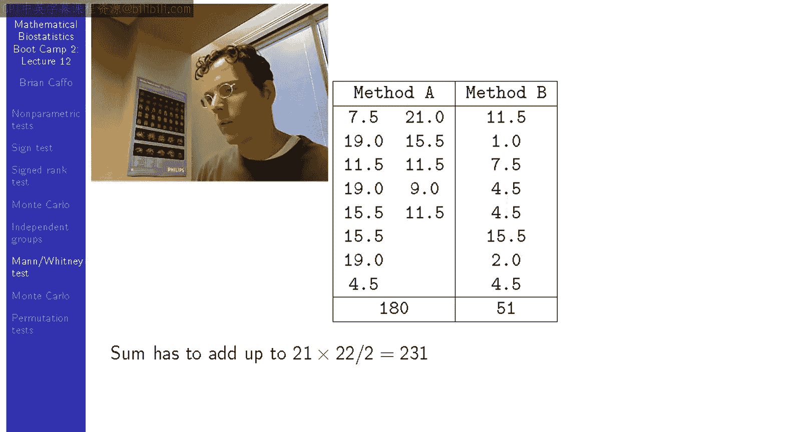
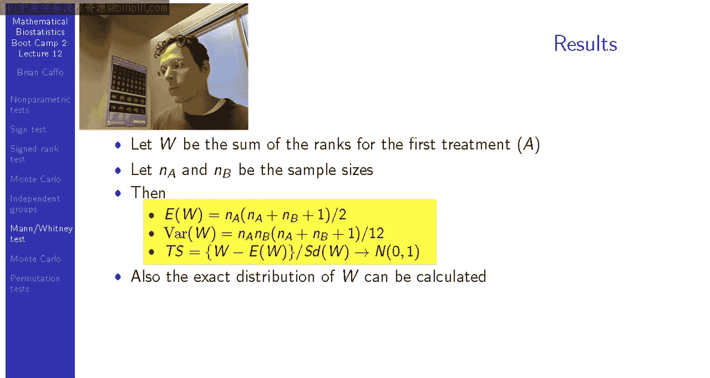
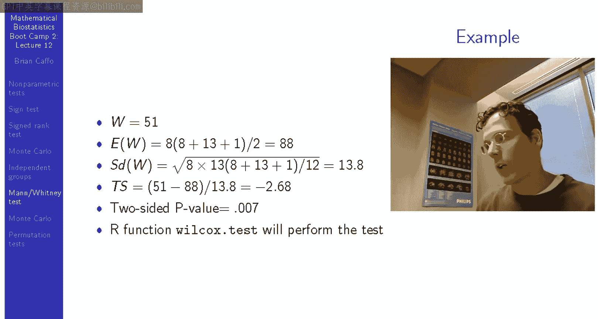
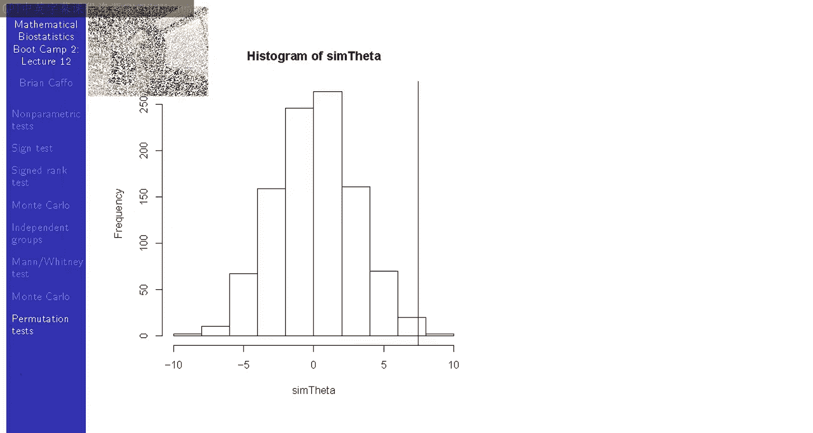
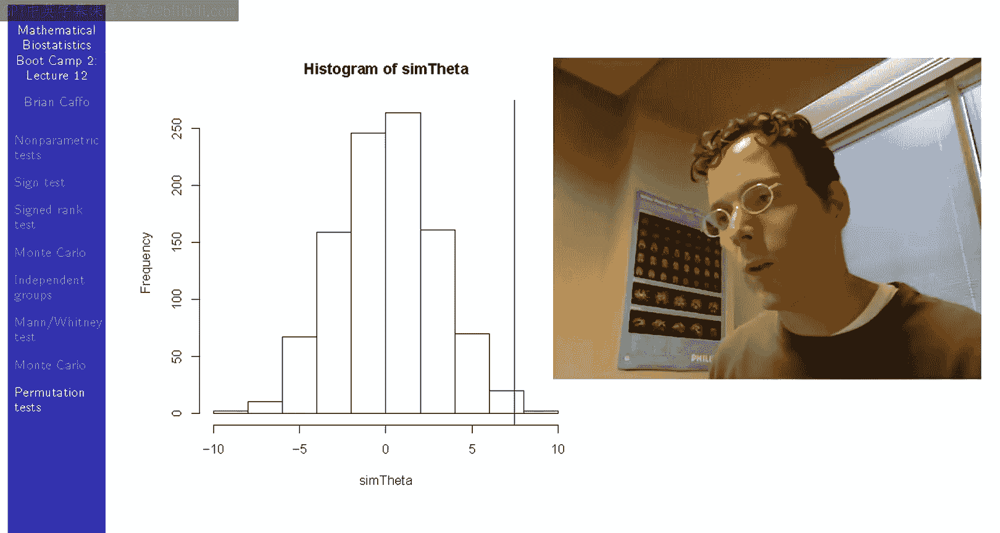

# 约翰霍普金斯大学《数据科学的高级统计｜Advanced Statistics for Data Science》中英字幕（deepseek p70 39_秩和检验.zh_en -BV1htPjeYEFH_p70-

0。

Okay， so that's the non parametric equivalent to the。

Paired test let's talk about the nonparmetrical equivalent to the unpaired test and here we have we're comparing two measurement techniques again from this wonderful book from Rice mathematical statistics and data analysis anyway they were comparing two measuring techniques and the units are in degrees Celsius program gra and here we have a group measured with Meth A in a group measured with methodthod B and we want to kind of test are the measurements the same and we'll be a little bit more formal about the hypothesis in a minute。

But so let's。Let's talk about how we can do that。 And so what basically the method we're going to use is。

Not to be confused with method A， Me B， the technique we're going to use for testing whether the two methods are the same。

Is to kind of take the AB labels and shuffle them on every measurement。

 but because to be non parametric， we're going to shuffle them on the ranks。

 but then we'll talk later on about shuffling them on the observed。Values themselves。

 That's the so called permutation test。

Okay， so what we're going to do is test whether or not the two measurements。

 two treatments have the same location， what I mean is kind of the distributions are centered at the same place。

 we're going to assume that the measurements are independently independent and identically distributed。

Have independent identically distributed errors that are not necessarily normal。

 so there's a difference between the errors being normally distributed versus the measurements being normally distributed。

And that's one way to so this is the problem with this test is that's one way to write out the assumptions。

 another way is to view this as a test of a kind of a distributional shift that the distribution for method B is kind of uniformly shifted relative to that of distribution A and that's called a stochastic shift for the two arbitrary distributions so you can either kind of specify the hypothesis kind of tightly that they're centered in the same location with IID errors and then you get the same test statistic and it has a set of power for that particular collection of hypotheses versus a very general one about a stochastic shift and it has a different kind of power for that set of hypotheses。

So all we're going to use is we're going to disregard labels， Me A， Meth B labels。

 we're going to rank the observations， and then we're going to use the sum of the ranks by discarding within each treatment label。

And this is called the Will Coxson ranks some test。

 it's equivalent this so called man Whitney test as well。

 so you might call it I don't know the the Wil Coxson Man Whitney test in R it's Wilcox。t。

And I should say that there are some slight differences between the tests， depending on how you。

 the tests work got to be the same， but they characterize the test statistic in slightly different ways。

 but it's still I think， correct to attribute the test to Will Coxon and Whit man and Whitney being to researchers。

A。So the procedure is to discard the treatment labels， Meth A， Me B in this case。

 rank the observations without concern over which treatment they were。

 calculate to some of the ranks in the first treatment， which it's arbitrary。

 you could pick the first treatment of the second treatment， you get the same value。

 but you have to pick one of the two， and then you either compare your statistic with the asymptotic normal distribution of the statistic or you can calculate the exact distribution under the non hypothesis。

So here I show the ranks for MethadA， the ranks from Meha B in case the two observations are tied。

 we give them the average rank and then move on the sum of the ranks for MethadA was 180 and the sum of the ranks for Mead B was 151 by the way the sum has to add up to 231。

By the way。嗯。And。Let's show just because that's a fun result， let's show why this is the case。

So Gas supposedly did this as a child some。Hypois that this story is apocryphal but whatever let's for our purposes let's assume he did it when he was a kid so as the story goes is that his teacher asked him to add up the numbers between one and 100 and he went down at his desk and just came back with the answer and the teacher said that's not possible how did you do that and then he went and really did it and got the same answer anyway rate I think the storys probably apocryphal but here it's really a neat way to show it。

I we could write x as the some of the digits from one to n1 plus2 plus3 and in that way。

 or we could write it as n plus n minus1 plus n minus2 it's the same exact thing all the way down to one So if you add the two together you get two x equals and in this case。

Notice 1 plus n is n plus 1，2 plus n minus1 is n plus 1，3 plus n minus2 is n plus1 and so on。

 and so this so 2 x is n times n plus1， which is exactly what's happening here is the number n plus1 added up n times so it's n times n plus1。

 so then x has to be n times n plus1 over 2。Okay， so let's let W be the sum of the ranks for the first treatment and then you know if a treatment has more numbers in it then it's under the nopo it's going to have a higher sum just by virtue of having more numbers。

 so we need to know NA and NB， the number in each sample。

 and it turns out that the expected value of the sum of the ranks under the nu hypothesispo from the first group works out to be this guy NA times NA plus Nv plus1 divided by 2 and so on with a standard error given by this guy。

 then we could create a test statistic which is our W or some of our ranks in our first group minus its expected value divided by standard error turns out to be。

Normal zero1， of course， you can calculate the exact distribution as we described before。

Okay， so let's go through our example， in this case our some of our ranks was 51 if we did method B。

Our sum of our ranks was 51， here's our expected value and standard deviation of that statistic 88 and 13 our test statistic works out to be negative 2。

68 P value of 0。007 for two sided and then you can also do the function Wilcox。

 test and it will perform it'll perform the test to you both for the one in two sample version。

 you have to read over the documentation for Wilcox test if you give it one vector it's going to do the sign rank test if you give it two vectors it's going to do the rank sum test。

So some final notes about the non-parmetric test is they tend to be more robust outliers than their parametric counterparts。

 they do not require normality assumptions， they often have exact small sample versions。

 and their trick their big trick is to focus on the ranks rather than the raw data。

There is some loss in power over there parametric counterparts assuming the parametric assumptions are met。

 but the loss and power is often not so bad and then I just want to emphasize nonparmetric tests are not assumption free。

 they're often distribution free for example the signed rank test you really kind of have to assume that the distribution is symmetric。

 but either way in all of the tests that we considered you have to have a sampling model that the data is IID right that's an assumption。

 a big assumption， the biggest assumption。So you know。

 just emphasize that non parametric tests are not assumption free。

 they're often distribution free but not assumption free。

And then so I just wanted to remind people about permutation tests because we've already talked about them a little bit sort of with regard to Fisher's exact test。

 but here we could also talk about them in general。

 So permutation tests are similar to these rank sum tests。

 though they use the data rather than the actual ranks。

 So under the no hypothesis for the rank sum test， we had the collection of ranks and and our null distribution was just obtained by permuting the treatment labels you know。

 we had NA。Treatment A labels and NB， treatment B labels。

 and we just permute those with respect to the ranks that would retain NA labels and NB labels。

 but they would be randomly allocated among the ranks。A permutation test is exactly the same thing。

 you're just doing it to the raw data rather than the actual ranks。

 and you have to come up with the statistics。And I go through the procedure here， you know。

 you could permute the ranks and then create a rank statistic I also want to。嗯。Well。

 I want to distinguish there's two ways to think about this。

 one is imagine if your treatment was actually randomized and you can think of the permutation test as actually kind of redoing the randomization and in that case the permutation test is called a randomization test if you interpret it that way。

 but you can also kind of，Perform the permutation test even if the treatment wasn't randomized because you're thinking along the lines of。

 well。My no hypothesis is that my labels， A and B， are exchangeable between the groups。

So either way it kind of makes sense， but it changes your interpretation a little bit of the test in either way。

 but at any rate， the Fser's exact tests， the rank sum tests。

 Fser's exact test which works on collections of binary data。

 the rank sum tests which works on ranking the observations and then the permutation test all have the same basic principle is that under the no hypothesis。

 however we're interpreting it is that treatment labels are the NA and NB treatment labels are。

Exchangeable and our null distribution is obtained by permuting those labels across the values in Fishery's exact test and the permutation test we're permuting them across the actual observed values。

 and then in the rank some tests were're converting the data to ranks first and then permuting across the ranks。

So just to reiterate， this is an easy way to produce a null distribution for a test of equal distribution。

 it has kind of a similar flavor to the bootstrap， maybe not exactly this produces an exact test。

 it's less robust but more powerful then rank some tests because you're not throwing away the data with ranks some tests you throw away the actual units and go to with ranks。

 so you gain robustness at the expense of power this you get a little bit more power under certain assumptions but you lose some of that robustness and it's very popular in large scale big data applications like genomics。

 for example， in neuroimaging。

So this final picture is just what you would aspire to get from a permutation test。

 you would permute Me B labels， you would say calculate the T statistic as if the permuted labels were the observed labels and you do that over and over again and you get a null distribution of T statistics right and then you。

Vertical line is where absolute our actual T statistic occurred。And then if that's the case。

 then you or whatever statistic， it doesn't have to be a T statistic。

That's a reasonable statistic to do。And then the percentage of the simulated statistics that are more extreme than our observed statistic is our exact P value。

 so that's a permutation test if you were to do it with the ranks。

 then this would just be simulating the exact small sample distribution of the rank sum statistic if you were do it with a raw data。

 then it's a so-called permutation test and so on。

