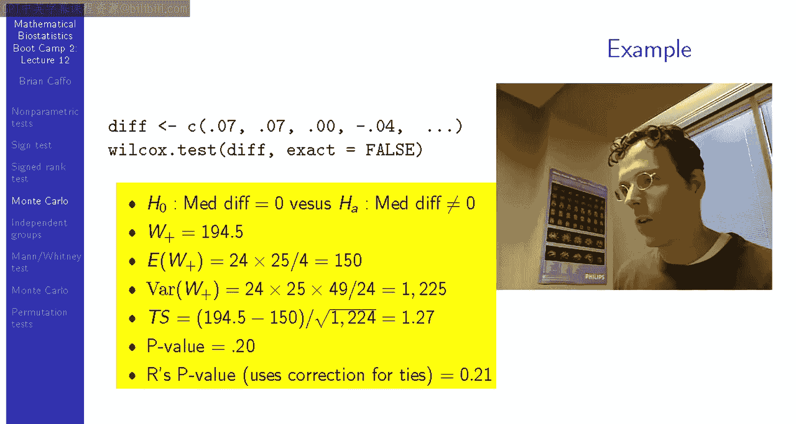
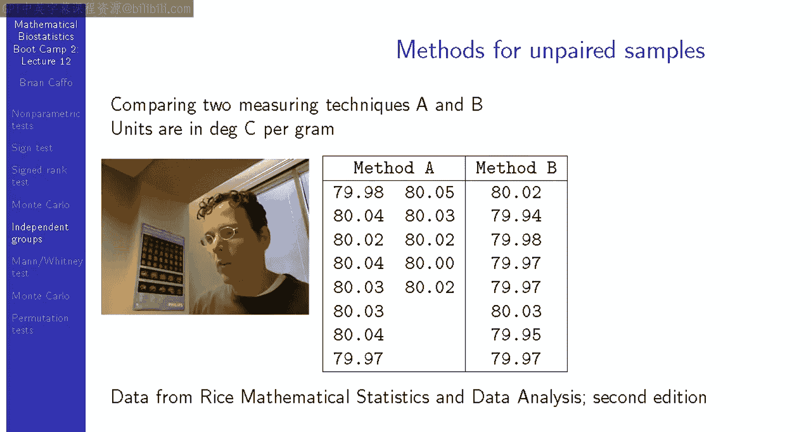
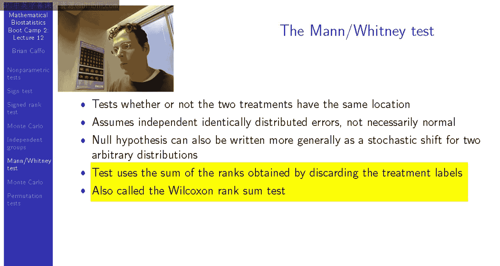
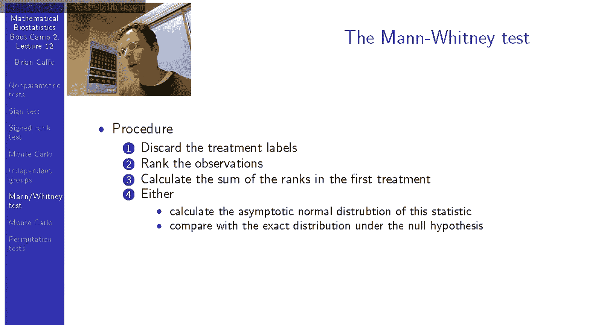
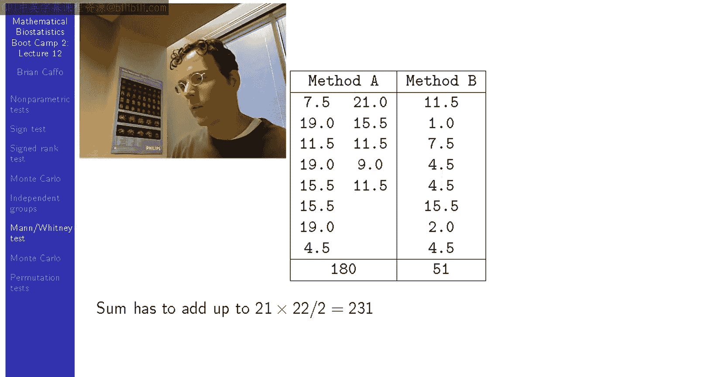
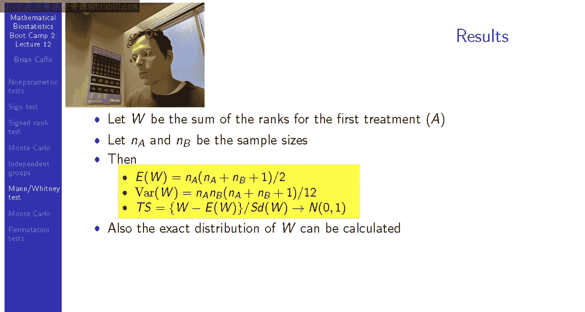
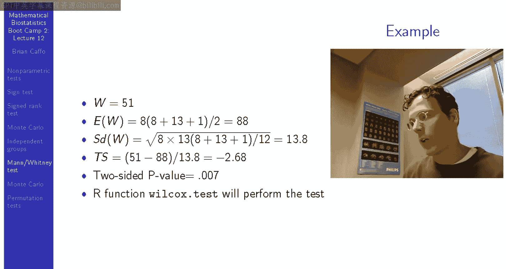
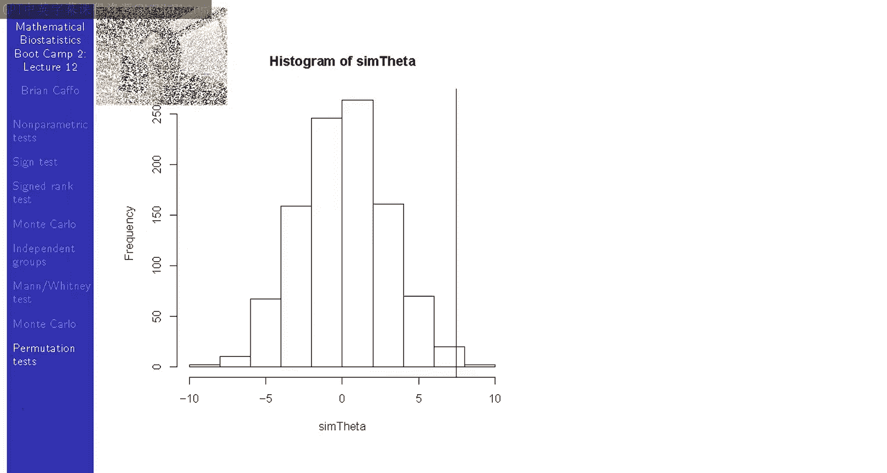
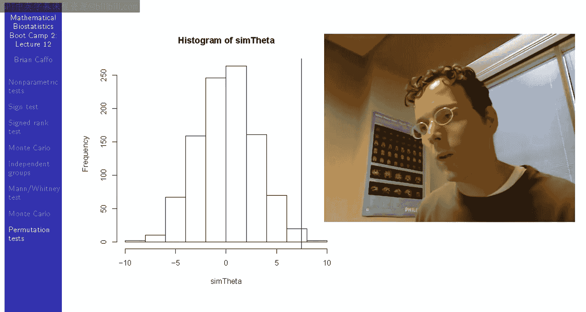

# 高级统计：第39讲：秩和检验 📊

在本节课中，我们将学习非参数检验中的秩和检验，它是独立样本t检验的非参数等价方法。我们将探讨其原理、计算步骤、假设条件，并与置换检验进行比较。

---

上一节我们介绍了配对样本的非参数检验（符号秩检验）。本节中，我们来看看独立样本的非参数等价方法。

这里有一个例子，比较两种测量技术（方法A和方法B）的测量结果（单位：摄氏度/克）。我们想检验这两种方法的测量结果是否相同。我们将使用一种方法：忽略样本的“方法A”和“方法B”标签，对所有观测值进行排序（即计算秩），然后基于秩进行计算。这种方法称为**Wilcoxon秩和检验**，也称为**Mann-Whitney U检验**。

## 检验的假设与思想

我们检验的零假设是：两种方法（或处理）的测量值具有相同的位置（即分布中心相同）。我们假设测量值是独立同分布的，其误差项独立同分布，但**不一定服从正态分布**。另一种更宽泛的假设是“随机漂移”，即方法B的分布相对于方法A的分布发生了均匀的位移。

检验的核心思想是：在零假设下，方法A和方法B的标签是可以互换的。因此，我们丢弃原始标签，将所有数据混合后排序，然后计算某一组（例如方法A）的秩和，并查看这个秩和是否与随机分配标签时期望的秩和存在显著差异。

## 检验步骤与计算

以下是执行Wilcoxon秩和检验的步骤：

1.  **合并与排序**：将两组数据合并，忽略其原始组别标签。
2.  **分配秩次**：对合并后的所有观测值从小到大排序，并分配秩次（1, 2, 3...）。如果出现并列值，则分配平均秩。
3.  **计算秩和**：将原始第一组（例如方法A）数据对应的秩次相加，得到秩和 **W**。
4.  **计算检验统计量**：根据样本量计算 **W** 的期望值和标准差，构造近似服从标准正态分布的Z统计量。
5.  **做出决策**：根据Z统计量计算p值，并与显著性水平比较。

### 秩和的性质

所有观测值的总秩和是一个固定值。对于总样本量 **N = n_A + n_B**，总秩和等于从1到N的自然数之和，其公式为：
**总秩和 = N(N+1)/2**

这个公式有一个著名的故事：据说高斯小时候快速计算出了1到100的和，即 `100*101/2 = 5050`。无论故事真假，这个公式都非常有用。

在我们的例子中，方法A的秩和为180，方法B的秩和为151，两者之和为331，验证了总秩和公式。

### 检验统计量的计算

设 **W** 为第一组（样本量为 **n_A**）的秩和。在零假设下，**W** 的期望值和标准差为：

*   **期望值 E(W) = n_A (N+1) / 2**
*   **标准差 SE(W) = sqrt( n_A * n_B * (N+1) / 12 )**

然后，我们可以计算标准化后的Z统计量：
**Z = (W - E(W)) / SE(W)**

这个Z统计量在大样本下近似服从标准正态分布。也可以计算精确的（小样本）分布。

### 实例计算

在我们的例子中，若以方法B为第一组，其秩和 **W = 51**，总样本数 **N=21**，**n_B=9**，**n_A=12**。

*   **E(W) = 9 * (21+1) / 2 = 99**
*   **SE(W) = sqrt( 9 * 12 * (21+1) / 12 ) = sqrt(198) ≈ 14.07**
*   **Z = (51 - 99) / 14.07 ≈ -3.41**

计算p值（双侧）约为0.0007，表明两种测量方法存在显著差异。

在R语言中，可以使用 `wilcox.test()` 函数轻松完成此检验。如果输入两个向量，它会执行秩和检验；如果输入一个向量，则执行符号秩检验。

## 非参数检验的特点与置换检验

在介绍了具体的秩和检验后，我们来总结一下非参数检验的特点，并介绍一个相关的强大工具：置换检验。

### 非参数检验的要点

*   **优点**：对异常值更稳健；不要求数据服从正态分布；常有精确的小样本版本。
*   **核心技巧**：关注数据的秩而非原始值。
*   **代价**：如果参数检验的假设（如正态性）成立，非参数检验的统计功效会略有损失，但通常损失不大。
*   **重要提醒**：非参数检验**并非没有假设**。它们通常是“分布自由”的，但仍需假设数据是独立同分布（IID）的。例如，符号秩检验要求分布对称。IID是所有这些检验中最重要的假设。

### 什么是置换检验？

置换检验与秩和检验思想相似，但它直接对**原始数据**进行操作，而非数据的秩。

其基本步骤是：
1.  在零假设（组别标签可交换）下，随机打乱“方法A”和“方法B”的标签。
2.  根据打乱后的标签，重新计算你关心的统计量（例如，两组均值之差、t统计量等）。
3.  重复上述过程成千上万次，得到一个在原假设下该统计量的“经验分布”（即置换分布）。
4.  将实际观测数据计算出的统计量值，与这个置换分布进行比较。落在分布极端位置（例如，尾部）的比例，就是精确的p值。

### 各类检验的联系

费希尔精确检验、秩和检验、置换检验都基于同一个核心原则：在零假设下，处理标签（A和B）在观测值（或秩）之间是**可交换的**。

*   **费希尔精确检验**：在列联表的边际固定的条件下，置换的是分类数据的标签。
*   **秩和检验**：先将数据转换为秩，然后在秩上置换标签。
*   **置换检验**：直接在原始观测值上置换标签。

置换检验比秩和检验利用了更多信息（原始值而非秩），因此在某些假设下功效更高，但牺牲了一些对异常值的稳健性。它在基因组学、神经影像学等大规模数据应用中非常流行。

---

本节课中我们一起学习了Wilcoxon秩和检验，它是用于比较两个独立组别中心位置的非参数方法。我们详细讲解了其计算原理、步骤和统计量的推导。同时，我们也探讨了非参数检验的优缺点，并引入了更通用的置换检验概念，理解了它们都基于“标签可交换”这一核心思想。掌握这些方法，可以在数据不满足正态性等参数假设时，为我们提供有力的分析工具。