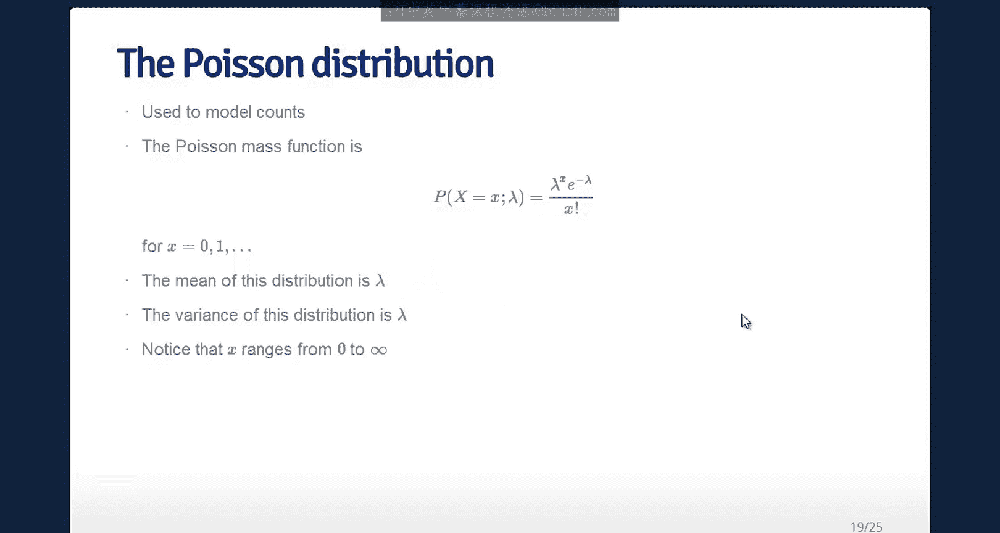
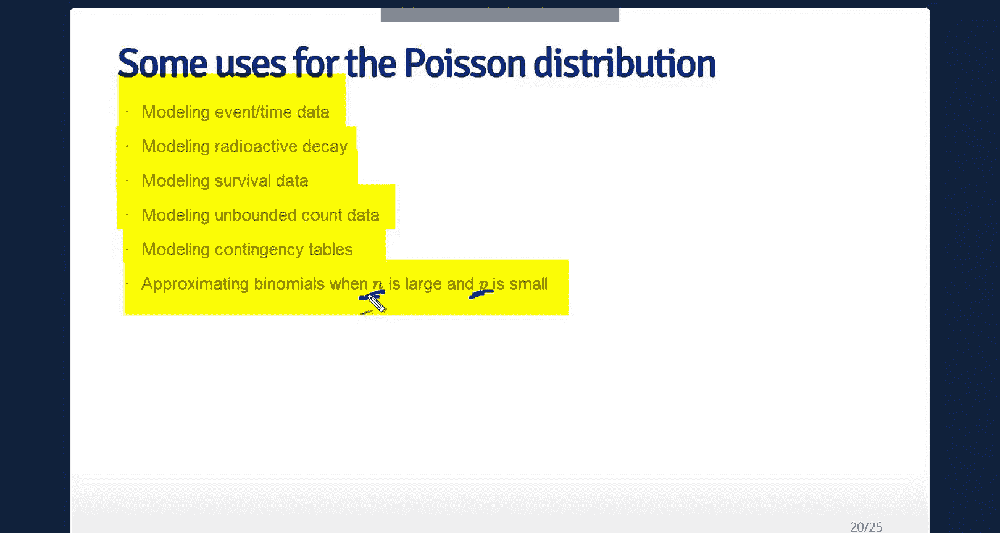
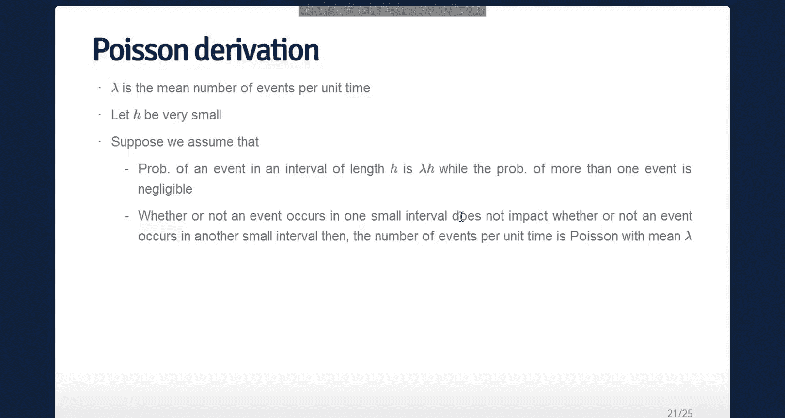
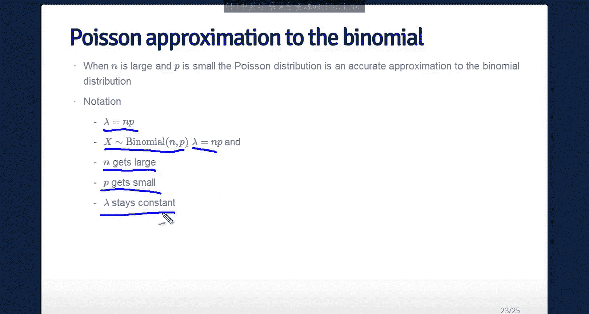
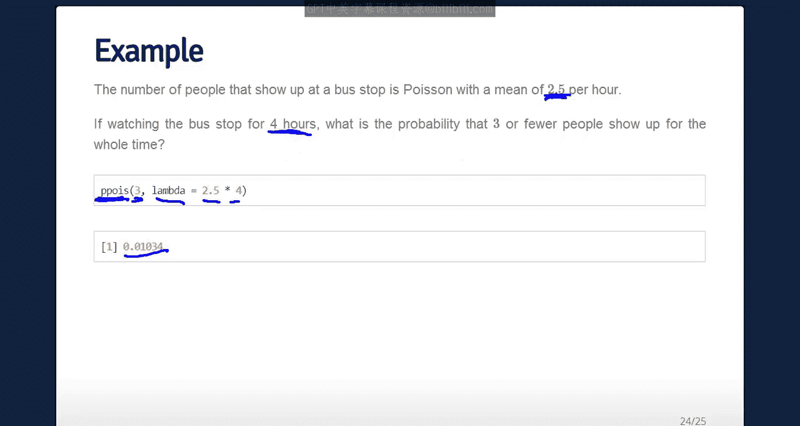
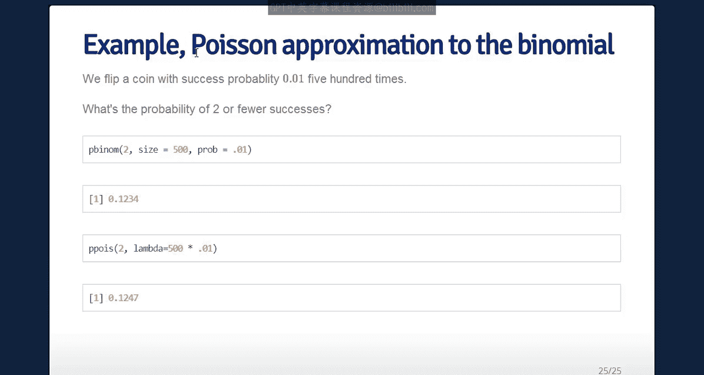

# 约翰霍普金斯大学《数据科学的高级统计｜Advanced Statistics for Data Science》中英字幕（deepseek p71 40_泊松分布.zh_en -BV1htPjeYEFH_p71-

Okay， so let's move on to another very important distribution。

 maybe not quite so important as the normal distribution， but awfully darn important。

 maybe maybe the second most important distribution。

 I think a compelling case could be made for the Poisson distribution being the second most important distribution。

I don't know， I have leanings in that direction。Okay。

 so the Poson distribution is used to model counts。

 the Poson mass function is this guy lambda the D Xe in the negative lambda all over x factorial where this is the probability x takes value little x for parameter lambda。

And it turns out that lambda is an easy parameter because it's just the mean。

 it expected value of x is lambda。But what's interesting about the Poisson random variable is that its variance is also lambda。

Well， we knew its variance had to be some function of lambda because the Poisson distribution only depends on the one parameter。

 but it is kind of neat that it works out that the mean and the variance are equal in this case。

And then notice in this case x ranges from zero to infinity。

 so you know you might use poisonsonons to model counts that are sort of unbounded， right so。

You know however many people show up at a bus stop。

 you don't you know sure you know there's some bound。

 there's only so many people in the world but for all intents and purposes that's an unbounded number。

 you can't really put a number on what the limit of what the limit of that really is in a meaningful way of course it's bounded by the number of total people but。

U。It's you know kind of conceptually unbounded in a different way that than if I flip a coin five times and I know I'm going to flip it five times。

 that's a different problem right we know that the most number of successes I can get is five。

Whereas if you're modeling how many people show up at a bus stop。

 then you really kind of don't know a realistic version of what that upper limit would be。

So some uses for the Poson event time data。If you're counting anything like the number of people that show up at a bus stop。

 the number of photons that are detected from a nuclear reactor。For per given unit time。

 these are all reasonable things to model with Poson。

So radioactive decay is the classic one because you can kind of demonstrate via some limiting arguments that radioactive decay does follow of Poson distribution survival data。

 it turns out there's this deep connection between a lot of these classic survival analysis models and poson models。

 survival analysis being modeling the time until some event。

 classically time until death for modeling for looking at diseases。

On you know any kind of unbounded count data you're going to model is Poson contingency tables so if I collect a bunch of people。

 collect a bunch of characteristics on them and just create cross-classified tables of how many people fell into this different classification that's called a contingency table。

 and it turns out modeling the counts of contingency tables， you model them with Poson usually。

And then binomials which are clearly not Poisson， if you have N being large and P being small。

 then people tend to model them as Poisson， in fact people do this so frequently that they don't even bother to mention that they're approximating a binomial with a Poisson so if you're modeling say for example a disease that's very rare and you have large sample sizes like what's the let's suppose you're studying autism and vaccination rates。

 so the percent of kids with autism is very small， the percent of the number of kids that gets vaccinated is very large。

 so if you were to model the autism rates you would do it probably more likely with a Poisson than you with a binomial。

I take that example because I saw someone doing that just the other day that they were studying that question。

嗯。Okay， so the。The Poson derivation。ISo this is where it comes from so the Poson distribution comes about from the so-called Poson processes and Poson processes。

 you know if you define like a mean number of events per unit time。

 you let the kind of a window H that you're looking at be very small and assume that in that interval of length H。

 the probability of an event occurring is lambda time H。

 while the probability of more than one event is negligible。

 so imagine you're monitoring your best stop you're saying I'm going to look at windows of 0。

1 second and then you know only one person can show up at a time。In that point one second。

 so let's just assume no two people are showing up holding hands or something like that。

 everyone's it's a commuter day where everyone's coming by themselves。

That if you take a small enough time window， you're only going to get one person showinging up to the bus stop at any given time。

And that and。And then whether or not a person shows up in one interval doesn't impact whether or not a person shows up in another interval that assumption may be all these for the bust stop example are suspect。

 but anyway rate these are the underlying assumptions for something to be a poisonson process and then if you take any interval and you count the number of。

Events that occur in that interval， that's a Poson random variable。

 and that's the original derivation of the Poisson random variable through Poson processes。

Um。So I want to emphasize that Posons are really the idea of studying rates and using Poson is really kind of highly tied together the lambda parameter from a Poson is really has a unit right you if I'm looking at radioactive decay right this is the lambda is the decay per unit time and t is the number of that many time points that I monitored so if I wanted to look at radioactive decay per minute t would be in minutes and lambda would be the rate per minute。

So note lambda is expected value of x over t is the expected count per unit time and t is the total monitoring time。

 so we always use。The Poisson distribution this way where we think of sometimes t is one in which case it kind of drops out。

But in our heads， we're always thinking of a Poson random variable as being kind of a model for rates。

Here's the poisonson approximation of the binomial if you ever need to use it。

 we assume that lambda is n times p and x is a binomial NPp。

Recall we're making lambda NP P and n gets large and P gets small， but lambda stays constant。

 then you can approximate x as。

Poson。Let's do it。So imagine。The number of people that show up at a bus stop is Poson with a mean of 2。

5 per hour。And you're watching the bus stop for oh I'm sorry this isnt this is not an example of a poson approximation of the binommial。

 this is just a regular poisson so we want the number of people that show up at a bus stop is poisson with a mean of 2。

5 people per hour we watch the bus stop for  four hours。

 what's the probability that or three or fewer people show up the whole time that is exactly just a Poisson probability three remembering that when we do P for probability distribution it does three or less okay which is what we want so we put three in there lambda is 2。

5 times the number of hours that we monitored four and that works out to be 1%。Okay。

 so see how we used it， Lambda was the event per unit time and t was the number of units of time that we measured okay so there's your Poisson example。

 let's go through an example of the Poisson approximating the binomial。

We flip a coin with success probability 0。01， so p is small。

 we flip it 500 times what's the probability of two or fewer successes so again p by noome2 size equals 500 prob equals 01 here's the exact calculation。

 it works out to be 0。12。Here's the Poson approximation P Poson2 lambda equals 500 times 0。

01 n times p， and that works out to be 0。1247， so pretty close。

Okay so that's the Poson approximation of the binomial。

 so here we just showed you exactly how accurate they were in this specific case。

And then in your regression class， you actually cover modeling counts using kind of a Poson version of regression so it's a very convenient model and it's great for modeling things like rates。

And I would say this， I would also mention this poisonson approximation of the binomial is so common that people don't even acknowledge that they're doing it。

 that it's just sort of done immediately in a lot of applications。

 particularly certain epidemiological applications if you're studying something like an infection or something like that that's rare relative to the size of the population you're studying。

 people just automatically use Poson approximations。

