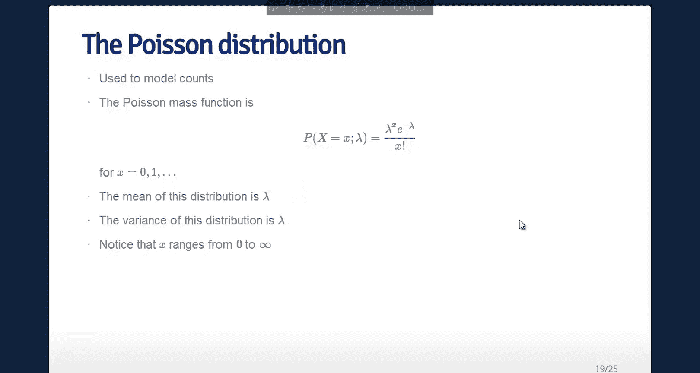
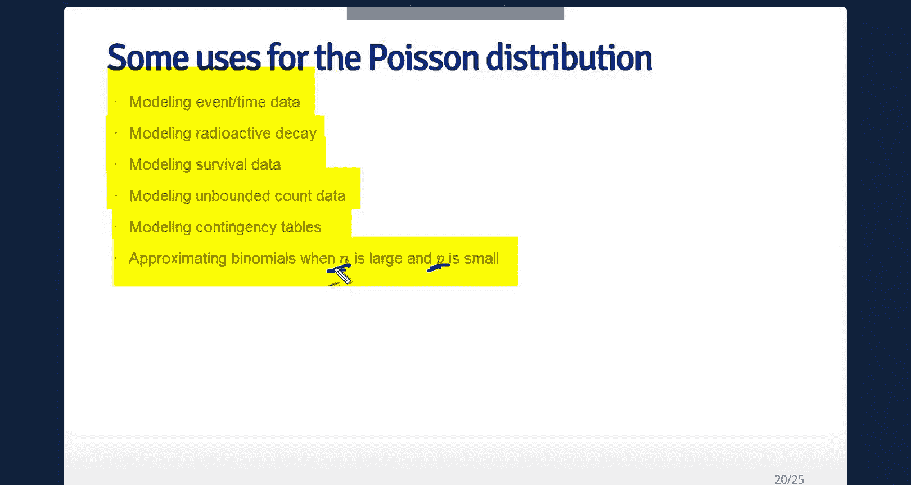
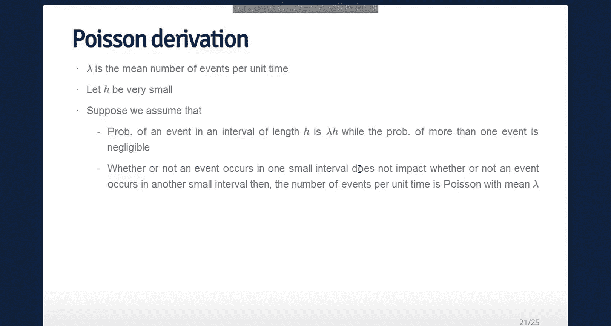
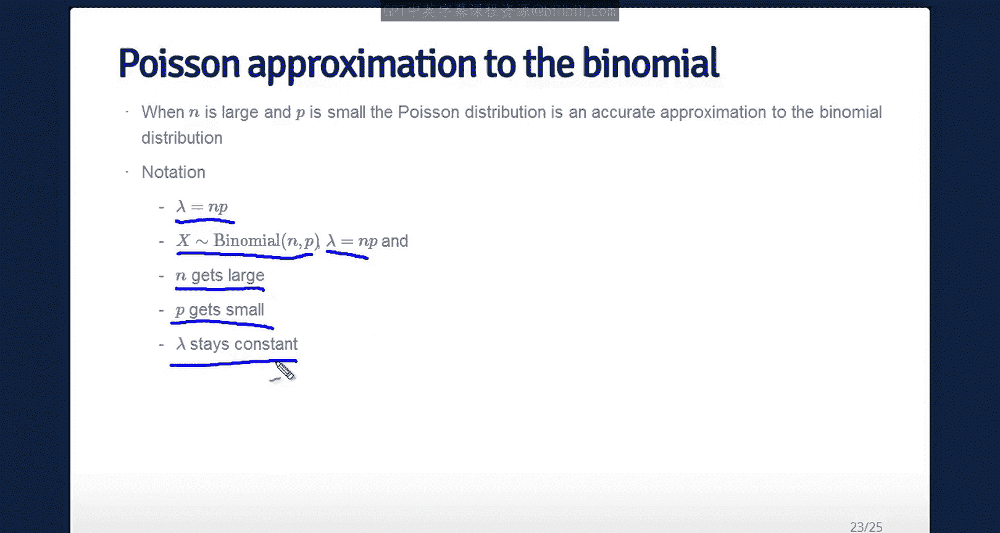
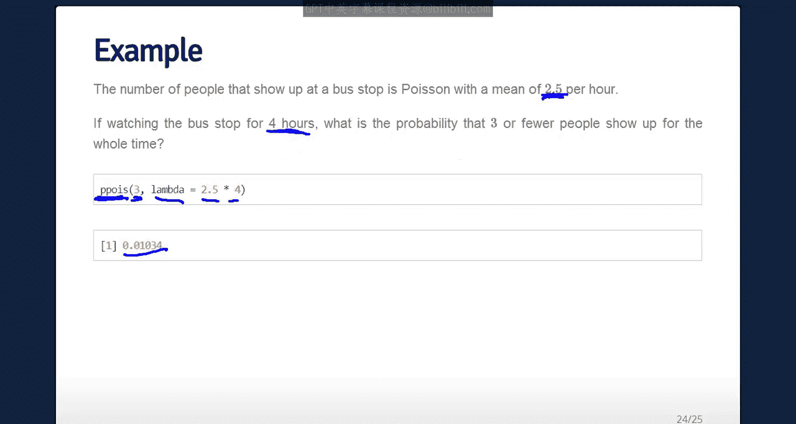
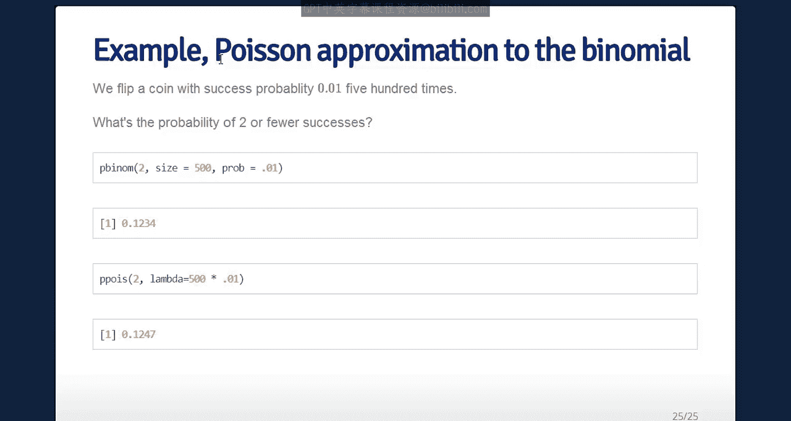

# 数据科学的高级统计：泊松分布

在本节课中，我们将学习泊松分布。这是一种用于建模计数数据的概率分布，在数据科学中应用广泛，尤其在处理事件发生率或计数问题时。

## 概述

泊松分布是继正态分布之后，另一个极其重要的概率分布。它专门用于对计数进行建模，例如单位时间内到达公交站的人数、检测到的光子数量等。其核心特点是均值和方差相等，且仅依赖于一个参数 λ。

## 泊松分布的定义与性质

上一节我们介绍了泊松分布的重要性，本节中我们来看看它的具体数学定义。

泊松分布的概率质量函数（PMF）由以下公式给出：



**P(X = x) = (λ^x * e^{-λ}) / x!**

其中：
*   **X** 是泊松随机变量。
*   **x** 是具体的计数值（x = 0, 1, 2, ...）。
*   **λ** 是分布的参数，它既是分布的**均值（期望值）**，也是分布的**方差**。即 **E(X) = Var(X) = λ**。
*   **x!** 表示 x 的阶乘。

泊松随机变量 X 的取值范围是从 0 到无穷大的整数。因此，它适用于建模那些理论上无上限的计数场景。

## 泊松分布的应用场景

了解了泊松分布的基本形式后，我们来看看它在哪些实际问题中发挥作用。

以下是泊松分布的一些典型应用领域：

*   **事件时间数据**：例如，单位时间内到达公交站的人数。
*   **放射性衰变**：这是经典应用，单位时间内检测到的衰变粒子数。
*   **生存分析数据**：生存分析（如建模疾病死亡时间）与泊松模型之间存在深刻的联系。
*   **无上限计数数据**：任何理论上没有明确上限的计数数据。
*   **列联表**：在统计学中，对分类数据进行交叉分类形成的计数表格，其单元格内的计数通常用泊松分布建模。



## 泊松过程与泊松分布的推导

泊松分布源于泊松过程。理解这个过程有助于我们把握泊松分布的本质。

泊松过程基于以下假设：我们定义一个单位时间的平均事件发生率为 λ。当我们观察一个极短的时间窗口 h 时，在这个窗口内发生一次事件的概率约为 **λ * h**，而发生多于一次事件的概率可以忽略不计。同时，不同时间窗口内事件的发生是相互独立的。

如果以上假设成立，那么在任意时间区间内发生的事件总数，就服从泊松分布。这就是泊松随机变量最初的推导过程。

## 作为速率的泊松分布

需要强调的是，使用泊松分布的核心思想是研究**速率**。参数 λ 通常代表单位时间内事件的期望发生次数。



如果我们监测了总时长为 t 的时间段，那么在这段时间内的期望事件总数就是 **λ * t**。因此，在计算概率时，我们经常使用 **λt** 作为泊松分布的参数。当 t=1 时，参数就简化为 λ。

## 泊松分布对二项分布的近似

在某些条件下，泊松分布可以用来近似二项分布。这在处理稀有事件时非常有用。

当二项分布的试验次数 n 很大，而每次试验的成功概率 p 很小时，如果令 **λ = n * p** 保持为一个常数，那么二项分布 B(n, p) 可以很好地用泊松分布 Pois(λ) 来近似。

以下是这种近似的一个具体例子：



假设我们抛一枚硬币，每次正面朝上（成功）的概率 p = 0.01。我们抛掷 n = 500 次。我们想计算成功次数不超过 2 次的概率。

*   **精确计算（二项分布）**：
    ```r
    pbinom(2, size=500, prob=0.01) # 计算结果约为 0.1234
    ```
*   **泊松近似**：令 λ = n * p = 500 * 0.01 = 5。
    ```r
    ppois(2, lambda=5) # 计算结果约为 0.1247
    ```

可以看到，两种方法的结果非常接近。这种近似在流行病学等研究稀有事件（如某种罕见疾病的感染）的领域中非常普遍，以至于人们常常直接使用泊松模型而不特别声明。

## 实例分析



让我们通过一个完整的例子来巩固对泊松分布的理解。

假设某个公交站，平均每小时有 2.5 人到达（即 λ = 2.5 人/小时）。现在我们观察该公交站 4 小时。我们想知道在这 4 小时内，到达人数不超过 3 人的概率是多少？

**解答**：
总观察时间 t = 4 小时。在 4 小时内的期望到达人数为 λt = 2.5 * 4 = 10 人。
因此，我们计算泊松分布 Pois(λt=10) 中，X ≤ 3 的概率。
```r
ppois(3, lambda=10) # 计算结果约为 0.01034
```
所以，4小时内到达人数不超过3人的概率约为1.03%。

## 总结



本节课中我们一起学习了泊松分布。我们首先了解了它是用于建模计数的关键分布，其均值和方差相等。接着，我们探讨了它的各种应用场景，如事件计数和放射性衰变。然后，我们从泊松过程的角度理解了它的由来，并强调了其与“速率”概念的紧密关联。最后，我们学习了泊松分布如何作为二项分布的近似，特别是在处理大样本小概率的稀有事件时非常有效，并通过具体实例进行了演示。泊松分布是后续学习泊松回归等高级统计模型的基础。