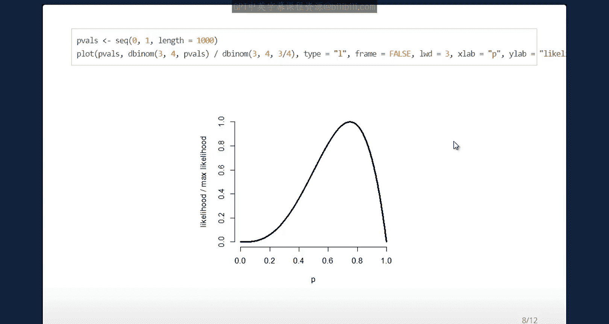
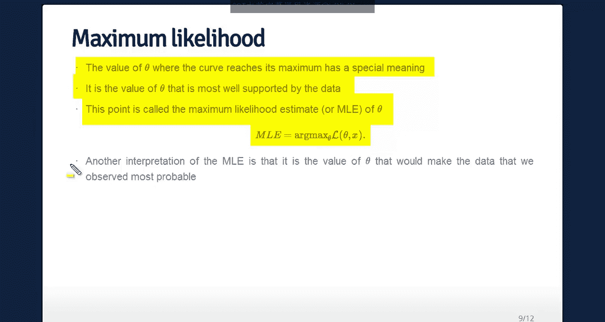
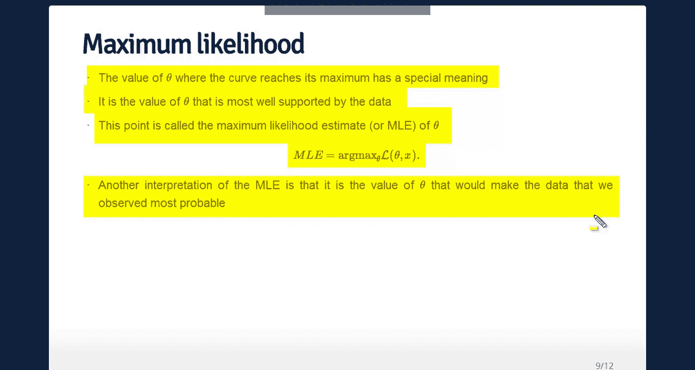
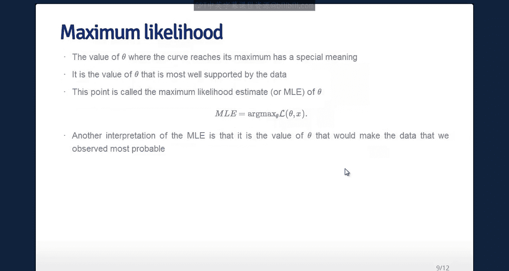
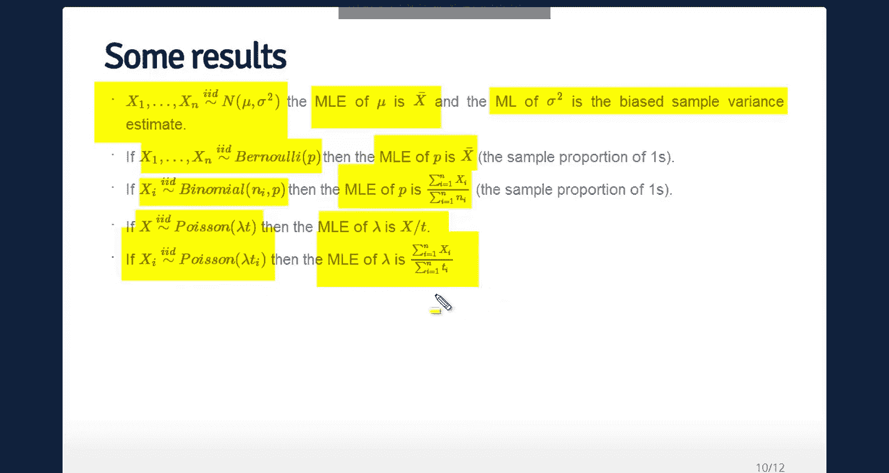
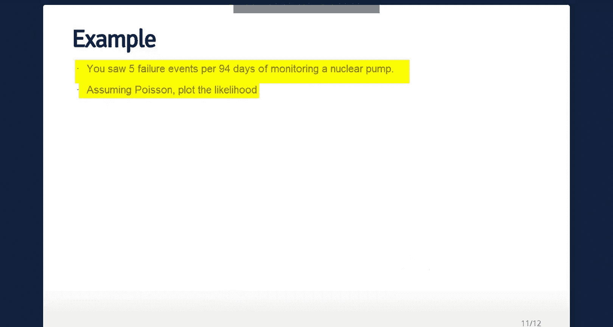
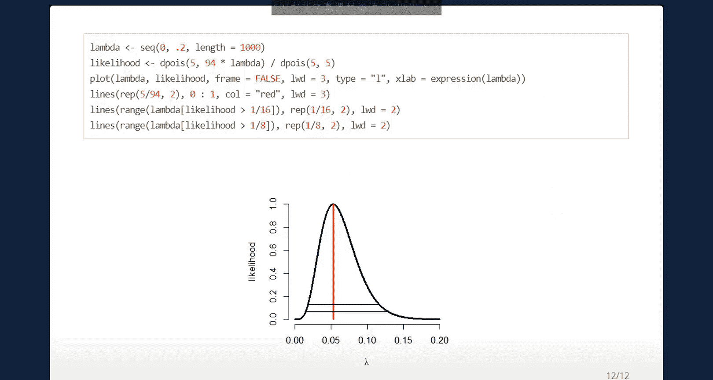

# 约翰霍普金斯大学《数据科学的高级统计｜Advanced Statistics for Data Science》中英字幕（deepseek p72 41_泊松似然.zh_en -BV1htPjeYEFH_p72-

Okay， so let's just。Discuss maximum likelihood a little bit more。

 the value of theta where the curve reaches its maximum is the so called maximum likelihood element estimator。

 so it is the value of the parameter that is most well supported by the data given the likelihood。嗯m。

So it's called the maximum likelihood estimator or MLE。

 so we could just define the MLLE as the argument maximum of the likelihood over theta。

And it has this nice interpretation that the MLE is the value of the parameter that makes the data that we observed most probable right so the likelihood is kind of thinking of the joint probability of the data as a function of the parameter。

 so it's sort of like turning tuning that parameter to where it makes the probability that we observe the。

The probability of the data that we observed most probable。

 which seems to make sense because we did observe the data that we observe。

 so it must be somewhat probable。

So here's some results。If we have some normal data， IID normal data。

 the MLE of mu is x bar and the MLE of sigma squared is the bias sample variance we divide by n instead of n minus1。

If x1 to XN are Bernoulli。Then the MLLE of P is x bar， the sample proportion of ones。

If X I are binomial N P， then the MLE of P is the total proportion of ones。

If the x is are poson lambda t， if an x is poson lambda t， then the MLE of lambda is x over t。

 the rate。If you have a bunch of IID Poson random variables。

 then the MLE of Lambda is the total number of events divided by the total rate。

Okay。So。Let's go through this example right here where you saw five failure events。

For 94 days of monitoring a nuclear pump， assuming a Poisson model plot the likelihoodli。

And by the way， right we know what the MLE is， right， the MLE is five over 94。

Okay。Let's see。So。My Lada is the parameter I'm interested in that。

 so I'm just going to create a grid of Lada values to create my function。

My likelihood is just the Poson density now viewed as a function of all ma lambda parameters。

 but remembering that in each case I sampled for 94 days。WithThe data fixed at five。And then。Der。

The MLE for Lambda。Lambda hat is equal to 5 over 94， so 94 times lambda hat。Is just five。

 So if I plug in5 for Lada， I will get the MLE。Okay。I will get the likelihood at the MLE。

So if I plot my lambda by my likelihood。And then I don't like the frame around it。

Line width is three。Type because that'll connect it in a line and my excellent So if you type expression。

It'll actually put the symbol Lada rather than the word Lambda。

 so you can be fancy like that if you'd like。And then。

Here's this red line is just showing where the MLE is and then of course the light lid achieves one at that point and then I draw these two kind of reference lines I'll talk about them in a second Okay。

 so this is the light lid so this is a plot of the estimated rate。

By the evidential support for that estimated rate。 So if we wanted to compare， you know。

 this point and this point， it would be。That ratio of those two guys， okay？Now。嗯。

I'd like to draw these reference lines for the following reasons。 So this reference line is at 1，8。

And this reference line is at。1，16th。Okay。And the reason I like to draw。

These reference lines is as follows， you know， this point， you know。

 so so I know that this line is 18 right here， So take this value of lambda right there and compare it to the MLE value of lambda right this ratio because the top is one and the bottom。

Is 18 That ratio is8 if you put the MLE in the numerator and1/8 if you put this value in the numerator and the same thing would go for this value right here at that corner so basically the MLLE is eight times better supported than that point but then if I take any other point in between the two right its height you know because its height is a little bit less than the MLE。

 we know that it's going to be slightly less well supported。嗯。

And so that it'll be slightly less than eight times better supported。Okay。Um。But。What's interesting。

 right？If you take， if you were to take now。Remember， this is one/8 right here。

Take this point right here， right？Okay。That value of lambda。Right， its value is less than one/8。

 so when we were to compare it to the MLE， it would be worse than eight times。

BeThe Emily would be better than eight times supported than that point。

Okay so there's so any other point in this range right。

 you cannot find a point that's more than eight times better supported right every point outside of that range you can find a point that's more than eight times better supported so these collection of points right here。

 these collection of lambmbda values right here are exactly the points such that there is no other point that is more than eight times better supported。

If we draw that line at 1/8。Of course， this is all predicated at having normalized the likelihood with the MLE at one。

And this line right here， all the points of lambda that fall within this interval， right。

 because it's 116th are the points such that。There is no point that is more than 16 times better supported。

 okay， and that's kind of useful， right？And you can do these experiments so where do I get8 and 16 so8 is too cubed and 16 is2 to the fourth I get those because if you do these coin flipping experiments where you know comparing the likelihood of whether a coin is too headed versus the likelihood of the coin being fair。

 you find that that kind of intuitively people start switching if they get three consecutive heads。

 they start saying， oh the coin that coin appears to be fair。

 unfair to the tune of being too headed and at about four consecutive coin flips。

 they're quite certain that the coin is unfair so you I consider these kind of like moderate and sort of strong evidence in favor of。

嗯。In favor of the points within。These line。So just to reiterate， if you take this interval。

 it's kind of like these are basically the likelihood equivalent of a confidence interval。

And so if you take all of these points， there is no such point that is more than eight times better supported given the data in the model。

 if you take a point outside of it， say this point。

 we know at least one point namely the MLE that's more than eight times better supported so those are little so-called likelihood intervals and you might say well wait the 18 is kind of arbitrary but it's no more or less arbitrary than say constructing a 95% confidence interval。

What you really want to give people is the full plot because it conveys all of the relevant information the only problem with likelihood is if you have multiple parameters like like in a regression setting。

 then you have to figure out how to do something。That displays just the like lid。

 but I wanted everyone to at least hear about the likeli。

 the remainder of the class will be focusing more on kind of frequency style inference that does not show likeli based plots。

 but I wanted people to be aware of this style of inference。

