# 约翰霍普金斯大学《数据科学的高级统计｜Advanced Statistics for Data Science》中英字幕（deepseek p73 42_泊松P值计算.zh_en -BV1htPjeYEFH_p73-

So there's a related idea， in fact， numerically equivalent idea of the so called attaintained significance level。

Our testtistic was two for HO mule 30 versus H mu different from 30 when we said that n was 100？So。

Here' is our normalized test statistic。Distribution。Under the null。

And our test stat work out to be too。And we said for a one sided test that if we set alpha alpha to be。

Am。If we set alpha to be 5%。5%， right， Then we got 1。645 there。 We set that to be 5%。

 Our two was bigger than it。And we would reject the no hypothesis What if it was 01% right that would be way out here so that there was。

1%。Then we would if we set alpha to that level。We would fail to reject。

 so look at what would be the alpha level。For which that you exactly achieve this balance where you pick。

 if you were to have picked an alpha level larger than it。Am。

If you were to pick an alpha level level larger than it。

 you would reject and smaller than it you would fail to reject I think you can see you know if we picked up here。

 we're going to reject if we picked down here so that our alpha level is this guy we would I'm sorry if we picked up here we would fail to reject and we picked up here we would reject so I think you can see if you were to move it so that the line exactly overlapped with your test statistic you would be exactly at that point and then that alpha level would be the alpha level for what you fail to reject。

If the alpha level were smaller than it and you reject if the alpha level were bigger than that。

And that guy is called the attained significance level， kind of for obvious reasons。

 it's sort of saying。What's the smallest significance level I could choose？And still reject。

So you can see this is equivalent to the P value right。

 you can see that by moving these lines around until we get to that perfect alpha。

 that probability of being larger than our test statistic， well that's also just the P value。

 so it's philosophically different， but it's the same quantity。

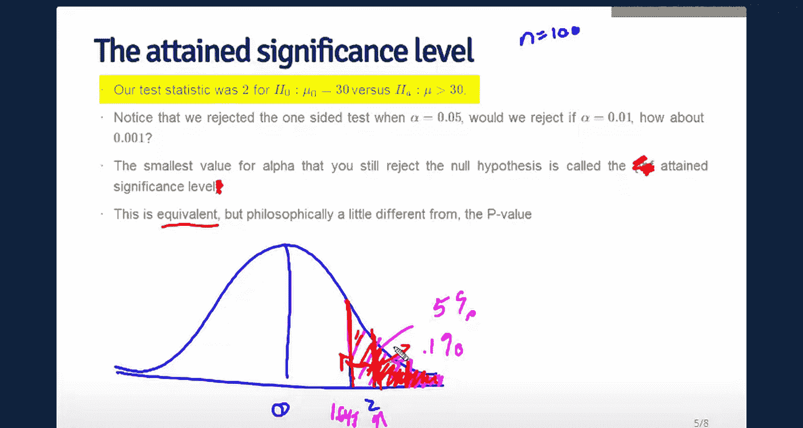

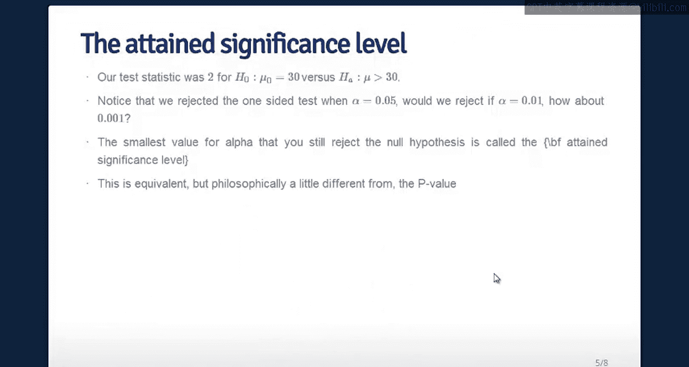

It's the same number， so any rate there's a difference between there's an interpretation difference between the attained significance level and the P value。

 but there's not a practical difference because they're the same number。

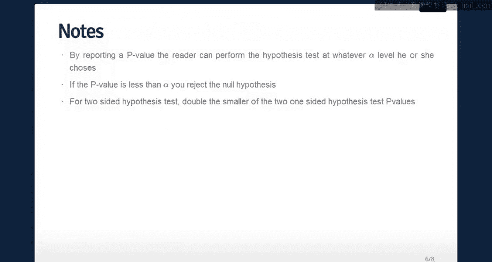

One reason I like P value is if someone gives you a P value。

 then the reader or interpreter of your test can perform the hypothesis test of whatever alpha they like。

They reject if the p value is smaller than alpha and they fail to reject if the P values is larger than alpha。

Okay， so that's one reason why I like P values is because then the person can calibrate the test however they'd like。

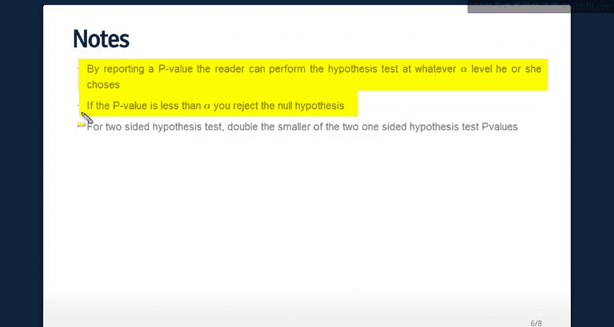

If you just tell them I rejected or I didn't reject。

 you haven't given them the same amount of information。

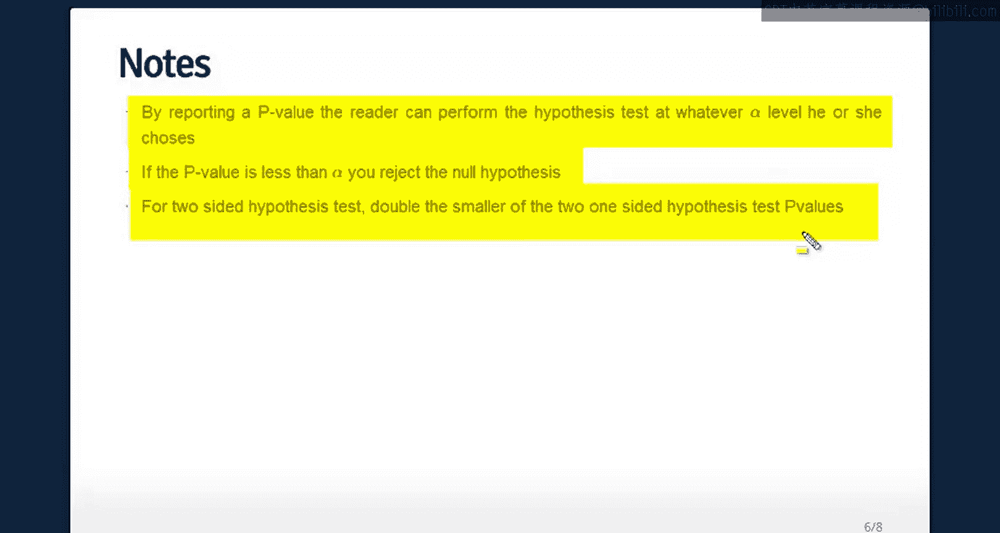

For two sided hypothesis tests， you double the smaller of the two， one sided P values。Right， so。

 you know， if you're。You know， if your Z distribution looks like this and you've got a test statistic right there。

 test here's the P value for that direction hypothesis test。

 here's the P value for that direction hypothesis test。

 you take that guy and double it and that's your P value。

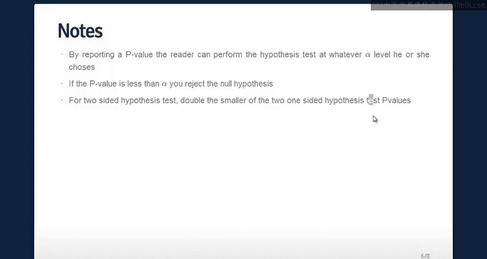

Okay， let's calculate a P value not just for a normal example， which we've already done。

 let's calculate a P value for this binomial example。

 your friend has a children seven of which are girls none are twins。

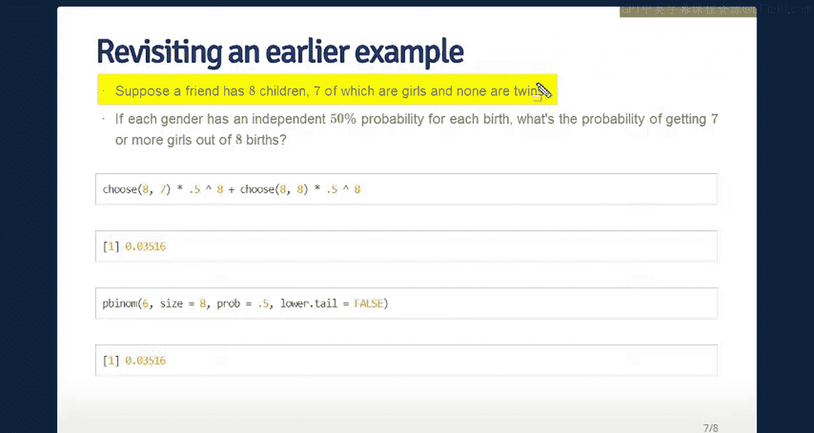

Of each gender has an independent 50% probability for each birth。

 what's the probability of getting seven or more girls out of eight births， that's a P value。

 the probability of getting if we're testing the hypothesis that H' not，P equal to 0。

5 versus H greater than 0。5， more evidence would be more of the children being girls and so the probability of getting our test our observed amount was seven。

 the probability of getting seven or more right is probability of seven and then plus the probability of eight。

 we're excited to be about 4%。Okay， and then you could just do this with P byome。

 remember you have to do six because if you do lower tail equals false。

 it does strictly greater than so it starts counting at seven when you put in six。

 but if we were to put in seven， it would start counting at eight。

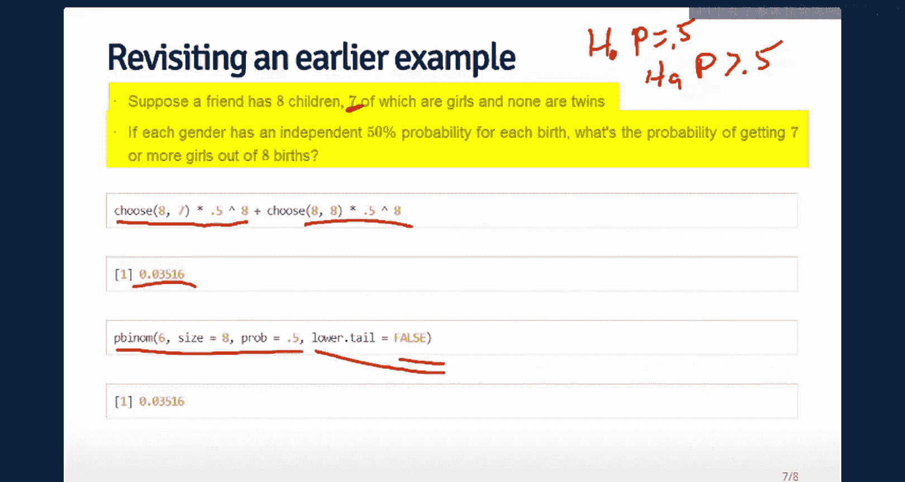

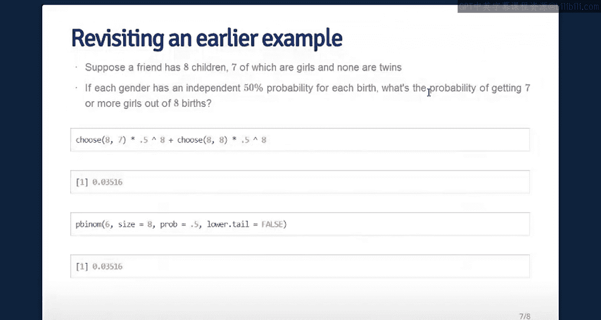

Let's do a Poisson example。Suppose that a hospital has an infection rate of 10 infections per 100 person days at risk。

 which is a rate of 10 over 1000 。1 during the last monitoring period。

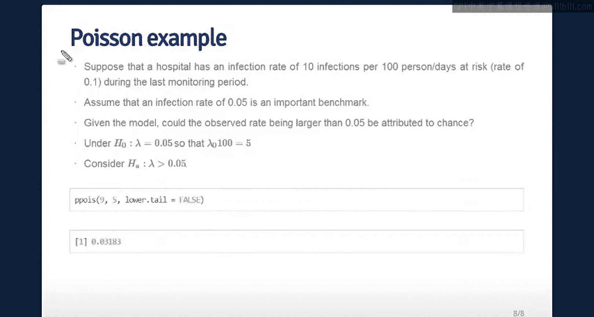

Assume that the infection rate of 5% is an important benchmark。

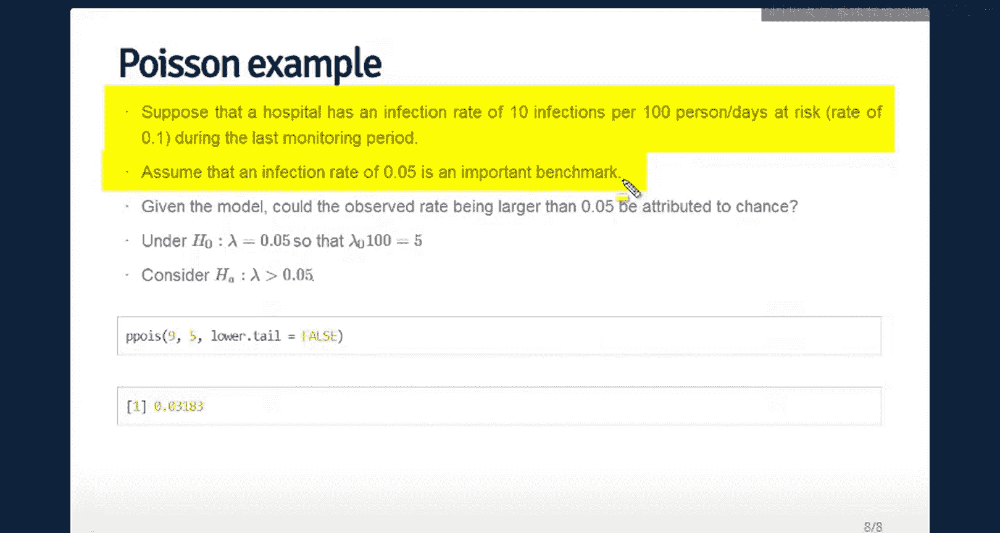

Given the model。Could the observed rate？Yeah， I shouldn't say 5%， they given an infection rate of。05。

Per day at risk is an important benchmark。Given the model。

 could the observed rate being larger than 0。05 be attributed to chance， that's what we want。

That's what we want to hypo test， so we want to test whether H and not lambda equals 0。05。

So if lambda was 0。05， then lambda not times 100 is 5 right， so if the rate is 0。05 per day。

 then the rate when monitored for 100 days should be 5。So we want to test H lambda greater than 。

05 because we're interested in whether our infection rate is higher than this benchmark。

 so we would do our Poisson probability of getting nine or more than nine。With a rate of five。

 we do this again more than nine because its it calculates the probability was strictly greater than so this will count 10。

 11， 12 so on。Okay， and that gives us a probability of 3%。 so the we would。

 if it was a one sided test， we would reject if it was a two sided test， you double it， right。

 you double the smaller of the two。One sided hypothesis test。

And so that gives you three different settings in which you can calculate P values。

 we went over a normal P value which is pretty easy。

 we went over a binomial P value and then we went over a Poson P value and in each case we did the same thing。

 we specified our hypotheses。We calculated the probability of getting a test statistic as or more extreme than was actually observed where this probability was calculated under the null hypothesis that quantity is of P value。

 you're going to reject if your P value is small， smaller than your off level and you're going to fail to reject if your P value is larger than your off level and then now that you know what a P value is。

 you can go and read some of those references and see all the fighting about it。

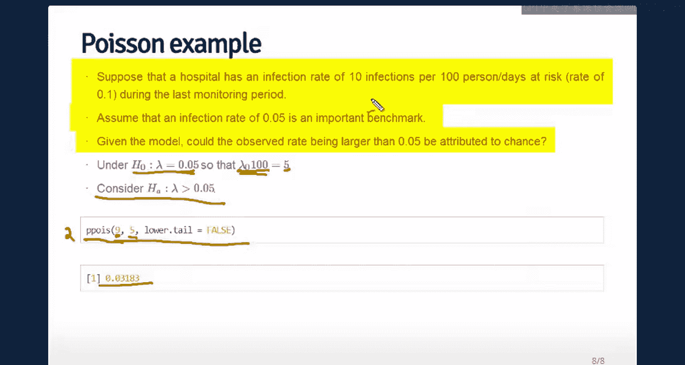

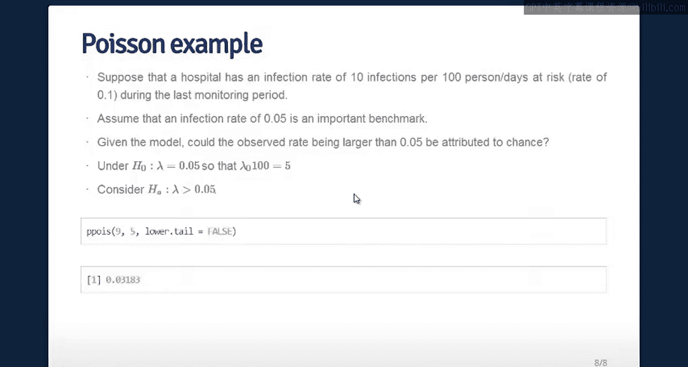