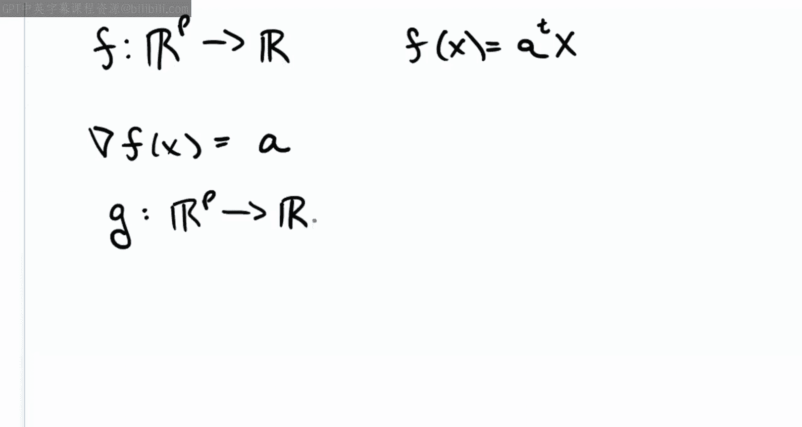
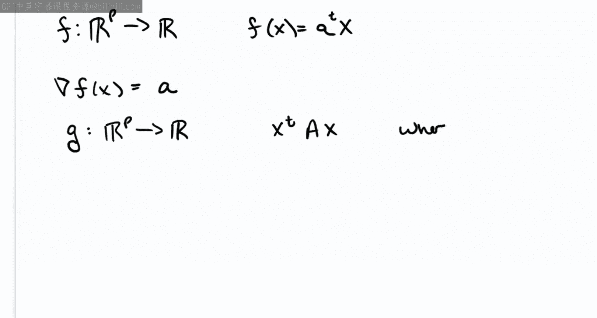
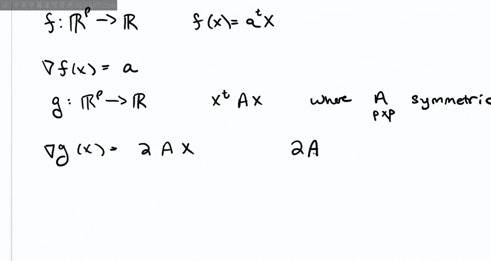
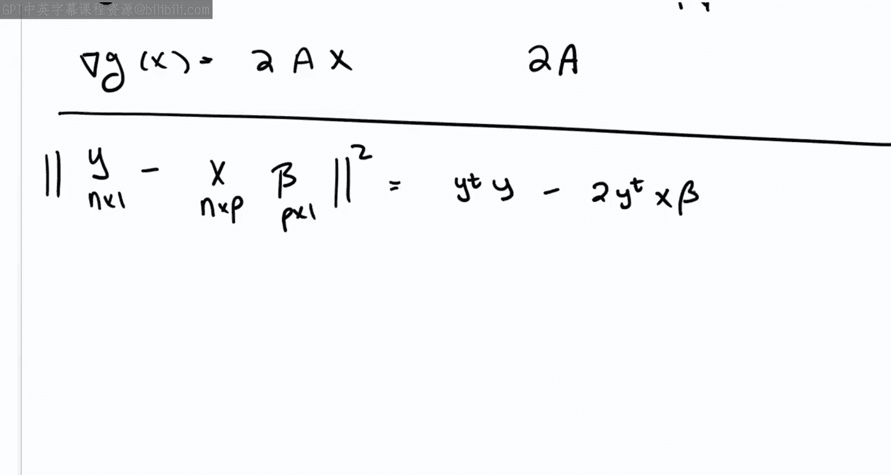
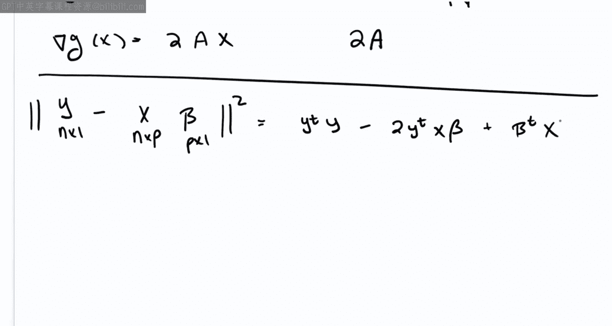
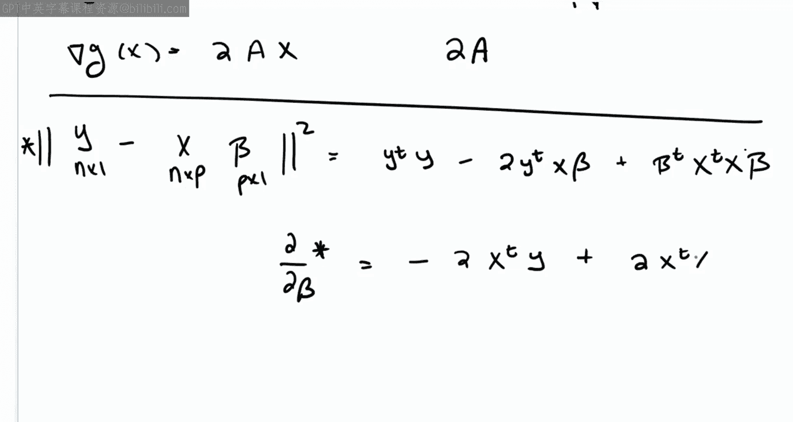
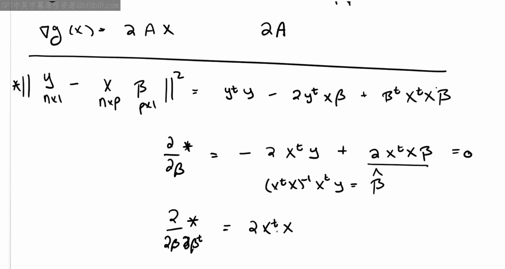
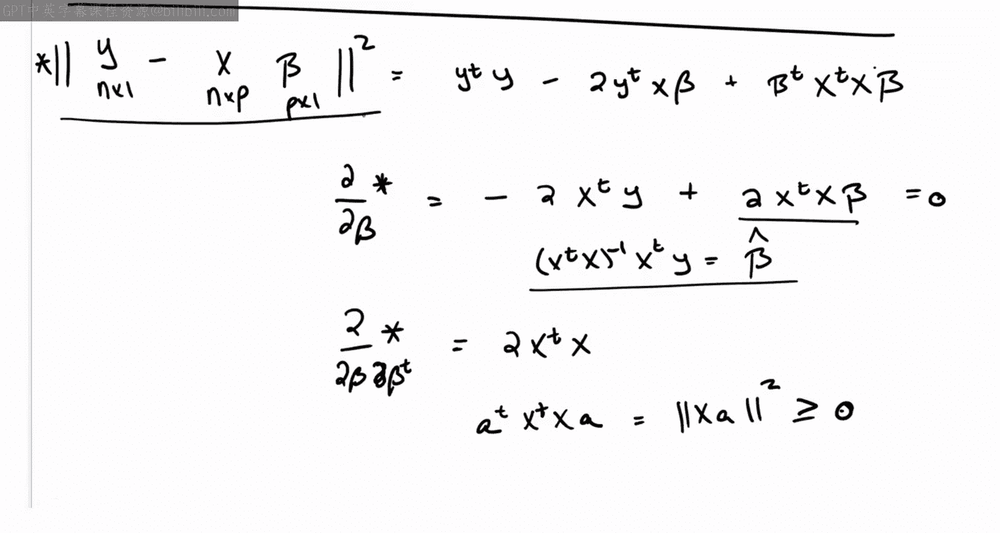

# 约翰霍普金斯大学《数据科学的高级统计｜Advanced Statistics for Data Science》中英字幕（deepseek p75 1_矩阵求导.zh_en -BV1htPjeYEFH_p75-

Hi and welcome to the lecture on some background notation。In this first part of this lecture。

 we're just going to cover some simple matrix derivatives。

And we're going to give an example of using those matrix derivatives in a statistical context。

As a first useful fact， consider a function F。From R P to R， that is linear。 so that f of x。Equals a。

Transpose times x。In this case， the gradient of F， the collection of element wise derivatives with respect to x。

Is simply。Equal to a。Now consider a quadratic form G。

 which is also a function from RP to R that looks like this。

X transpose a X， where。

A is a P by P symmetric matrix。Then in this case， the gradient of G works out to be。2， a X。

If I were then to take a second derivative of G with respect to x。Get the so called Hessian。

 which is the collection of。Pair wise。Pwise derivatives， for example。

 if I have components I and Xi and Xj of the vector X。

 then the Ij element of the Heshe matrix the pairwise is the order derivatives derivative with respect to Xi and derivative with respect to Xj。

The second derivative is simply 2A。Let's go through a simple example。

But one that is very fundamental for the class。

Imagine you have a vector Y， which is an n by one vector of data points。

 And you would like to explain that vector y。With x an n by P collection of explanatory variables。

 So each row of x is a potential explainer of the data point， the corresponding data point of y。

 And you want to do this in a linear fashion。 so you want to simply multiply x by a P by 1 vector beta to get an explanatory version of y using the rows of x。

You're going to。Accomplish this by attempting to minimize。

The sum of the square distances between the vector you'd like to explain Y and the linear collection of explanatory variables x times beta。

If I were to expand this minimize distance out， I would get Y transpose Y-2 Y transpose x beta。

Plus。Beta transpose x transpose x beta。

Using our results above， if we were to take a derivative of this function with respect to beta。

We would get derivative with respect to beta。We would get。Of this function， we would get。Negative。Qu。

X transpose y。Plus。2。X transpose x beta。

Setting that equal to0， we get the solution x transpose x inverse。

 x transpose y is equal to say beta hat， let's say that's our estimator。

Now let's leave for the time being the idea that x transpose x is invertible。

Let's put that discussion off for a second。Now if I want to take the second derivative。

 the second derivative。Of asterisks。The only term that involves beta is this 2 x transpose x beta using the results that we just talked about。

 we get x transpose x，2 x transpose x。Now， having said that， we note that。X transpose x and two。

 hence 2 x transpose x is a positive， definite matrix。

 We can see that because if we take any non zero vector a and we have a transpose x transpose X A that is exactly equal to the norm。

Of。X a。Square。So thus， that has to be well。Greater than or equal to 0。

 So that means that our solution to our derivative is， in fact， a minimum。

And so this beta hat is the minimizer of this least square solution。

 so that's an example of using our matrix derivative results to find a solution to a statistically meaningful equation。

