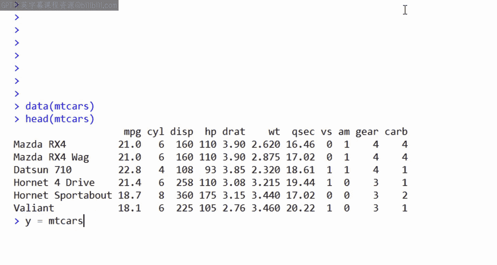
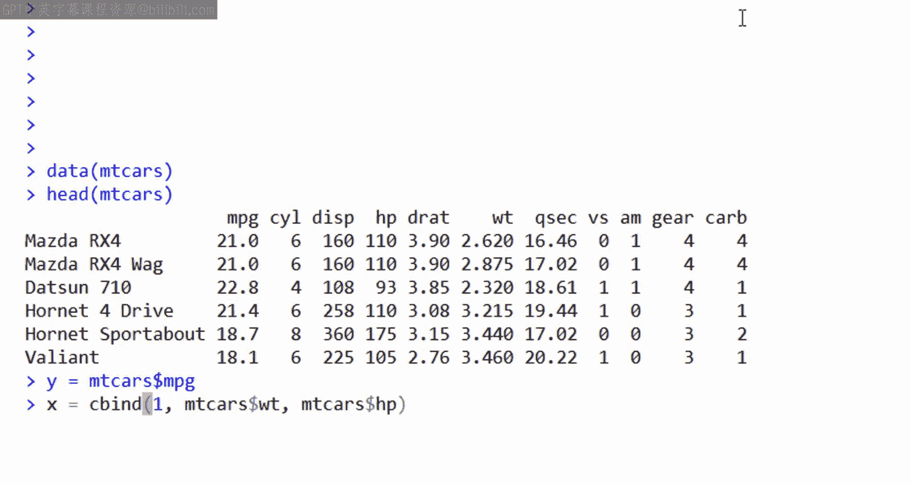
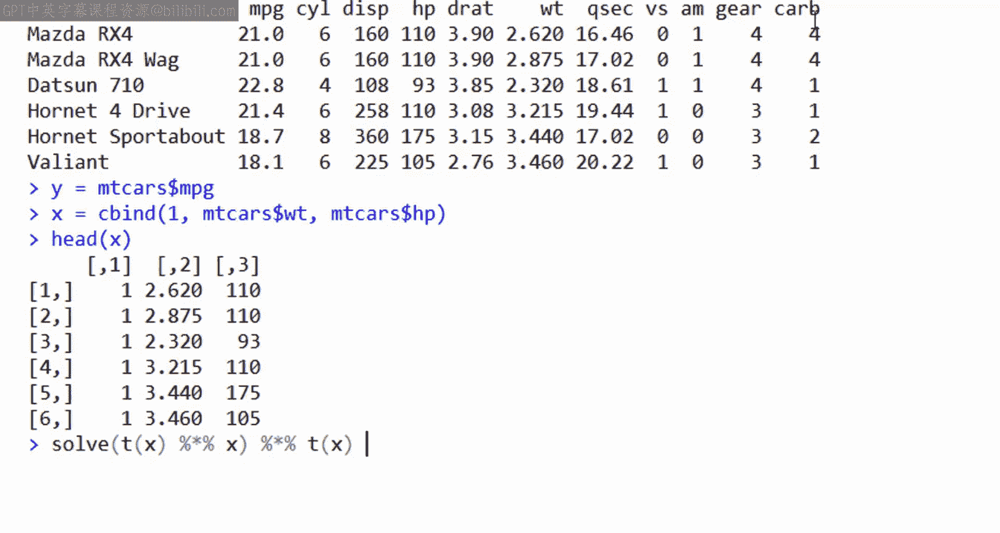
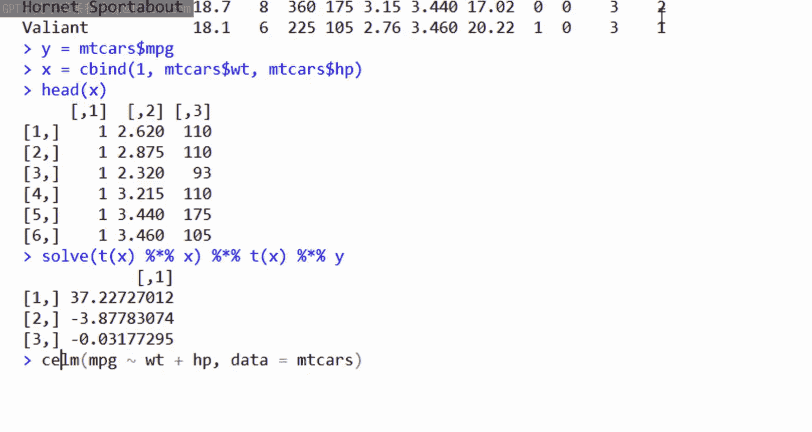
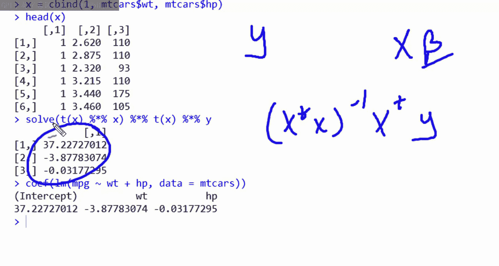

# 约翰霍普金斯大学《数据科学的高级统计｜Advanced Statistics for Data Science》中英字幕（deepseek p76 2_编程示例.zh_en -BV1htPjeYEFH_p76-

We're just going to actually execute the commands here in a particular data set for predicting an outcome using the linear combinations of a couple vectors from a coefficient or from a design matrix。

So I'm going to use the data set empty cars， so I'm going to do data empty cars。

And then here it's that。Here's the first couple of pros。

And I want my why to be empty cars。

Miles per gallon。And I want my X to be a matrix that has a vector of ones。A weight vector。

And horsepower。

Okay， so let's just check。Head of x。 now we know that the best predictor of y that's created as the collection of linear combinations of the columns of x。

Yes。锁。Inverse of x transpose x。Times。Ex transpose。

Times。And there it is。 We can check this with our's LM function。 We have miles per gallon。

 as the outcome。And we had weight as a predictor and horsepower as a predictor。

And this is what the L M function does automatically。 Oh， and I just， let me describe grab the。Co。

And you could see they're identical。Okay， so that is our equation， let's write it out one more time。

Our equation， if we have a vector y， an n by1 vector y that we're interested in predicting with an n by p matrix x and we want to predict y or explain y with linear combinations of the columns of x。

 the best estimator of the collection of column weights is x transpose x。Inverse x transpose。Why。

 and we just saw that when we did that， we got these collection of numbers throughout the class now we're going to talk a lot more about how to use those numbers and more about their statistical properties。

