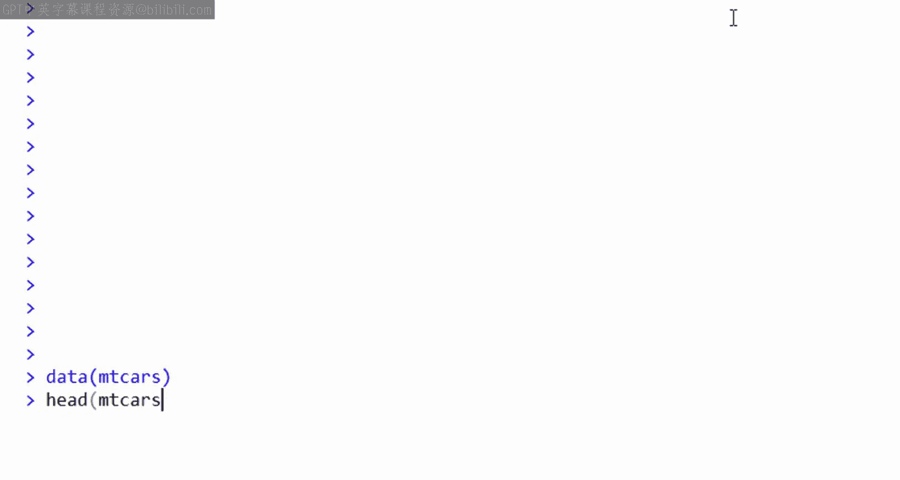
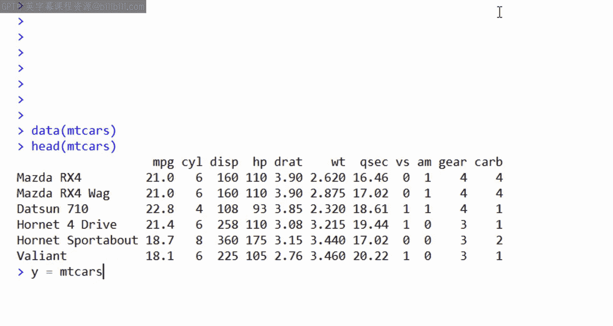
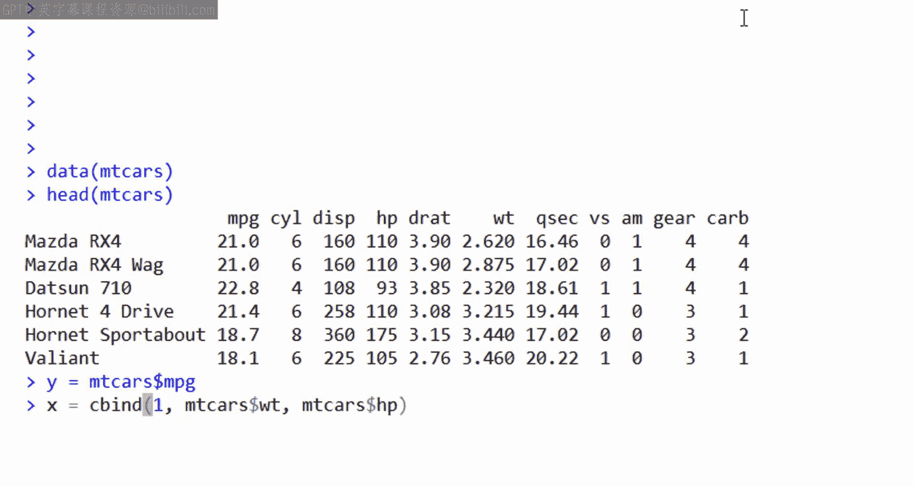
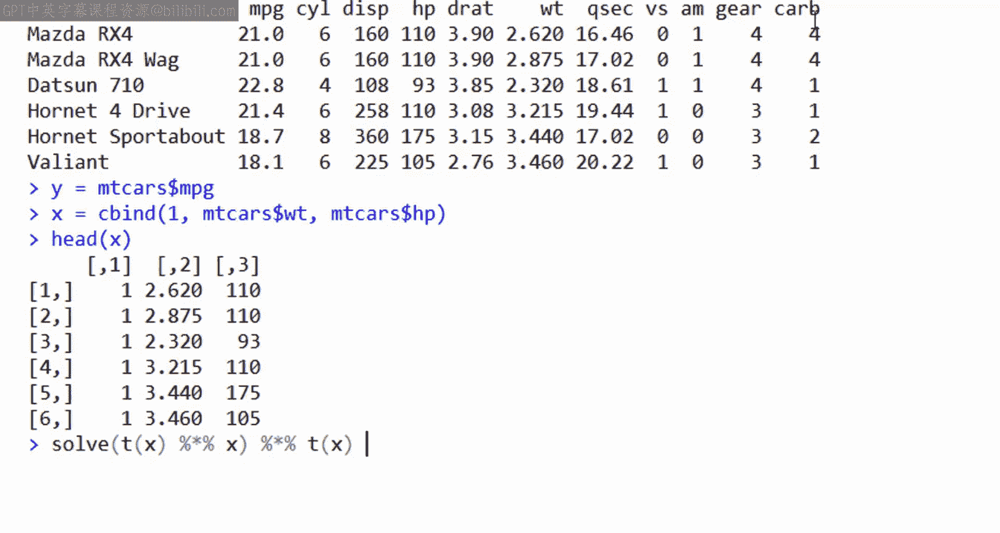
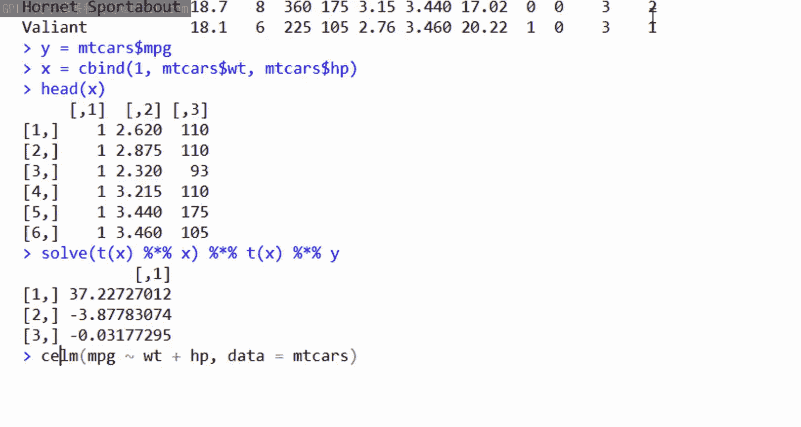
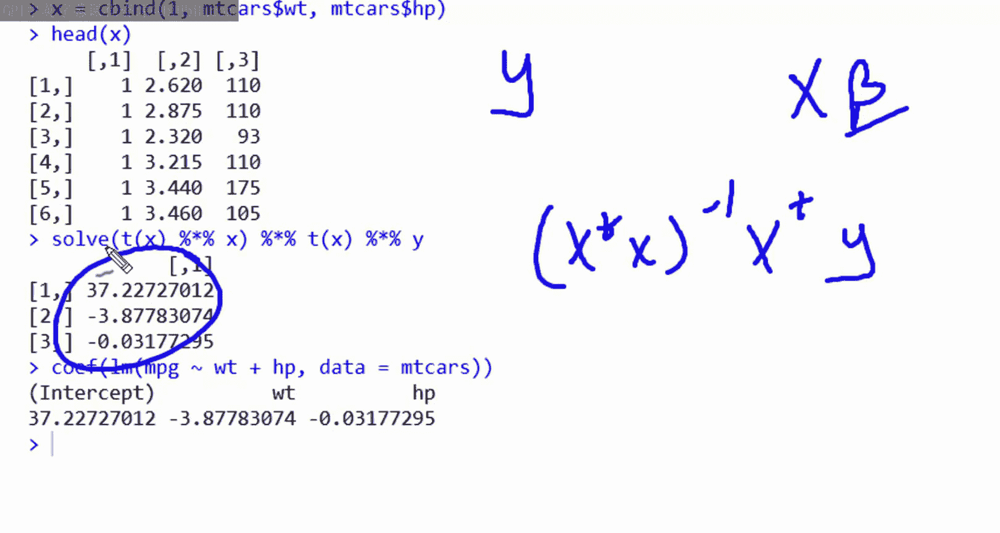

# 数据科学的高级统计：2：编程示例 🚗

在本节课中，我们将通过一个具体的编程示例，学习如何使用线性回归模型来预测一个结果。我们将使用R语言和内置的 `mtcars` 数据集，通过设计矩阵（或系数矩阵）中几个向量的线性组合来预测汽车的每加仑英里数（mpg）。

## 概述

我们将执行以下步骤：加载数据、定义结果变量和预测变量矩阵、手动计算线性回归的最佳系数估计值，最后使用R内置的 `lm` 函数验证我们的计算结果。核心公式是线性回归的系数估计公式：**β̂ = (XᵀX)⁻¹Xᵀy**。

## 数据准备与变量定义

首先，我们加载 `mtcars` 数据集并查看其前几行。



```r
data(mtcars)
head(mtcars)
```



接下来，我们定义结果变量 `y` 为每加仑英里数（`mpg`）。

```r
y <- mtcars$mpg
```



然后，我们定义预测变量矩阵 `X`。这个矩阵将包含三列：一列全为1（用于计算截距项），以及汽车的 `wt`（重量）和 `hp`（马力）变量。

```r
X <- as.matrix(cbind(1, mtcars$wt, mtcars$hp))
colnames(X) <- c("Intercept", "Weight", "Horsepower")
head(X)
```

## 手动计算回归系数

上一节我们定义了变量，本节中我们来看看如何手动应用最小二乘法公式来计算最佳回归系数。



根据线性回归理论，对结果变量 `y` 的最佳线性预测，是通过 `X` 矩阵各列的线性组合得到的。其系数向量 `β` 的最佳估计值由以下公式给出：

**β̂ = (XᵀX)⁻¹ Xᵀ y**

现在，我们在R中执行这个计算：

```r
beta_hat <- solve(t(X) %*% X) %*% t(X) %*% y
beta_hat
```

执行上述代码后，我们将得到三个系数估计值，分别对应截距、重量和马力。



## 使用 `lm` 函数验证结果

为了验证我们手动计算的结果是否正确，我们可以使用R语言内置的 `lm`（线性模型）函数来拟合相同的模型。

以下是使用 `lm` 函数的代码：

```r
model <- lm(mpg ~ wt + hp, data = mtcars)
coef(model)
```

运行后，你会发现 `lm` 函数返回的系数与我们手动计算的 `beta_hat` 结果完全一致。这证实了我们手动计算过程的正确性。

## 核心公式回顾与总结

本节课中我们一起学习了线性回归系数估计的核心实践。让我们最后再明确一下这个核心方程。

如果我们有一个我们感兴趣的 `n x 1` 维结果向量 **y**，以及一个 `n x p` 维的设计矩阵 **X**，我们希望通过 **X** 各列的线性组合来预测或解释 **y**。那么，这些列权重（即回归系数）的最佳估计量是：

**β̂ = (XᵀX)⁻¹ Xᵀ y**



在本示例中，我们执行了这个计算并得到了具体的系数数值。在后续课程中，我们将更深入地探讨如何解释和使用这些数字，并进一步研究它们的统计性质。