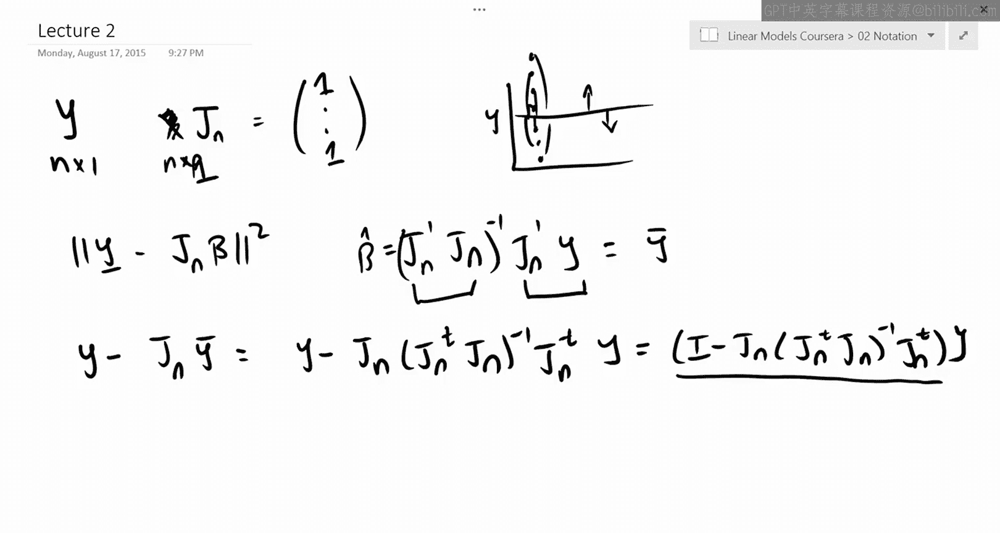
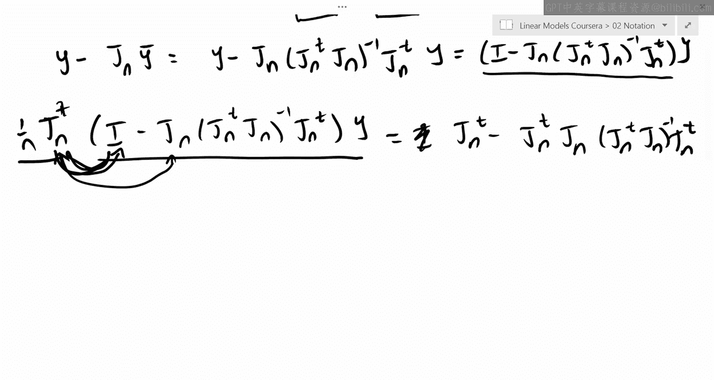
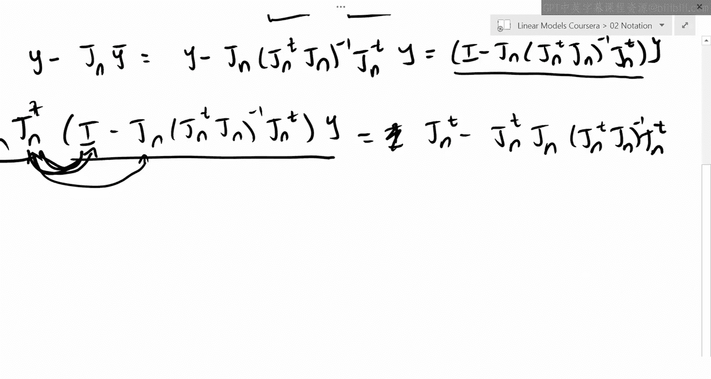
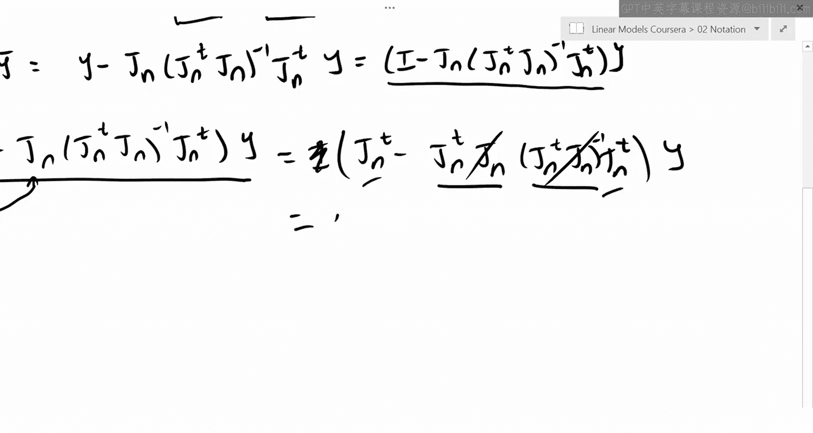
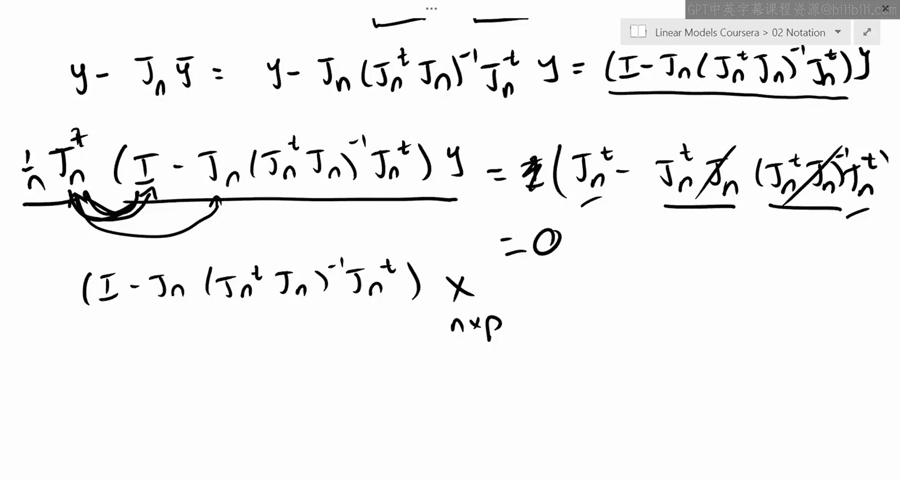
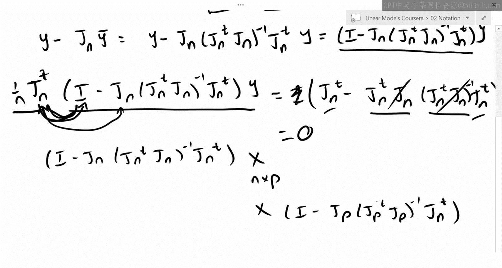
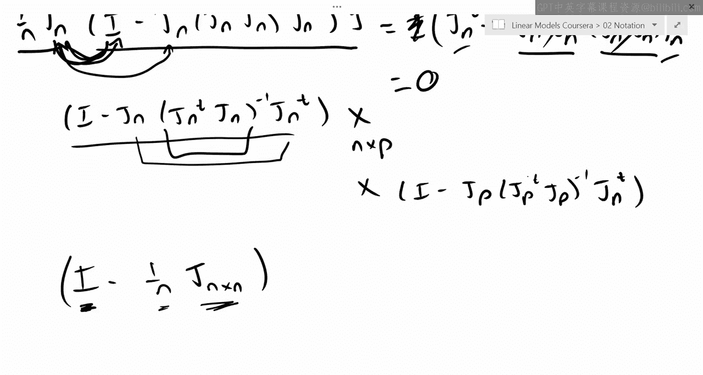

# 约翰霍普金斯大学《数据科学的高级统计｜Advanced Statistics for Data Science》中英字幕（deepseek p77 3_矩阵乘法中心化.zh_en -BV1htPjeYEFH_p77-

Recall from the last lecture， we were concerned with a vector y。Of outcomes， which is n by1。

 and we had a matrix x， which was n by P。So in this lecture， we're not going to focus on x。

 And because I can't write out a bold one like I can when I when I was typing up the lecture notes。

 I'm going to write as J times J with a little n by it。 We want it to be an n by one vector of ones。

 So this is just equal to1。Up to n times repeated by one。 So imagine， for example。

 in our least squares discussion that we talked about last time。

 we have a bunch of y vector y values。 Here's y。 and that there's no really corresponding x values。

 So I'm drawing them all in one column。 And I just want to find。

The horizontal line that best describes them in the sense of minimizing the sum of the square distances。

Okay， well， in the last lecture， we did that by minimizing the vector y minus。 And then in this case。

 it would just be J N times beta， which would be a scalar squared。 We wanted to minimize that。

 And we found that the minimizer of that would satisfy。Beta had。Equal to JN transpose JN。Inverse。

JN transpose times y。Now， a vector of1 transpose times our vector y。

 that's just the sum of the elements of y。A vector of ones transpose times a vector of ones is just a sum of1 of n1s。

 which is n。 So the inverse of that is one over n。 So this quantity is the average of the elements of y's or y bar。

 the scalar y bar。Okay， so it is interesting to note then。That are。

If we were to take Y and then subtract off JN。Times Y bar our best estimate of the horizontal line that best predicts the Ys。

If we were to take that， right， we could write that out as y minus。JN times。JN transpose JN。

Inverse all right T for transpose。J N transpose y， okay。

 and then I can write that out as I minus J N。JN transpose JN。Inverse， JN transpose Y。

So this multiplication， pre multiplication by this matrix。

Takes every element of y and subtracts off the mean， or in other words， mean centers。

The vector y。And， and it's clear to see that this mean centers it。

 because what if I were to pre multiply it by Jn transpose times 1 over n。 Okay。

 so remember that pre multiplying any vector by that will take the average。

 So let's pre multiply by Jn transpose times 1 over n。

And see what happens to prove ourselves that we've mean centered it。 so if we've mean centered it。

 then if we take the mean， we should get0。Okay， so here's our mean centered version of y。

 and then I'm going to pre multiply that vector times 1 over n times Jn transpose。

And I'm suggesting that she give me one。I'm sorry。 I'm suggesting that should give me 0。 Okay。

 so J N times I here， that's just J N。 And then look at this。

 J N times this will give me J N transpose times J N。 Let me write it out。 So we get。

We get JN transpose from multiplication of these two together。Then we get minus J N transpose JN。

Times Jn transpose Jn inverse。Times J and transpose， and I'm running out of room here。

啊。

And that whole thing。Times y。So this is just the inverse of that， so those go away。

 and then we have a JN transpose minus a JN transpose， which is zero。

So what I， what I hope you've seen。Is that pre multiplication by I minus Jn。JN transpose JN。Inverse。

 JN transpose。Pre multiplication of that vector times any vector will then mean center it。

So as a specific example， if I have a matrix x， which is n by P and I pre multiply it by it。

 it will then。That's the same thing as multiplying each column vector of x by that matrix。

 so that mean centers the columns of x。Conversely， if I post multily x。

 if I post multiply x times I minus JP。

JP transpose， JP inverse， JP transpose， that will mean center every row of X。

 and this is a very convenient operation。

And we've seen that if we multiply this matrix， I minus this JN matrix。

 if we multiply it by JN on the left， JN transpose on the left or JN on the right。

 it will give us zero。The last thing I'd like is just for you to note the form of this matrix。

 so the I is， of course， the diagonal matrix of ones。But JN transpose JN。

 this term part right that is there is one over n。And then the outer product， JN。

 so that's just a scalar， the outer product JN times JN transpose。

 the outer product of two vectors of ones is just a matrix of ones， so I might write that as J。

N by N。Meaning a matrix of ones。 So that's the form of what that matrix looks like。 It's a。

 it's a diagonal， the。Dagonal matrix diagonal matrix of ones。

 and then a matrix of all ones pre multiplied by a one over n。

 And that's the matrix that if multiplying any vector or matrix on the。On the left， we'll center it。

 center the columns， and multiplication on the right will center the rows。

