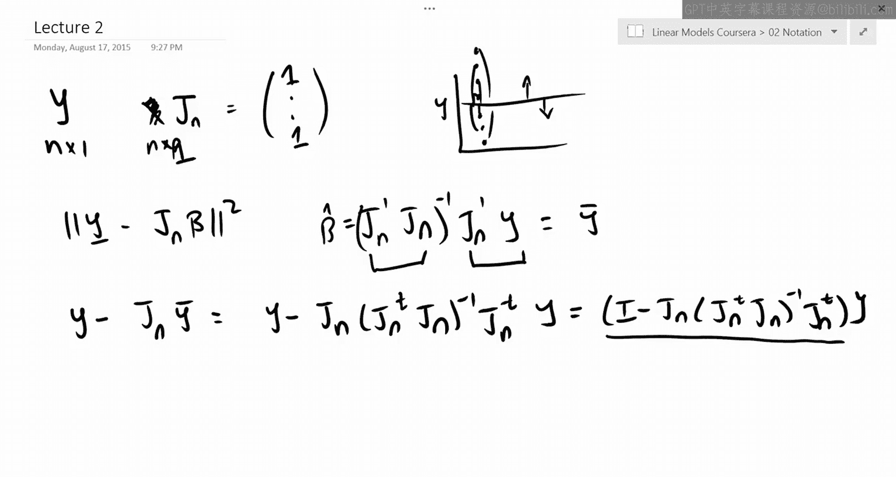
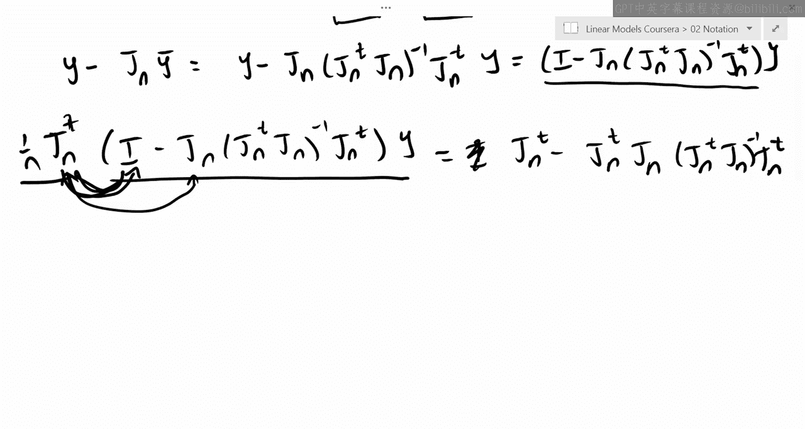
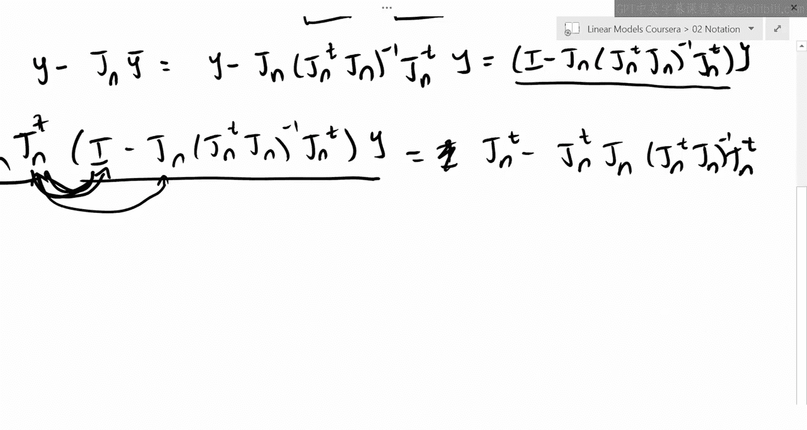
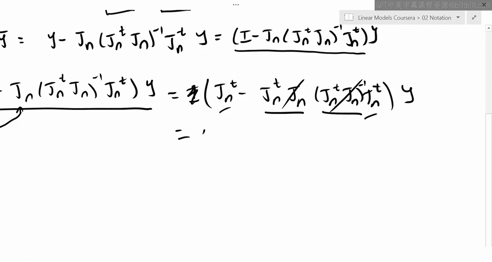
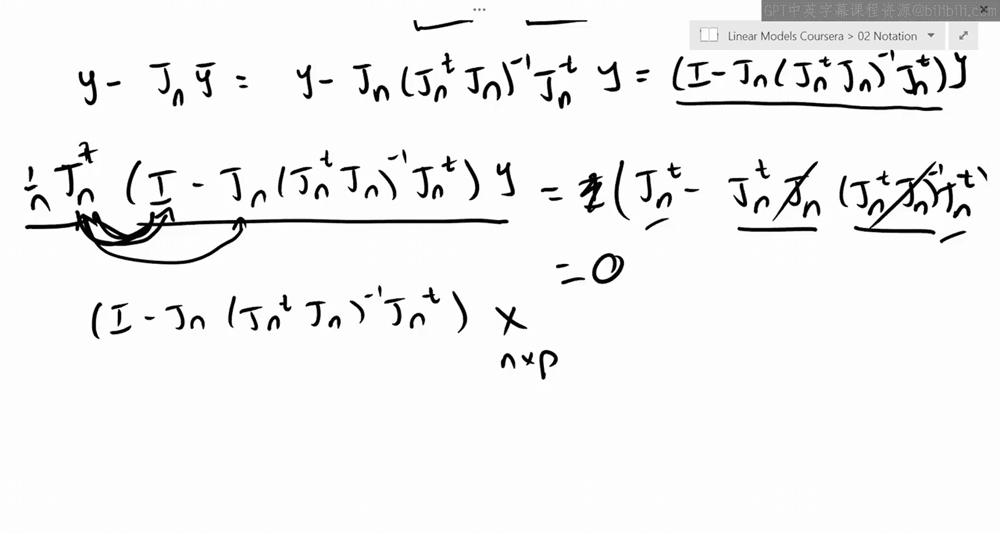
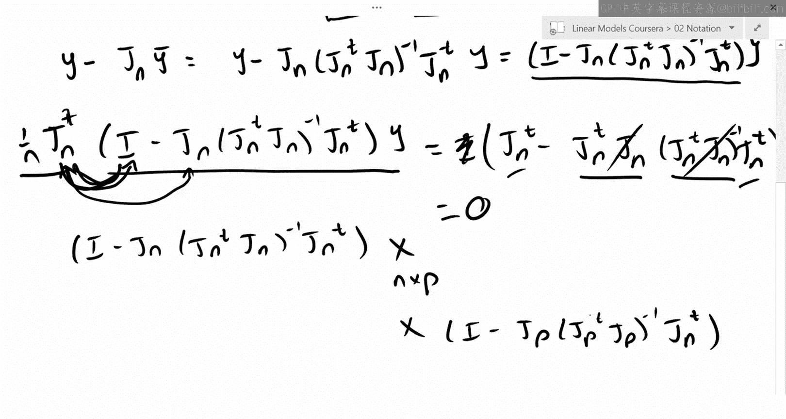
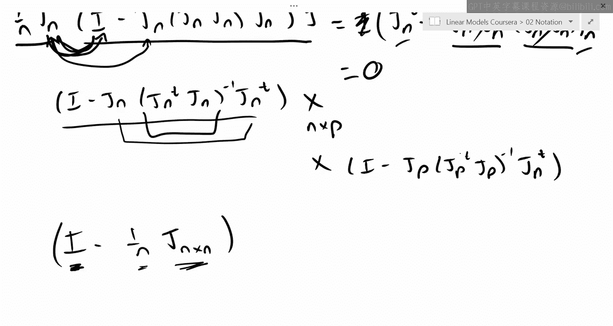

# 高级统计学：3：矩阵乘法中心化 📊

在本节课中，我们将学习如何通过矩阵乘法来对数据进行中心化处理。我们将从一个简单的例子出发，逐步推导出中心化矩阵的通用形式，并理解其工作原理。

---

## 概述

上一节我们讨论了最小二乘法，并找到了描述数据的最佳水平线。本节中，我们将聚焦于一个特定的矩阵运算，该运算能够从数据中减去其均值，从而实现数据的“中心化”。我们将看到，这个操作可以通过一个特定的投影矩阵来完成。

## 从最小二乘到均值中心化

回顾上一讲，我们关注一个结果向量 **y**，其维度为 n × 1。我们还有一个矩阵 **X**，维度为 n × p。在本讲中，我们暂时不关注 **X**。

由于无法像在讲义中那样书写粗体，我将用 **Jₙ** 表示一个 n × 1 的全1向量。这个向量就是由 n 个 1 组成的列向量。

例如，在我们上次讨论的最小二乘问题中，我们有一组 **y** 值。这里画出 **y** 向量，它们没有对应的 **x** 值，所以我将它们画在一列中。我们希望找到一条水平线，以最小化平方距离之和的方式来最好地描述这些点。

在上次课程中，我们通过最小化向量 **y** 减去 **Jₙ** 乘以一个标量 β 的平方范数来实现。我们找到了最小化该表达式的解满足以下公式：

**β̂ = (Jₙᵀ Jₙ)⁻¹ Jₙᵀ y**

一个全1向量的转置乘以向量 **y**，就是 **y** 各元素之和。全1向量的转置乘以全1向量，就是 n 个 1 的和，即 n。其逆为 1/n。因此，这个量就是 **y** 元素的平均值，即标量 **ȳ**。

## 构造中心化矩阵

有趣的是，如果我们取 **y** 并减去 **Jₙ** 乘以 **ȳ**（即我们对 **y** 的最佳水平线估计），我们可以写出：

**y - Jₙȳ = y - Jₙ (Jₙᵀ Jₙ)⁻¹ Jₙᵀ y**

然后，我可以将其写为：

**(I - Jₙ (Jₙᵀ Jₙ)⁻¹ Jₙᵀ) y**

所以，用这个矩阵左乘向量 **y**，会从 **y** 的每个元素中减去其均值，换句话说，就是对向量 **y** 进行均值中心化。

可以清楚地看到这实现了均值中心化。因为如果我们用 **(1/n) Jₙᵀ** 左乘任何向量，就会得到该向量的平均值。那么，如果我们已经中心化了向量，再取平均值应该得到 0。

让我们用 **(1/n) Jₙᵀ** 左乘我们中心化后的 **y** 版本来验证：

**(1/n) Jₙᵀ [I - Jₙ (Jₙᵀ Jₙ)⁻¹ Jₙᵀ] y**

计算 **Jₙᵀ I** 就是 **Jₙᵀ**。然后看 **Jₙᵀ** 乘以后面这项：

**Jₙᵀ Jₙ (Jₙᵀ Jₙ)⁻¹ Jₙᵀ**

**(Jₙᵀ Jₙ)** 和它的逆相乘得到单位矩阵，所以这部分简化为 **Jₙᵀ**。

于是我们得到 **Jₙᵀ - Jₙᵀ**，结果为零。因此，整个表达式结果为零，证明了中心化后向量的均值为零。

## 中心化矩阵的性质与应用

我希望你已经看到，用矩阵 **I - Jₙ (Jₙᵀ Jₙ)⁻¹ Jₙᵀ** 左乘任何向量，都会对该向量进行均值中心化。

作为一个具体例子，如果我有一个 n × p 的矩阵 **X**，并用该矩阵左乘它，这相当于对 **X** 的每一列向量都乘以该矩阵，从而对 **X** 的列进行中心化。

相反，如果我右乘 **X**，即 **X [I - Jₚ (Jₚᵀ Jₚ)⁻¹ Jₚᵀ]**，那将会对 **X** 的每一行进行中心化。这是一个非常方便的操作。

我们已经看到，如果用这个矩阵左乘或右乘全1向量 **Jₙ**，结果将是零向量。

## 中心化矩阵的形式

最后，请注意这个矩阵的形式。**I** 当然是单位矩阵。而 **Jₙ (Jₙᵀ Jₙ)⁻¹ Jₙᵀ** 这一项，其中 **(Jₙᵀ Jₙ)⁻¹ = 1/n**，**Jₙ Jₙᵀ** 是两个全1向量的外积，结果是一个所有元素都为1的 n × n 矩阵，我将其记为 **J_{n×n}**。

因此，中心化矩阵的形式是：

**I - (1/n) J_{n×n}**

它是一个单位矩阵减去一个所有元素为 1/n 的矩阵。这个矩阵左乘任何向量或矩阵会中心化其列，右乘则会中心化其行。

---

## 总结

本节课中，我们一起学习了如何通过矩阵乘法实现数据的中心化。我们从最小二乘估计均值出发，推导出了通用的中心化矩阵 **H = I - (1/n) J_{n×n}**。我们验证了该矩阵能将向量的均值变为零，并理解了其对矩阵列（左乘）和行（右乘）的中心化作用。这个操作在数据预处理和许多统计计算中都非常重要。