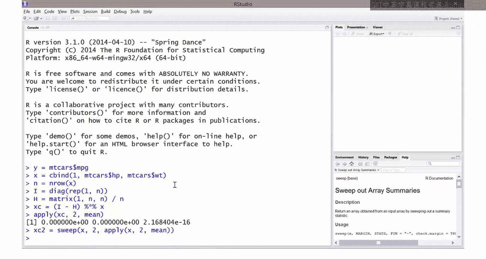
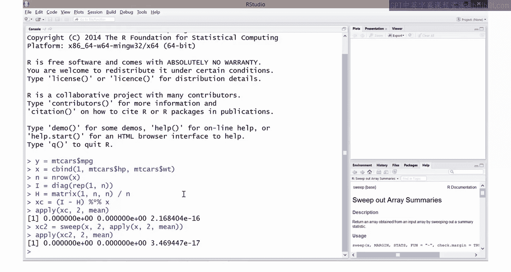

# 约翰霍普金斯大学《数据科学的高级统计｜Advanced Statistics for Data Science》中英字幕（deepseek p78 4_编程示例.zh_en -BV1htPjeYEFH_p78-

Let's go through a simple example of centering using these matrix manipulations。

 So remember we were working with the empty cars data set in our X matrix here is the vector of ones horsepower and weight。

So let me just define n as the number rows of x。And then I is going to be a diagonal matrix。Of ones。

And then。H。I'm going to just define H as the right hand part of the matrix I minus JN JN transpose Jn amverse Jn Okay。

 so that's going to be we discussed in the last lecture that that's just a matrix of ones。

 so that's matrix。One with n rows and n columns， and then divided by n。Okay。

 so we're going to say that the centered version of the column centered version of x is nothing other than I minus H。

Matrix multiplied times x。Okay， and then let's now apply to our centered version of x along the columns。

 the function mean， and these should all be about 0 if we've done it right， and of course， they are。

 you know， up to machine precision。By the way。If。You do。Sweep， for example。

 is probably a more efficient way to do this。 So if you wanted to do。X C2。Is sweep。X。2。Apply。To mean。

 So first， we're going to calculate the means， and then we're going to sweep the means out of every row。

 Okay， and then now。

I want to apply X E to the mean。 You'll see that it， of course。Mean centered it that way as well。

 However， that doesn't lead。 that's just the computational。The computational aspect， the。

Matrix result is actually kind of useful for a lot of the mathematics we're going to be doing later on in the class。

