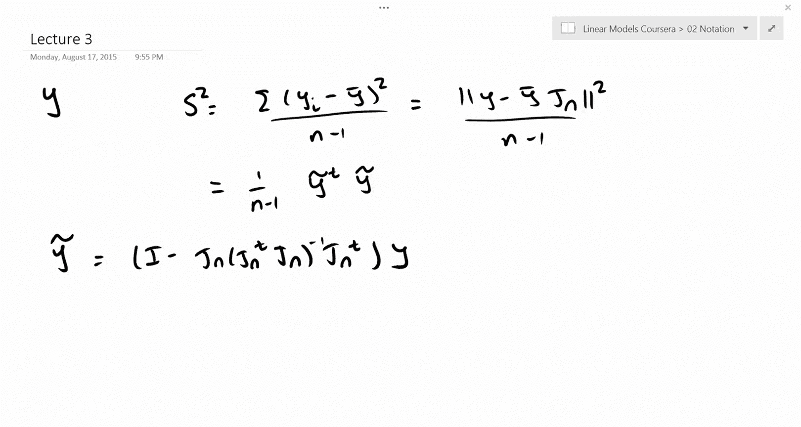
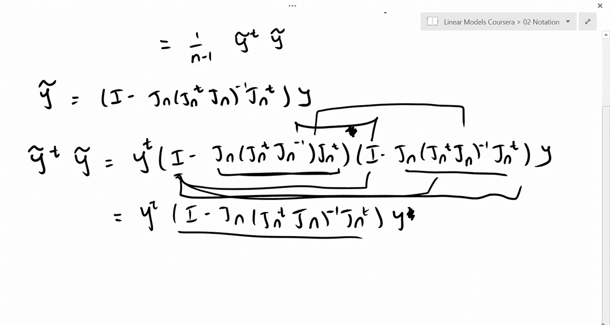
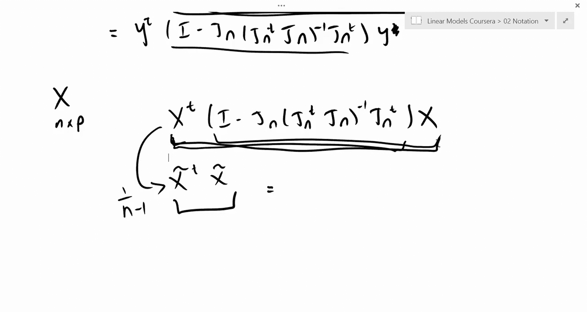

# 约翰霍普金斯大学《数据科学的高级统计｜Advanced Statistics for Data Science》中英字幕（deepseek p79 5_矩阵乘法求方差.zh_en -BV1htPjeYEFH_p79-

So our variance of our vector y。Is equal to let's call it S squared。

 That's equal to the summation of y I minus y bar。Quantity squared over n -1。

So that's exactly equal to the norm y minus y bar times Jn。Squared divided by n minus1。

So that is exactly equal to 1 over n -1。 Let's say y tilde transpose y tilde。

 where y tilde is the centered version of y。 so that could be written as I minus J N。

Ja and transpose。Jen。Inverse JN transpose times y。Now it's interesting to note some things about computing the variance this way。

First， consider， and let's just ignore the one over n -1 and just focus on the y tilde transpose。

Times Y tilled apart。So that's equal to y times I minus Jn。

JN transpose JN inverse JN transpose that repeat again。

And there should be a transpose in front of that y， and then I would put a transpose up here。

 but notice this matrix is symmetric， the I is symmetric。

 and then this matrix right here is symmetric if you stare at it carefully。

And then another thing that's interesting to note。Is that。If I were to multiply this out。

 I times I is just I。I times this guy is just it again， I times this matrix。

 which I like to call a hat matrix。So i times the hat matrix is just itself。

 and then i times the hat matrix this way is just itself， so we get minus two hat matrices。And then。

The hat matrix times itself you'll notice is itempot。In other words， if you multiply at times itself。

 you get itself back， so we get negative two hat matrices and then a plus one hat matrix。

 so we get I minus the hat matrix again。 So and if you don't see all the details。

 then just work this out。I know you all know linear algebra really well。

 so just work this out for yourself and notice that this matrix。Is， in fact， itempotent。

 Both the both interior matrices， the I and the hat matrix are itempotent。

 but their subtraction is also item potentent。 So y transpose times I minus J N， J N transpose J N。

Inverse， JN transpose times y。Is exactly the sum of the squared deviations around the mean。

 we don't actually have to multiply that matrix out twice to obtain these deviations。

And so that's another interesting little shortcut， or just， I would say。

 interesting little fact about creating variances。Is that all we need to do is sort of sandwich the around the two in between the two vectors。

 this matrix to create the collection of squared deviations。

 So let me give you another example that is quite useful。 Let's suppose you have a matrix X。

 which is M by P。

Okay。And you took x transpose times I minus Jn。JN transpose JN inverse JN transpose times x。Well。

 again。This is， remember if we pre multiply x。If we pre multiply x by that matrix。

 it's going to center all the columns。So， and if we then pre multiply。Post multiply by it。

 multiply on the right by it。This is going to center all the rows of x transpose。

 which is centering all the columns of x again。 So this is， say， x tilde。

Transpose times x tilde and again， because it's id potent that we can just have its having one in the middle there it's just like having two。

 so because of that this equation right here is exactly x tilde transpose times x tilde。

And if you look at that。If you look at this matrix。Okay。That is nothing other than。

The result is nothing other than a matrix where every diagonal element is the squared deviations around that particular column of x and every off diagonal element is the cross deviations of that particular column minus its mean。

Times another particular column minus its mean。And so this matrix。

 if we then multiply at times 1 over n minus1， is the so called varianceance covariance matrix down the diagonal are the variances of the columns in all the off diagonals。

Are the covariances between the Ith and Js column in the IJ off diagonal entry。

 so you can see that with this matrix manipulation。

 it's actually quite easy to arithmettically arrive at a covariance matrix without actually having to write any loops if you have matrix arithmetic defined。

So why don't we go through a coding example just to show this and then we'll be done with some of our basic matrix algebra prerequisites。

 hopefully this will have gotten us into the mood and the mindset for using matrices and block partition and block partition manipulations of matrices that we're going to need a lot throughout the class and if you're not。

If you're getting a little bit lost now， just we're going to keep going over these concepts over and over and over again。

 so you'll get very， very much so familiar with them later on in the class。

