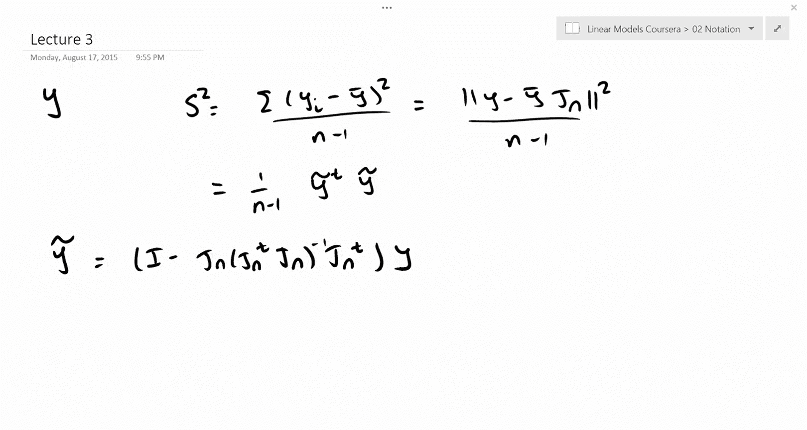
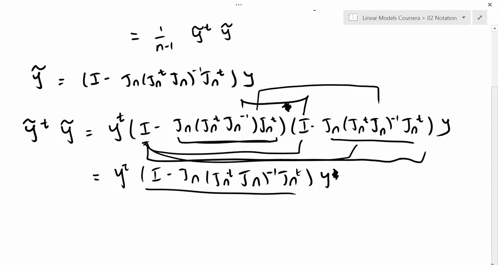
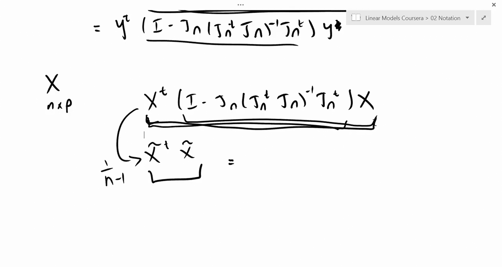

# 数据科学的高级统计：5：矩阵乘法求方差 🧮

在本节课中，我们将学习如何使用矩阵运算来计算数据的方差和协方差矩阵。我们将看到，通过巧妙的矩阵操作，可以避免编写循环，从而高效地完成这些统计计算。

---

## 向量方差的计算

我们的向量 **y** 的方差，记作 **S²**，定义为：



**S² = Σ (yᵢ - ȳ)² / (n - 1)**

这恰好等于向量 **y** 与其均值向量之差的范数平方除以 **(n-1)**。更具体地说，它可以表示为：

**S² = (1 / (n - 1)) * (ȳ̃ᵀ * ȳ̃)**

其中，**ȳ̃** 是向量 **y** 的中心化版本（即每个元素减去均值）。这个中心化过程可以通过一个矩阵运算来实现：

**ȳ̃ = (I - J_n (J_nᵀ J_n)⁻¹ J_nᵀ) * y**

这里的矩阵 **I** 是单位矩阵，**J_n** 是一个元素全为1的 n 维列向量。

---

## 矩阵运算的简化与性质

上一节我们介绍了方差的计算公式，本节中我们来看看其中的矩阵运算有何有趣的性质。

首先，我们暂时忽略系数 **1/(n-1)**，只关注核心部分 **ȳ̃ᵀ * ȳ̃**。将其展开：

**ȳ̃ᵀ * ȳ̃ = yᵀ * (I - H) * y**

其中，矩阵 **H = J_n (J_nᵀ J_n)⁻¹ J_nᵀ** 通常被称为“帽子矩阵”。

以下是关于这个运算的几个关键点：
*   **对称性**：矩阵 **(I - H)** 是对称的。
*   **幂等性**：矩阵 **H** 和 **(I - H)** 都是幂等矩阵。这意味着 **H * H = H**，且 **(I - H) * (I - H) = (I - H)**。
*   **计算捷径**：由于幂等性，**ȳ̃ᵀ * ȳ̃** 等价于 **yᵀ * (I - H) * y**。我们无需先显式地计算出中心化向量 **ȳ̃**，再求其内积，而可以直接通过一次“三明治”乘法（向量-矩阵-向量）得到所有偏差平方和。

---

## 扩展到协方差矩阵

理解了单个向量的方差计算后，我们可以将其推广到矩阵，从而计算协方差矩阵。

假设我们有一个 **n × p** 的数据矩阵 **X**，其中每一行是一个观测，每一列是一个变量。我们想计算这 p 个变量的方差-协方差矩阵。

我们可以进行如下运算：



**X̃ᵀ * X̃**

其中，**X̃** 是矩阵 **X** 按列中心化后的结果（即每一列减去该列的均值）。有趣的是，这个中心化过程同样可以通过矩阵 **H** 来实现：

**X̃ = (I - H) * X**

因此，**X̃ᵀ * X̃ = Xᵀ * (I - H) * X**

让我们看看结果矩阵的含义：
*   **对角线元素**：第 i 个对角线元素是第 i 列（变量）的偏差平方和，即 **Σ (x_{ki} - x̄_i)²**。
*   **非对角线元素**：第 (i, j) 个元素是第 i 列和第 j 列的交叉偏差乘积和，即 **Σ (x_{ki} - x̄_i)(x_{kj} - x̄_j)**。

最后，如果我们将这个结果矩阵乘以标量 **1/(n-1)**，就得到了标准的**样本方差-协方差矩阵**：
*   对角线是各个变量的方差。
*   非对角线是每对变量之间的协方差。

---

## 代码示例

理论部分已经介绍完毕，现在让我们通过一个简单的代码示例来直观地展示如何用矩阵运算计算协方差矩阵，并与内置函数的结果进行对比。

```python
import numpy as np

# 生成示例数据：10个观测，3个变量
n, p = 10, 3
X = np.random.randn(n, p)

# 方法1：使用矩阵运算
# 创建全1向量和帽子矩阵 H
J = np.ones((n, 1))
H = J @ np.linalg.inv(J.T @ J) @ J.T
I = np.eye(n)
# 计算中心化矩阵
X_tilde = (I - H) @ X
# 计算方差-协方差矩阵
cov_matrix_method1 = (X_tilde.T @ X_tilde) / (n - 1)

print("方法1（矩阵运算）得到的协方差矩阵：")
print(cov_matrix_method1)

# 方法2：使用NumPy内置函数
cov_matrix_method2 = np.cov(X, rowvar=False, bias=False) # rowvar=False表示每列是一个变量

print("\n方法2（np.cov）得到的协方差矩阵：")
print(cov_matrix_method2)

# 检查两者是否（近似）相等
print("\n两种方法的结果是否接近？", np.allclose(cov_matrix_method1, cov_matrix_method2))
```

---

## 总结



本节课中我们一起学习了如何利用矩阵乘法高效地计算统计量。
1.  我们首先将向量方差的定义式，重写为向量中心化后与其自身内积的形式。
2.  接着，我们探讨了其中涉及的“帽子矩阵” **H** 的对称性和幂等性，这些性质简化了计算。
3.  然后，我们将此方法推广到数据矩阵 **X**，通过运算 **Xᵀ * (I - H) * X / (n-1)** 直接得到方差-协方差矩阵，避免了显式循环。
4.  最后，我们通过代码验证了这一过程。掌握这种矩阵视角对于理解后续课程中更复杂的模型（如线性回归）至关重要。如果现在感觉有些吃力，请不要担心，我们会在课程中反复运用这些概念，帮助你逐渐熟练掌握。