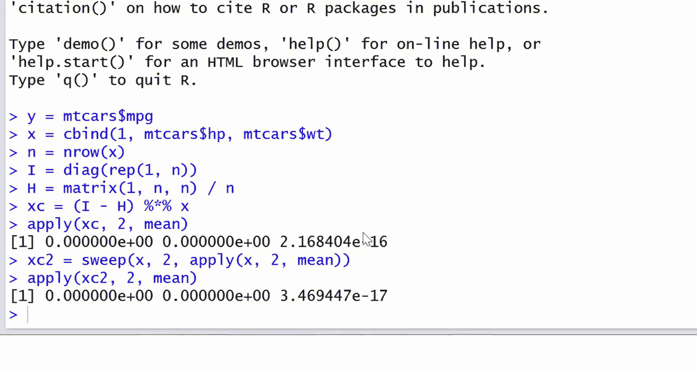
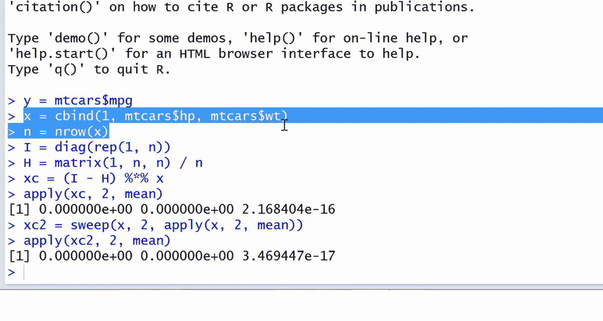
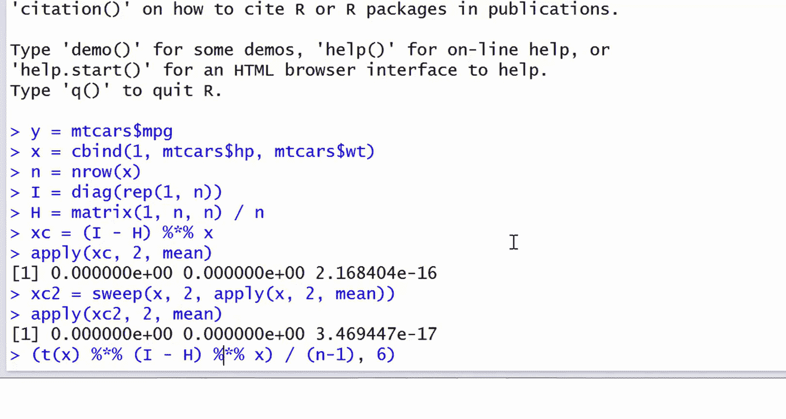
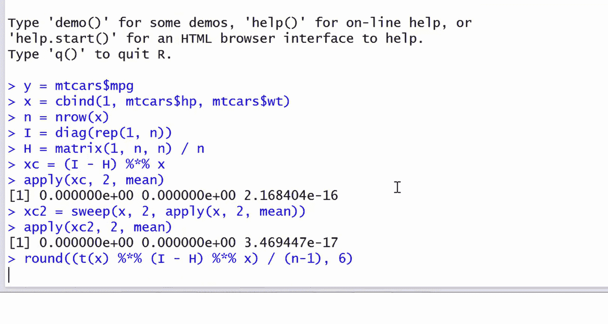
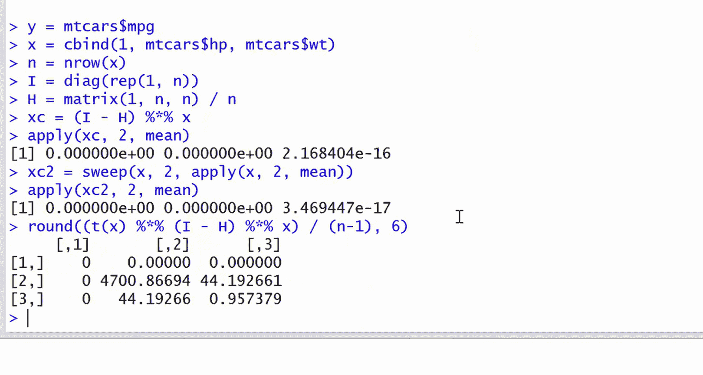
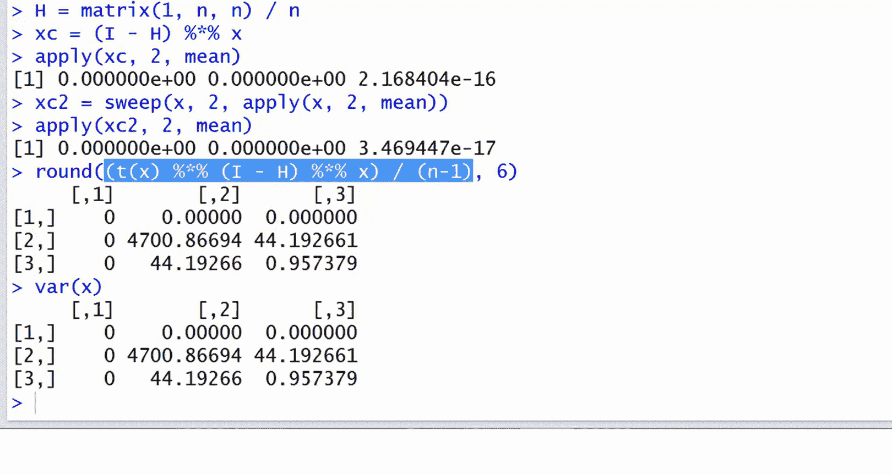

# 约翰霍普金斯大学《数据科学的高级统计｜Advanced Statistics for Data Science》中英字幕（deepseek p80 6_编程示例.zh_en -BV1htPjeYEFH_p80-

Let's calculate manually using matrix arithmetic， calculate the variance covariance matrix of the x matrix we've defined before。

 so recall this was the diamond data set and I defined my x matrix as having a column of ones horsepower and then weight and we've predefined our I our diagonal matrix of ones and we've predefined the hat matrix of ones。

 which is nothing other than a n by n matrix of ones divided by n。

Okay， so what we claimed is that if I take the transpose of x and multiply at times I minus the hat matrix times times。

Times X。That quantity should be the covariance matrix。Provided I then divided by n minus1。

And then I don't want to print out the whole thing。To arbitrary number of decimal places。

 so I'm going to round it to six decimal places。 So when I do that I get that matrix right there。

And just to show you that it's the same thing that R is doing if you do var of x。

You of course， get the same matrix， so in this variance of x manipulation that we did。

 we get zeros down the first column and the first row because the first row is a vector of ones。

 it has no variation。Okay， then in the lower two by two matrix of this， these two diagonal elements。

 4700。And 0。95 are the variances of column1 and column2 of the x matrix。

And then 44 is the covariance of the first column and the second column。

 And we see here how we can do that using。Mattrix calculations， rather than say looping over indices。

Okay， so we're going to use these kinds of matrix manipulations a lot throughout the class。

 and so you get more and more used to them if you're not already。

