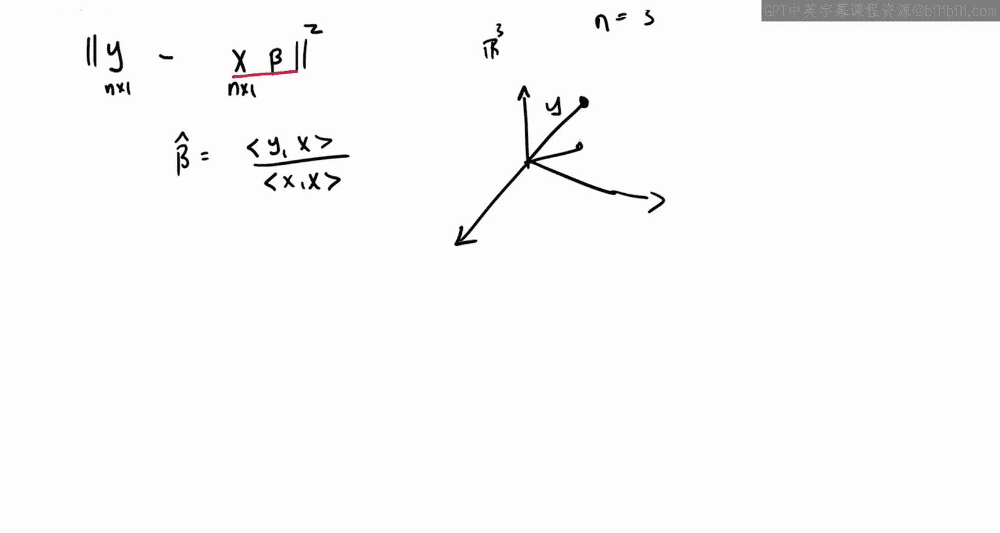
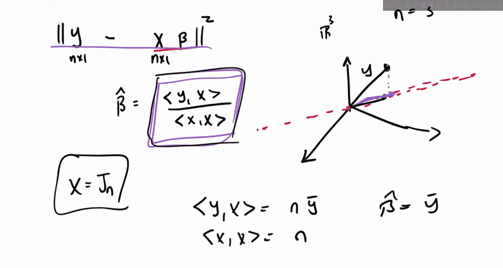
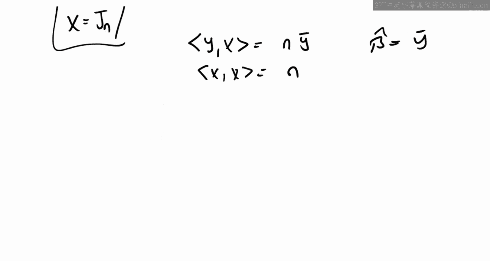
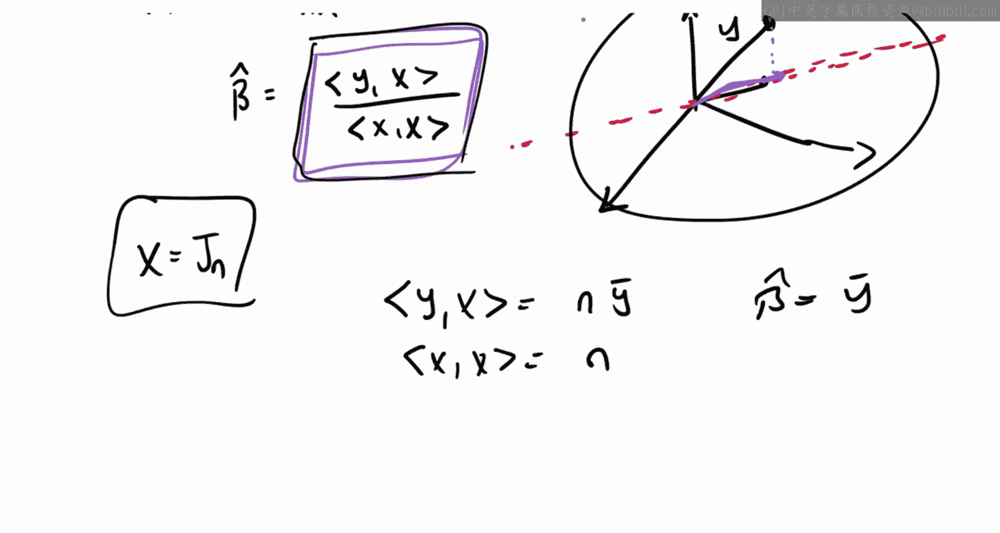
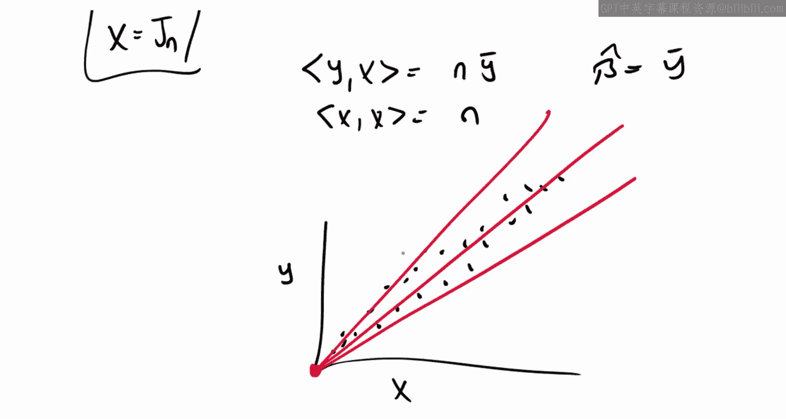
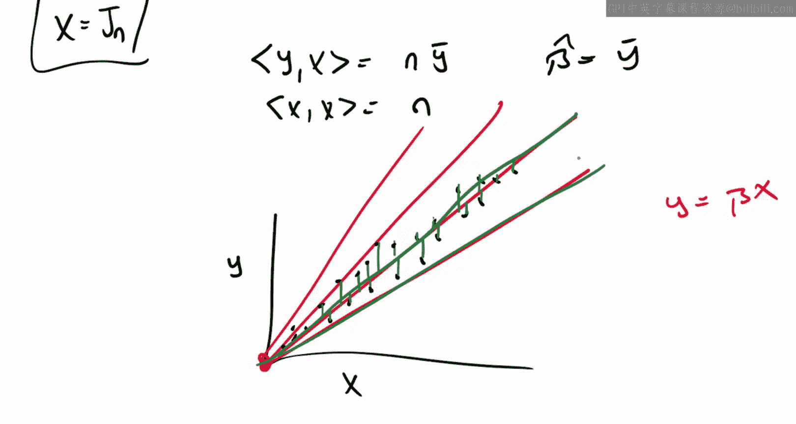

# 约翰霍普金斯大学《数据科学的高级统计｜Advanced Statistics for Data Science》中英字幕（deepseek p81 7_过原点回归.zh_en -BV1htPjeYEFH_p81-

Now let's slightly extend our previous example where we have an outcome y that's n by one。

 and we have a single predictor x that's a vector that's also n by one and we want to minimize。

That quantity right there。 Now， what I'd like you to do is go through the same arguments we used in the last lecture to discover that the beta hat that we want to get is the inner product of Y and x over the inner product of x with itself。

So the insight is something like this， imagine if n was3， so our data。

Our outcome is three dimensional。Then our why。Is some vector in R3。

 So this is R3 that I'm plotting right here， and here is our Y vector。Okay， our x vector lives。

 let's say here， and then the space x times beta。

Just lives。Along that line。And so what？Is beta hat this quantity right here that is。

The multiplier times x that we have to get to to get to the point beta hat times x。

 That is the projection of y， right， the minimizer of the distance between y and the collection of x beta。

 the projection of y onto this red line。OkaySo beta hat is the particular multiplier times x that we have to get to that point。

 and then beta hat times x is this specific purple vector right there。

Okay so what least squares is doing is it's finding the projection of our point y onto the space that is the constant multiples of the vector x times beta。

 the vector constant multiples of x， which we're labeling x times beta。

So this is a fairly fairly famous， interesting old equation。

 I would also note that in the specific case where x is equal and let me get my。

Thing to be black again in the specific case where X is JN。 X is just a constant of ones。

 Notice that the inner product of y and x is just n bar。

 whereas the inner product of x with itself is just n。

 So beta hat works out to be Y bar in that special case。

 So we haven't changed anything from our previous lecture。 If x happens to be a constant。

 we still arrive at the same answer， of course。So hopefully， so commit this formula to memory。

Because it's a very useful one。 I would say there's this startling fact， too。

 which is that you can develop all of multivariable regression by considering only this one example。

 which is regression to the origin。Let's before we finish this lecture。

 let's just draw a picture of what we're doing kind of in more data space。

So remember this picture right here。Was。V。Outcome Y plotted in three dimensional space when we happen to have a three dimensional vector。

 But imagine if instead we plotted our data， something like this were to every X Y pair combination。

 we plotted the Y value versus the x value。 Okay， so then we would get a bunch of points like this。

 let's say if they looked nice and behaved。 well， what is regression to the origin doing in this sense。

 if we were thinking about this plot。 Okay， so we have a series。

Of potential lines， right， Because the equation y equal to beta x is a line that goes to the origin。

 So we have a series of potential lines。 And what our least squares equation says is take your data。

And project it。Not projected。 I'm sorry。 Take the vertical distances。

Between the data points and the line， right， That's the distance between the Y I points and X I times beta。

 So take the vertical distances， those vertical distances， and atom up squared。

And find the line that has the least sum of the absolute some of the squared vertical distances。

 Okay， so if we picked this line right here， we'd do a lot better than if we did this line right there。

 okay。

