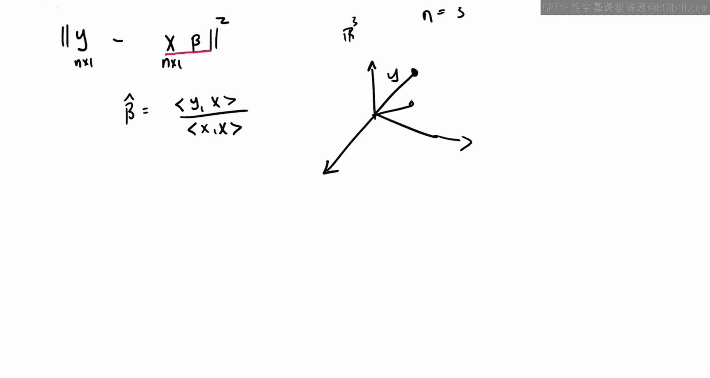
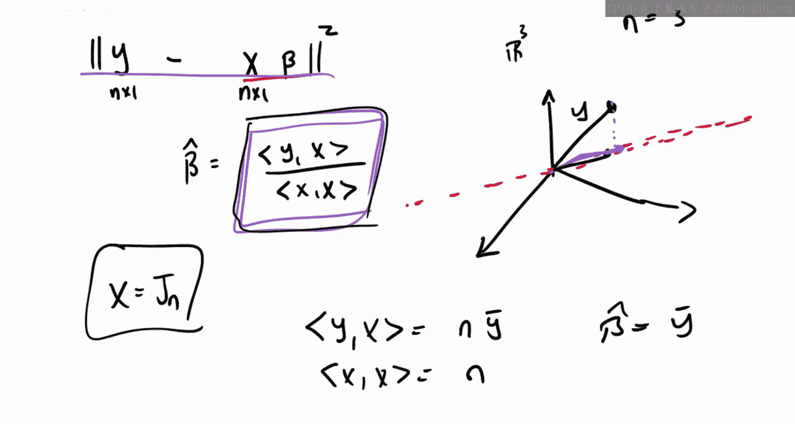
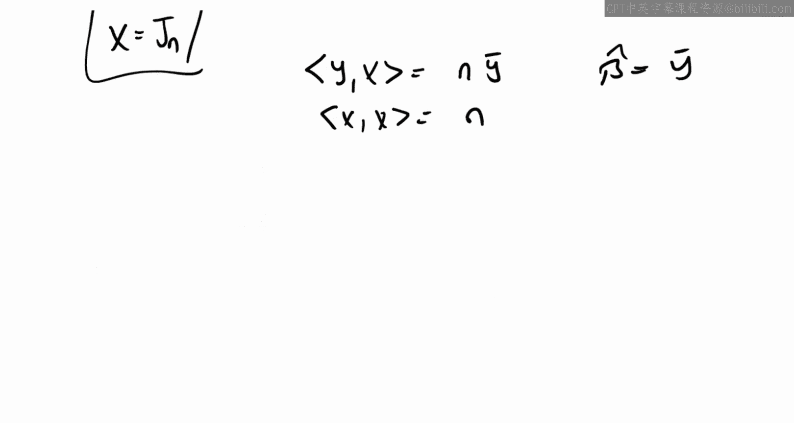
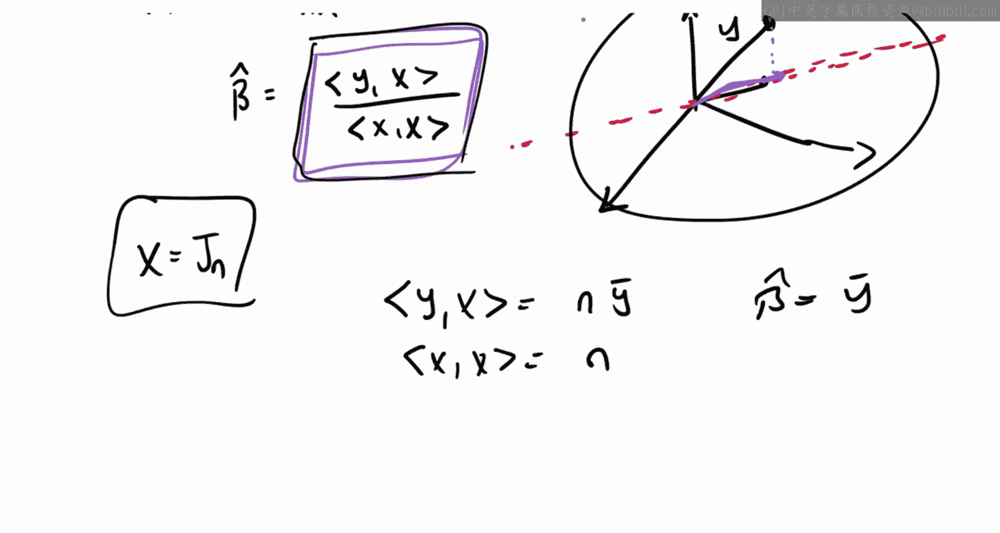
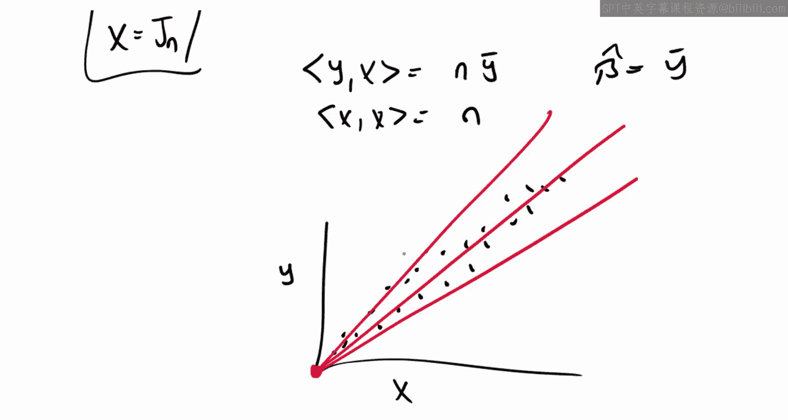
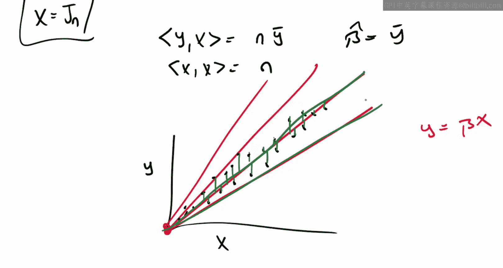

# 高级统计学：7：过原点回归 📈

在本节课中，我们将学习一种特殊的线性回归模型——过原点回归。我们将通过几何和数据空间的视角，理解其核心公式的推导过程，并探讨其与普通回归的联系。

## 概述

上一节我们讨论了简单线性回归。本节中，我们来看看一个特殊情况：当回归线被强制通过原点（即截距为0）时，如何找到最优的斜率参数。我们将从最小化残差平方和的目标出发，推导出核心公式，并通过几何投影和数据散点图两种方式直观理解其含义。

## 核心公式推导

现在，我们略微扩展之前的例子。我们有一个 **n×1** 的因变量向量 **y**，以及一个同样为 **n×1** 的自变量向量 **x**。我们的目标是最小化以下残差平方和：

`∑(y_i - β * x_i)^2`

我们希望找到使该表达式最小的 **β** 值。你可以沿用上一讲中的论证过程来发现，我们想要的 **β_hat** 是：

**β_hat = (y·x) / (x·x)**

其中，`(y·x)` 表示向量 **y** 和 **x** 的内积，`(x·x)` 是向量 **x** 与自身的内积。

## 几何视角理解

我们可以从几何投影的角度来理解这个公式。假设 **n=3**，那么我们的结果 **y** 是三维空间 **R^3** 中的一个向量。

*   **y** 向量位于这个三维空间中。
*   我们的 **x** 向量也位于同一个空间。
*   所有可能的 **x * β** 则位于一条穿过原点的直线上，这条直线由向量 **x** 张成。

那么，**β_hat** 就是这样一个特定的乘数：当 **x** 乘以 **β_hat** 后，得到的向量 **β_hat * x** 恰好是 **y** 向量在上述直线上的**投影**。

因此，最小二乘法所做的，就是找到我们的数据点 **y** 在由向量 **x** 张成的直线空间上的投影。这是一个非常著名且有趣的结论。

## 与常数回归的联系

需要指出一个特殊情况：当 **x** 等于全1向量 **J_n**（即每个元素都为1）时。

*   此时，**y** 和 **x** 的内积 `(y·x)` 就是 **n * y_bar**（y的均值乘以n）。
*   而 **x** 与自身的内积 `(x·x)` 就是 **n**。

因此，**β_hat** 计算结果就是 **y_bar**。这与我们上一讲中常数模型的结果完全一致。所以，过原点回归是更一般模型的特例，当自变量为常数时，它自然退化为求均值的模型。

请务必记住这个核心公式，因为它非常有用。一个惊人的事实是，你可以仅通过研究这个“过原点回归”的例子，来发展出整个多元回归理论。

## 数据空间视角

在结束本讲之前，让我们从更常见的数据空间（散点图）视角来看看我们在做什么。

回想之前的几何图，**y** 被画在三维空间中。现在，想象我们绘制数据散点图：将每一个 **(x_i, y_i)** 配对组合，以 **x** 值为横坐标，**y** 值为纵坐标进行绘制，我们会得到一系列数据点。

那么，在这个散点图意义上，过原点回归在做什么？

我们有一系列可能的直线，因为方程 **y = βx** 是一条通过原点的直线。我们的最小二乘准则告诉我们：取数据点与直线之间的**垂直距离**（即 **y_i** 与 **x_i * β** 的差值），将这些垂直距离平方后求和，然后找到能使这个平方和最小的那条直线。

如果我们选择了正确的直线，其残差平方和将远小于选择其他不合适的直线。

## 总结

本节课中，我们一起学习了过原点回归模型。
1.  我们推导了其核心参数估计公式：**β_hat = (y·x) / (x·x)**。
2.  我们从**几何投影**的角度理解了这个公式，即寻找 **y** 在 **x** 张成直线上的投影。
3.  我们探讨了它与常数回归模型的联系，当 **x** 为全1向量时，它等价于求样本均值。
4.  最后，我们从**数据散点图**的视角，将其理解为寻找一条通过原点的直线，使得所有数据点到该直线垂直距离的平方和最小。

这个简单的模型是理解更复杂回归分析的基石。