# 约翰霍普金斯大学《数据科学的高级统计｜Advanced Statistics for Data Science》中英字幕（deepseek p82 8_先中心化处理.zh_en -BV1htPjeYEFH_p82-

Recall in the last lecture that when we had an outcome Y and a regressor X， Y was N by one。

 and X was a agressor that was N by one。Recall that if we wanted to minimize the least squares criteria。

Our minimum worked out to be beta hat equal to the inner product of Y and X。

Over the inner product of X with itself。Now imagine if we and this。

 if we were to look at the Y and x pairs。This fits a line to the origin。 However， you know。

 let's add some data over here。 Aign to the origin may or may not make sense， so。

let me draw a picture that's a little bit closer to what I'm thinking。 So imagine。

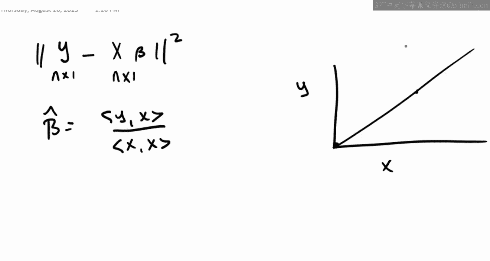

If you had a setting like this， there's a clear linear relationship。

 but trying to fit a line through the origin to that data set isn't going to work so well。

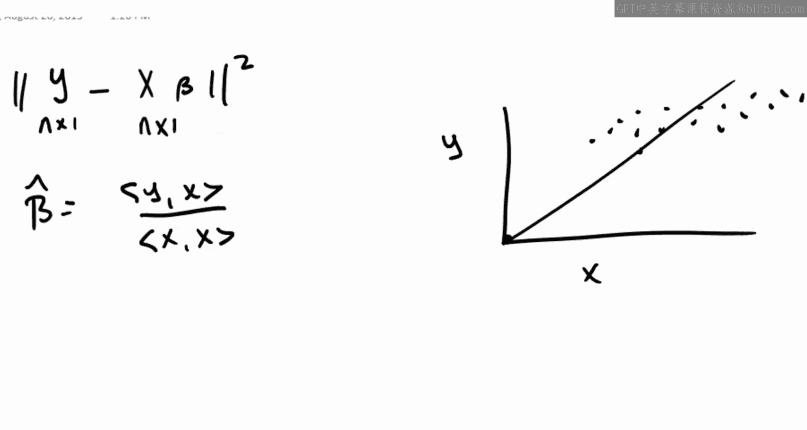

So what you might consider doing is resetting the origin to somewhere more relevant， okay？Or。

 of course， fitting a line that also has an intercept。

 But let's imagine if all you had at your disposal was regression through the origin。

 Well first thing you might want to do is to just reset the origin to be right in the middle of the data。

 Then when you were to fit a line through the origin。

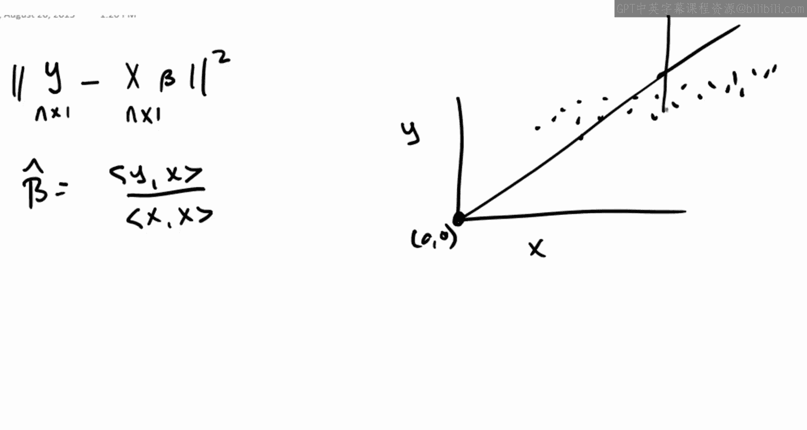

It would go right through the data in a pretty reasonable fashion。

 at least it would take care of the problem that the origin is sort of nowhere near the data and it's forcing the line to go into a position that is not at all reasonable。

So how would we get right in the middle of the data， Well。

 we would just say let's define y Tilde as the centered version of y。

 one where we've subtracted off the mean from every data point so that it now has mean zero。

 and then this is ostensibly just shifting the origin right into the middle of the data set。

 so that would just be I minus you know JN， Jn transpose JN inverse， Jn transpose。Times y。

And then if we were to center our x， that's， of course， I minus the same matrix。Times x。

So now if we were to do regression through the origin of this。

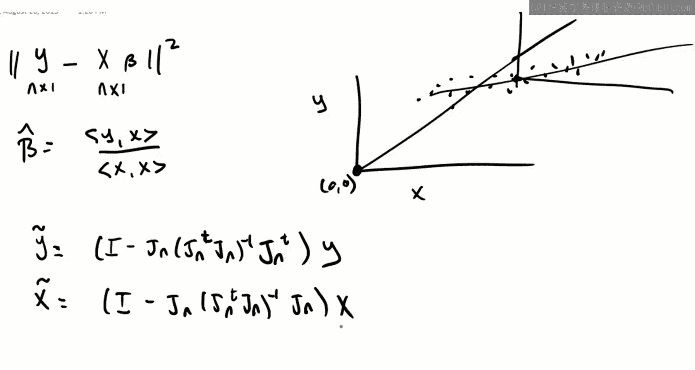

2 matrices。 I try to minimize Y tilde minus x tilde。Beta， what would。

Squared the norm of that squared。 What would be the beta hat， In fact。

 just to differentiate it from the beta before， let's call it gamma。 What would be the gamma hat。

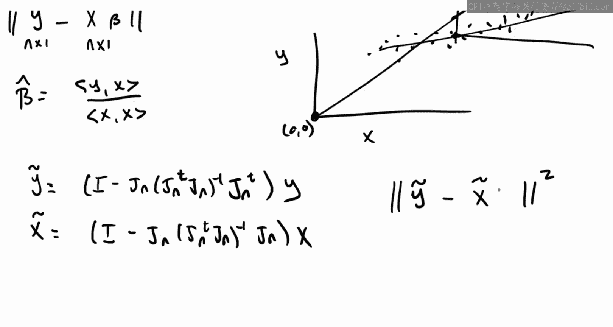

That we would get。 Well， it， it's， of course， gamma hat would be norm inner， I'm sorry。

 Inter product of。Y tilde and x tilde divided by the inner product of x tilde。By itself。Okay， well。

 that is equal to y transpose times I minus。 And let me just replace this matrix。

 I don't have to keep writing it。 Let me just call it H I minus H transpose times I minus H。

Then times x。All over。X transpose times I minus H。I minus H。Times x will transpose there。 So now。

 if you go back to our previous lecture or a couple of lectures previous when we were talking about variances。

What you can see is that this works out to be。This quantity in the top。

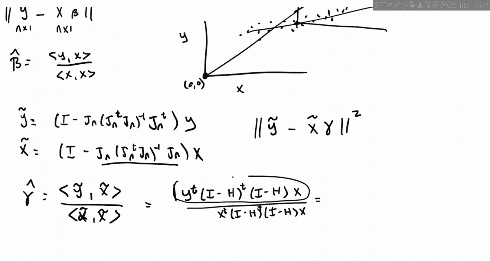

That works out to be， and-1。Times the covariance， the empirical covariance between y and x。

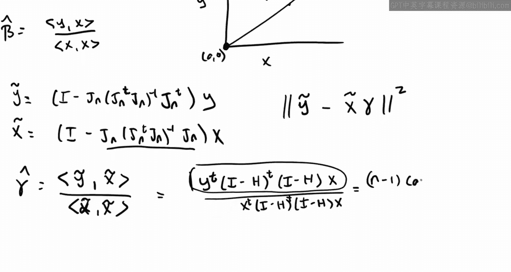

And this quantity in the denominator。Is n minus1 times the variance of x。

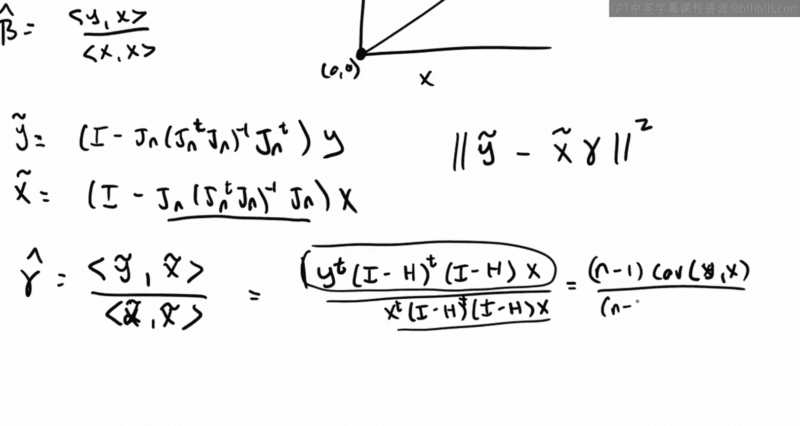

Well， we can manipulate that and let's， you know， to make it a little bit more。

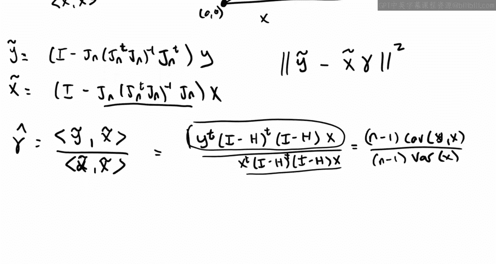

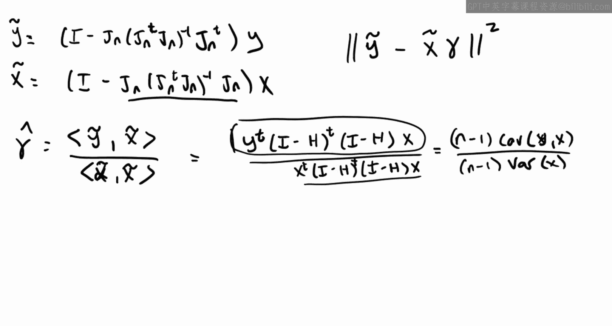

Andng。Statistical， lets let's write as row X， Y is row hat X Y is the empirical correlation between Y and X and sigma。

Squared X hat is the empirical variance of X and sigma hat squared Y because the empirical variance of Y。

 Okay， so that makes it seem a little bit more statistical。

 This language over here seems more like we're writing computer code than writing mathematical notation。

 Okay， so let's take that。 So the covariance is nothing other than we can write the numerator， right。

 The numerator is n -1。 that could be written as the correlation between y and X。Times。

The standard deviation for x。There was a standard deviation for y， and the denominators， of course。

The variance of x。And then we should put hats over there。Okay。So the n minus1 is cancel out。

One of the two sigma X's cancel out and you get row hat。X。X， Y。

Times the standard deviation of the y divided by the standard deviation of the x and this。

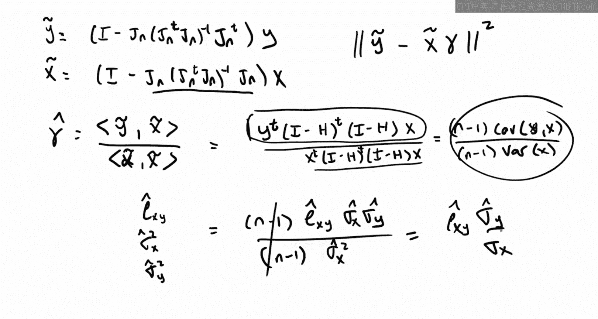

Its sort of a famous formula。And that's basically saying that the slope。

 if we were to center our y our outcome and center our regressor and fit the regression to the origin。

The slope of the best fitting regression line is the correlation between the y and the x。

 The estimated correlation between the y and the x times the ratio of the standard deviations。Now。

 a couple things to note。 first of all， the units of this quantity are correct。

 So the slope has to be in units change in y over change in x。 So units of y divided by units of x。

 Okay， but let's let's look at this quantity。 The correlation is a unitfr quantity。

 Then it's multiplied by the standard deviation of the y。

 So that's units of y divided by the standard deviation of the x。 So that's the units of x。

 So this quantity our estimated slope has units y units divided by x units。

 which is what it has to have。It's also interesting that if we reverse the relationship。

And fit X as the outcome and Y as the predictor。 All that happens then is these two reverse themselves because the correlation。

 it doesn't matter which argument is first。 then it works out to be row hat， X， Y。

 sigma hat X divided by sigma hat Y。So that also implies notice what this also implies is if we standardize our two regression variables in addition to centering them before we do regression to the origin。

 then both their variances are one and the regression to the mean。

 I'm sorry the regression correlation works out to just the regression slope estimate works out to just be the correlation。

Okay， so that's maybe everything you need to know about regression through the origin and the big take home message is that if you center your variables first。

 regression to the origin leads to and we'll see in a minute this leads to the exact same regression slope then if we fit a line that has both an intercept and a slope。

 but it works out to be the correlation between the x's and the y's times the ratio of the standard deviations。

 Okay， so let's try some computer code。To just illustrate this and and compare it with what LMR's function for aggression is doing。

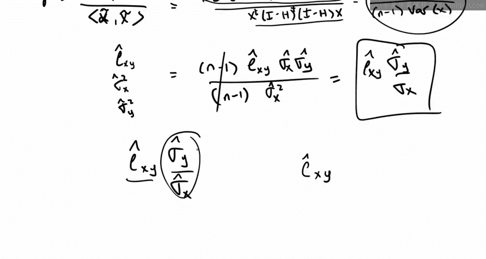