# 数据科学的高级统计：8：先中心化处理 📊

在本节课中，我们将要学习一个重要的数据处理技巧：中心化。我们将探讨为什么在拟合回归线时，有时需要先将数据“平移”到中心位置，以及这样做如何简化计算并得到与包含截距项的回归模型相同的结果。

---

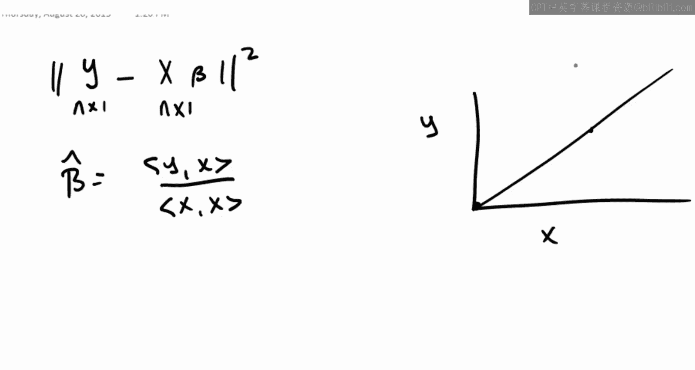

上一节我们回顾了通过原点回归的基本公式。本节中我们来看看，当数据点远离原点时，直接拟合通过原点的直线会遇到什么问题，以及如何通过中心化处理来解决它。

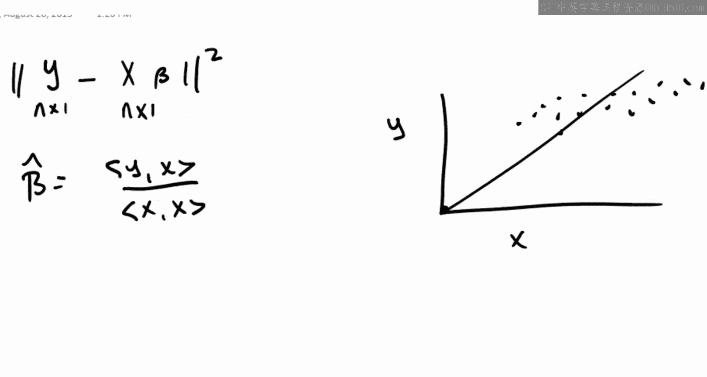

回忆上一讲的内容，当我们有一个结果变量 **Y** 和一个回归变量 **X** 时，**Y** 是 N×1 的向量，**X** 也是 N×1 的向量。如果我们想最小化最小二乘准则，其解为：
**β̂ = (YᵀX) / (XᵀX)**

这个公式拟合了一条通过原点的直线。然而，如果数据分布如下图所示，存在明显的线性关系，但试图用一条通过原点的直线去拟合这些数据，效果不会太好。

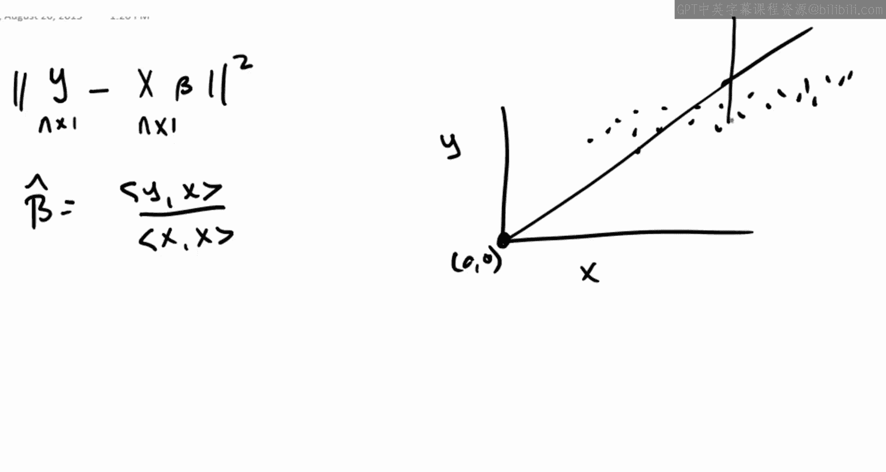


因此，你可能会考虑将原点“重置”到一个更相关的位置。或者，当然，也可以拟合一条包含截距项的直线。但让我们假设，你手头只有“通过原点回归”这一种工具。那么，你首先想做的可能就是直接将原点重置到数据的中心位置。这样，当你再拟合一条通过原点的直线时，它就能以一种相当合理的方式穿过数据。


至少，这解决了原点远离数据点、并迫使直线处于一个完全不合理位置的问题。

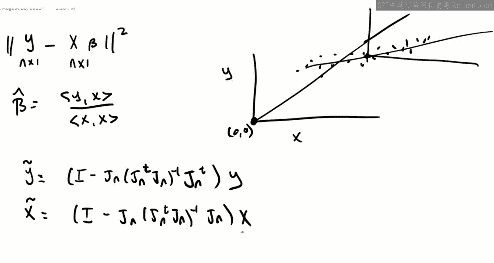

---

那么，我们如何找到数据的中心呢？我们可以定义 **Ỹ** 为 **Y** 的中心化版本，即从每个数据点中减去均值，使其均值为零。这实质上就是将原点平移到数据集的中心。数学上，这可以表示为：
**Ỹ = (I - H)Y**，其中 **H = J(JᵀJ)⁻¹Jᵀ**，**J** 是全1向量。

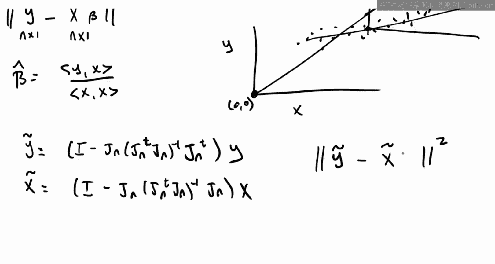

同样地，我们也可以中心化我们的 **X**：
**X̃ = (I - H)X**

现在，如果我们对这两个中心化后的矩阵进行通过原点的回归，即最小化 **||Ỹ - X̃γ||²**，我们得到的 **γ̂** 会是什么呢？

根据公式，**γ̂** 应为：
**γ̂ = (ỸᵀX̃) / (X̃ᵀX̃)**

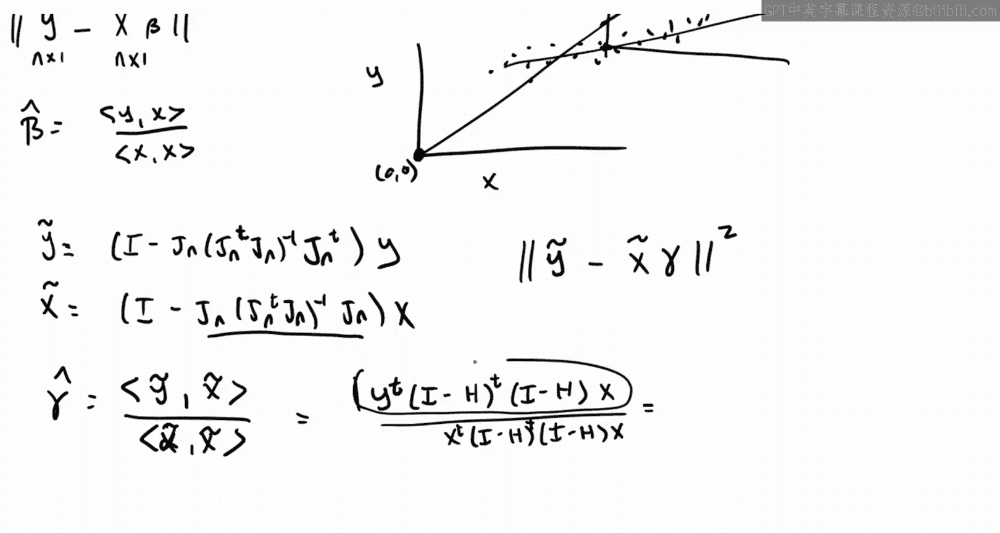

将其展开，代入中心化矩阵：
**γ̂ = [Yᵀ(I-H)ᵀ(I-H)X] / [Xᵀ(I-H)ᵀ(I-H)X]**

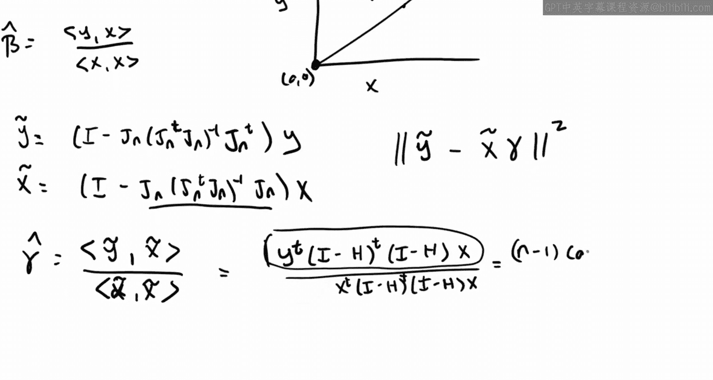

回顾之前关于方差的讲座，我们可以发现，分子部分等于 **(n-1)** 乘以 **Y** 和 **X** 的经验协方差，分母部分等于 **(n-1)** 乘以 **X** 的经验方差。

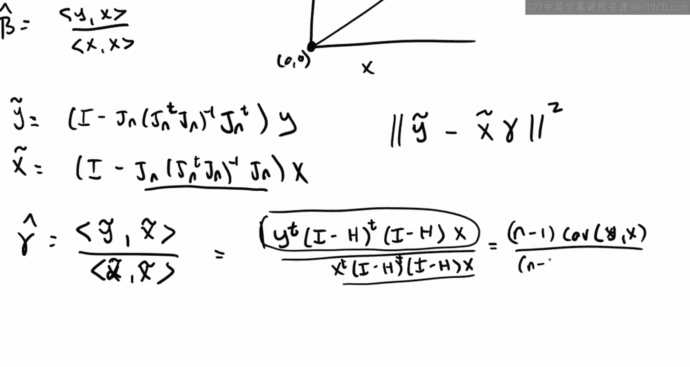

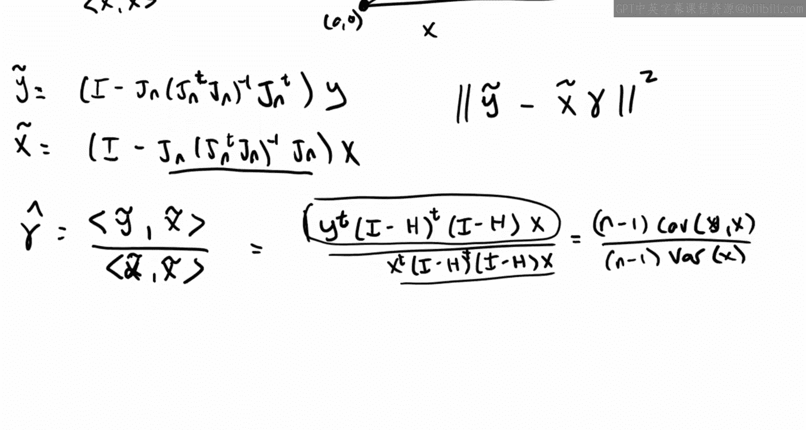

因此，我们可以将 **γ̂** 重写为：
**γ̂ = [Cov̂(X, Y)] / [Var̂(X)]**

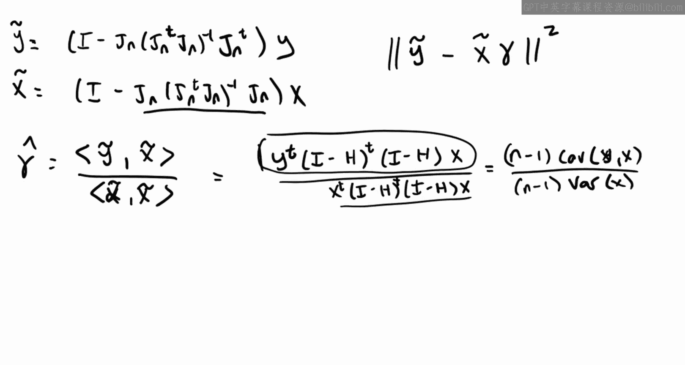

为了使其更具统计意义，我们引入相关系数和标准差。经验相关系数记为 **ρ̂(X,Y)**，经验方差记为 **σ̂²ₓ** 和 **σ̂²ᵧ**。那么，协方差可以表示为相关系数乘以两个标准差的乘积。

所以，分子可以写为：**(n-1) * ρ̂(X,Y) * σ̂ₓ * σ̂ᵧ**
分母为：**(n-1) * σ̂²ₓ**

**(n-1)** 项相互抵消，一个 **σ̂ₓ** 也与分母中的 **σ̂²ₓ** 抵消一个，最终我们得到：
**γ̂ = ρ̂(X,Y) * (σ̂ᵧ / σ̂ₓ)**

这是一个著名的公式。它基本上说明：如果我们先将结果变量 **Y** 和回归变量 **X** 中心化，然后进行通过原点的回归，那么最佳拟合回归线的斜率就等于 **Y** 和 **X** 的（估计）相关系数乘以它们标准差的比值。

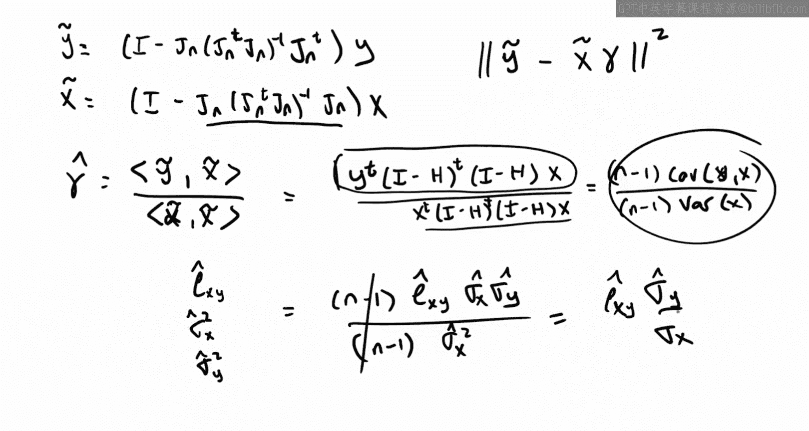

以下是关于这个公式的几个要点：
*   **单位正确性**：斜率必须是 **Y** 的单位除以 **X** 的单位。相关系数是无单位的，乘以 **σ̂ᵧ**（Y的单位）再除以 **σ̂ₓ**（X的单位），正好得到正确的单位。
*   **关系的对称性**：如果我们反转关系，将 **X** 作为结果变量，**Y** 作为预测变量进行拟合，那么斜率估计会变成 **ρ̂(X,Y) * (σ̂ₓ / σ̂ᵧ)**。因为相关系数是对称的。
*   **标准化**：如果我们在中心化的基础上，进一步将两个回归变量标准化（使其方差为1），那么回归斜率估计就简化为 **ρ̂(X,Y)**，即相关系数本身。

---

所以，关于通过原点回归，最重要的结论是：**如果你先对变量进行中心化处理，那么通过原点回归得到的斜率，与拟合一条同时包含截距和斜率的直线所得到的斜率是完全相同的。** 这个斜率值就是相关系数与标准差比值的乘积。

最后，让我们通过一些计算机代码来验证这一点，并将其与 R 语言中 `lm()` 函数的结果进行比较。

```r
# 生成示例数据
set.seed(123)
n <- 100
x <- rnorm(n, mean=5, sd=2)  # X的均值不为0
y <- 2 + 1.5*x + rnorm(n, sd=1) # 真实的截距为2，斜率为1.5

# 方法1：使用lm拟合带截距的模型
fit_with_intercept <- lm(y ~ x)
coef(fit_with_intercept) # 查看截距和斜率估计

# 方法2：先中心化，再进行通过原点的回归
y_centered <- y - mean(y)
x_centered <- x - mean(x)
fit_through_origin <- lm(y_centered ~ 0 + x_centered) # ‘0+’ 表示无截距
coef(fit_through_origin) # 只查看斜率估计

# 方法3：手动计算中心化后的斜率公式
cor_xy <- cor(x, y)
sd_y <- sd(y)
sd_x <- sd(x)
slope_manual <- cor_xy * (sd_y / sd_x)
slope_manual

# 比较结果：方法2的斜率 与 方法1的斜率 应该相同
# 方法3手动计算的结果也应与它们相同
```

运行这段代码，你会发现 `fit_with_intercept` 的斜率估计、`fit_through_origin` 的斜率估计以及 `slope_manual` 计算出的值是完全一致的。这直观地验证了我们推导的结论。

---

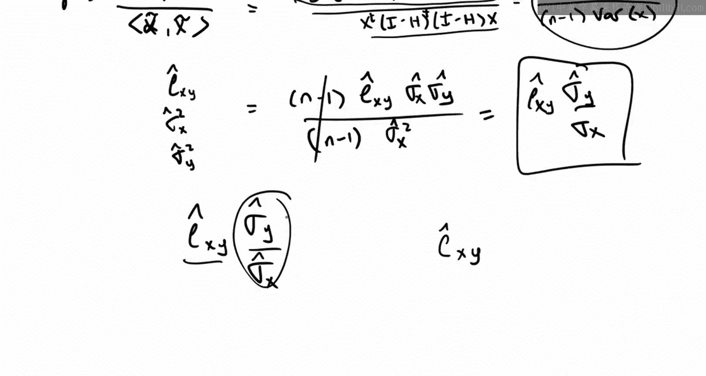

本节课中我们一起学习了中心化处理在回归分析中的重要作用。我们了解到，通过对数据进行中心化，可以将“包含截距的回归”问题转化为“通过原点的回归”问题，并且两者会得到完全相同的斜率估计。这个斜率可以通过一个简洁的统计公式计算：**γ̂ = ρ̂(X,Y) * (σ̂ᵧ / σ̂ₓ)**。这是一个连接几何（回归线）、代数（最小二乘解）和统计学（相关系数、标准差）的优美结果。掌握这一技巧，有助于我们更灵活地理解和处理回归模型。